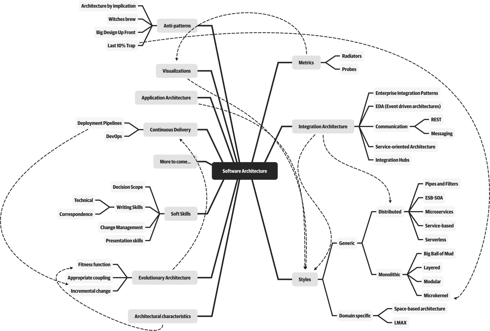
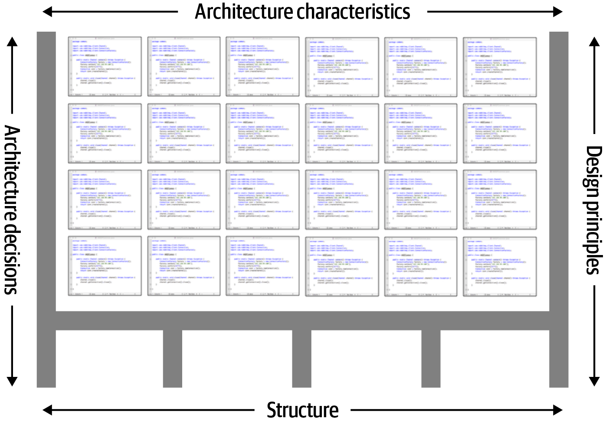
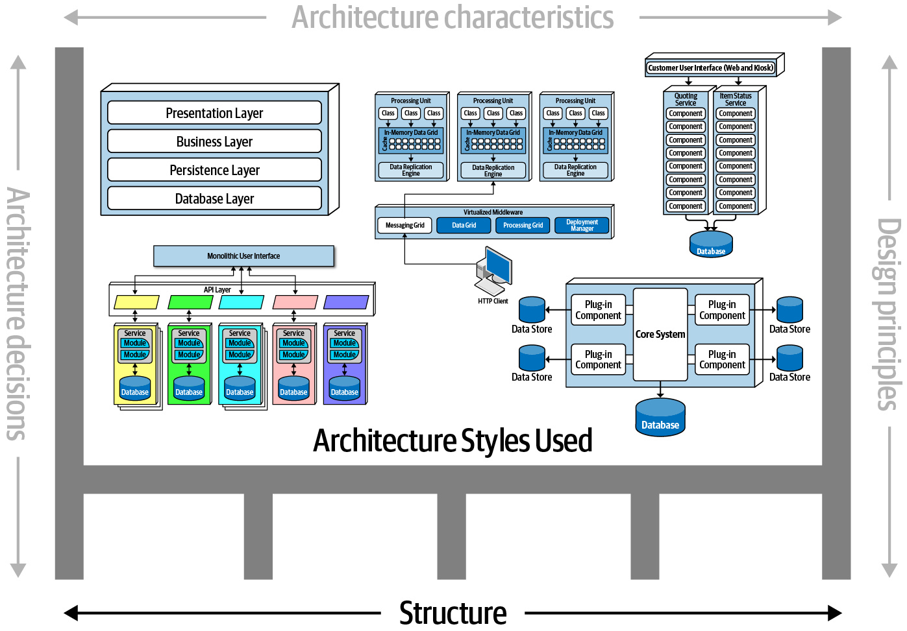
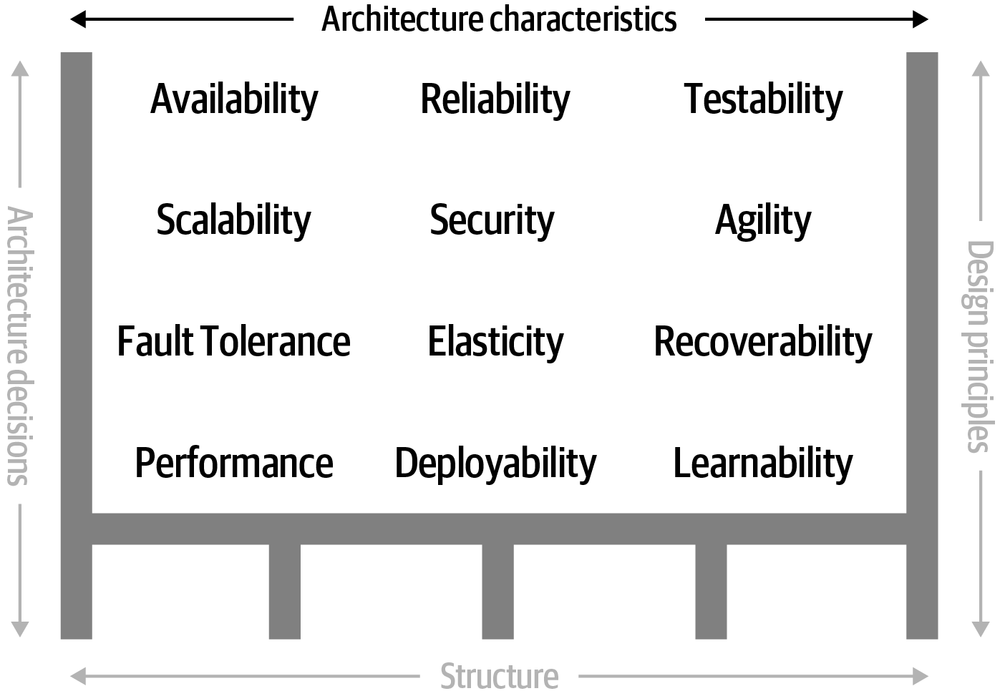
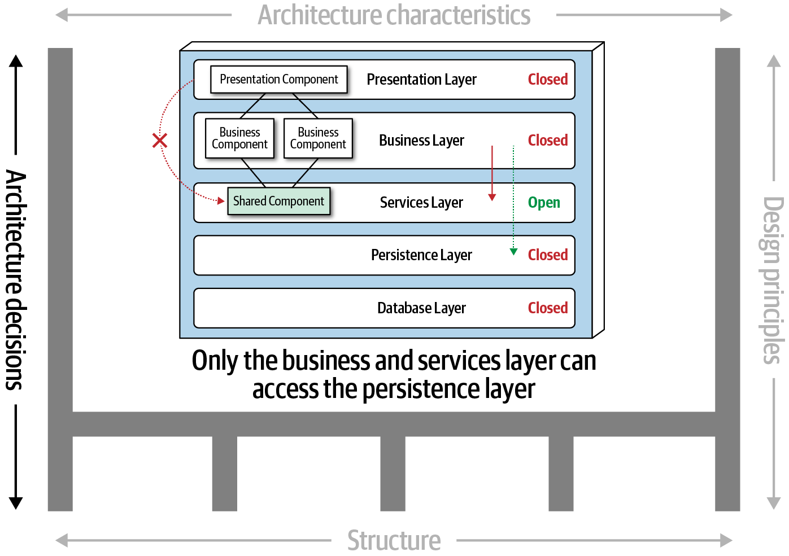
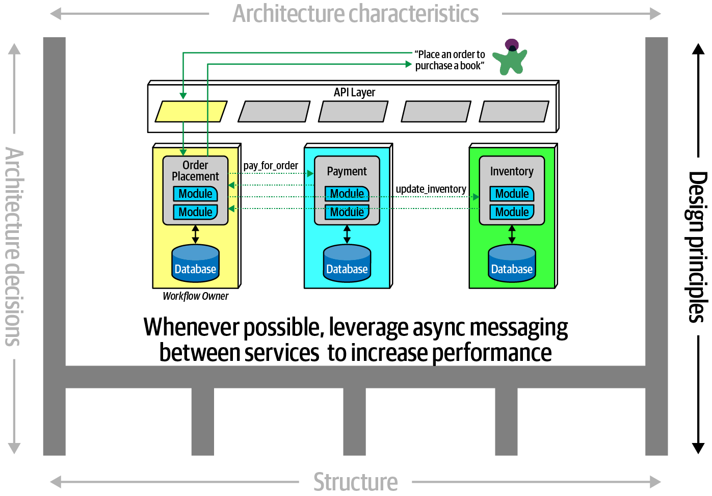
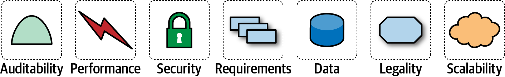

# 第 1 章 引言

> 原文章名：Introduction
> 来源：英文第一版，书内第 1–20 页，PDF 第 21–40 页。
> 进度：第一章全文已翻译并对照原文校订。
> 图像保留英文原图，图中文字的中文对照见文末；下文页码均指原书书内页码。

“软件架构师”（software architect）这一职业，在世界各地的许多最佳职业榜单中都名列前茅。然而，看看这些榜单上的其他职业（例如高级执业护士或财务经理），就会发现它们都有清晰的职业发展路径。为什么软件架构师却没有这样的路径呢？

首先，业界对软件架构（software architecture）本身就缺乏一个恰当的定义。我们在教授基础课程时，学生经常希望我们简明地定义软件架构师究竟做些什么，而我们一直坚决拒绝给出这样的定义。这样做的也不只有我们。在著名的白皮书[《谁需要架构师？》（Who Needs an Architect?）](https://oreil.ly/-Dbzs)中，Martin Fowler 同样拒绝尝试给出定义，转而引用了下面这句名言：

> 架构关乎那些重要的东西……不管那究竟是什么。
>
> ——Ralph Johnson

<!-- 书内第 1 页，PDF 第 21 页；接续前两段。 -->

在学生的追问下，我们绘制了图 1-1 所示的思维导图。虽然它远不完整，但仍能体现软件架构所涵盖的范围。事实上，我们稍后就会给出自己对软件架构的定义。

其次，正如思维导图所示，软件架构师承担的职责数量庞大、范围广泛，而且仍在不断扩展。十年前，软件架构师只需处理架构中纯技术层面的内容，例如模块化、组件和模式。此后，随着能够利用更广泛能力的新架构风格（例如微服务）出现，软件架构师的职责也随之扩展。我们会在第 13 页“架构与……的交集”中，介绍架构与组织其他方面的诸多交集。

<!-- 书内第 2 页，PDF 第 22 页。 -->

*图 1-1：软件架构师的职责涵盖技术能力、软技能、运维意识，以及许多其他方面。*

第三，由于软件开发生态系统迅速演进，软件架构的内涵也在不断变化。今天给出的任何定义，几年后都可能严重过时。[维基百科对软件架构的定义](https://oreil.ly/YLsY2)提供了一个合理的概览，但其中许多表述已经过时，例如：“软件架构涉及做出基础性的结构选择，而这些选择一旦实施，修改的成本就很高。”然而，架构师在设计微服务等现代架构风格时，就已将增量变化的理念融入其中——在微服务中进行结构变更，不再需要付出高昂代价。当然，这种能力也意味着需要与耦合等其他关注点进行权衡。许多软件架构书籍把架构当作静态问题：一旦解决，就可以放心地不再过问。而本书始终承认软件架构固有的动态性质，包括其定义本身的变化。

第四，许多软件架构资料只具有历史参考价值。阅读维基百科相关页面时，你一定会注意到令人眼花缭乱的缩略词，以及指向庞大知识体系的交叉引用。然而，其中许多缩略词代表的尝试已经过时，或以失败告终。即使某些方案几年前完全有效，如今也可能因为背景条件改变而不再适用。软件架构史上不乏这样的例子：架构师尝试了一种做法，随后才发现其有害的副作用。本书会介绍其中许多教训。

<!-- 书内第 3 页，PDF 第 23 页。 -->

为什么现在要写一本关于软件架构基础的书？在软件开发领域，不断变化的并不只有软件架构的范围。新技术、新方法、新能力……事实上，与其列出过去十年间的所有变化，还不如找出哪些东西没有变化来得容易。软件架构师必须在这个不断变化的生态系统中做出决策。既然一切都在变化，连我们做决策的基础也不例外，架构师就应该重新审视早期软件架构著作所依据的一些核心公理。例如，早期的软件架构书籍没有考虑 DevOps 的影响，因为那些书写成时，DevOps 尚未出现。

学习架构时，读者必须记住：和许多艺术作品一样，架构只有放在具体背景中才能理解。架构师做出的许多决策，都基于其所处环境的现实条件。例如，20 世纪末的架构设计有一个主要目标，就是尽可能高效地利用共享资源，因为当时所有基础设施都很昂贵，而且都是商业产品：操作系统、应用服务器、数据库服务器等。想象一下，走进 2002 年的一座数据中心，对运维负责人说：“嘿，我想出了一种革命性的架构风格，每个服务都在独立隔离的机器上运行，并拥有专用数据库（这描述的就是我们如今所说的微服务）。所以，我需要 50 份 Windows 许可证，另外还要 30 份应用服务器许可证，以及至少 50 份数据库服务器许可证。”在 2002 年，尝试构建微服务这样的架构，费用高得难以想象。但随着随后几年开源软件的兴起，加上 DevOps 革命带来的工程实践进步，我们已经能够以合理的方式构建上述架构。读者应当记住，所有架构都是其背景条件的产物。

## 定义软件架构

整个行业一直难以精确定义“软件架构”。一些架构师把软件架构称为系统的蓝图，另一些则把它定义为开发系统的路线图。这些常见定义的问题在于：蓝图或路线图究竟包含什么？例如，架构师在分析架构时，到底在分析什么？

<!-- 书内第 4 页，PDF 第 24 页。 -->

图 1-2 展示了一种理解软件架构的方式。在这个定义中，软件架构由系统的结构（图中支撑架构的粗黑线）、系统必须支持的架构特性（architecture characteristics，即各种“-ilities”）、架构决策（architecture decisions），以及设计原则（design principles）共同组成。

*图 1-2：架构由结构、架构特性（“-ilities”）、架构决策和设计原则共同组成。*

<!-- 书内第 5 页，PDF 第 25 页。 -->

如图 1-3 所示，系统的结构指实现系统时所采用的一种或多种架构风格，例如微服务、分层或微内核。仅仅描述结构，并不能完整说明一个架构。例如，假设有人请一位架构师描述架构，而对方回答：“这是微服务架构。”这里，架构师谈论的只是系统的结构，并非系统架构的全部。要完整理解系统架构，还需要了解架构特性、架构决策和设计原则。

*图 1-3：结构指系统所采用的架构风格类型。*

<!-- 书内第 6 页，PDF 第 26 页。 -->

架构特性是定义软件架构的另一个维度（见图 1-4）。架构特性界定了系统的成功标准，这些标准通常与系统的功能相互独立。请注意，理解图中列出的所有特性，都不需要先了解系统的具体功能，但系统正常运作又离不开这些特性。架构特性如此重要，因此我们专门用几章来理解和定义它们。

*图 1-4：架构特性指系统必须支持的各种“-ilities”（如可用性、可靠性等）。*

定义软件架构的下一个要素是架构决策。架构决策规定了构建系统时应遵循的规则。例如，架构师可能做出这样的决策：在分层架构中，只有业务层和服务层可以访问数据库（见图 1-5），禁止表现层直接调用数据库。架构决策构成系统的约束，并指导开发团队明确哪些事情可以做，哪些不可以做。

<!-- 书内第 7 页，PDF 第 27 页。 -->

*图 1-5：架构决策是构建系统的规则。*

如果由于某种条件或其他约束，系统的某个部分无法实施一项架构决策，那么可以通过一种称为“例外许可”（variance）的机制，允许偏离该决策或规则。大多数组织都有例外许可机制，由架构评审委员会（architecture review board，ARB）或首席架构师使用。这些机制将针对特定标准或架构决策申请例外的过程正式化。架构评审委员会（如果没有委员会，则由首席架构师）会分析该例外，并依据理由和权衡结果批准或拒绝申请。

架构定义中的最后一个要素是设计原则。设计原则与架构决策的不同之处在于：设计原则是指导方针，而不是必须严格遵守的规则。例如，图 1-6 中的设计原则指出，开发团队应该在微服务架构中利用服务间的异步消息传递来提升性能。架构决策这样的规则，不可能覆盖服务通信的所有情形和选项，因此可以使用设计原则指导首选方式（本例中为异步消息传递），同时允许开发者根据具体情况选择更合适的通信协议，例如 REST 或 gRPC。

<!-- 书内第 8 页，PDF 第 28 页。 -->

*图 1-6：设计原则是构建系统的指导方针。*

## 对架构师的期望

定义软件架构师的角色，与定义软件架构同样困难。其职责范围可能从专家级程序员，一直延伸到为公司确定战略性技术方向。与其在定义角色这件徒劳的事情上浪费时间，我们建议把注意力放在对架构师的期望上。

无论具体的角色、头衔或职位描述如何，人们对软件架构师都有以下八项核心期望：

- 做出架构决策
- 持续分析架构
- 跟进最新趋势
- 确保遵守决策
- 拥有多样化的接触与实践经验
- 具备业务领域知识
- 具备人际交往能力
- 理解并应对组织政治

<!-- 书内第 9 页，PDF 第 29 页。 -->

要有效履行软件架构师职责并获得成功，首要关键在于理解并践行上述每一项期望。

### 做出架构决策

*架构师应当制定架构决策和设计原则，用于指导团队、部门或整个企业的技术决策。*

在第一项期望中，关键的行动词是“指导”。架构师应该指导技术选择，而不是直接指定技术。例如，架构师可能决定使用 React.js 进行前端开发。在这种情况下，架构师做出的是技术决策，而不是能够帮助开发团队做出选择的架构决策或设计原则。架构师更应该要求开发团队采用基于响应式的框架进行前端 Web 开发，从而引导团队在 Angular、Elm、React.js、Vue 或其他基于响应式的 Web 框架之间做出选择。

通过架构决策和设计原则指导技术选择，并不容易。做出有效架构决策的关键，是问自己：这项架构决策是在帮助团队做出正确的技术选择，还是替团队做出了技术选择？话虽如此，架构师有时确实需要指定某种技术，以保障可扩展性、性能或可用性等特定架构特性。在这种情况下，即使指定了具体技术，它仍然可以被视为架构决策。架构师往往很难把握这条界线，因此第 19 章将专门讨论架构决策。

### 持续分析架构

*架构师应当持续分析架构及当前技术环境，并提出改进方案。*

这项期望涉及架构生命力（architecture vitality）：在业务和技术不断变化的情况下，评估三年或更久以前确定的架构，如今是否仍然适用。根据我们的经验，投入精力持续分析现有架构的架构师还不够多。因此，大多数架构都会出现一定程度的结构退化（structural decay）：开发者所做的代码或设计变更，影响了性能、可用性和可扩展性等必需的架构特性。

在这项期望中，架构师还经常忽略测试和发布环境。能够敏捷地修改代码显然有好处，但如果团队需要数周才能完成变更测试，数月才能发布，那么整体架构就谈不上敏捷。

<!-- 书内第 10 页，PDF 第 30 页。 -->

架构师必须全面分析技术与问题领域的变化，以判断架构是否合理稳健。虽然招聘启事很少提及这类要求，但架构师必须满足这一期望，才能让应用持续适应需求。

### 跟进最新趋势

*架构师应当跟进最新的技术与行业趋势。*

开发者必须及时了解自己每天使用的技术的最新进展，才能保持竞争力（也才能保住工作！）。对架构师而言，跟进最新技术和行业趋势的要求更为关键。架构师做出的决策通常影响长远，而且难以改变。理解并跟踪关键趋势，可以帮助架构师为未来做好准备，做出正确决策。

跟踪趋势并保持同步并不容易，对软件架构师尤其如此。第 24 章会讨论用于实现这一目标的各种方法与资源。

### 确保遵守决策

*架构师应当确保架构决策和设计原则得到遵守。*

确保遵守，意味着架构师要持续验证开发团队是否遵循了自己制定、记录并传达的架构决策与设计原则。考虑这样一种情况：架构师决定，在分层架构中只允许业务层和服务层访问数据库，不允许表现层访问。这意味着，即使是最简单的数据库调用，表现层也必须经过架构中的各层。某位用户界面开发者可能不同意这一决策，出于性能考虑直接访问数据库或持久层。然而，架构师做出这一决策有明确的理由：控制变更。通过封闭各层，数据库发生变更时就不会影响表现层。如果不确保架构决策得到遵守，就可能出现这类违规情况，架构将无法满足所要求的架构特性（“-ilities”），应用或系统也就无法按预期运行。

第 6 章会进一步讨论如何使用自动化适应度函数（fitness functions）和自动化工具，衡量架构决策的遵守情况。

<!-- 书内第 11 页，PDF 第 31 页。 -->

### 拥有多样化的接触与实践经验

*架构师应当接触多种不同的技术、框架、平台和环境。*

这并不意味着架构师必须精通每一种框架、平台和语言，而是说，至少应熟悉多种技术。如今大多数环境都是异构的，架构师至少应当知道如何与多个系统和服务对接，无论它们采用何种语言、平台和技术。

满足这项期望的最佳途径之一，是走出舒适区。只专注一种技术或平台，是一种安全的选择。高效的软件架构师应当积极寻找机会，积累多种语言、平台和技术的实践经验。一个好方法是关注技术广度，而非技术深度。技术广度既包括你有所了解但并未深入掌握的内容，也包括你非常熟悉的内容。例如，对架构师而言，熟悉十种不同的缓存产品及其各自的优缺点，远比只精通其中一种更有价值。

### 具备业务领域知识

*架构师应当具备一定程度的业务领域专业知识。*

高效的软件架构师不仅懂技术，也了解问题空间所属的业务领域。缺少业务领域知识，就很难理解业务问题、目标和需求，也就很难设计出有效的架构来满足业务要求。想象一下，在一家大型金融机构担任架构师，却不理解平均趋向指数（average directional index）、射幸合同（aleatory contracts）、利率行情上涨（rates rally），甚至非优先债务（nonpriority debt）等常见金融术语。缺少这些知识，架构师就无法与利益相关者和业务用户沟通，并会很快失去可信度。

我们认识的最成功的架构师，既拥有广泛、扎实的技术实践知识，也深入了解某个特定领域。他们能够使用高管和业务用户熟悉并理解的领域知识与语言，有效地与这些利益相关者交流。这反过来让对方充分相信：软件架构师清楚自己在做什么，也有能力创建有效而正确的架构。

<!-- 书内第 12 页，PDF 第 32 页。 -->

### 具备人际交往能力

*架构师应当具备出色的人际交往能力，包括团队合作、引导协作和领导能力。*

对于大多数开发者和架构师而言，拥有出色的领导力与人际交往能力，是一项很难满足的期望。作为技术人员，开发者和架构师喜欢解决技术问题，而不是人的问题。然而，正如 Gerald Weinberg 的名言所说：“不管他们怎么告诉你，归根结底总是人的问题。”架构师不仅要为团队提供技术指导，还要带领开发团队实现架构。无论架构师的角色或头衔是什么，要成为高效的软件架构师，领导能力至少占据所需能力的一半。

行业中软件架构师众多，都在竞争有限的架构职位。强大的领导力与人际交往能力，可以帮助架构师与同行拉开差距、脱颖而出。我们认识许多软件架构师，他们是优秀的技术专家，却因为无法领导团队、辅导和培养开发者，也无法有效传达想法、架构决策和原则，而成为低效的架构师。不言而喻，这些架构师很难长期保住一个职位或一份工作。

### 理解并应对组织政治

*架构师应当理解企业的组织政治环境，并能够在其中妥善行事。*

在一本软件架构书中讨论谈判与办公室政治，可能显得有些奇怪。为了说明谈判能力有多重要、多必要，考虑这样一种情况：开发者决定采用[策略模式](https://oreil.ly/wyDB8)，降低某段复杂代码的整体[圈复杂度（cyclomatic complexity）](https://oreil.ly/QG3RQ)。谁会特别在意呢？人们可能会赞赏开发者使用了这种模式，但几乎在所有情况下，开发者都不需要为这个决定寻求批准。

再考虑另一种情况：一位负责大型客户关系管理（customer relationship management，CRM）系统的架构师，发现很难控制其他系统对数据库的访问、保护某些客户数据，或更改任何数据库模式，因为太多其他系统都在使用 CRM 数据库。于是，架构师决定创建所谓的应用孤岛（application silos），使每个应用数据库只能由拥有它的应用访问。这项决策能够让架构师更好地控制客户数据、安全和变更。然而，与前面开发者的例子不同，公司里几乎所有人都会质疑这项决策（当然，CRM 应用团队可能例外）。其他应用需要客户管理数据。如果这些应用不能再直接访问数据库，就必须向 CRM 系统请求数据，通过 REST、SOAP 或其他远程访问协议发起调用。

<!-- 书内第 13 页，PDF 第 33 页；上一段跨页。 -->

关键在于：架构师做出的几乎每一项决策都会受到质疑。产品负责人、项目经理和业务利益相关者会因为成本增加或工作量（时间）上升而质疑架构决策；认为自己的做法更好的开发者，也会提出质疑。不论哪种情况，架构师都必须应对公司的组织政治，并运用基本谈判技巧，让大多数决策获得批准。这一点可能让软件架构师非常沮丧，因为他们作为开发者时做出的大部分决策，都不需要批准，甚至不需要评审。代码结构、类设计、设计模式选择，有时甚至语言选择，都是编程艺术的一部分。然而，当架构师终于能够做出影响广泛而重要的决策时，却又必须为其中几乎每一项说明理由、争取支持。谈判技巧与领导能力一样关键且必不可少，因此我们用整整一章来介绍它们（见第 23 章）。

## 架构与……的交集

过去十年，软件架构的范围不断扩大，涵盖了越来越多的职责和视角。十年前，架构与运维的典型关系是契约式、正式的，而且伴随着大量繁文缛节。为了避免自行承担运维工作的复杂性，许多公司经常将运维外包给第三方，并通过服务级别协议（service-level agreements，SLA）约定正常运行时间、规模、响应能力，以及许多其他重要的架构特性。如今，微服务等架构可以自如地利用过去专属于运维的能力。例如，弹性伸缩曾经需要费力地内建于架构之中（见第 15 章），而微服务通过架构师与 DevOps 的协作，能更轻松地处理这一问题。

### 历史：Pets.com 与弹性伸缩的由来

软件开发的历史蕴含着丰富的经验教训，既有成功，也有失败。我们容易以为，如今的能力（例如弹性伸缩）是某位聪明的开发者在某天突然创造出来的，但这些想法往往源自惨痛教训。Pets.com 就是早期的一个例子。它在互联网早期出现，希望成为宠物用品领域的 Amazon.com。幸运的是，他们拥有一个出色的营销部门，设计出了一个吸引人的吉祥物：一个拿着麦克风、说话不拘礼数的袜子玩偶。这个吉祥物成了超级明星，出现在游行和全国性体育赛事等公共活动中。

<!-- 书内第 14 页，PDF 第 34 页。 -->

不幸的是，Pets.com 的管理层似乎把所有钱都花在吉祥物上，而不是基础设施上。当订单开始大量涌入时，他们毫无准备：网站缓慢、交易丢失、配送延迟，等等……几乎是最糟糕的局面。情况严重到，这家公司在灾难性的圣诞购物高峰后不久就关门了，并将唯一剩下的有价值资产——吉祥物——卖给了竞争对手。

这家公司需要的是弹性伸缩：能够根据需要启动更多资源实例。云服务提供商如今将其作为一种标准化服务提供，但在互联网早期，公司必须自行管理基础设施，许多公司因此栽在一种前所未闻的现象上：成功过头，也能毁掉企业。Pets.com 和其他类似的惨痛案例，促使工程师开发出今天架构师得以使用的框架。

接下来的几节将介绍架构师角色与组织其他部分之间的一些新交集，重点说明架构师获得的新能力和承担的新职责。

### 工程实践

传统上，软件架构与用于创建软件的开发流程是分开的。构建软件的流行方法有几十种，包括瀑布式开发，以及 Scrum、极限编程、精益和 Crystal 等各种敏捷方法；它们大多不影响软件架构。

然而，过去几年间的工程进步，使流程方面的问题也进入软件架构的关注范围。区分软件开发流程与工程实践很有帮助。这里的流程（process），指团队如何组建和管理、会议如何进行，以及工作流如何组织，也就是人们如何组织和互动的运作方式。而软件工程实践（engineering practices），指独立于具体流程、已经证明能够带来可重复收益的实践。例如，持续集成就是一种经过验证的工程实践，并不依赖特定流程。

#### 从极限编程到持续交付的道路

[极限编程（Extreme Programming，XP）](http://www.extremeprogramming.org)的起源，很好地说明了流程与工程之间的区别。20 世纪 90 年代初，以 Kent Beck 为首的一群经验丰富的软件开发者，开始质疑当时流行的几十种不同开发流程。根据他们的经验，这些流程似乎都无法稳定地产生良好结果。一位 XP 创始人曾说，选择当时已有的一种流程，“对于保证项目成功而言，并不比抛硬币更可靠”。他们决定重新思考如何构建软件，并于 1996 年 3 月启动 XP 项目。为了形成自己的流程，他们抛开传统观念，转而关注过去曾促成项目成功的实践，并将这些实践推向极致。他们的推理是：在以往项目中，测试越多，质量往往越高。因此，XP 将测试实践推向极致：先写测试再开发，确保所有代码在进入代码库之前都经过测试。

<!-- 书内第 15 页，PDF 第 35 页；上一段跨页。 -->

XP 被归入其他理念相近的流行敏捷流程之中，但它是少数包含工程实践的方法之一，例如自动化、测试、持续集成，以及其他基于经验的具体技术。推动软件开发工程层面持续进步的努力，在《持续交付》（Continuous Delivery，Addison-Wesley Professional 出版）中得到延续——该书更新了许多 XP 实践——并在 DevOps 运动中取得成果。从许多方面看，DevOps 革命发生于运维开始采用 XP 最初倡导的工程实践之时：自动化、测试、声明式的单一事实来源，以及其他实践。

我们强烈支持这些进步；正是这些渐进的步骤，最终将使软件开发成长为一门真正的工程学科。

重视工程实践很重要。首先，软件开发缺少许多更成熟的工程学科所具备的特点。例如，与预测软件结构中同等重要的方面相比，土木工程师能够更准确地预测结构变化。其次，软件开发的一大软肋是估算：需要多少时间、多少资源、多少资金？这一困难部分源于陈旧的核算惯例，无法适应软件开发的探索性质；另一部分则是因为，我们历来不擅长估算，而这至少有一部分是由“未知的未知”造成的。

> ……因为，正如我们所知，有已知的已知，也就是我们知道自己知道的事情。我们也知道有已知的未知，也就是说，我们知道有些事情自己不知道。但还有未知的未知——那些我们不知道自己不知道的事情。
>
> ——美国前国防部长 Donald Rumsfeld

未知的未知是软件系统的劲敌。许多项目开始时，都会列出一份“已知的未知”清单：开发者知道接下来必须学习哪些领域知识和技术。然而，项目也会受制于“未知的未知”：没有人预料到、却突然冒出来的事情。这就是所有“前期大设计”（Big Design Up Front）式软件开发工作都会遇到困难的原因：架构师无法针对未知的未知进行设计。用本书作者之一 Mark 的话来说：

> 由于未知的未知，所有架构最终都会走向迭代；敏捷只是承认这一点，并更早开始迭代。

<!-- 书内第 16 页，PDF 第 36 页。 -->

因此，尽管流程与架构大体上相互独立，迭代流程仍然更符合软件架构的本质。如果团队试图使用瀑布式这样的陈旧流程构建微服务等现代系统，就会遇到很大阻力，因为这类流程忽略了软件实际形成的方式。

架构师往往也是项目的技术负责人，因此会决定团队采用哪些工程实践。正如架构师必须先认真考虑问题领域，再选择架构一样，也必须确保架构风格与工程实践相互配合、相互促进。例如，微服务架构以机器资源的自动化配置、自动化测试与部署，以及许多其他条件为前提。如果运维团队方式陈旧，依赖手工流程，又缺少测试，却试图构建这样的架构，就会产生巨大阻力，难以成功。正如不同的问题领域适合某些架构风格，工程实践与架构风格之间也存在类似的共生关系。

从极限编程到持续交付的思想演进仍在继续。工程实践的最新进展，为架构带来了新的能力。Neal 最近的著作[《构建演进式架构》（Building Evolutionary Architectures，O’Reilly 出版）](http://shop.oreilly.com/product/0636920080237.do)重点介绍了理解工程实践与架构交集的新方式，使架构治理能够更好地自动化。我们不会在这里概述那本书，但其中提出的重要新术语和思维方式，将贯穿本书后续许多关于架构特性的讨论。Neal 的书介绍了如何构建能够随时间平稳变化的架构。第 4 章中，我们将架构描述为需求与其他关注点的组合，如图 1-7 所示。

*图 1-7：软件系统的架构既包括需求，也包括所有其他架构特性。*

软件开发领域的任何实践经验都会表明，没有什么会保持不变。因此，架构师可能设计出满足特定标准的系统，但这种设计必须经受住实现过程的考验（架构师如何确保设计得到正确实现），以及软件开发生态系统驱动的不可避免的变化。我们需要的是演进式架构（evolutionary architecture）。

<!-- 书内第 17 页，PDF 第 37 页。 -->

《构建演进式架构》引入了适应度函数的概念，用于在系统随时间发生变化时保护并治理架构特性。这一概念来自演化计算。设计遗传算法时，开发者可以使用各种技术让解发生变异，通过迭代演化出新解。当为某个特定目标设计算法时，开发者必须衡量结果，判断它更接近还是更远离最优解；这种衡量方式就是适应度函数。例如，如果开发者设计遗传算法来解决旅行商问题（目标是寻找经过多个城市的最短路线），适应度函数衡量的就是路径长度。

《构建演进式架构》借用这一思想，提出架构适应度函数（architectural fitness functions）：对某项或某些架构特性是否得到保持进行客观评估。这种评估可以使用多种机制，例如度量指标、单元测试、监控和混沌工程。例如，架构师可能将页面加载时间确定为一项重要架构特性。为了允许系统变化而不降低性能，架构设计中可以加入一个适应度函数：通过测试测量每个页面的加载时间，并在项目的持续集成中运行该测试。这样，架构师就始终知道架构关键部分的状态，因为每个部分都有适应度函数这样的验证机制。

这里不会详细介绍适应度函数的全部内容。不过，我们会在适用之处指出采用这种方法的机会并给出示例。请注意适应度函数的执行频率与其提供的反馈之间的关系。你会发现，采用持续集成、机器资源自动化配置等敏捷工程实践，能够更容易地构建有韧性的架构。这也说明，架构与工程实践已经紧密交织。

### 运维 / DevOps

近年来，架构与相关领域最明显的交集伴随着 DevOps 的出现而产生，其背后是对一些架构公理的重新思考。多年来，许多公司将运维视为独立于软件开发的职能；为了节省成本，他们经常将运维外包给另一家公司。20 世纪 90 年代和 21 世纪初设计的许多架构，都假定架构师无法控制运维，并围绕这一限制进行防御性设计（第 15 章的空间架构就是一个很好的例子）。

然而，几年前，一些公司开始试验新的架构形式，将许多运维方面的关注点与架构结合起来。例如，在 ESB 驱动的 SOA 等旧式架构中，弹性伸缩之类的事情由架构设计负责处理，这使架构大幅复杂化。从根本上说，架构师被迫针对“为节省成本而外包运维”所引入的限制进行防御性设计。因此，他们构建的架构需要在内部处理规模、性能、弹性，以及许多其他能力。这种设计的副作用，就是架构变得复杂得多。

<!-- 书内第 18 页，PDF 第 38 页；上一段跨页。 -->

微服务架构风格的创建者意识到，这些运维问题交给运维处理更合适。通过建立架构与运维之间的协作关系，架构师可以简化设计，把运维最擅长的事情交给运维。因此，在意识到资源使用不当造成了偶然复杂性（accidental complexity）之后，架构师与运维人员携手创建了微服务。我们会在第 17 章介绍其细节。

### 流程

另一个公理是：软件架构与软件开发流程大体上相互独立；构建软件的方式（流程）对软件架构（结构）影响很小。因此，虽然团队采用的软件开发流程确实会对软件架构产生一些影响，尤其在工程实践方面，但历史上，人们大多将两者视为独立的事物。大多数软件架构书籍忽略了软件开发流程，并对可预测性等问题做出似是而非的假设。然而，团队开发软件所采用的流程，会影响软件架构的许多方面。例如，过去几十年间，许多公司基于软件的本质采用了敏捷开发方法。敏捷项目中的架构师可以预期团队采用迭代开发，因此能更快获得决策反馈。这反过来让架构师可以更积极地开展试验，以及其他依赖反馈来获取知识的活动。

正如前文 Mark 所说，所有架构都会走向迭代，这只是时间问题。因此，本书将始终以敏捷方法为基线，并在适当之处指出例外。例如，许多单体架构仍然使用较老的流程，这种情况依然常见，原因可能是系统年代、组织政治，或其他与软件无关、可以解释这一现象的因素。

敏捷方法尤其擅长支持架构中的一个关键方面：重构结构。团队经常发现，需要将架构从一种模式迁移到另一种模式。例如，团队最初采用单体架构，因为它容易且能够快速起步，但现在需要将其迁移到更现代的架构。与强调前期规划的流程相比，敏捷方法更能支持这类变化，因为它具有紧密的反馈循环，并鼓励使用[绞杀者模式（Strangler Pattern）](https://oreil.ly/ZRpCc)和[特性开关（feature toggles）](https://trunkbaseddevelopment.com)等技术。

<!-- 书内第 19 页，PDF 第 39 页。 -->

### 数据

大量正式的应用开发工作都涉及外部数据存储，通常采用关系型数据库的形式，也越来越多地采用 NoSQL 数据库。然而，许多软件架构书籍对这个重要方面只是浅尝辄止。代码与数据是共生的：缺少其中任何一方，另一方都难以发挥作用。

数据库管理员经常与架构师协作，为复杂系统构建数据架构，分析数据关系与复用将如何影响一组应用。本书不会深入到这种专业细节层面。同时，我们也不会忽视外部存储的存在，以及系统对它的依赖。尤其在讨论架构的运维层面和架构量子（architectural quantum，见第 92 页“架构量子与粒度”）时，我们会将数据库等重要外部关注点纳入考虑。

## 软件架构定律

虽然软件架构的范围广得几乎难以把握，但其中确实存在一些统一的要素。作者们在实践中一次次碰到同一个道理，从而首先领悟了软件架构第一定律：

> 软件架构中的一切都是权衡。
>
> ——软件架构第一定律

对于软件架构师而言，任何问题都不存在一条简单清晰的判断尺度。每项决策都必须考虑许多相互对立的因素。

> 如果架构师认为自己发现了某种不需要权衡的东西，更有可能只是尚未识别出其中的权衡。
>
> ——推论 1

我们对软件架构的定义超越了结构骨架，还包含原则、特性等。架构的内涵比结构元素的组合更广泛，这体现在软件架构第二定律中：

> 为什么，比怎么做更重要。
>
> ——软件架构第二定律

当我们尝试保留学员在工作坊练习中设计架构方案的成果时，发现了这一视角的重要性。由于练习有时间限制，我们保留的唯一产物，就是表示拓扑结构的图。换句话说，我们记录了他们如何解决问题，却没有记录团队为什么做出特定选择。架构师可以查看一个自己并不了解的现有系统，弄清其架构结构如何运作，却很难解释为什么选择某种方案，而没有选择其他方案。

<!-- 书内第 20 页，PDF 第 40 页；上一段跨页。 -->

本书将始终强调架构师为什么做出特定决策，以及其中的权衡。我们还会在第 285 页“架构决策记录”中，介绍记录重要决策的有效方法。

---

## 图中文字中文对照（译者整理）

以下仅对照原图中的文字标签，不属于原书新增正文；原图保留原有布局和连线关系。

### 图 1-1

- 软件架构（Software Architecture）。
- 反模式（Anti-patterns）：隐含形成的架构（Architecture by implication）、女巫杂烩（Witches brew）、前期大设计（Big Design Up Front）、最后 10% 陷阱（Last 10% Trap）。这些反模式名称暂作直译，具体含义需结合后续上下文理解。
- 可视化（Visualizations）；应用架构（Application Architecture）。
- 持续交付（Continuous Delivery）：部署流水线（Deployment Pipelines）、DevOps。
- 软技能（Soft Skills）：决策范围（Decision Scope）、写作技能（Writing Skills，包括技术写作 Technical 与往来沟通 Correspondence）、变更管理（Change Management）、演示技能（Presentation skills）。
- 演进式架构（Evolutionary Architecture）：适应度函数（Fitness function）、适当的耦合（Appropriate coupling）、增量变化（Incremental change）。
- 架构特性（Architectural characteristics）。
- 度量指标（Metrics）：信息展示器（Radiators）、探针（Probes）。
- 集成架构（Integration Architecture）：企业集成模式（Enterprise Integration Patterns）、事件驱动架构（EDA，Event driven architectures）、通信（Communication，包括 REST 与消息传递 Messaging）、面向服务的架构（Service-oriented Architecture）、集成枢纽（Integration Hubs）。
- 风格（Styles）：通用（Generic）与领域专用（Domain specific）。
- 通用风格中的分布式（Distributed）：管道与过滤器（Pipes and Filters）、ESB-SOA、微服务（Microservices）、基于服务（Service-based）、无服务器（Serverless）。
- 通用风格中的单体（Monolithic）：大泥球（Big Ball of Mud）、分层（Layered）、模块化（Modular）、微内核（Microkernel）。
- 领域专用风格：空间架构（Space-based architecture）、LMAX。
- 还有更多……（More to come...）。

### 图 1-2

架构特性（Architecture characteristics）、架构决策（Architecture decisions）、设计原则（Design principles）、结构（Structure）。中央的小型代码截图作为示意背景，未逐字转录。

### 图 1-3

- 外围标签同图 1-2；底部强调“所采用的架构风格”（Architecture Styles Used）。
- 分层示例：表现层（Presentation Layer）、业务层（Business Layer）、持久层（Persistence Layer）、数据库层（Database Layer）。
- 空间架构示例：处理单元（Processing Unit）、类（Class）、内存数据网格（In-Memory Data Grid）、缓存（Cache）、数据复制引擎（Data Replication Engine）、虚拟化中间件（Virtualized Middleware）、消息网格（Messaging Grid）、数据网格（Data Grid）、处理网格（Processing Grid）、部署管理器（Deployment Manager）、HTTP 客户端（HTTP Client）。
- 服务示例：客户用户界面（Web 和自助终端）（Customer User Interface (Web and Kiosk)）、报价服务（Quoting Service）、物品状态服务（Item Status Service）、组件（Component）、数据库（Database）。
- 微服务示例：单体式用户界面（Monolithic User Interface）、API 层（API Layer）、服务（Service）、模块（Module）、数据库（Database）。
- 微内核示例：核心系统（Core System）、插件组件（Plug-in Component）、数据存储（Data Store）、数据库（Database）。

### 图 1-4

可用性（Availability）、可靠性（Reliability）、可测试性（Testability）、可扩展性（Scalability）、安全性（Security）、敏捷性（Agility）、容错性（Fault Tolerance）、弹性（Elasticity）、可恢复性（Recoverability）、性能（Performance）、可部署性（Deployability）、易学性（Learnability）。外围标签同图 1-2。

### 图 1-5

表现层（Presentation Layer）、表现组件（Presentation Component）、业务层（Business Layer）、业务组件（Business Component）、服务层（Services Layer）、共享组件（Shared Component）、持久层（Persistence Layer）、数据库层（Database Layer）；封闭（Closed）、开放（Open）。底部规则：“只有业务层和服务层可以访问持久层。”外围标签同图 1-2。

> 译注：本图底部写的是“访问持久层”，正文举例则写“访问数据库”；此处分别保留原文表述。

### 图 1-6

“下单购买一本书”（Place an order to purchase a book）；API 层（API Layer）、下单（Order Placement）、支付（Payment）、库存（Inventory）、模块（Module）、数据库（Database）、工作流负责人（Workflow Owner）；调用标签 `pay_for_order` 为“支付订单”，`update_inventory` 为“更新库存”。底部原则：“尽可能在服务之间使用异步消息传递，以提升性能。”外围标签同图 1-2。

### 图 1-7

从左至右：可审计性（Auditability）、性能（Performance）、安全性（Security）、需求（Requirements）、数据（Data）、合法性（Legality）、可扩展性（Scalability）。
