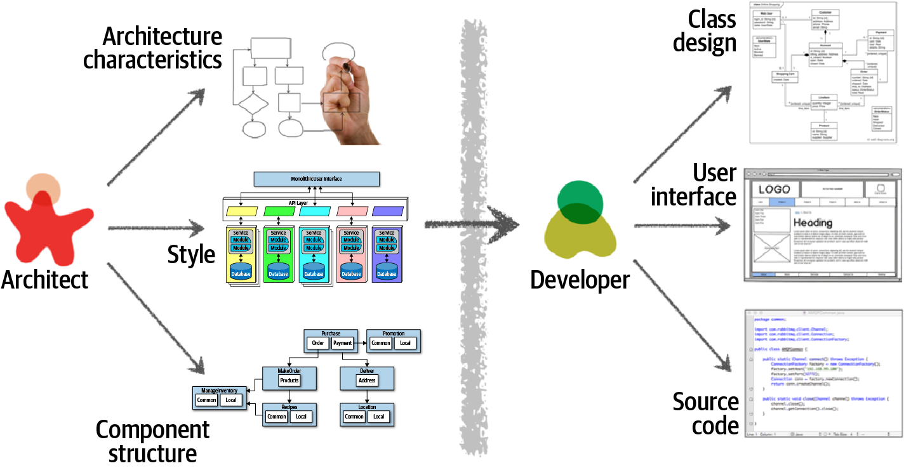
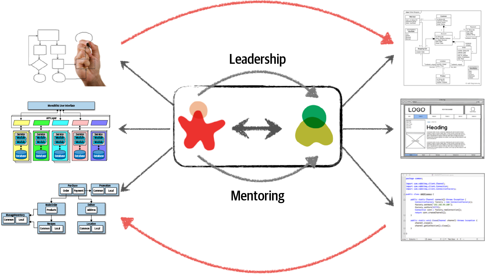
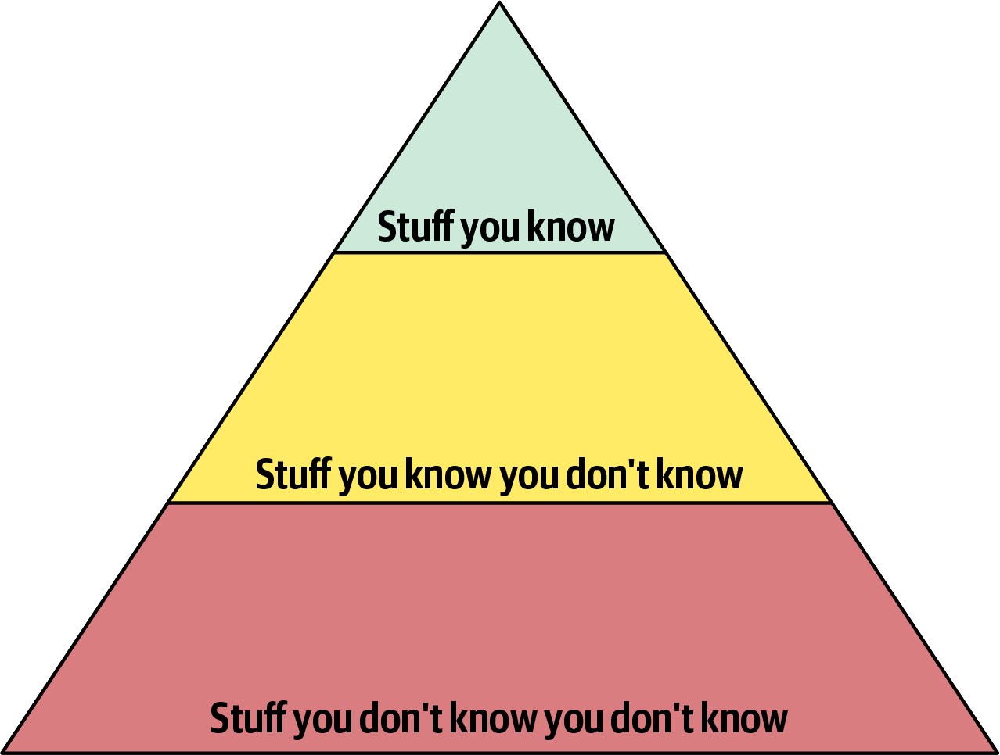
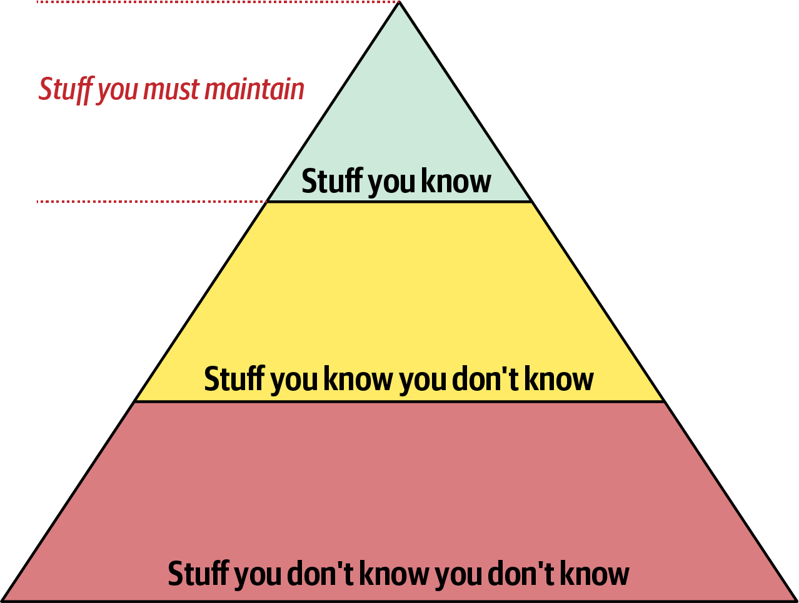
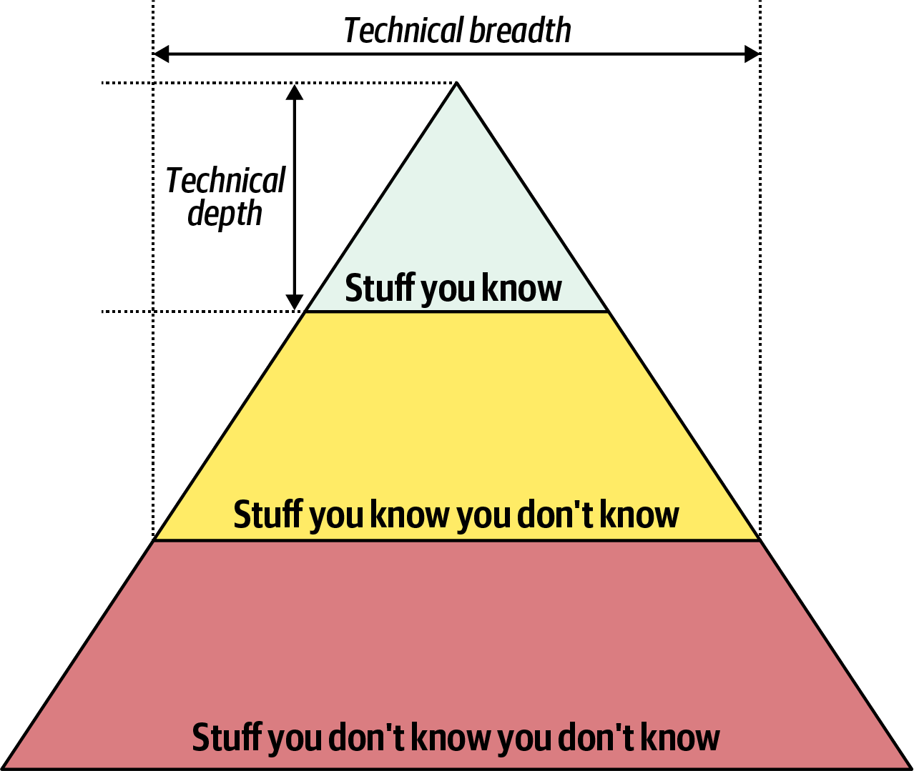
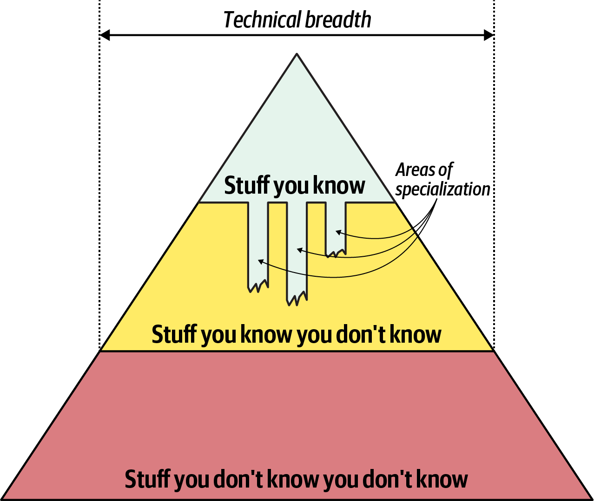
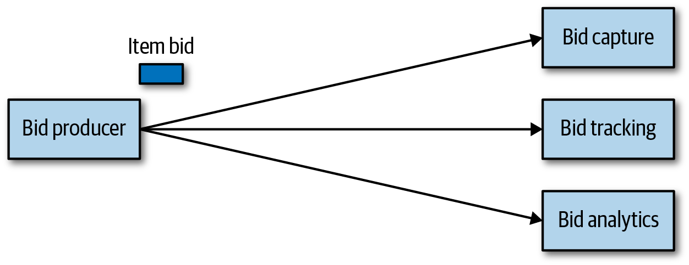
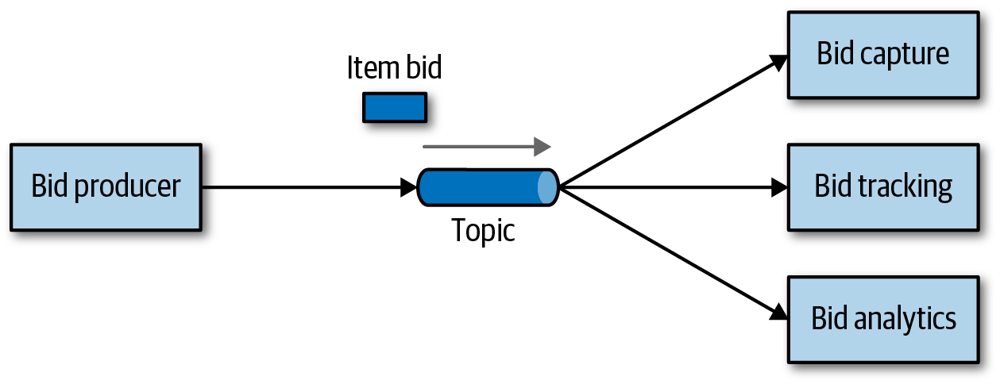
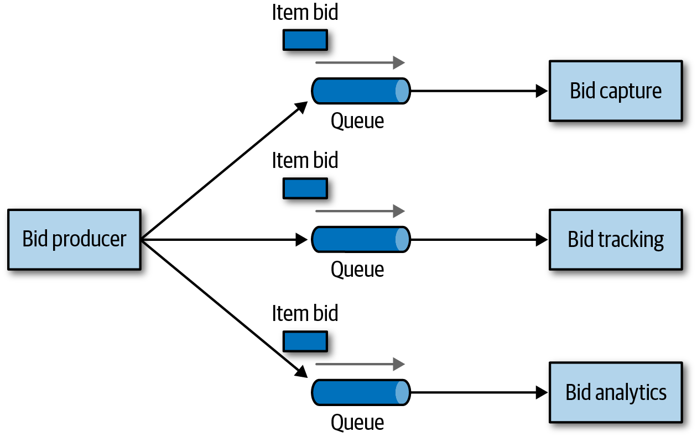

# 第 2 章 架构思维

> 原文章名：Architectural Thinking
> 来源：英文第一版，书内第 23–36 页，PDF 第 43–56 页。
> 校译进度：本轮已完成全文逐段对照与中文通读；详见[校译记录](../../reviews/chapter-02-review.md)。
> 图像保留英文原图，图中文字的中文对照见文末；下文页码均指原书书内页码。
> 独立复审：本章原文对照、中文通读、图表及相关自测题已核查，见[独立复审记录](../../reviews/independent-pass/chapter-02.md)。

<!-- 书内第 23 页，PDF 第 43 页。 -->

<!-- CH02-001 -->

架构师看待事物的方式与开发者不同，就像气象学家与艺术家看待云朵的方式可能不同一样。这称为架构思维（architectural thinking）。遗憾的是，太多架构师以为，架构思维只是“思考架构”。

<!-- CH02-002 -->

架构思维远不止于此。它意味着以架构的眼光或视角看待事物。像架构师一样思考，主要包括四个方面。首先，理解架构与设计的区别，并知道如何与开发团队协作，让架构发挥作用。其次，在保持一定技术深度的同时，拥有广泛的技术知识，从而看见别人没有发现的解决方案和可能性。第三，理解并分析不同方案和技术涉及的权衡，进而作出取舍。最后，理解业务驱动因素的重要性，以及如何将它们转化为架构关注点。

<!-- CH02-003 -->

本章将探讨这四个方面，介绍如何像架构师一样思考，并以架构的眼光看待事物。

## 架构与设计

<!-- CH02-004 -->

架构与设计的区别常常令人困惑。架构在哪里结束，设计又从哪里开始？架构师与开发者各自承担什么职责？像架构师一样思考，意味着理解架构与设计之间的区别，也要看清两者如何紧密结合，共同解决业务和技术问题。

<!-- CH02-005 -->

请看图 2-1，它对比了传统职责划分中架构师与开发者的工作。如图所示，架构师负责分析业务需求，从中提取并定义架构特性（“-ilities”）；选择适合问题领域的架构模式和风格；创建组件，也就是系统的构建单元。这些活动产生的成果随后被移交给开发团队，由他们负责为每个组件创建类图、创建用户界面，以及开发和测试源代码。

<!-- 书内第 24 页，PDF 第 44 页；上一段跨页。 -->

*图 2-1：架构与设计的传统视角。*

<!-- CH02-006 -->

图 2-1 所示的传统职责模型存在几个问题。事实上，这张图恰好说明了架构为何很少能发挥作用。具体来说，架构师与开发者之间存在有形和无形的屏障，穿过屏障的箭头却是单向的：这正是各类架构问题的根源。架构师做出的决策，有时根本没有传达到开发团队；开发团队做出的、改变架构的决策，也很少反馈给架构师。在这一模型中，架构师与开发团队脱节，因此架构很少能实现最初的目标。

<!-- CH02-007 -->

要让架构发挥作用，就必须打破架构师与开发者之间有形和无形的屏障，在架构师与开发团队之间建立紧密的双向关系。为此，架构师和开发者必须属于同一个虚拟团队，如图 2-2 所示。这一模型不仅促进架构与开发之间充分的双向沟通，也让架构师能够为团队中的开发者提供指导和辅导。

<!-- 书内第 25 页，PDF 第 45 页。 -->

*图 2-2：通过协作让架构发挥作用。*

<!-- CH02-008 -->

传统瀑布式方法把软件架构视为静态、固定的设计，而当今系统的架构会随着项目的每次迭代或每个阶段不断变化和演进。架构师与开发团队之间的紧密协作，是任何软件项目取得成功的必要条件。那么，架构究竟在哪里结束，设计又从哪里开始？两者并没有这样的分界。两者都属于软件项目的生命周期，必须始终保持同步，才能取得成功。

## 技术广度

<!-- CH02-009 -->

开发者与架构师需要掌握的技术细节范围有所不同。开发者必须具备相当的技术深度，才能完成工作；而软件架构师必须具备相当的技术广度，才能像架构师一样思考，以架构视角看待事物。图 2-3 的知识金字塔展示了这一点，它涵盖世界上的全部技术知识。事实表明，在不同的职业阶段，技术人员应当重视的信息类型也不同。

<!-- 书内第 26 页，PDF 第 46 页。 -->

*图 2-3：代表全部知识的金字塔。*

<!-- CH02-010 -->

如图 2-3 所示，对任何人而言，全部知识都可以划分为三个部分：你知道的、你知道自己不知道的，以及你不知道自己不知道的。

<!-- CH02-011 -->

“你知道的”包括技术人员每天用来完成工作的技术、框架、语言和工具，例如 Java 程序员掌握 Java。“你知道自己不知道的”包括技术人员略有了解或听说过，但缺乏专业知识甚至完全不会使用的事物。Clojure 编程语言就是这一层知识的一个好例子。大多数技术人员听说过 Clojure，也知道它是一门基于 Lisp 的编程语言，但不会用它编写代码。“你不知道自己不知道的”是知识三角形中最大的部分，其中包含大量技术、工具、框架和语言；它们也许恰好是解决技术人员当前问题的理想方案，但技术人员甚至不知道它们的存在。

<!-- 书内第 27 页，PDF 第 47 页。 -->

<!-- CH02-012 -->

开发者在职业生涯早期，主要致力于扩大金字塔顶部，积累经验和专业能力。这个阶段以此为重点非常合适，因为开发者需要更丰富的视角、实用知识和动手经验。顶部扩大时，中间部分也会随之扩大：开发者接触到更多技术及相关事物，“知道自己不知道的”知识储备也会增加。

<!-- CH02-013 -->

在图 2-4 中，扩大金字塔顶部是有益的，因为专业能力受到重视。然而，“你知道的”也正是“你必须维护的”——软件世界里没有什么一成不变。如果开发者成为 Ruby on Rails 专家，却在随后一两年里不再关注它，那么这种专业能力也不会持续。金字塔顶部的知识需要持续投入时间，才能维持熟练程度。归根结底，个人知识金字塔顶部的大小，就是其技术深度。

*图 2-4：开发者必须持续维护专业能力，才能保有它。*

<!-- 书内第 28 页，PDF 第 48 页。 -->

<!-- CH02-014 -->

然而，当开发者转向架构师角色时，所需知识的性质也会变化。架构师的很大一部分价值，在于了解多种技术，并知道如何用它们解决具体问题。例如，对架构师而言，知道某个问题有五种解决方案，比只精通其中一种更有益。对架构师最重要的是金字塔的顶部和中间部分；中间部分向底部延伸的范围，代表架构师的技术广度，如图 2-5 所示。

*图 2-5：一个人掌握的知识构成技术深度，所了解知识的广泛程度构成技术广度。*

<!-- CH02-015 -->

对架构师而言，广度比深度更重要。架构师需要在技术约束下，判断不同方案所提供的能力是否合适，因此广泛了解各种候选方案很有价值。所以，对架构师来说，明智的做法是放下一部分来之不易的专长，将时间用于扩展自己的知识组合，如图 2-6 所示。图中表明，一些专长领域仍会保留，可能是自己特别喜欢的技术领域；另一些领域的专长则可以有意不再维持，将精力用于拓展广度。

<!-- 书内第 29 页，PDF 第 49 页。 -->

*图 2-6：架构师角色的技术广度扩大，技术深度有所收缩。*

<!-- CH02-016 -->

知识金字塔说明，架构师与开发者的角色有着根本区别。开发者整个职业生涯都在磨炼专业能力，而转向架构师角色，意味着必须改变这一视角，许多人觉得这很困难。这进而导致两种常见的失衡：第一，架构师试图在许多领域都保持精通，结果哪个领域也没做好，还把自己累得筋疲力尽。第二，表现为专业知识陈旧，却错误地认为自己过时的知识仍然处于前沿。在大型公司中，我们经常看到这种情况：创办公司的开发者转入领导岗位，却仍依据陈旧的标准做技术决策（见第 30 页“冰冻穴居人反模式”）。

<!-- CH02-017 -->

架构师应当重视技术广度，以便拥有更大的“箭囊”，解决问题时有更多的“箭”可选。正在转向架构师角色的开发者，可能需要改变看待知识获取的方式。在整个职业生涯中，每位开发者都应考虑如何平衡知识组合的深度与广度。

<!-- 书内第 30 页，PDF 第 50 页。 -->

### 冰冻穴居人反模式

<!-- CH02-018 -->

“冰冻穴居人反模式”（Frozen Caveman Anti-Pattern）是一种在实践中常见的行为反模式：面对任何架构，架构师总会回到自己特别执着、却不合理的担忧上。例如，Neal 的一位同事曾参与一个采用集中式架构的系统。但每次向客户方架构师提交设计时，对方都会反复追问：“可要是我们与意大利失联了怎么办？”几年前，一次罕见的通信故障曾让总部无法与意大利的门店联系，造成很大不便。尽管再次发生的概率极低，这些架构师却对这一特定架构特性过度执着。

<!-- CH02-019 -->

通常，这一反模式出现在过去因错误决策或意外事件吃过苦头的架构师身上，使他们此后格外谨慎。风险评估固然重要，但也必须切合实际。区分实际存在的技术风险与感知到的风险，是架构师持续学习的一部分。像架构师一样思考，需要克服这些“冰冻穴居人”式的观念与经历带来的局限，看到其他方案，并提出更切题的问题。

## 分析权衡

<!-- CH02-020 -->

像架构师一样思考，就是看清每种方案中的权衡，无论它是否属于技术层面，并通过分析这些权衡来判断什么方案最合适。引用本书作者之一 Mark 的话：

<!-- CH02-021 -->

> 架构，就是那些无法靠 Google 搜出答案的事情。

<!-- CH02-022 -->

架构中的一切都是权衡，这也是为什么所有架构问题都有一个著名的回答：“视情况而定。”虽然许多人越来越厌烦这个答案，但遗憾的是，事实确实如此。REST 与消息传递哪个更好？微服务是不是合适的架构风格？你无法靠 Google 搜出答案，因为这确实取决于具体情况：部署环境、业务驱动因素、公司文化、预算、时间安排、开发者技能，以及许多其他因素。每个人的环境、处境和问题都不相同，这也正是架构如此困难的原因。引用本书另一位作者 Neal 的话：

<!-- CH02-023 -->

> 架构中没有对错答案，只有权衡。

<!-- 书内第 31 页，PDF 第 51 页。 -->

<!-- CH02-024 -->

例如，考虑图 2-7 所示的物品拍卖系统，有人为一件拍卖品出价。

*图 2-7：拍卖系统中的权衡示例——队列还是主题？*

<!-- CH02-025 -->

出价生成（Bid Producer）服务根据竞拍者的操作生成出价，再将出价金额发送给出价捕获（Bid Capture）、出价跟踪（Bid Tracking）和出价分析（Bid Analytics）服务。既可以使用队列，以点对点消息传递方式实现，也可以使用主题，以发布—订阅消息传递方式实现。架构师应该选择哪一种？你无法靠 Google 搜出答案。架构思维要求架构师分析每个选项的权衡，再根据具体情况选择最合适的方案。

<!-- CH02-026 -->

图 2-8 和图 2-9 展示了拍卖系统的两种消息传递方案：图 2-8 在发布—订阅模型中使用主题，图 2-9 则在点对点模型中使用队列。

*图 2-8：使用主题进行服务间通信。*

<!-- 书内第 32 页，PDF 第 52 页。 -->

*图 2-9：使用队列进行服务间通信。*

<!-- CH02-027 -->

图 2-8 的主题方案有一个明显优势：架构可扩充性（architectural extensibility）。正是这一点，让它看起来成了显而易见的选择。出价生成服务只需与一个主题建立连接；而图 2-9 的队列方案中，出价生成服务必须连接三个不同的队列。如果因为需要向每位竞拍者提供其在每场拍卖中的全部出价历史，而新增一个出价历史（Bid History）服务，那么现有系统完全不需要修改。创建新服务后，只需订阅已经包含出价信息的主题即可。然而，在图 2-9 的队列方案中，必须为出价历史服务新增一个队列，还必须修改出价生成服务，让它增加一条到新队列的连接。这里的重点是：使用队列时，新增出价相关功能需要对系统做出较大修改；而采用主题时，现有基础设施完全不需要改变。另外请注意，主题方案中的出价生成服务耦合更低：它不知道出价信息将如何使用，也不知道由哪些服务使用。在队列方案中，出价生成服务则明确知道这些信息如何使用、由谁使用，因此与系统的耦合更高。

<!-- CH02-028 -->

经过这样的分析，采用发布—订阅消息模型的主题方案，似乎显然是最好的选择。然而，引用 Clojure 编程语言创建者 Rich Hickey 的话：

<!-- CH02-029 -->

> 程序员对所有事物的好处都很清楚，却对其中的权衡一无所知。架构师必须两方面都了解。

<!-- 书内第 33 页，PDF 第 53 页。 -->

<!-- CH02-030 -->

从架构角度思考，既要看到方案的收益，也要分析它的不利之处，也就是采用它所需接受的权衡。继续看拍卖系统的例子，软件架构师还会分析主题方案的缺点。比较两者时，首先注意图 2-8：采用主题时，任何人都可以访问出价数据，这可能引发数据访问和数据安全问题。而图 2-9 的队列模型中，发送到队列的数据，只能由接收该消息的特定消费者访问。如果某个恶意服务监听队列，对应服务就收不到那些出价数据；此时会立即发出数据丢失通知，提示可能存在安全漏洞。换句话说，窃听主题很容易，窃听队列则没那么容易。

<!-- CH02-031 -->

除了安全问题，图 2-8 的主题方案还只支持同构契约。接收出价数据的所有服务，都必须接受相同的契约和同一组出价数据。而在图 2-9 的队列方案中，每个消费者都可以拥有适合自身数据需求的契约。例如，假设新增的出价历史服务不仅需要出价，还需要当前要价，而其他服务都不需要这项信息。在主题方案中，就必须修改契约，从而影响使用这些数据的所有其他服务。在队列模型中，这是独立通道，因此可以使用独立契约，而不影响任何其他服务。

<!-- CH02-032 -->

图 2-8 主题模型的另一个缺点，是不支持监控主题中的消息数量，因此也不支持据此实现自动伸缩。而在图 2-9 的队列方案中，可以分别监控每个队列，并对每个出价消费者应用程序化负载均衡，使它们能够彼此独立地自动伸缩。请注意，这项权衡与具体技术有关：[高级消息队列协议（Advanced Message Queuing Protocol，AMQP）](https://www.amqp.org)将交换器（生产者发送消息的目标）与队列（消费者监听的目标）分离，因此可以支持程序化负载均衡和监控。

> 译注：本例关于主题和队列的访问、安全、契约及监控能力的比较，按原书保留。原文随后指出，监控和伸缩的权衡取决于具体技术；文中也未交代权限配置或丢失通知的实现，不能将这些描述直接视为所有消息产品的通用保证。

<!-- CH02-033 -->

经过这番权衡分析，现在哪个方案更好？答案是什么？视情况而定！表 2-1 总结了这些权衡。

*表 2-1：主题的权衡。*

<!-- CH02-034 -->

| 主题的优点 | 主题的缺点 |
| --- | --- |
| 架构可扩充性 | 数据访问与数据安全方面的顾虑 |
| 服务解耦 | 不支持异构契约 |
| | 监控与程序化伸缩方面的限制 |

<!-- 书内第 34 页，PDF 第 54 页。 -->

<!-- CH02-035 -->

这里的要点是：软件架构中的每件事都有权衡，有优点，也有缺点。像架构师一样思考，就是分析这些权衡，再问：“可扩充性与安全性，哪一个更重要？”不同方案之间的选择，始终取决于业务驱动因素、环境，以及许多其他因素。

## 理解业务驱动因素

<!-- CH02-036 -->

像架构师一样思考，意味着理解系统成功所需的业务驱动因素（business drivers），并将这些要求转化为架构特性，例如可扩展性、性能和可用性。这是一项具有挑战性的任务，要求架构师具备一定程度的业务领域知识，并与关键业务利益相关者保持健康的协作关系。本书专门用几章讨论这一主题。第 4 章定义各种架构特性；第 5 章介绍识别和明确架构特性的方法；第 6 章则介绍如何衡量每项特性，以确保系统满足业务需要。

## 平衡架构工作与亲自编码

<!-- CH02-037 -->

架构师面临的一项困难任务，是如何在亲自编码与软件架构工作之间取得平衡。我们坚信，每位架构师都应该编写代码，并保持一定程度的技术深度（见第 25 页“技术广度”）。这看起来可能很容易，但有时却相当难做到。

<!-- CH02-038 -->

要兼顾亲自编码与软件架构师的工作，第一个建议是避免瓶颈陷阱（bottleneck trap）。当架构师负责项目关键路径上的代码，通常是底层框架代码，并因此成为团队瓶颈时，就落入了这一陷阱。原因在于，架构师不是全职开发者，必须在开发者角色（编写和测试源代码）与架构师角色（画图、开会，以及再开更多的会）之间取得平衡。

<!-- CH02-039 -->

高效的软件架构师可以这样避免瓶颈陷阱：把关键路径与框架代码交给开发团队的其他成员，自己集中编写未来一到三个迭代才会用到的一项业务功能，例如一个服务或一个界面。这样做有三个好处。第一，架构师可以获得编写生产代码的实践经验，又不会成为团队瓶颈。第二，关键路径和框架代码交由开发团队承担，这本来就是它们应该归属的地方，使团队拥有这些代码，并更好地理解系统中较难的部分。第三，也许也是最重要的一点，架构师和开发团队一样，在编写业务代码，因此更能体会团队在流程、操作步骤和开发环境方面遇到的困难。

<!-- 书内第 35 页，PDF 第 55 页；上一段跨页。 -->

<!-- CH02-040 -->

然而，假设架构师无法与开发团队一起开发代码，又该如何保持动手实践和一定程度的技术深度？有四种基本方式，可以让架构师在工作中保持实践，而不必“回家练习编码”（不过，我们也建议在家练习）。

<!-- CH02-041 -->

第一种方式，是经常开展概念验证（proof of concept，POC）。这种实践不仅要求架构师编写源代码，还能通过考虑实现细节，帮助验证架构决策。例如，架构师如果无法在两种缓存方案之间做出选择，一个有效的办法是分别使用两种缓存产品开发可运行的示例，并比较结果。这让架构师能够亲自了解实现细节，以及开发完整方案所需的工作量，也便于更好地比较不同缓存方案的可扩展性、性能或整体容错性等架构特性。

<!-- CH02-042 -->

对于概念验证，我们的建议是：只要条件允许，架构师就应该尽力把代码写到生产环境所要求的质量水平。推荐这样做有两个原因。首先，本打算用完即弃的概念验证代码，经常会进入源代码仓库，成为其他人遵循的参考架构或指导示例。架构师最不愿看到的，就是别人把这些用完即弃、粗糙的示例代码，当成自己平时的工作水准。第二，编写达到生产质量的概念验证代码，可以让架构师练习编写高质量、结构良好的代码，而不是不断强化不良编码习惯。

<!-- CH02-043 -->

另一种保持动手实践的方式，是处理一些技术债务故事或架构故事，让开发团队腾出精力处理关键的功能性用户故事。这些故事通常优先级较低，因此，即使架构师在某个迭代中没有机会完成某项技术债务或架构故事，也不至于造成严重后果，一般不会影响该迭代的成功。

<!-- CH02-044 -->

同样，在迭代中修复缺陷，也是既保持亲自编码又帮助开发团队的一种方式。虽然这项工作谈不上光鲜，但它让架构师能够发现代码库中、甚至架构中可能存在的问题与薄弱环节。

<!-- CH02-045 -->

通过创建简单的命令行工具和分析器，帮助开发团队自动化日常任务，也是保持编码能力、提高团队效率的好方法。找出开发团队反复执行的任务，并将其自动化。开发团队会感激这些自动化工作。例如，自动化源代码校验器可以检查其他 lint 检查未覆盖的特定编码规范；还可以自动化检查清单，以及重复性的手工代码重构任务。

<!-- 书内第 36 页，PDF 第 56 页；上一段跨页。 -->

<!-- CH02-046 -->

自动化也可以用于架构分析和适应度函数，确保架构持续有效，并符合既定的架构要求。例如，架构师可以在 Java 平台上使用 [ArchUnit](https://www.archunit.org) 编写 Java 代码，自动检查架构规则是否得到遵守；也可以编写自定义[适应度函数](https://evolutionaryarchitecture.com)，在确保遵守架构规则的同时获得动手经验。第 6 章将讨论这些技术。

<!-- CH02-047 -->

作为架构师，保持动手实践的最后一种方法，是经常进行代码评审。虽然架构师并没有实际编写代码，但至少参与了源代码层面的工作。此外，代码评审还有额外的好处：确保遵守架构要求，并发现为团队提供指导和辅导的机会。

> 译注：本节原文先称“四种基本方式”，后文另将代码评审列为“最后一种方法”。译文保留原书的数量与列举方式。

---

## 图中文字中文对照（译者整理）

以下对照原图中的主要文字标签，不属于原书新增正文；原图保留布局与连线。图 2-1 和图 2-2 中作为示意素材的小型类图、界面和源代码截图不逐字转录。

### 图 2-1

架构师（Architect）、开发者（Developer）、架构特性（Architecture characteristics）、风格（Style）、组件结构（Component structure）、类设计（Class design）、用户界面（User interface）、源代码（Source code）。

架构示意中的标签：单体式用户界面（Monolithic User Interface）、API 层（API Layer）、服务（Service）、模块（Module）、数据库（Database）。组件结构示意中的标签：购买（Purchase）、订单（Order）、支付（Payment）、促销（Promotion）、通用（Common）、本地（Local）、创建订单（MakeOrder）、商品（Products）、配送（Deliver）、地址（Address）、管理库存（ManageInventory）、配方（Recipes）、位置（Location）。

### 图 2-2

领导（Leadership）、指导（Mentoring）；架构与开发示意素材同图 2-1。

### 图 2-3

自上而下：你知道的（Stuff you know）、你知道自己不知道的（Stuff you know you don't know）、你不知道自己不知道的（Stuff you don't know you don't know）。

### 图 2-4

三层标签同图 2-3；新增“你必须维护的知识”（Stuff you must maintain）。

### 图 2-5

三层标签同图 2-3；技术广度（Technical breadth）、技术深度（Technical depth）。

### 图 2-6

三层标签同图 2-3；技术广度（Technical breadth）、专长领域（Areas of specialization）。

### 图 2-7

物品出价（Item bid）、出价生成（Bid producer）、出价捕获（Bid capture）、出价跟踪（Bid tracking）、出价分析（Bid analytics）。箭头表示出价信息从生成服务传向其他三个服务。

### 图 2-8

服务和消息标签同图 2-7；主题（Topic）。

### 图 2-9

服务和消息标签同图 2-7；队列（Queue），每个接收服务有独立队列。
