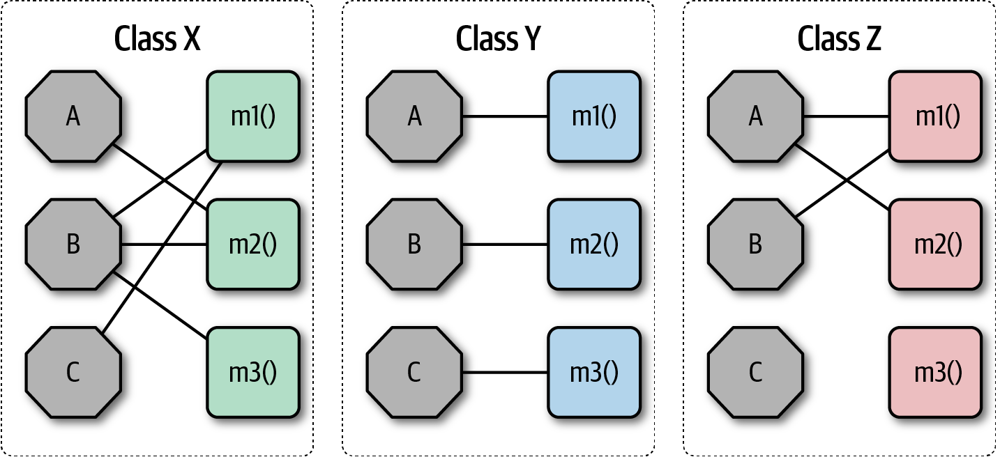
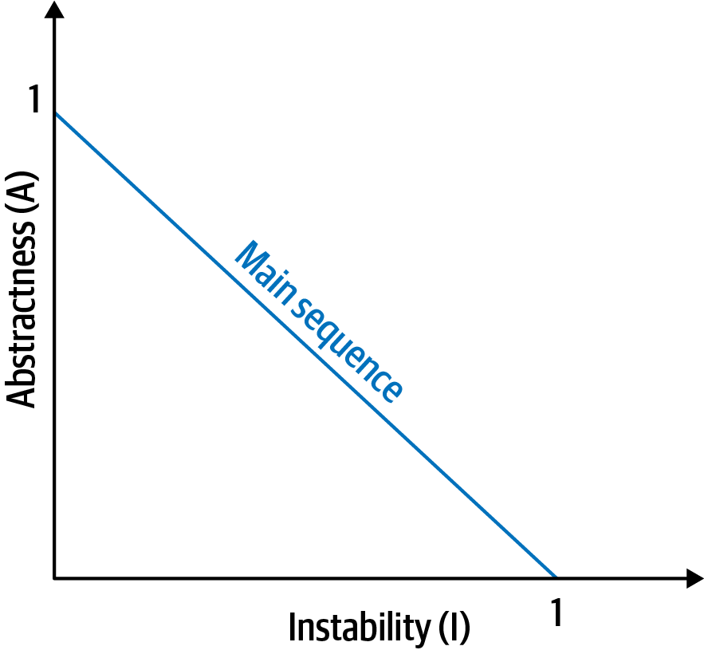
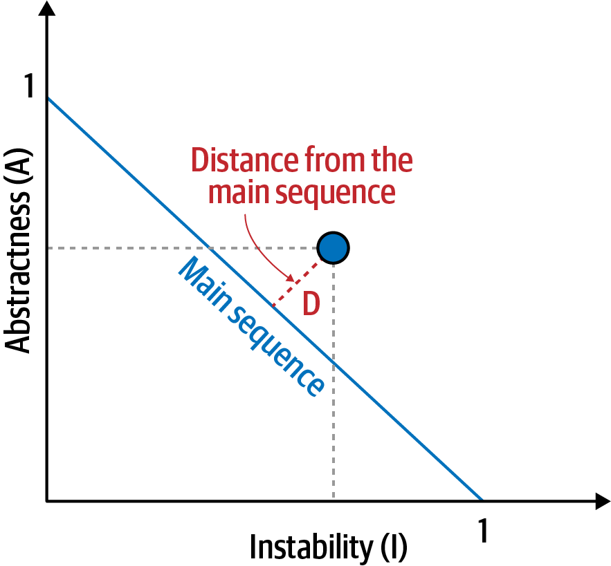
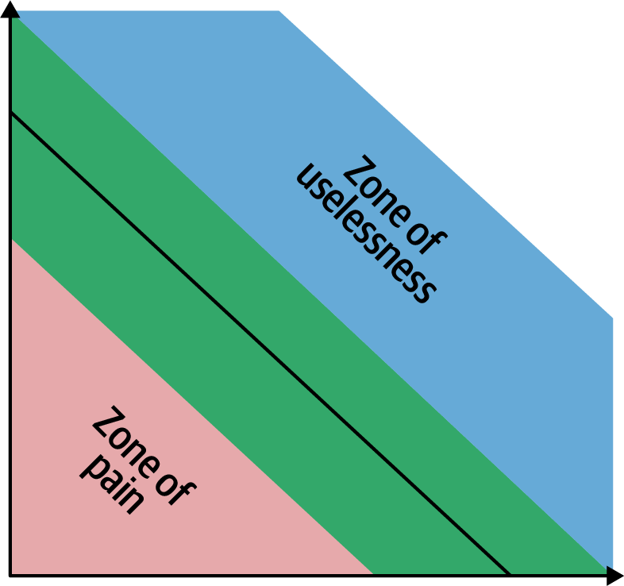
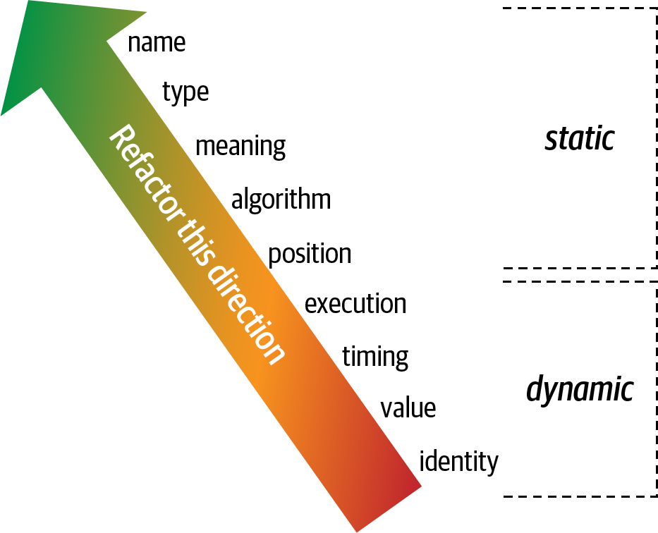
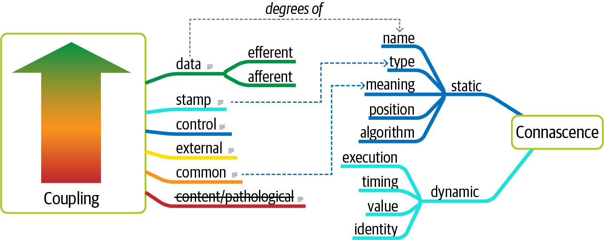

# 第 3 章 模块化

> 原文章名：Modularity
> 来源：英文第一版，书内第 37–53 页，PDF 第 57–73 页。
> 校译进度：本轮已完成全文逐段对照与中文通读；详见[校译记录](../../reviews/chapter-03-review.md)。
> 保留英文原图，图中文字中文对照见文末。公式依据页面图像转录；原文疑点以译注标出。下文页码均指原书书内页码。

<!-- 书内第 37 页，PDF 第 57 页。 -->

<!-- CH03-001 -->

首先，我们希望厘清架构讨论中围绕模块化使用、甚至滥用的一些常见术语，并给出贯穿本书的定义。

<!-- CH03-002 -->

> 关于软件架构的文字，95% 都在赞颂“模块化”的好处，却几乎没有谈到如何实现它。
>
> ——Glenford J. Myers（1978）

<!-- CH03-003 -->

不同平台提供不同的代码复用机制，但都支持某种方式，将相关代码组织为模块。虽然这一概念在软件架构中普遍存在，却一直难以定义。随便在网上搜索，就能找到几十种定义，彼此并不一致，有些甚至相互矛盾。从 Myers 的引文可以看出，这并不是新问题。然而，既然没有公认的定义，为了保持本书用语一致，我们也必须加入这场讨论，给出自己的定义。

<!-- CH03-004 -->

对架构师而言，理解模块化（modularity），以及它在所选开发平台上的各种表现形式，至关重要。许多架构分析工具，例如度量指标、适应度函数和可视化工具，都依赖这些模块化概念。模块化是一种组织原则。如果架构师设计系统时不关注各部分如何连接，最终就会产生一个困难重重的系统。借用物理学的类比，软件系统模拟复杂系统，而复杂系统往往趋向熵增，也就是无序。要维持物理系统的秩序，就必须向其中输入能量。软件系统也一样：架构师必须持续投入精力，确保系统结构合理、稳健；这样的结构不会自然而然地形成。

<!-- 书内第 38 页，PDF 第 58 页。 -->

<!-- CH03-005 -->

保持良好的模块化，正是我们所谓隐含架构特性的一个例子：几乎没有项目会明确要求架构师确保模块划分清晰、通信合理，但可持续维护的代码库离不开秩序与一致性。

## 定义

<!-- CH03-006 -->

词典将模块（module）定义为：“一组标准化部件或独立单元中的每一个，可用于构建更复杂的结构。”我们用“模块化”描述相关代码的逻辑分组，可以是面向对象语言中的一组类，也可以是结构化或函数式语言中的一组函数。大多数语言都提供模块化机制，例如 Java 的包（package）、.NET 的命名空间（namespace）等。开发者通常利用模块将相关代码组织在一起。例如，Java 中的 `com.mycompany.customer` 包，应该包含与客户有关的内容。

<!-- CH03-007 -->

如今，编程语言提供了多种代码组织机制，开发者反而难以选择。例如，在许多现代语言中，开发者可以通过函数或方法、类、包或命名空间定义行为，而每种方式都有不同的可见性与作用域规则。其他语言还加入元对象协议（metaobject protocol）等编程构造，为开发者提供更多扩展机制，使情况更加复杂。

<!-- CH03-008 -->

架构师必须了解开发者如何组织代码，因为这会对架构产生重要影响。例如，如果几个包紧密耦合，那么在相关工作中复用其中一个包就会更加困难。

### 类出现之前的模块化复用

<!-- CH03-009 -->

在面向对象语言出现之前就开始编程的开发者，可能会疑惑：为什么现在普遍存在如此多种不同的代码分隔方式？其中很大一部分原因与向后兼容有关，但兼容的并不是代码，而是开发者的思维方式。1968 年 3 月，Edsger Dijkstra 在《ACM 通讯》（Communications of the ACM）上发表了一封题为[《Go To 语句有害论》（Go To Statement Considered Harmful）](https://oreil.ly/9Zw-J)的信。他批评当时编程语言中普遍使用的 `GOTO` 语句，因为它允许在代码中非线性跳转，使推理和调试变得困难。

<!-- CH03-010 -->

这篇文章推动了结构化编程语言时代的到来，以 Pascal 和 C 为代表，鼓励开发者更深入地思考程序各部分如何配合。开发者很快发现，大多数语言都缺少将同类事物进行逻辑分组的良好机制。于是，模块化语言的短暂时代开始了，例如 Modula（Pascal 创造者 Niklaus Wirth 随后设计的语言）和 Ada。这些语言具有模块这种编程构造，与我们今天理解的包或命名空间很相似，只是没有类。

<!-- 书内第 39 页，PDF 第 59 页。 -->

<!-- CH03-011 -->

模块化编程时代很短暂。面向对象语言因为提供了封装和复用代码的新方式而流行起来。不过，语言设计者仍然认识到模块的用途，以包、命名空间等形式保留了它。为了支持不同范式，语言中存在许多奇特的兼容性特征。例如，Java 支持模块化范式（通过包和使用静态初始化器的包级初始化）、面向对象范式和函数式范式，每种编程风格都有自己的作用域规则与特殊之处。

<!-- CH03-012 -->

在架构讨论中，我们将模块化作为一个通用术语，表示相关代码的分组，可以是类、函数或其他分组。它并不意味着物理分离，只表示逻辑分离；这种区别有时很重要。例如，从便利的角度看，将大量类放在一个单体应用中可能是合理的。然而，到了需要重新组织架构的时候，模块边界划分不严谨所带来的耦合，就会妨碍拆分单体。因此，将模块化作为一个独立概念来讨论，而不局限于特定平台强制或暗示的物理分离方式，是有帮助的。

<!-- CH03-013 -->

命名空间也是一个通用概念，需要与 .NET 平台上的具体技术实现区分开来。开发者经常需要精确、完全限定的名称，以区分不同的软件资产，例如组件、类等。最明显的例子就是人们每天使用的互联网：与 IP 地址关联的、全局唯一的标识符。大多数语言都有某种模块化机制，同时兼作命名空间，用于组织变量、函数和方法。有时，模块结构还会体现为物理结构。例如，Java 要求包结构与类文件所在的物理目录结构对应。

### 没有名称冲突的语言：Java 1.0

<!-- CH03-014 -->

Java 最初的设计者，在处理当时各种编程平台上的名称冲突方面拥有丰富经验。Java 的初始设计采用了一种巧妙办法，避免两个同名类产生歧义。例如，如果问题领域同时包含目录商品订单（catalog order）和安装工单（installation order），两者都叫 `order`，含义却截然不同，对应的类也不同，该怎么办？Java 的解决办法是建立包命名空间机制，并要求物理目录结构与包名对应。由于文件系统不允许同一个目录中存在两个同名文件，他们利用操作系统的固有特性，排除了歧义的可能性。因此，Java 最初的 `classpath` 只包含目录，避免了名称冲突的可能。

<!-- 书内第 40 页，PDF 第 60 页。 -->

<!-- CH03-015 -->

然而，语言设计者发现，强制每个项目都具备完整的目录结构很麻烦，尤其当项目规模变大时更是如此。此外，构建可复用资产也很困难：框架和库必须展开到目录结构中。在 Java 的第二个主要版本（1.2，称为 Java 2）中，设计者加入了 JAR 机制，允许归档文件在 `classpath` 中充当目录结构。此后十年间，Java 开发者一直在努力正确配置由目录和 JAR 文件共同组成的 `classpath`。当然，最初的设计意图也被打破了：现在，两个 JAR 文件可能在 `classpath` 中产生名称冲突，由此留下了无数调试类加载器的艰辛经历。

## 衡量模块化

<!-- CH03-016 -->

鉴于模块化对架构师的重要性，他们需要工具来理解它。幸运的是，研究者创建了多种与语言无关的度量指标，帮助架构师理解模块化。我们重点讨论三个关键概念：内聚、耦合和共变性。

### 内聚

<!-- CH03-017 -->

内聚（cohesion）指模块中的各部分在多大程度上应当放在同一个模块内。换句话说，它衡量各部分彼此关联的程度。理想情况下，内聚模块的所有部分都应该封装在一起，因为如果进一步拆分，就必须通过模块间调用重新耦合这些部分，才能产生有用的结果。

<!-- CH03-018 -->

> 试图拆分一个内聚的模块，只会增加耦合并降低可读性。
>
> ——Larry Constantine

<!-- CH03-019 -->

计算机科学家定义了多种内聚类型，以下按从最好到最差的顺序排列：

**功能内聚（Functional cohesion）**

<!-- CH03-020 -->

模块的每个部分都与其他部分相关，模块包含实现其功能所必需的一切。

**顺序内聚（Sequential cohesion）**

<!-- CH03-021 -->

两个模块相互作用，其中一个模块的输出成为另一个模块的输入。

**通信内聚（Communicational cohesion）**

<!-- CH03-022 -->

两个模块构成一条通信链，各自处理信息，也可能共同产生某种输出。例如，向数据库添加一条记录，再依据该信息生成一封邮件。

<!-- 书内第 41 页，PDF 第 61 页。 -->

**过程内聚（Procedural cohesion）**

<!-- CH03-023 -->

两个模块必须按特定顺序执行代码。

**时间内聚（Temporal cohesion）**

<!-- CH03-024 -->

模块之间因时间上的依赖而关联。例如，许多系统在启动时必须初始化一系列看似无关的事物，这些不同任务具有时间内聚性。

**逻辑内聚（Logical cohesion）**

<!-- CH03-025 -->

模块内的数据在逻辑上相关，但功能上并不相关。例如，一个模块负责转换来自文本、序列化对象或流的信息。这些操作彼此有关，但功能相当不同。几乎每个 Java 项目中的 `StringUtils` 包，都是这类内聚的常见例子：其中是一组操作 `String` 的静态方法，除此之外没有其他关联。

**偶然内聚（Coincidental cohesion）**

<!-- CH03-026 -->

模块中的元素除了处于同一个源文件中，彼此没有其他关系；这是最差的一种内聚形式。

<!-- CH03-027 -->

虽然内聚分为上述七种类型，但作为度量指标，它仍不如耦合精确。某个模块的内聚程度，往往取决于具体架构师的判断。例如，考虑下面的模块定义：

**客户维护（Customer Maintenance）**

<!-- CH03-028 -->

- 添加客户
- 更新客户
- 获取客户
- 通知客户
- 获取客户订单
- 取消客户订单

<!-- CH03-029 -->

最后两项是否应当放在这个模块中？还是应该创建两个独立模块，例如：

**客户维护（Customer Maintenance）**

<!-- CH03-030 -->

- 添加客户
- 更新客户
- 获取客户
- 通知客户

<!-- 书内第 42 页，PDF 第 62 页。 -->

**订单维护（Order Maintenance）**

<!-- CH03-031 -->

- 获取客户订单
- 取消客户订单

<!-- CH03-032 -->

哪种结构正确？一如既往，视情况而定：

<!-- CH03-033 -->

- 订单维护只有这两个操作吗？如果是，将它们合并回客户维护也许更合理。
- 客户维护预计会变得很庞大，以至于开发者需要寻找提取行为的机会吗？
- 订单维护是否需要了解大量客户信息，以致拆分后必须引入高度耦合，两个模块才能正常工作？这就回到了前面 Larry Constantine 的引文。

<!-- CH03-034 -->

这些问题所代表的权衡分析，正是软件架构师工作的核心。

<!-- CH03-035 -->

令人惊讶的是，尽管内聚具有主观性，计算机科学家还是开发出了一种很好的结构度量指标，用于判断内聚，更准确地说，是判断内聚的缺失。著名的 [Chidamber 与 Kemerer 面向对象度量指标集](https://oreil.ly/-1lMh)，由 Chidamber 和 Kemerer 提出，并以二人的姓氏命名，用于衡量面向对象软件系统的特定方面。其中包含许多常见代码指标，例如圈复杂度（见第 79 页“圈复杂度”），以及第 44 页“耦合”中讨论的几个重要耦合指标。

<!-- CH03-036 -->

Chidamber 与 Kemerer 提出的方法内聚缺失度（Lack of Cohesion in Methods，LCOM）指标，衡量模块的结构内聚性，通常以组件为对象。最初版本见公式 3-1。

*公式 3-1：LCOM，版本 1。*

<!-- CH03-037 -->

$$
\mathrm{LCOM}=\begin{cases}
|P|-|Q|, & \text{若 } |P|>|Q| \\
0, & \text{否则}
\end{cases}
$$

<!-- CH03-038 -->

每有一个方法不访问某个特定的共享字段，P 就加一；每有方法共享某个特定字段，Q 就减一。读者如果看不懂这个表达式，我们完全理解。更糟的是，随着时间推移，它还逐渐变得更加复杂。1996 年提出的第二种变体（因此称为 LCOM96B）见公式 3-2。

> 译注：本段对 P、Q 的增减说明与公式中的集合基数记法存在疑点，译文保留原文。后文对“方法组”的说明也是原书的直观解释，没有给出严格的分组和计数规则；不能将其直接当作公式 3-2 的等价计算方法。使用指标计算工具时，应核对其具体定义。

<!-- 书内第 43 页，PDF 第 63 页。 -->

*公式 3-2：LCOM 96b。*

<!-- CH03-039 -->

$$
\mathrm{LCOM96b}=\frac{1}{a}\sum_{j=1}^{a}\frac{m-\mu(A_j)}{m}
$$

<!-- CH03-040 -->

我们不准备逐一解释公式 3-2 中的变量和运算符，因为下面的文字说明更清楚。基本上，LCOM 指标揭示了类内部的偶然耦合。下面是一种更易理解的 LCOM 定义：

**LCOM**

<!-- CH03-041 -->

没有通过共享字段关联起来的方法组的总数。

<!-- CH03-042 -->

考虑一个类，它有私有字段 `a` 和 `b`。许多方法只访问 `a`，另一些方法只访问 `b`。没有通过共享字段（`a` 和 `b`）关联起来的方法组很多，因此这个类的 LCOM 分数很高，表明它的方法内聚缺失程度很高。请看图 3-1 中的三个类。



*图 3-1：LCOM 指标示意，字段用八边形表示，方法用方块表示。*

<!-- CH03-043 -->

图 3-1 中，字段以单个字母表示，方法以方块表示。类 X 的 LCOM 分数较低，表明结构内聚性良好。类 Y 则缺乏内聚：其中每对字段与方法，都可以独立放在一个类中，而不影响行为。类 Z 的内聚情况混合，开发者可以将最后一组字段与方法重构到独立的类中。

<!-- 书内第 44 页，PDF 第 64 页。 -->

<!-- CH03-044 -->

架构师在分析代码库、准备从一种架构风格迁移到另一种风格时，可以借助 LCOM。迁移架构时，共享工具类往往令人头疼。LCOM 可以帮助架构师找出那些仅因偶然因素把不同内容耦合在一起的类；这些内容本来就不该放在同一个类中。

<!-- CH03-045 -->

许多软件度量指标存在严重缺陷，LCOM 也不例外。它只能发现结构上的内聚缺失，无法从逻辑上判断特定部分是否应该放在一起。这又呼应了软件架构第二定律：为什么比怎么做更重要。

### 耦合

<!-- CH03-046 -->

幸运的是，我们拥有更好的工具来分析代码库中的耦合，它们部分基于图论：方法调用与返回形成调用图，因此可以运用数学分析。1979 年，Edward Yourdon 与 Larry Constantine 出版了《结构化设计：计算机程序与系统设计学科基础》（Structured Design: Fundamentals of a Discipline of Computer Program and Systems Design，Prentice-Hall 出版），定义了许多核心概念，其中包括传入耦合与传出耦合。传入耦合（afferent coupling）衡量进入某个代码制品（组件、类、函数等）的连接数量；传出耦合（efferent coupling）衡量它指向其他代码制品的连接数量。几乎每个平台都有工具，可以分析代码的耦合特征，帮助架构师重组、迁移或理解代码库。

#### 为什么耦合指标的名字如此相似？

<!-- CH03-047 -->

架构领域中，两个代表相反概念的重要指标，名字为什么几乎一样，只在发音最相近的元音上有所区别？这些术语源自 Yourdon 与 Constantine 的《结构化设计》。他们借用数学概念，创造了如今常见的 afferent 和 efferent coupling，其实本该称为 incoming（传入）和 outgoing（传出）coupling。然而，原作者偏爱数学上的对称，而非表达上的清晰，开发者于是想出了一些记忆方法：英文字母表中 a 在 e 前面，对应先传入再传出；或者记住 efferent 的 e 与 exit（出口）的首字母相同，表示向外的连接。

### 抽象度、不稳定性与到主序列的距离

<!-- CH03-048 -->

组件耦合的原始数值对架构师有价值，而其他一些派生指标可以支持更深入的评估。这些指标由 Robert Martin 为一本 C++ 书籍提出，但也广泛适用于其他面向对象语言。

<!-- 书内第 45 页，PDF 第 65 页。 -->

<!-- CH03-049 -->

抽象度（abstractness）是抽象制品（抽象类、接口等）与具体制品（实现）的比率，用于衡量抽象与具体实现之间的比例关系。例如，一个代码库完全没有抽象，所有代码都挤在一个巨大的函数里，如单个 `main()` 方法。另一种极端则是抽象过多，使开发者难以理解各部分如何连接，例如，开发者要花一段时间才能弄明白 `AbstractSingletonProxyFactoryBean` 应该怎么用。

<!-- CH03-050 -->

抽象度公式见公式 3-3。

*公式 3-3：抽象度。*

<!-- CH03-051 -->

$$
A=\frac{\sum m^a}{\sum m^c}
$$

<!-- CH03-052 -->

公式中，`mᵃ` 表示模块中的抽象元素，即接口或抽象类，`mᶜ` 表示具体元素，即非抽象类。这一指标关注的仍是抽象与实现的比例。最直观的理解方式是：假设一个应用有 5,000 行代码，全都在一个 `main()` 方法中。抽象度的分子为 1，分母为 5,000，因此结果几乎为 0。由此，这个指标衡量的是代码中抽象的比率。

<!-- CH03-053 -->

架构师通过计算抽象制品总数与具体制品总数的比率，得到抽象度。

> 译注：此处的公式、按类定义的计数方式，以及按代码行解释的例子，口径并不一致；后文还将抽象度主要视为 0 到 1 之间的数。这里保留本版原文，不将疑点静默改写为另一套定义。

<!-- CH03-054 -->

另一个派生指标是不稳定性（instability），定义为传出耦合与传入、传出耦合总和之比，见公式 3-4。

*公式 3-4：不稳定性。*

<!-- CH03-055 -->

$$
I=\frac{C^e}{C^e+C^a}
$$

<!-- CH03-056 -->

其中，`Cᵉ` 表示传出耦合，`Cᵃ` 表示传入耦合。

<!-- CH03-057 -->

不稳定性指标衡量代码库在变更时容易出问题的程度。具有高度不稳定性的代码库，由于耦合较高，发生变更时更容易出问题。例如，一个类调用许多其他类来委派工作，那么只要一个或多个被调用的方法发生变化，调用方就很容易受到破坏。

<!-- 书内第 46 页，PDF 第 66 页。 -->

### 到主序列的距离

<!-- CH03-058 -->

可用于整体评估架构结构的指标为数不多，到主序列的距离（distance from the main sequence）就是其中之一。它由不稳定性与抽象度派生而来，见公式 3-5。

*公式 3-5：到主序列的距离。*

<!-- CH03-059 -->

$$
D=|A+I-1|
$$

<!-- CH03-060 -->

其中，A 为抽象度，I 为不稳定性。

<!-- CH03-061 -->

注意，抽象度和不稳定性都是比率，其结果总是在 0 到 1 之间（实际中不太有意义的极端抽象度情况除外）。因此，将两者关系绘制出来，就得到图 3-2。



*图 3-2：主序列定义了抽象度与不稳定性之间的理想关系。*

<!-- CH03-062 -->

这个距离指标以抽象度与不稳定性之间的理想关系为参照。接近这条理想直线的类，在这两个相互竞争的关注点之间取得了良好平衡。例如，将某个类的指标值绘制在图上，就可以计算它到主序列的距离，如图 3-3 所示。

<!-- 书内第 47 页，PDF 第 67 页。 -->



*图 3-3：某个类到主序列的归一化距离。*

<!-- CH03-063 -->

图 3-3 中，开发者先在图上标出待评估的类，再测量对应点与理想直线之间的距离。越接近直线，类的平衡就越好。过度偏向右上角的类，会进入架构师所谓的无用区（zone of uselessness）：代码过于抽象，以致难以使用。相反，落入左下角的代码进入痛苦区（zone of pain）：实现太多、抽象不足，代码就会变得脆弱、难以维护，如图 3-4 所示。



*图 3-4：无用区与痛苦区。*

<!-- 书内第 48 页，PDF 第 68 页。 -->

<!-- CH03-064 -->

许多平台都有提供这些度量的工具，可以在架构师需要熟悉代码库、迁移架构或评估技术债务时，帮助他们分析代码。

#### 度量指标的局限

<!-- CH03-065 -->

尽管业界有一些代码级指标，可以帮助深入理解代码库，但与其他工程学科的分析工具相比，我们的工具仍然非常粗糙。即使指标直接从代码结构推导而来，也需要解释。例如，圈复杂度（见第 79 页“圈复杂度”）可以衡量代码库的复杂程度，却无法区分本质复杂性（底层问题本身复杂）与偶然复杂性（代码比本来应有的程度更复杂）。几乎所有代码级指标都需要解释，但为圈复杂度等关键指标建立基线仍然有用，使架构师能够评估代码体现的是哪一类复杂性。我们会在第 82 页“治理与适应度函数”中讨论如何建立这类测试。

<!-- CH03-066 -->

请注意，前面提到的 Edward Yourdon 与 Larry Constantine 的《结构化设计：计算机程序与系统设计学科基础》，出版于面向对象语言流行之前，主要讨论函数等结构化编程构造，而非方法。它还定义了其他耦合类型，本书不再介绍，因为这些类型已被共变性概念取代。

### 共变性

<!-- CH03-067 -->

1996 年，Meilir Page-Jones 出版《每位程序员都应了解的面向对象设计知识》（What Every Programmer Should Know About Object-Oriented Design，Dorset House 出版），细化了传入与传出耦合指标，并用一个称为共变性（connascence）的概念，将这些指标重新表述，使其适用于面向对象语言。他的定义如下：

<!-- CH03-068 -->

> 如果修改一个组件时，必须同时修改另一个组件，才能保持系统整体的正确性，那么这两个组件就具有共变性。
>
> ——Meilir Page-Jones

<!-- CH03-069 -->

他提出了两类共变性：静态与动态。

#### 静态共变性

<!-- CH03-070 -->

静态共变性（static connascence）指源代码层面的耦合，与第 50 页“动态共变性”中介绍的运行时耦合相对；它细化了《结构化设计》所定义的传入与传出耦合。换句话说，架构师将以下静态共变性类型，视为传入或传出耦合的不同程度：

<!-- 书内第 49 页，PDF 第 69 页。 -->

**名称共变性（Connascence of Name，CoN）**

<!-- CH03-071 -->

多个组件必须对某个实体的名称达成一致。

<!-- CH03-072 -->

通过方法名称建立关联，是代码库中最常见、也最理想的耦合方式，尤其是现代重构工具已经让全系统的名称变更变得非常容易。

**类型共变性（Connascence of Type，CoT）**

<!-- CH03-073 -->

多个组件必须对某个实体的类型达成一致。

<!-- CH03-074 -->

它指许多静态类型语言中的常见能力：将变量和参数限定为特定类型。然而，这种能力并不只来自语言本身——某些动态类型语言也提供可选择的类型约束，典型例子是 [Clojure](https://clojure.org) 与 [Clojure Spec](https://clojure.org/about/spec)。

**含义共变性（Connascence of Meaning，CoM），或约定共变性（Connascence of Convention，CoC）**

<!-- CH03-075 -->

多个组件必须对特定值的含义达成一致。

<!-- CH03-076 -->

代码库中最明显、最常见的例子，是使用硬编码数字而非具名常量。例如，在某些语言中，人们常会在某处定义 `int TRUE = 1; int FALSE = 0`。想象一下，如果有人把这两个值颠倒，会引起什么问题。

**位置共变性（Connascence of Position，CoP）**

<!-- CH03-077 -->

多个组件必须对值的顺序达成一致。

<!-- CH03-078 -->

即使在静态类型语言中，方法和函数调用的参数值也存在这个问题。例如，开发者创建了方法 `void updateSeat(String name, String seatLocation)`，却用 `updateSeat("14D", "Ford, N")` 调用它，那么即使类型正确，语义也不正确。

**算法共变性（Connascence of Algorithm，CoA）**

<!-- CH03-079 -->

多个组件必须对某个特定算法达成一致。

<!-- CH03-080 -->

常见情况是，开发者定义一种安全哈希算法，必须在服务器端与客户端运行，并产生相同结果以验证用户。显然，这是较强的耦合形式：只要任一方算法的任何细节发生变化，握手就无法继续工作。

<!-- 书内第 50 页，PDF 第 70 页。 -->

#### 动态共变性

<!-- CH03-081 -->

Page-Jones 定义的另一类是动态共变性（dynamic connascence），它分析运行时的调用。下面介绍不同类型的动态共变性：

**执行共变性（Connascence of Execution，CoE）**

<!-- CH03-082 -->

多个组件的执行顺序很重要。

<!-- CH03-083 -->

考虑下面的代码：

<!-- CH03-084 -->

```java
email = new Email();
email.setRecipient("foo@example.com");
email.setSender("me@me.com");
email.send();
email.setSubject("whoops");
```

<!-- CH03-085 -->

这段代码无法正确工作，因为某些属性必须按顺序设置。

**时机共变性（Connascence of Timing，CoT）**

<!-- CH03-086 -->

多个组件执行的时机很重要。

<!-- CH03-087 -->

常见情况是，两个线程同时执行而产生竞态条件，从而影响联合操作的结果。

**值共变性（Connascence of Values，CoV）**

<!-- CH03-088 -->

多个值彼此关联、必须共同变化时，就存在值共变性。

<!-- CH03-089 -->

例如，开发者用代表四个角的四个点定义一个矩形。为了保持数据结构的完整性，不能在不考虑对其他点影响的情况下，随意改变其中一个点。

<!-- CH03-090 -->

更常见、也更棘手的情况涉及事务，尤其是在分布式系统中。当架构师设计一个具有多个独立数据库的系统，却需要在所有数据库中更新同一个值时，这些值就必须一起改变，或者都不改变。

**身份共变性（Connascence of Identity，CoI）**

<!-- CH03-091 -->

多个组件必须引用同一个实体时，就存在身份共变性。

<!-- CH03-092 -->

常见例子是，两个独立组件必须共享和更新同一个数据结构，例如分布式队列。

<!-- CH03-093 -->

架构师更难确定动态共变性，因为与分析调用图相比，我们还缺乏同样有效的工具来分析运行时调用。

<!-- 书内第 51 页，PDF 第 71 页。 -->

#### 共变性的属性

<!-- CH03-094 -->

共变性是架构师与开发者使用的一种分析工具。了解它的若干属性，有助于开发者恰当地运用它。下面分别介绍这些属性：

**强度（Strength）**

<!-- CH03-095 -->

架构师根据开发者重构这种耦合的难易程度，判断共变性的强度。有些共变性类型显然比另一些更理想，如图 3-5 所示。架构师和开发者可以通过重构，使代码朝更好的共变性类型演进，从而改善代码库的耦合特征。

<!-- CH03-096 -->

架构师应优先采用静态共变性，而不是动态共变性，因为简单的源代码分析就能识别静态共变性，现代工具也让改善它变得容易。例如，可以将含义共变性重构为名称共变性：用具名常量代替魔法值。



*图 3-5：共变性的强度为重构提供了良好指引。*

**局部性（Locality）**

<!-- CH03-097 -->

共变性的局部性衡量代码库中模块彼此接近的程度。同一模块内的代码彼此接近，通常比不同模块或代码库中相距较远的代码具有更多、更强的共变性。换句话说，同一种共变性，在相距较远时可能表明耦合不良，在靠近时却可以接受。例如，同一组件中的两个类具有含义共变性，对代码库的损害小于两个组件之间具有相同共变性的情况。

<!-- 书内第 52 页，PDF 第 72 页；上一段跨页。 -->

<!-- CH03-098 -->

开发者必须同时考虑强度与局部性。同样是较强的共变性，集中在一个模块内部时，比散布在相距较远的代码中带来的代码异味更轻。

**程度（Degree）**

<!-- CH03-099 -->

共变性的程度与影响范围大小有关：它影响少量类，还是许多类？影响范围较小的共变性，对代码库造成的损害也较小。换句话说，如果只有几个模块，较强的动态共变性未必很糟糕。然而，代码库往往会增长，小问题也就相应变大。

<!-- CH03-100 -->

Page-Jones 给出了三条利用共变性改善系统模块化的指导原则：

<!-- CH03-101 -->

1. 将系统拆分为封装的元素，使整体共变性最小化。
2. 尽量减少仍然跨越封装边界的共变性。
3. 最大化封装边界内部的共变性。

<!-- CH03-102 -->

传奇的软件架构创新者 Jim Weirich 让共变性概念重新受到关注，并提出了两条很好的建议：

<!-- CH03-103 -->

> 程度法则（Rule of Degree）：将较强形式的共变性转换为较弱形式。
>
> 局部性法则（Rule of Locality）：软件元素之间的距离越远，就应采用越弱的共变性。

### 统一耦合与共变性指标

<!-- CH03-104 -->

到目前为止，我们讨论了耦合与共变性，这些指标来自不同年代，关注的对象也不同。然而，从架构师的角度看，两种视角存在重叠。Page-Jones 所定义的静态共变性，代表传入或传出耦合的不同程度。结构化编程只关注传入或传出，共变性则关注事物如何耦合在一起。

<!-- CH03-105 -->

为了直观理解这些概念的重叠，请看图 3-6。左侧是结构化编程的耦合概念，右侧是共变性特征。对于结构化编程所谓的数据耦合，也就是方法调用，共变性进一步指导这种耦合应该采用什么形式。结构化编程并未真正涉及动态共变性所覆盖的领域；我们将在第 92 页“架构量子与粒度”中对这一概念作进一步归纳。

<!-- 书内第 53 页，PDF 第 73 页。 -->



*图 3-6：统一耦合与共变性。*

#### 20 世纪 90 年代共变性概念的问题

<!-- CH03-106 -->

架构师将这些有用的指标应用于系统分析和设计时，会遇到几个问题。首先，这些指标关注底层代码细节，着眼于代码质量和整洁程度，而不一定是架构结构。架构师往往更关心模块如何耦合，而非耦合程度。例如，架构师关注同步通信还是异步通信，却不那么关心具体如何实现。

<!-- CH03-107 -->

第二个问题在于，共变性并未真正回答许多现代架构师必须做出的一个基本决策：在微服务等分布式架构中，应该采用同步通信还是异步通信？回到软件架构第一定律，一切都是权衡。第 7 章讨论架构特性的作用范围之后，我们会介绍思考现代共变性的新方式。

## 从模块到组件

<!-- CH03-108 -->

本书始终将“模块”作为相关代码集合的通用名称。然而，大多数平台还支持某种形式的组件（component），它是软件架构师使用的关键构建单元之一。自计算机科学早期以来，逻辑或物理分离的概念及相应分析就已经存在。尽管关于组件和分离的论述与思考如此丰富，开发者和架构师仍然很难获得良好结果。

<!-- CH03-109 -->

第 8 章将讨论如何从问题领域中推导组件，但在此之前，必须先讨论软件架构的另一个基础方面：架构特性及其作用范围。

---

## 图中文字中文对照（译者整理）

以下对照图中的文字标签，不属于原书新增正文；原图保留其布局与连线。

### 图 3-1

类 X（Class X）、类 Y（Class Y）、类 Z（Class Z）；字段 A、B、C；方法 `m1()`、`m2()`、`m3()`。连线表示方法与字段之间的关联。

### 图 3-2

纵轴：抽象度 A（Abstractness）；横轴：不稳定性 I（Instability）；对角线：主序列（Main sequence）。

### 图 3-3

坐标轴与主序列标签同图 3-2；红色虚线段表示到主序列的距离 D（Distance from the main sequence）。

### 图 3-4

无用区（Zone of uselessness）、痛苦区（Zone of pain）。

### 图 3-5

箭头：“沿这个方向重构”（Refactor this direction），指向较弱的共变性。静态（static）部分从上到下为名称（name）、类型（type）、含义（meaning）、算法（algorithm）、位置（position）；动态（dynamic）部分为执行（execution）、时机（timing）、值（value）、身份（identity）。图中的静态类型顺序与正文列举顺序不完全相同，分别保留。

### 图 3-6

左侧：耦合（Coupling）；数据耦合（data），含传出（efferent）与传入（afferent）；印记耦合（stamp）；控制耦合（control）；外部耦合（external）；公共耦合（common）；内容或病态耦合（content/pathological，原图删除线保留）。虚线标签“……的程度”（degrees of）。右侧：共变性（Connascence），分为静态（static）与动态（dynamic）；具体类型名称与前述各图一致。
