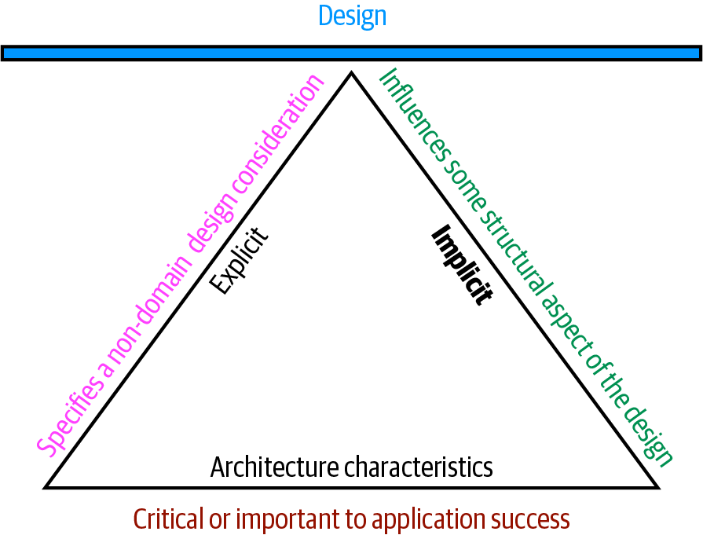

# 第 4 章 架构特性的定义

> 原文章名：Architecture Characteristics Defined
> 来源：英文第一版，书内第 55–64 页，PDF 第 75–84 页。
> 进度：第四章全文已翻译并对照原文校订。
> 保留英文原图，中文标签对照见文末；下文页码均指原书书内页码。

<!-- 书内第 55 页，PDF 第 75 页。 -->

一家公司决定使用软件解决某个问题，于是收集这个系统的需求清单。需求收集有多种方法，一般由团队采用的软件开发流程决定。但在设计软件解决方案时，架构师还必须考虑许多其他因素，如图 4-1 所示。

*图 4-1：软件解决方案既包含领域需求，也包含架构特性。*

架构师可以参与定义领域或业务需求，但一项关键职责是定义、发现并分析软件必须完成、却不直接属于领域功能的所有事情，也就是架构特性。

软件架构与编码、设计有何区别？区别很多，包括架构师在定义架构特性时承担的角色：这些特性是系统中独立于问题领域的重要方面。许多组织使用不同术语描述软件的这些特征，包括非功能性需求（nonfunctional requirements），但我们不喜欢这个词，因为它带有自我贬低的意味。架构师创造这个术语，是为了将架构特性与功能需求区分开来，但从语言上看，把某件事称为“非功能性”，会产生负面影响：团队如何能被说服，认真关注某种“非功能性”的东西？另一个流行术语是质量属性（quality attributes），我们也不喜欢，因为它暗示的是事后质量评估，而不是设计。我们更喜欢“架构特性”这个词，因为它描述了对架构成功、进而对整个系统成功至关重要的关注点，同时不会削弱其重要性。

<!-- 书内第 56 页，PDF 第 76 页；上一段跨页。 -->

架构特性符合三个标准：

- 指明一个非领域的设计关注点。
- 影响设计的某个结构方面。
- 对应用成功至关重要或具有重要意义。

这些相互关联的定义要素，如图 4-2 所示。

*图 4-2：架构特性的判别特征。*

图 4-2 的定义包含上述三个要素，以及一些补充限定：

**指明一个非领域的设计关注点**

设计应用时，需求说明应用应该做什么；架构特性则规定成功的运维与设计标准，涉及如何实现需求，以及为什么做出某些选择。例如，一项常见且重要的架构特性，是规定应用应达到某种性能水平，而这通常不会出现在需求文档中。更明显的例子是，没有需求文档会写“防止技术债务”，但它是架构师与开发者共同的设计关注点。我们会在第 65 页“从领域关注点中提取架构特性”中深入讨论显式与隐式特性的区别。

<!-- 书内第 57 页，PDF 第 77 页。 -->

**影响设计的某个结构方面**

架构师试图描述项目架构特性的主要原因，与设计上的考虑有关：要满足这一架构特性，是否需要特别的结构安排？例如，安全是几乎每个项目都需要考虑的问题，所有系统在设计和编码时，都必须采取基本防护措施。但当架构师需要专门设计某些东西时，安全就上升为架构特性。考虑示例系统中与支付有关的两种情况：

*第三方支付处理方*

如果由某个集成点处理支付细节，架构就不应需要特别的结构安排。设计应包括加密、哈希等标准安全措施，但不需要专门结构。

*应用内部的支付处理*

如果正在设计的应用必须处理支付，架构师可能为此设计专门的模块、组件或服务，从结构上隔离关键的安全关注点。此时，这一架构特性就同时影响架构与设计。

当然，许多情况下，仅凭这两个判断条件仍不足以做出决定：以往的安全事件、与第三方集成的性质，以及许多其他因素，都可能影响判断。不过，这仍然展示了架构师确定如何为某些能力进行设计时，必须考虑的一些问题。

**对应用成功至关重要或具有重要意义**

应用可以支持大量架构特性……但不应该这样做。支持每项架构特性，都会增加设计复杂性。因此，架构师的一项关键工作，是选择尽可能少、而非尽可能多的架构特性。

我们进一步将架构特性分为隐式与显式。隐式架构特性很少出现在需求中，却是项目成功所必需的。例如，可用性、可靠性和安全性支撑几乎所有应用，却很少在设计文档中明确规定。架构师必须在分析阶段运用问题领域知识，发掘这些特性。例如，高频交易公司可能不会为每个系统都明确规定低延迟，但这个领域的架构师知道它有多重要。显式架构特性则出现在需求文档或其他具体指示中。

图 4-2 有意使用三角形：定义中的各要素互相支撑，共同支撑系统的整体设计。三角形所形成的支点说明，这些架构特性常常相互影响，这也使得“权衡”成为架构师普遍使用的术语。

<!-- 书内第 58 页，PDF 第 78 页；上一段跨页。 -->

## 架构特性列表（不完整）

架构特性覆盖软件系统的广泛范围，从模块化等底层代码特性，到可扩展性、弹性等复杂的运维关注点。尽管过去曾尝试将其标准化，但并不存在真正通用的标准。相反，各个组织都对这些术语形成自己的解释。另外，由于软件生态系统变化很快，新的概念、术语、度量与验证方式不断出现，也为架构特性的定义提供了新的机会。

尽管数量多、范围广，架构师通常仍会将架构特性划分为若干大类。以下几节介绍其中一些类别与例子。

### 运维架构特性

运维架构特性包括性能、可扩展性、弹性、可用性和可靠性等能力。表 4-1 列出了一些运维架构特性。

*表 4-1：常见的运维架构特性。*

| 术语 | 定义 |
| --- | --- |
| 可用性（Availability） | 系统需要保持可用的时间有多长？如果要求全天候可用，就必须采取措施，使系统在任何故障发生后都能迅速恢复运行。 |
| 连续性（Continuity） | 灾难恢复能力。 |
| 性能（Performance） | 包括压力测试、峰值分析、功能使用频率分析、所需容量与响应时间。性能验收有时本身就是一项工作，可能需要数月才能完成。 |
| 可恢复性（Recoverability） | 业务连续性要求，例如发生灾难时，要求系统多快重新上线？这将影响备份策略，以及冗余硬件的需求。 |
| 可靠性 / 安全保障（Reliability / safety） | 评估系统是否需要故障安全机制，或是否承担涉及生命安全的关键任务。如果发生故障，会让公司损失巨额资金吗？ |
| 健壮性（Robustness） | 在运行期间互联网连接中断、停电或硬件故障时，处理错误与边界条件的能力。 |
| 可扩展性（Scalability） | 随用户数或请求量增加，系统仍能正常工作并保持性能的能力。 |

运维架构特性与运维及 DevOps 的关注点大量重叠，在许多软件项目中构成它们的交集。

<!-- 书内第 59 页，PDF 第 79 页。 -->

### 结构架构特性

架构师必须关注代码结构。许多情况下，架构师单独或共同承担代码质量职责，例如良好的模块化、组件之间受控的耦合、可读的代码，以及许多其他内部质量评估。表 4-2 列出了一些结构架构特性。

*表 4-2：结构架构特性。*

| 术语 | 定义 |
| --- | --- |
| 可配置性（Configurability） | 最终用户通过易用界面，轻松改变软件某些配置的能力。 |
| 可扩充性（Extensibility） | 插入新功能有多重要？ |
| 可安装性（Installability） | 在所有必要平台上安装系统的容易程度。 |
| 可利用性 / 复用（Leverageability / reuse） | 在多个产品之间利用公共组件的能力。 |
| 本地化（Localization） | 在数据字段的录入、查询界面中支持多种语言，以及在报表中支持多字节字符、计量单位或货币等要求。 |
| 可维护性（Maintainability） | 对系统实施变更与增强有多容易？ |
| 可移植性（Portability） | 系统是否需要运行在多个平台上？例如，前端是否需要同时对接 Oracle 与 SAP DB？ |
| 可支持性（Supportability） | 应用需要什么级别的技术支持？为了调试系统错误，需要什么级别的日志及其他设施？ |
| 可升级性（Upgradeability） | 在服务器和客户端上，从应用或解决方案旧版本轻松、快速升级到新版本的能力。 |

### 横切架构特性

许多架构特性属于容易辨认的类别，但也有许多不在这些类别中，或者难以归类，却仍然构成重要的设计约束与关注点。表 4-3 描述了其中一些。

*表 4-3：横切架构特性。*

| 术语 | 定义 |
| --- | --- |
| 无障碍性（Accessibility） | 让所有用户都能使用，包括色盲、听力受损等残障用户。 |
| 可归档性（Archivability） | 一段时间后是否需要归档或删除数据？例如，客户账户在三个月后删除，或者标记为过时，归档到辅助数据库以供日后访问。 |
| 身份验证（Authentication） | 确保用户确实是其所声称身份的安全要求。 |
| 授权（Authorization） | 确保用户只能访问应用中特定功能的安全要求，可以按用例、子系统、网页、业务规则、字段级别等进行限制。 |
| 法律（Legal） | 系统受到哪些法律约束，例如数据保护、萨班斯—奥克斯利法案、GDPR 等？公司要求保留哪些权利？对于应用的构建或部署方式，是否有监管要求？ |
| 隐私（Privacy） | 向公司内部员工隐藏交易的能力，例如加密交易，使数据库管理员和网络架构师也无法查看。 |
| 安全性（Security） | 数据库中的数据是否需要加密？内部系统之间的网络通信是否需要加密？远程用户访问时，需要采用哪种身份验证？ |
| 可支持性（Supportability） | 应用需要什么级别的技术支持？为了调试系统错误，需要什么级别的日志及其他设施？ |
| 易用性 / 目标可达成性（Usability / achievability） | 用户需要接受何种程度的培训，才能通过应用或解决方案实现目标？应像对待任何其他架构问题一样，认真对待易用性要求。 |

<!-- 书内第 60 页，PDF 第 80 页；表 4-3 在原书中跨页。 -->

任何架构特性清单都必然不完整；任何软件都可能基于独特因素，形成重要的架构特性，例如第 60 页“意大利性”中的例子。

#### 意大利性

Neal 的一位同事讲述过一个体现架构特性独特性的故事。她为一位客户工作，客户规定必须采用集中式架构。然而，对每个提出的设计，客户第一个问题都是：“可要是我们与意大利失联了，会怎样？”多年前，一次罕见的通信中断，使总部与意大利分支机构失去联系，给整个组织留下了创伤。因此，此后所有架构都必须满足一项坚定的要求，团队最终称其为“意大利性”（Italy-ility）。大家都知道，这意味着可用性、可恢复性与韧性的一种独特组合。

此外，上述许多术语都不够精确，甚至存在歧义，有时是因为细微差别，有时是因为缺少客观定义。例如，互操作性（interoperability）与兼容性（compatibility）看似相同，对某些系统而言确实如此。但两者也有区别：互操作性意味着容易与其他系统集成，进而意味着公开、文档化的 API；兼容性则更关注行业与领域标准。另一个例子是可学习性（learnability）。它的一种定义是用户学会使用软件的容易程度；另一种定义则是系统能够在多大程度上利用机器学习算法，自动了解环境，实现自配置或自优化。

许多定义彼此重叠。例如，可用性与可靠性似乎几乎总是重叠。但考虑互联网协议 UDP，原文称它位于 TCP 之下。UDP 在 IP 上可用，却不可靠：数据包可能乱序到达，接收方也可能需要再次请求丢失的数据包。

> 译注：本段关于 UDP 与 TCP 层次关系的原文表述存在疑点。此处明确保留其归属；讨论网络协议时应另行核对，不能把这段作为协议层次关系的依据。

不存在完整的标准清单。国际标准化组织（ISO）发布了一份[按能力组织的清单](https://oreil.ly/SKc_Y)，与我们列出的许多内容重叠，但主要仍是一份不完整的类别列表。以下是其中一些 ISO 定义：

<!-- 书内第 61 页，PDF 第 81 页。 -->

**性能效率（Performance efficiency）**

衡量在已知条件下，性能相对于所用资源量的情况。它包括时间行为（响应时间、处理时间或吞吐率的度量）、资源利用（所用资源的数量与类型），以及容量（超过既定最大限制的程度）。

**兼容性（Compatibility）**

产品、系统或组件能够在与其他产品、系统或组件交换信息，或者共享相同硬件或软件环境时，执行所需功能的程度。它包括共存性（在与其他产品共享环境和资源时，仍能高效完成所需功能）与互操作性（两个或多个系统能够交换并利用信息的程度）。

**易用性（Usability）**

用户能够有效、高效并满意地使用系统来实现预期目的。它包括适合性可识别性（用户能否判断软件是否适合自己的需要）、易学性（用户学会使用软件的容易程度）、用户错误防护（防止用户犯错），以及无障碍性（让具有最广泛特征与能力的人群都能使用软件）。

**可靠性（Reliability）**

系统在规定条件下、规定时间内正常发挥功能的程度。它包括成熟性（软件在正常运行时是否满足可靠性需要）、可用性（软件处于可运行和可访问状态）、容错性（发生硬件或软件故障时，软件是否仍按预期运行），以及可恢复性（软件能否在故障后恢复受影响的数据，并重新建立所需系统状态）。

**安全性（Security）**

软件保护信息与数据的程度，使人员、其他产品或系统，按照各自授权类型与级别获得恰当的数据访问权限。这组特性包括保密性（只有获授权者才能访问数据）、完整性（软件防止未经授权访问或修改软件及数据）、不可否认性（能否证明某项操作或事件确已发生）、可追责性（能否追踪用户行为），以及真实性（证明用户身份）。

<!-- 书内第 62 页，PDF 第 82 页。 -->

**可维护性（Maintainability）**

开发者能够有效、高效地修改软件，以改进、修正软件，或使其适应环境与需求变化的程度。它包括模块化（软件由独立组件构成的程度）、可复用性（开发者能够在多个系统中或构建其他资产时使用某项资产的程度）、可分析性（开发者获取软件具体度量的容易程度）、可修改性（修改软件而不引入缺陷或降低现有产品质量的程度），以及可测试性（开发者和其他人员测试软件的容易程度）。

**可移植性（Portability）**

开发者将系统、产品或组件从一种硬件、软件或其他运行及使用环境迁移到另一种环境的程度。它包括适应性（开发者能否有效、高效地调整软件，以适应不同或演进中的硬件、软件或其他运行及使用环境）、可安装性（软件能否在规定环境中安装或卸载），以及可替代性（开发者使用其他软件替代其功能的容易程度）。

ISO 清单的最后一项涉及软件功能层面，我们认为它不属于本清单：

**功能适合性（Functional suitability）**

产品或系统在规定条件下使用时，提供满足明示及隐含需求的功能的程度。这项特性包括以下子特性：

*功能完整性（Functional completeness）*

功能集合覆盖所有规定任务与用户目标的程度。

*功能正确性（Functional correctness）*

产品或系统以所需精度提供正确结果的程度。

*功能恰当性（Functional appropriateness）*

功能有助于完成规定任务与目标的程度。这些并非架构特性，而是促使我们构建软件的需求。这说明，关于架构特性与问题领域之间关系的思考一直在演进。第 7 章将介绍这一演进。

<!-- 书内第 63 页，PDF 第 83 页。 -->

### 软件架构中的诸多歧义

架构师经常感到沮丧的一点，是许多关键事物都缺乏清晰定义，甚至包括软件架构这项活动本身！这导致公司为常见事物自行定义术语，进而造成整个行业的混乱：架构师要么使用含糊不明的词语，要么更糟，用同一术语表达截然不同的含义。尽管我们希望如此，却无法为整个软件开发领域强制建立标准术语。不过，我们遵循并推荐领域驱动设计的建议：在同事之间建立并使用统一语言（ubiquitous language），帮助减少术语造成的误解。

## 权衡与最不坏的架构

应用只能支持我们所列架构特性中的少数几项，原因有很多。首先，每项被支持的特性，都需要设计投入，可能还需要结构支持。其次，更大的问题在于，每项架构特性往往都会影响其他特性。例如，架构师如果想提升安全性，几乎肯定会对性能产生负面影响：应用必须进行更多实时加密、通过间接访问隐藏秘密，以及开展其他可能降低性能的活动。

用一个比喻可以说明这种相互关联。据说，飞行员学习驾驶直升机时常常感到困难，因为双手、双脚都各自需要控制，而改变其中一个，又会影响其他控制。因此，驾驶直升机是一种平衡练习，这很好地描述了选择架构特性时的权衡过程。架构师为每项特性设计支持，都可能使整体设计更复杂。

因此，架构师很少有机会在设计系统时，将每项架构特性都最大化。更多时候，决策归结为在若干相互竞争的关注点之间做权衡。

> 不要追求最好的架构，而要追求最不坏的架构。

架构特性过多，会导致试图解决所有业务问题的通用方案；这类架构很少奏效，因为设计会变得难以驾驭。

这意味着，架构师应努力让架构尽可能支持迭代。如果更容易修改架构，就不必为第一次尝试是否找到完全正确的方案而过度焦虑。敏捷软件开发最重要的经验之一，就是迭代的价值；这一点适用于软件开发的所有层面，包括架构。

<!-- 书内第 64 页，PDF 第 84 页；上一段跨页。 -->

---

## 图中文字中文对照（译者整理）

以下仅对照原图标签，不属于原书新增正文。

### 图 4-1

从左至右：可审计性（Auditability）、性能（Performance）、安全性（Security）、需求（Requirements）、数据（Data）、合法性（Legality）、可扩展性（Scalability）。

### 图 4-2

顶部横梁：设计（Design）。三角形内部：架构特性（Architecture characteristics）；左侧显式（Explicit），右侧隐式（Implicit）。三条边分别是：指明一个非领域的设计关注点（Specifies a non-domain design consideration）、影响设计的某个结构方面（Influences some structural aspect of the design）、对应用成功至关重要或具有重要意义（Critical or important to application success）。
