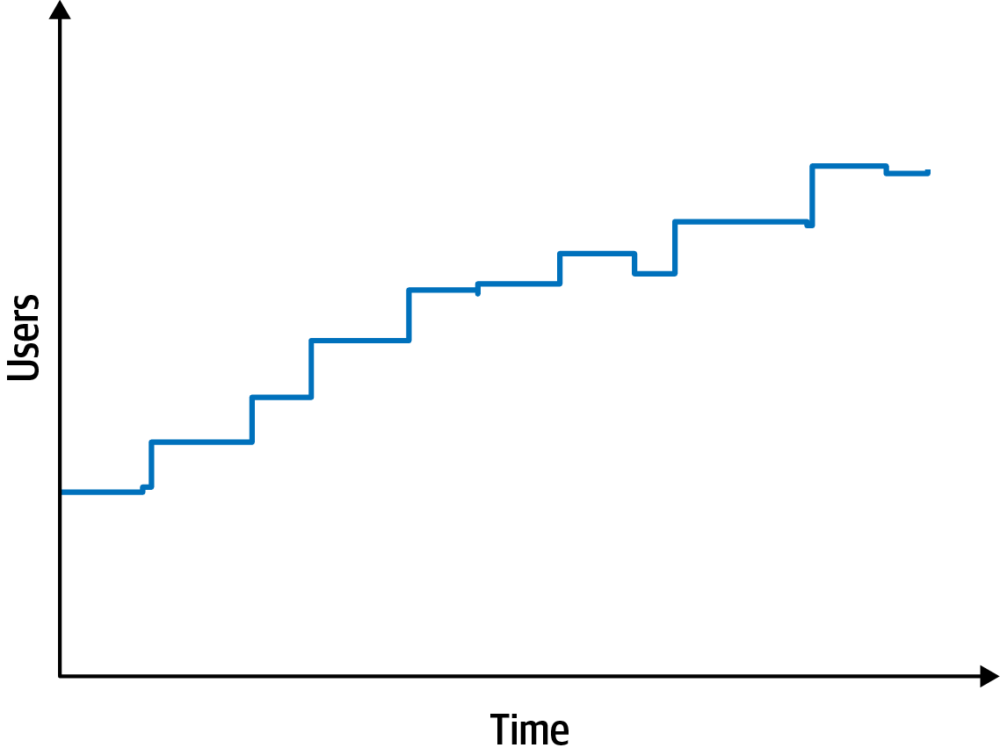
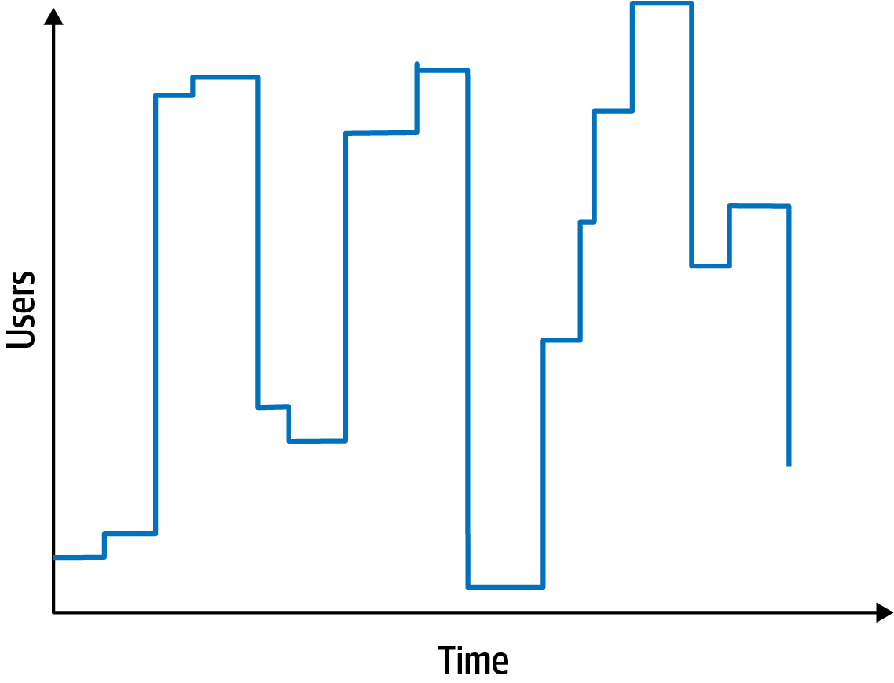

# 第 5 章 识别架构特性

> 原文章名：Identifying Architectural Characteristics
> 来源：英文第一版，书内第 65–75 页，PDF 第 85–95 页。
> 进度：第五章全文已翻译并对照原文校订。
> 保留英文原图，中文标签对照见文末；下文页码均指原书书内页码。

<!-- 书内第 65 页，PDF 第 85 页。 -->

识别起驱动作用的架构特性，是创建架构或判断现有架构是否适用的首要步骤之一。要为某个问题或应用识别正确的架构特性（“-ilities”），架构师不仅需要理解领域问题，还必须与该领域的利益相关者协作，确定从领域角度看真正重要的是什么。

架构师至少可以通过三种途径发现架构特性：从领域关注点、需求和隐含的领域知识中提取。前面已经讨论过隐含特性，这里介绍另外两种途径。

## 从领域关注点中提取架构特性

架构师必须能够转译领域关注点，识别正确的架构特性。例如，最重要的关注点是可扩展性，还是容错性、安全性或性能？也许系统需要同时具备这四种特性。理解关键领域目标与领域处境，才能将这些关注点转化为各种“-ilities”，进而为正确且有充分理由的架构决策奠定基础。

与领域利益相关者协作，定义起驱动作用的架构特性时，一个建议是尽力缩短最终清单。架构中一个常见反模式，是试图设计支持所有架构特性的通用架构。每支持一项特性，整体系统设计就会更复杂；支持过多特性，会使复杂性不断增加，甚至在架构师与开发者开始处理领域问题之前就已如此，而领域问题才是编写软件的最初动机。不要纠结特性的数量，而要记住保持设计简单这一目的。

<!-- 书内第 66 页，PDF 第 86 页；上一段跨页。 -->

### 案例研究：瓦萨号

过度规定架构特性、最终葬送项目的经典故事，当属瓦萨号（Vasa）。这艘瑞典战舰建于 1626 至 1628 年间，国王希望它成为有史以来最宏伟的船。此前，船只要么运兵，要么作战，而瓦萨号要兼顾两者！大多数船只有一层甲板，瓦萨号有两层！所有火炮的尺寸都是同类船只的两倍。尽管造船专家有些担忧，但他们最终无法拒绝 Adolphus 国王的要求，还是完成了建造。庆祝时，船驶入港湾，从一侧鸣炮致意。不幸的是，由于头重脚轻，船倾覆，沉入瑞典海湾底部。20 世纪初，打捞者将它救起，如今陈列在斯德哥尔摩的一座博物馆中。

> 译注：以上为本版原书的历史叙述，按原意翻译；本工程未据外部史料核验其具体细节。

许多架构师和领域利益相关者，希望为应用或系统必须支持的最终架构特性清单逐项排序。这样做当然值得向往，但多数情况下却是徒劳，不仅浪费时间，还会给关键利益相关者带来许多不必要的挫折与分歧。所有利益相关者很少能对每一项特性的优先级达成一致。更好的方式是，请领域利益相关者从最终清单中选出最重要的三项，不必排序。这样不仅更容易取得共识，也能推动关于“什么最重要”的讨论，并帮助架构师在做关键决策时分析权衡。

大多数架构特性，来自倾听关键领域利益相关者，并与他们共同判断从领域角度看什么最重要。这看起来很直接，但问题在于，架构师与领域利益相关者说着不同的语言。架构师谈论可扩展性、互操作性、容错性、易学性与可用性；领域利益相关者谈论并购、用户满意度、上市时间与竞争优势。于是出现了“转译失真”：双方听不懂对方。架构师不知道如何创建支持用户满意度的架构，领域利益相关者也不理解，为什么讨论应用时总是如此关注可用性、互操作性、易学性与容错性。幸运的是，领域关注点与架构特性之间，通常存在转译关系。表 5-1 列出了一些常见领域关注点，以及支持它们的架构特性。

<!-- 书内第 67 页，PDF 第 87 页。 -->

*表 5-1：从领域关注点转译为架构特性。*

| 领域关注点 | 架构特性 |
| --- | --- |
| 并购 | 互操作性、可扩展性、适应性、可扩充性 |
| 上市时间 | 敏捷性、可测试性、可部署性 |
| 用户满意度 | 性能、可用性、容错性、可测试性、可部署性、敏捷性、安全性 |
| 竞争优势 | 敏捷性、可测试性、可部署性、可扩展性、可用性、容错性 |
| 时间与预算 | 简单性、可行性 |

需要注意，敏捷性并不等于上市时间；真正需要的是敏捷性加上可测试性和可部署性。许多架构师转译领域关注点时都会落入这个陷阱。只关注其中一个因素，就像调蛋糕面糊时忘了加面粉。例如，领域利益相关者可能会说：“由于监管要求，我们绝对必须按时完成日终基金定价。”低效的架构师可能只关注性能，因为它看起来是这一领域关注点的核心。然而，这位架构师仍会因为许多原因而失败。首先，如果需要时系统不可用，再快也没用。其次，随着业务领域扩大、基金数量增加，系统必须能够扩展，才能按时完成日终处理。第三，系统不仅要可用，还要可靠，不能在计算日终基金价格时崩溃。第四，如果计算进行到约 85% 时崩溃，会怎样？系统必须能够恢复，并从中断处继续。最后，系统可能很快，但基金价格算对了吗？因此，除了性能，架构师还必须同样关注可用性、可扩展性、可靠性、可恢复性和可审计性。

## 从需求中提取架构特性

一些架构特性来自需求文档中的明确陈述。例如，预期用户数量与规模，经常明确出现在领域描述或领域关注点中。其他特性来自架构师固有的领域知识，这也是领域知识始终对架构师有益的众多原因之一。例如，假设架构师为大学生设计选课应用。为便于计算，假设学校有 1,000 名学生，选课时间为 10 小时。架构师应该按稳定负载设计，隐含假定学生会在选课时段内均匀分布吗？还是应该根据大学生的习惯和倾向，设计一个能够应对所有 1,000 名学生在最后 10 分钟尝试选课的系统？了解学生典型拖延习惯的人，都知道这个问题的答案！这类细节很少写进需求文档，却会影响设计决策。

<!-- 书内第 68 页，PDF 第 88 页；上一段跨页。 -->

### 架构 Kata 的起源

几年前，著名架构师 Ted Neward 设计了架构 Kata（architecture katas），为初学者提供一种巧妙的练习方式：从以领域为中心的描述中推导架构特性。Kata 来自日本武术，指注重正确形式与技法的个人训练练习。

> 如何培养优秀的设计者？当然是让优秀的设计者进行设计。
>
> ——Fred Brooks

那么，如果架构师整个职业生涯里，真正有机会设计架构的次数还不到六次，我们又该如何培养优秀架构师？

为了给有志成为架构师的人提供练习材料，Ted 创建了第一个架构 Kata 网站，本书作者 Neal 和 Mark 对其进行了改编和更新。练习的基本形式，是向架构师提供用领域语言描述的问题，以及补充背景：那些可能不会出现在需求中，却会影响设计的因素。各小组用 45 分钟进行设计，然后向其他小组展示结果，由大家投票选出最佳架构。忠于最初目的，架构 Kata 为有志成为架构师的人提供了有用的练习场。

每个 Kata 都有预定义部分：

**描述（Description）**

系统试图解决的整体领域问题。

**用户（Users）**

系统预期的用户数量或类型。

**需求（Requirements）**

领域或领域层面的需求，类似于架构师从业务用户或领域专家那里获得的需求。

几年后，Neal 在自己的[博客](http://nealford.com/katas)上更新了格式，为每个 Kata 增加包含重要额外考虑因素的补充背景部分，使练习更贴近现实。

**补充背景（Additional context）**

架构师必须考虑的许多因素，并未明确写在需求中，而是来自对问题领域的隐含知识。

我们鼓励正在成长的架构师使用这个网站，开展自己的 Kata 练习。任何人都可以组织一次午餐交流，让有志成为架构师的团队解决一个问题，再请经验丰富的架构师现场评价设计和权衡分析，或者事后进行简短分析。由于练习有时间限制，设计不会十分详尽。理想情况下，团队成员能够从经验丰富的架构师那里，获得关于遗漏权衡与替代设计的反馈。

<!-- 书内第 69 页，PDF 第 89 页；上一段跨页。 -->

## 案例研究：Silicon Sandwiches

为了说明几个概念，我们使用一个架构 Kata，概念来源见第 68 页“架构 Kata 的起源”。为了展示架构师如何从需求中推导架构特性，下面介绍 Silicon Sandwiches（三明治连锁店）的 Kata。

**描述**

一家全国性三明治连锁店，希望在现有电话订餐服务之外，提供在线订餐。

**用户**

数千人，也许有一天达到数百万人。

**需求**

- 用户下单后，系统提供三明治取餐时间及前往门店的路线，必须集成几个包含交通信息的外部地图服务。
- 如果门店提供配送服务，派司机将三明治送给用户。
- 可通过移动设备访问。
- 提供全国性的每日促销或特价活动。
- 提供本地的每日促销或特价活动。
- 接受在线支付、到店支付或货到付款。

**补充背景**

- 门店采用加盟制，每家店的所有者不同。
- 母公司近期计划向海外扩张。
- 公司的目标是雇用低成本劳动力，以最大化利润。

面对这个场景，架构师如何推导架构特性？每项需求都可能影响架构的一个或多个方面，也有许多不会。架构师并不是在这里设计整个系统——仍需要投入大量工作，编写代码来解决领域问题。相反，架构师寻找的是影响设计、尤其影响结构的因素。首先，将候选架构特性区分为显式与隐式。

<!-- 书内第 70 页，PDF 第 90 页。 -->

### 显式特性

显式架构特性作为必要设计的一部分，出现在需求规格说明中。例如，购物网站可能希望支持特定数量的并发用户，领域分析师会将其写入需求。架构师应该考虑需求的每个部分，判断它是否涉及架构特性。但首先，应当考察领域层面对预期指标的预测，也就是 Kata 中“用户”部分的信息。

首先应当引起架构师注意的细节之一，是用户数量：目前数千人，未来可能达到数百万人——这家三明治店真有雄心！因此，可扩展性，也就是处理大量并发用户而不严重降低性能的能力，是最重要的架构特性之一。注意，问题陈述没有明确要求可扩展性，而是用预期用户数量来表达这一要求。架构师经常必须将领域语言解读为对应的工程概念。

不过，我们可能还需要弹性，即应对突发请求的能力。这两项特性经常被混为一谈，但其约束不同。可扩展性表现为图 5-1 所示的曲线。

*图 5-1：可扩展性衡量处理并发用户时的性能。*

另一方面，弹性衡量突发流量，如图 5-2 所示。

<!-- 书内第 71 页，PDF 第 91 页。 -->

*图 5-2：有弹性的系统必须承受用户数量的突增。*

有些系统具有可扩展性，却缺少弹性。例如，酒店预订系统如果没有特别促销或活动，用户数量可能相对稳定。相反，演唱会票务系统在新票开售时，狂热歌迷会涌入网站，因此需要高度弹性。有弹性的系统通常也需要可扩展性：既应对突发流量，也处理大量并发用户。

Silicon Sandwiches 的需求中没有出现弹性要求，但架构师应该将其识别为重要因素。需求有时会直接写明架构特性，也有一些隐藏在问题领域中。想想三明治店：全天流量都一样吗？还是用餐时间会出现流量突增？几乎肯定是后者。因此，优秀架构师应该识别这一潜在架构特性。

架构师应该依次考虑每项业务需求，判断其中是否存在架构特性：

**1. 用户下单后，获得取餐时间和前往门店的路线，并可选择集成包含交通信息的外部地图服务。**

外部地图服务意味着集成点，可能影响可靠性等方面。例如，开发者构建一个依赖第三方系统的应用，如果调用第三方失败，就会影响调用方的可靠性。但架构师也必须避免过度规定架构特性。假如外部交通服务宕机，Silicon Sandwiches 网站也应当失败吗？还是只在缺少交通信息时稍微降低效率？架构师始终应当警惕，不要给设计引入不必要的脆弱性。

<!-- 书内第 72 页，PDF 第 92 页；上一段跨页。 -->

**2. 如果门店提供配送服务，派司机将三明治送给用户。**

支持这一需求，似乎不需要特别的架构特性。

**3. 可通过移动设备访问。**

这项需求主要影响应用设计，指向构建可移植的 Web 应用，或者多个原生 Web 应用。考虑到预算限制和应用的简单性，架构师很可能认为创建多个应用过于复杂，因此倾向于为移动端优化的 Web 应用。于是，架构师可能希望为页面加载时间及其他对移动端敏感的因素，定义具体的性能架构特性。注意，这种情况下架构师不应独自行动，而应与用户体验设计者、领域利益相关者和其他相关人员协作，审视这类决策。

> 译注：本段“原生 Web 应用”对应本版原文 native web applications，保留原表述，未替作者改为其他应用类别。

**4. 提供全国性的每日促销或特价活动。**

**5. 提供本地的每日促销或特价活动。**

这两项需求都要求能够定制促销与特价活动。注意，第 1 项需求还暗示了根据地址定制交通信息。基于这三项需求，架构师可能将可定制性作为架构特性。例如，微内核这样的架构风格，通过定义插件架构，非常适合支持定制行为。在这种情况下，默认行为位于核心，开发者通过插件编写根据地点而变化的可选定制部分。然而，传统设计也可以通过模板方法（Template Method）等设计模式满足这一需求。这类难题在架构中很常见，要求架构师不断比较候选方案之间的权衡。第 74 页“设计、架构与权衡”会进一步讨论这项具体权衡。

**6. 接受在线支付、到店支付或货到付款。**

在线支付意味着安全要求，但这项需求没有表明，需要超出隐含要求的特别高安全级别。

**7. 门店采用加盟制，每家店的所有者不同。**

这项需求可能给架构带来成本约束。架构师应该结合成本、时间和员工技能等限制检查可行性，判断是否适合采用简单架构或可牺牲架构（sacrificial architecture）。

<!-- 书内第 73 页，PDF 第 93 页。 -->

**8. 母公司近期计划向海外扩张。**

这意味着国际化，即 i18n。有许多设计技术能够满足这一需求，通常不必用特殊结构来支持。不过，它肯定会影响设计决策。

**9. 公司的目标是雇用低成本劳动力，以最大化利润。**

这项需求表明易用性很重要，但同样更多属于设计问题，而非架构特性。

从前述需求中推导出的第三项架构特性，是性能：没有人愿意在性能糟糕的三明治网站购物，尤其在高峰时段。然而，性能是个有细微差别的概念——架构师到底应该针对哪种性能进行设计？第 6 章会讨论性能的各种细节。

我们还需要结合可扩展性指标来定义性能指标。换句话说，既要建立不考虑特定规模时的性能基线，也要确定给定用户数量下可接受的性能水平。架构特性常常相互作用，迫使架构师结合它们之间的关系进行定义。

### 隐式特性

许多架构特性未在需求文档中规定，却构成设计的重要方面。系统可能需要支持的一项隐式架构特性是可用性：确保用户能够访问三明治网站。与其密切相关的是可靠性：确保网站在交互过程中持续运行。没有人愿意在一个不断断开连接、迫使自己重新登录的网站上购物。

安全性是每个系统的隐式特性：没有人想创建不安全的软件。不过，可以根据其关键程度确定优先级，这也体现了本书定义中各要素的相互关联。如果安全影响设计的某个结构方面，而且对应用至关重要或具有重要意义，架构师就将其视为架构特性。

对 Silicon Sandwiches，架构师可能假定支付应由第三方处理。这样，只要开发者遵守基本安全规范，例如不以明文传递信用卡号码、不存储过多信息等，架构师就不需要为安全安排特殊结构；应用中的良好设计已经足够。每项架构特性都与其他特性交互，这也导致架构师经常过度规定架构特性。这与规定不足同样有害，因为它让系统设计过于复杂。

<!-- 书内第 74 页，PDF 第 94 页。 -->

Silicon Sandwiches 需要支持的最后一项主要架构特性，综合了需求中的几个细节：可定制性。注意，问题领域中的多个部分都提供定制行为，例如配方、本地促销，以及可在本地覆盖的路线。因此，架构应支持便于实现定制行为的能力。通常，这属于应用设计。但按本书定义，问题领域中如果有某部分依赖特定结构来支持，它就进入架构特性的范畴。不过，这项设计要素并非应用成功的关键。需要注意，选择架构特性时并不存在正确答案，只有不正确的答案；或者，用 Mark 的一句名言来说：

> 架构中没有错误答案，只有代价高昂的答案。

#### 设计、架构与权衡

在 Silicon Sandwiches 的 Kata 中，架构师很可能识别出可定制性属于系统的一部分，但随之而来的问题是：它属于架构，还是设计？架构意味着某种结构要素，设计则处于架构之内。对于本例的可定制性，架构师可以选择微内核之类的架构风格，从结构上提供支持。然而，如果因为其他相互竞争的关注点而选择另一种风格，开发者也可以使用模板方法设计模式实现定制，让父类定义可由子类覆盖的工作流。哪种设计更好？

像所有架构问题一样，这取决于多个因素。首先，是否有性能、耦合等充分理由，不采用微内核架构？其次，在两种设计中，是否有某些其他期望的架构特性，在其中一种更难实现？第三，采用每种设计或模式，要支持所有架构特性，各自成本多高？这类架构权衡分析，是架构师角色的重要组成部分。

最重要的是，架构师必须与开发者、项目经理、运维团队，以及软件系统的其他共同建设者协作。不应脱离实现团队做出任何架构决策，否则就会落入令人畏惧的象牙塔架构师（Ivory Tower Architect）反模式。对 Silicon Sandwiches，架构师、技术负责人、开发者与领域分析师应该共同决定，如何最好地实现可定制性。

架构师也可以设计一种不从结构上支持可定制性的架构，转而由应用本身的设计支持这种行为，见第 74 页“设计、架构与权衡”。架构师不必为找出完全正确的一组架构特性而过度焦虑——开发者可以用多种方式实现功能。不过，正确识别重要的结构要素，可能带来更简单或更优雅的设计。架构师必须记住：架构中不存在最好的设计，只有一组最不坏的权衡。

<!-- 书内第 75 页，PDF 第 95 页；上一段跨页。 -->

架构师还必须为这些特性确定优先级，努力找到所需的最简单集合。团队初步识别架构特性后，一个有用的练习是找出最不重要的一项：如果必须删掉一个，会删哪个？一般来说，架构师更可能删减显式特性，因为许多隐式特性支撑系统的普遍成功。我们对“至关重要或具有重要意义”的定义，有助于判断应用是否真的需要某项架构特性。尝试找出最不适用的一项，可以帮助识别真正必要的特性。对 Silicon Sandwiches，我们识别出的特性中，哪一项最不重要？同样没有绝对正确的答案。但在这个例子中，可以去掉可定制性或性能。我们可以不将可定制性视为架构特性，而计划在应用设计中实现它。在运维架构特性中，性能可能最不关键。当然，这并不意味着开发者打算创建性能糟糕的应用，而是不让性能优先于可扩展性、可用性等其他特性。

---

## 图中文字中文对照（译者整理）

### 图 5-1

纵轴：用户数（Users）；横轴：时间（Time）。阶梯曲线表示用户规模随时间增长。

### 图 5-2

纵轴：用户数（Users）；横轴：时间（Time）。曲线表示用户数量的突增与回落。
