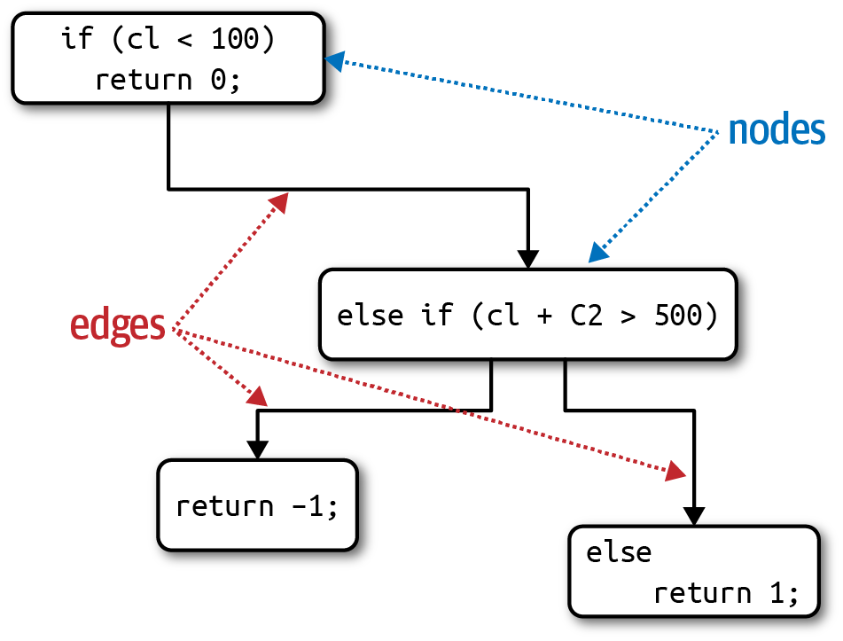
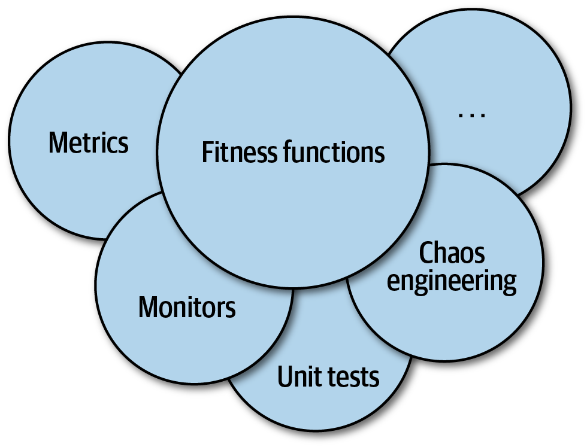
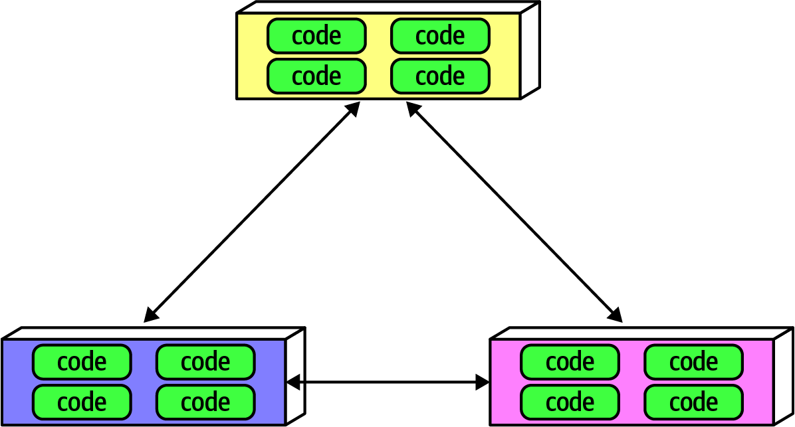
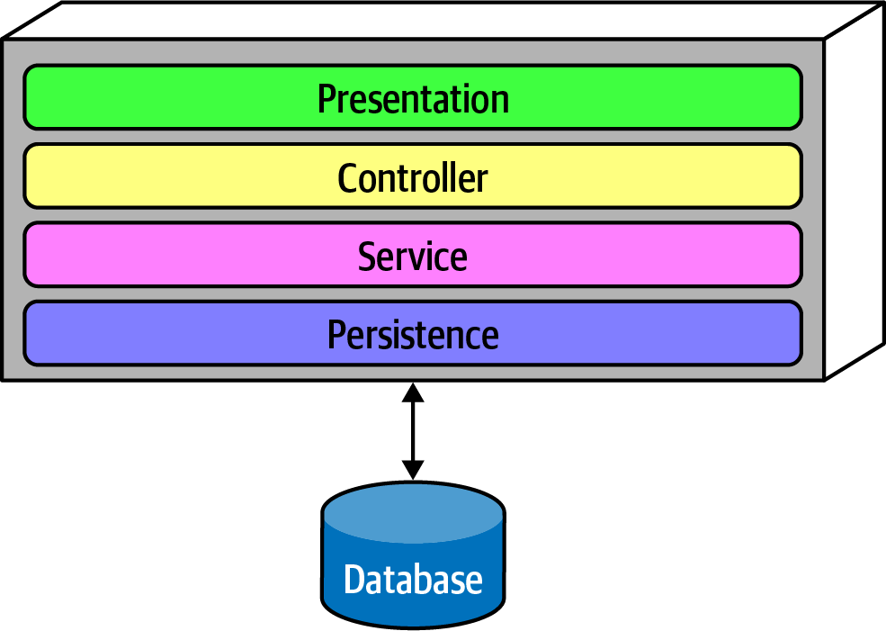

# 第 6 章 衡量与治理架构特性

> 原文章名：Measuring and Governing Architecture Characteristics
> 来源：英文第一版，书内第 77–89 页，PDF 第 97–109 页。
> 校译进度：本轮已完成全文逐段对照与中文通读；详见[校译记录](../../reviews/chapter-06-review.md)。
> 保留英文原图与原书代码，中文标签对照见文末；下文页码均指原书书内页码。示例反映本版原书内容，并非针对当前库版本验证的可运行工程。
> 独立复审：本章原文对照、中文通读、图、代码、公式及相关自测题已核查，见[独立复审记录](../../reviews/independent-pass/chapter-06.md)。原书代码和图论说明的问题保留正文并以译注说明。

<!-- 书内第 77 页，PDF 第 97 页。 -->

<!-- CH06-001 -->

架构师必须应对软件项目各个方面多种多样的架构特性。性能、弹性和可扩展性等运维方面，与模块化、可部署性等结构关注点交织在一起。本章重点介绍如何具体定义一些常见架构特性，并为它们建立治理机制。

## 衡量架构特性

<!-- CH06-002 -->

组织在定义架构特性时，存在几个常见问题：

**它们不是物理学**

<!-- CH06-003 -->

许多常用架构特性的含义很模糊。例如，架构师如何针对敏捷性或可部署性进行设计？行业对常见术语的看法差异很大，有时源于合理的背景差异，有时则出于偶然。

**定义差异巨大**

<!-- CH06-004 -->

即使在同一组织内部，不同部门对性能等关键特征的定义也可能不一致。在开发、架构和运维对定义达成共识之前，很难进行恰当讨论。

<!-- 书内第 78 页，PDF 第 98 页。 -->

**包含过多子特性**

<!-- CH06-005 -->

许多期望具备的架构特性，是由多项更细的特性组成的。例如，开发者可以将敏捷性分解为模块化、可部署性和可测试性。

<!-- CH06-006 -->

对架构特性做出客观定义，可以解决这三个问题：在整个组织内，对具体定义取得一致，团队就能建立围绕架构的统一语言。同时，鼓励采用客观定义，也会促使团队拆解复合特性，找出能够客观定义和衡量的特征。

### 运维度量

<!-- CH06-007 -->

许多架构特性有明显的直接度量方式，例如性能或可扩展性。不过，即便是它们，也会因团队目标不同而有多种细微解释。例如，团队可能衡量某些请求的平均响应时间，这是运维架构特性度量的好例子。但如果只看平均值，而某个边界条件使 1% 的请求耗时达到其他请求的十倍，会怎样？如果网站流量足够大，这些离群值甚至可能无法在平均值中显现。因此，团队可能还希望衡量最大响应时间，以发现异常值。

#### 性能的多种形式

<!-- CH06-008 -->

本书描述的许多架构特性，都有多种存在细微差别的定义。性能就是一个好例子。许多项目关注总体性能，例如 Web 应用的请求与响应周期耗时多久。然而，架构师与 DevOps 工程师已经为建立性能预算（performance budgets）投入大量工作：为应用的特定部分设定专门预算。例如，许多组织研究用户行为后，认为首次页面渲染，也就是浏览器或移动设备中网页首次出现可见进展的最佳时间为 500 毫秒，即半秒；大多数应用在这一指标上落在两位数范围。对试图吸引尽可能多用户的现代网站而言，这是一个重要跟踪指标，背后的组织已经建立了极其细致的度量。

> 译注：原文在“两位数范围”处未给出单位；译文不自行补充。

<!-- CH06-009 -->

一些指标还会进一步影响应用设计。许多有前瞻性的组织，为页面下载设置以 KB 计的体积预算（K-weight budgets）：限制特定页面允许使用的库与框架的总字节数。其依据是物理约束：网络在一定时间内能够传输的字节数有限，尤其对于高延迟地区的移动设备而言。

<!-- 书内第 79 页，PDF 第 99 页。 -->

<!-- CH06-010 -->

高水平团队不只是设定硬性的性能数字，还会基于统计分析建立定义。例如，某个视频流服务希望监控可扩展性。工程师不会随意指定一个数字作为目标，而是随时间测量负载规模，建立统计模型，并在实时指标偏离预测模型时发出警报。偏离可能意味着两件事：模型不正确，或者系统出了问题；两者都是团队希望知道的。

<!-- CH06-011 -->

随着工具与认识不断细化，团队可以衡量的特性类型也在快速演进。例如，许多团队近来关注[首次内容绘制（first contentful paint）](https://oreil.ly/mAHFZ)和首次 CPU 空闲（first CPU idle）等指标的性能预算，它们都能揭示移动设备用户浏览网页时遇到的性能问题。随着设备、目标、能力及其他许多因素改变，团队会不断找到新的衡量对象和方式。

### 结构度量

<!-- CH06-012 -->

有些客观度量不像性能那么明显。如何衡量内部结构特性，例如良好的模块化？遗憾的是，目前还不存在全面衡量内部代码质量的指标。不过，一些指标与常用工具仍能帮助架构师处理代码结构中的关键方面，尽管只能覆盖较窄的维度。

<!-- CH06-013 -->

代码中一个显然可以衡量的方面，是由圈复杂度指标定义的复杂程度。

#### 圈复杂度

<!-- CH06-014 -->

圈复杂度（Cyclomatic Complexity，CC）是一项代码级指标，由 Thomas McCabe, Sr. 于 1976 年提出，用于在函数或方法、类、应用层面，客观衡量代码复杂程度。

<!-- CH06-015 -->

它通过将图论应用于代码进行计算，具体关注造成不同执行路径的决策点。例如，函数中如果没有决策语句，如 `if`，则 CC = 1；如果有一个条件判断，则 CC = 2，因为存在两条可能的执行路径。

<!-- CH06-016 -->

计算单个函数或方法圈复杂度的公式为：

<!-- CH06-017 -->

$$
CC=E-N+2
$$

<!-- CH06-018 -->

其中，N 表示节点，原文解释为代码行；E 表示边，原文解释为可能的决策。请看示例 6-1 中类似 C 的代码。

<!-- 书内第 80 页，PDF 第 100 页。 -->

*示例 6-1：用于评估圈复杂度的代码。*

<!-- CH06-019 -->

```java
public void decision(int c1, int c2) {
    if (c1 < 100)
        return 0;
    else if (c1 + C2 > 500)
        return 1;
    else
        return -1;
}
```

<!-- CH06-020 -->

示例 6-1 的圈复杂度为 3，即 3 − 2 + 2；图示见图 6-1。

> 译注：原书代码返回类型为 `void`，却返回数值；`C2` 与参数 `c2` 的大小写也不同。图 6-1 中的变量还出现 `cl`，分支返回值的位置与代码不完全一致。此处保留原书。标准公式中的 N、E 应按控制流图的节点和边计数，不能直接取代码行数与决策数；原书的图与“3 − 2 + 2”不足以作为严格计数示例。核验依据见[本章独立复审记录](../../reviews/independent-pass/chapter-06.md)。



*图 6-1：decision 函数的圈复杂度。*

<!-- CH06-021 -->

公式中的数字 2，是针对单个函数或方法的简化。对于向其他方法扇出调用的情况，原文将其称为图论中的连通分量，更一般的公式为：

<!-- CH06-022 -->

$$
CC=E-N+2P
$$

<!-- CH06-023 -->

其中，P 表示连通分量的数量。

> 译注：上段将向其他方法的扇出调用与连通分量相联系，按原书保留；两者并非同义概念，不能直接以扇出调用数作为 P。

<!-- CH06-024 -->

架构师与开发者普遍认同，过度复杂的代码是一种代码异味；它几乎损害代码库所有期望的特性：模块化、可测试性、可部署性等。但如果团队不关注逐步增长的复杂性，复杂性最终就会主导代码库。

<!-- 书内第 81 页，PDF 第 101 页。 -->

#### 圈复杂度多少才合适？

<!-- CH06-025 -->

讨论这个主题时，作者经常被问到：CC 的合理阈值是多少？当然，像软件架构中的所有问题一样：视情况而定！这取决于问题领域的复杂程度。例如，如果问题本身在算法上复杂，方案也会产生复杂的函数。架构师应监控 CC 的几个关键方面：函数复杂是因为问题领域，还是因为编码不佳？或者，代码划分是否不合理？换句话说，能否将一个大方法拆成更小的逻辑块，将工作与复杂性分配给更多组织良好的方法？

<!-- CH06-026 -->

一般来说，如果不考虑复杂领域等其他因素，行业常用的 CC 阈值认为小于 10 可以接受。我们觉得这个阈值很高，更希望代码低于 5，体现高内聚、良好分解的结构。Java 领域的度量工具 [Crap4J](http://www.crap4j.org)，结合 CC 与代码覆盖率，尝试判断代码有多糟糕：如果 CC 超过 50，再高的代码覆盖率也救不了它。Neal 在职业生涯中见过最可怕的代码，是某商业软件包核心的一个 C 函数，CC 超过 800！这个函数有 4,000 多行代码，大量使用 `GOTO` 语句，以跳出深得难以置信的嵌套循环。

<!-- CH06-027 -->

测试驱动开发（test-driven development，TDD）等工程实践，往往会产生一个意外但积极的副作用：对给定问题领域，方法平均更小、更简单。采用 TDD 时，开发者先写一个简单测试，再编写使测试通过的最少代码。着眼于各个具体行为，并划清测试边界，有助于形成结构合理、高内聚、CC 较低的方法。

### 流程度量

<!-- CH06-028 -->

有些架构特性与软件开发流程相交。例如，敏捷性经常被视为理想特征，但它是一项复合架构特性，架构师可以将其分解为可测试性、可部署性等。

<!-- CH06-029 -->

几乎所有平台都有代码覆盖率工具，可以评估测试完整程度，从而衡量可测试性。与所有软件检查一样，这类工具不能代替思考，使用时仍须明确检验的目的。例如，代码库可以达到 100% 覆盖率，却使用很弱的断言，实际上不能提升对代码正确性的信心。但可测试性显然是一项可客观衡量的特性。同样，团队也可以通过多种指标衡量可部署性：成功与失败部署的比例、部署耗时、部署导致的问题与缺陷等。每个团队都有责任选出合适的一组度量指标，使收集到的数据在质量和数量上都能满足本组织的需要。许多指标最终取决于团队优先级与目标。

<!-- 书内第 82 页，PDF 第 102 页；上一段跨页。 -->

<!-- CH06-030 -->

敏捷性及其组成部分显然与软件开发流程有关，但流程也可能影响架构结构。例如，如果易于部署和测试是高优先级目标，架构师就会在架构层面更加重视模块化与隔离，这正是架构特性驱动结构决策的例子。只要满足本书的三个标准，软件项目范围内几乎任何方面都可能上升为架构特性，迫使架构师通过设计决策将其纳入考虑。

## 治理与适应度函数

<!-- CH06-031 -->

架构师确定架构特性并排列优先级之后，如何确保开发者遵循这些优先级？模块化就是一个好例子：它重要，却不紧急。许多软件项目总是优先处理紧急事项，但架构师仍然需要治理机制。

### 治理架构特性

<!-- CH06-032 -->

治理（governance）源于希腊词 kubernan，意思是“掌舵”，是架构师角色的一项重要职责。顾名思义，架构治理涵盖软件开发流程中架构师（包括企业架构师等角色）希望施加影响的任何方面。例如，确保组织内的软件质量属于架构治理，因为它处在架构范围内，疏忽可能导致灾难性的质量问题。

<!-- CH06-033 -->

幸运的是，越来越成熟的解决方案，可以减轻架构师处理这一问题的负担，这体现了软件开发生态系统的能力在逐步提升。[极限编程](http://www.extremeprogramming.org)推动的软件项目自动化催生了持续集成，又进一步推动运维自动化，也就是如今所说的 DevOps，并延伸到架构治理。[《构建演进式架构》](http://shop.oreilly.com/product/0636920080237.do)介绍了一组称为适应度函数的技术，用于自动化架构治理的许多方面。

<!-- 书内第 83 页，PDF 第 103 页。 -->

### 适应度函数

<!-- CH06-034 -->

《构建演进式架构》中的“演进”，更多来自演化计算，而非生物学。该书作者之一 Rebecca Parsons 博士，曾在演化计算领域工作，包括遗传算法等工具。遗传算法运行后产生一个解，再利用演化计算领域的成熟技术进行变异。如果开发者希望设计遗传算法来产生有益结果，往往就需要引导算法，提供衡量结果质量的客观指标。这种引导机制称为适应度函数：用于评估输出距离目标有多近的目标函数。例如，开发者需要解决著名的[旅行商问题](https://oreil.ly/GApjt)，它也是机器学习研究中的一个基础问题。给定一位旅行商、必须访问的城市清单以及城市间距离，最优路线是什么？如果使用遗传算法解决，某个适应度函数可以评估路线长度，越短越成功；另一个可以评估路线总成本，尽量降低成本；还可以评估旅行商离家时间，优化以缩短总旅行时间。

<!-- CH06-035 -->

演进式架构实践借用这一概念，形成架构适应度函数：

**架构适应度函数**

<!-- CH06-036 -->

任何能够客观评估某项架构特性或一组架构特性是否得到保持的机制。

<!-- CH06-037 -->

适应度函数并不是供架构师下载的新框架，而是看待许多现有工具的新视角。注意定义中的“任何机制”：架构特性各不相同，验证技术也同样多样。取决于使用方式，适应度函数与许多现有验证机制重叠，包括度量指标、监控、单元测试库、混沌工程等，如图 6-2 所示。

<!-- 书内第 84 页，PDF 第 104 页。 -->



*图 6-2：适应度函数的机制。*

<!-- CH06-038 -->

根据架构特性，可以使用许多不同工具实现适应度函数。例如，第 44 页“耦合”中介绍了用于评估模块化的指标。下面给出几个适应度函数示例，测试模块化的不同方面。

#### 循环依赖

<!-- CH06-039 -->

模块化是大多数架构师关注的隐式架构特性，因为维护不善会破坏代码库结构，因此，架构师应高度重视良好的模块化。然而，许多平台上的某些力量，却与这一良好意图相悖。例如，在流行的 Java 或 .NET 开发环境中，只要开发者引用一个尚未导入的类，IDE 就会热心弹出对话框，询问是否自动导入。由于这种情况频繁发生，大多数程序员几乎会条件反射般地确认自动导入提示。然而，随意在类或组件之间添加导入关系，会给模块化带来灾难。图 6-3 展示了一种架构师力求避免、破坏性尤其强的反模式。

<!-- 书内第 85 页，PDF 第 105 页。 -->



*图 6-3：组件之间的循环依赖。*

<!-- CH06-040 -->

图 6-3 中，每个组件都引用其他组件中的内容。这种组件网络破坏了模块化，因为开发者无法单独复用一个组件，而不带上其他组件。如果那些组件又耦合到更多组件，架构就越来越接近[大泥球（Big Ball of Mud）](https://oreil.ly/usx7p)反模式。架构师如何治理这种行为，而不必一直盯着那些习惯性快速确认导入的开发者？代码评审有帮助，但在开发周期中发生得太晚，效果有限。如果允许团队随意跨代码库导入一周，再做评审，代码库已经受到严重损害。

<!-- CH06-041 -->

解决办法是编写适应度函数来监控循环，如示例 6-2 所示。

*示例 6-2：检测组件循环的适应度函数。*

<!-- CH06-042 -->

```java
public class CycleTest {
    private JDepend jdepend;

    @BeforeEach
    void init() {
        jdepend = new JDepend();
        jdepend.addDirectory("/path/to/project/persistence/classes");
        jdepend.addDirectory("/path/to/project/web/classes");
        jdepend.addDirectory("/path/to/project/thirdpartyjars");
    }

    @Test
    void testAllPackages() {
        Collection packages = jdepend.analyze();
        assertEquals("Cycles exist", false, jdepend.containsCycles());
    }
}
```

<!-- 书内第 86 页，PDF 第 106 页；示例 6-2 在原书中跨页。 -->

<!-- CH06-043 -->

代码中，架构师使用 [JDepend](https://oreil.ly/ozzzk) 度量工具检查包之间的依赖。工具理解 Java 包结构，一旦存在循环就让测试失败。架构师可以将测试接入项目的持续构建，不必再担心开发者随手导入而意外引入循环。这是适应度函数守护软件开发中“重要但不紧急”实践的好例子：这是架构师重视的关注点，却很少影响日常编码。

#### 到主序列距离的适应度函数

<!-- CH06-044 -->

第 44 页“耦合”中，我们介绍了较为冷门的指标“到主序列的距离”，架构师也可以使用适应度函数验证，如示例 6-3 所示。

*示例 6-3：到主序列距离的适应度函数。*

<!-- CH06-045 -->

```java
@Test
void AllPackages() {
    double ideal = 0.0;
    double tolerance = 0.5; // project-dependent
    Collection packages = jdepend.analyze();
    Iterator iter = packages.iterator();
    while (iter.hasNext()) {
        JavaPackage p = (JavaPackage)iter.next();
        assertEquals("Distance exceeded: " + p.getName(),
            ideal, p.distance(), tolerance);
    }
}
```

代码注释 `project-dependent` 表示容差取决于项目。

<!-- CH06-046 -->

代码中，架构师用 JDepend 设置可接受值的阈值；如果某个类超出范围，就使测试失败。

> 译注：原文这里写“类”，示例实际遍历 `JavaPackage`；分别保留，不混淆其分析层级。

<!-- CH06-047 -->

这个例子既体现了客观衡量架构特性的方式，也说明开发者与架构师在设计和实现适应度函数时，协作至关重要。目的不是让一群架构师登上象牙塔，开发出开发者无法理解的晦涩适应度函数。

<!-- CH06-048 -->

> 架构师必须先确保开发者理解适应度函数的目的，再要求他们遵守。

<!-- 书内第 87 页，PDF 第 107 页。 -->

<!-- CH06-049 -->

过去几年，适应度函数工具不断成熟，也出现了一些专用工具。例如 [ArchUnit](https://www.archunit.org)，它是受到 [JUnit](https://junit.org) 启发、并使用 JUnit 生态部分能力的 Java 测试框架。ArchUnit 提供多种以单元测试形式表达的预定义治理规则，也允许架构师编写专门测试来检查模块化。请看图 6-4 的分层架构。



*图 6-4：分层架构。*

<!-- CH06-050 -->

设计图 6-4 这样的分层单体时，架构师划分各层有充分理由；第 10 章会介绍分层架构的动机、权衡等。但如何确保开发者遵守这些分层约束？一些开发者可能不理解模式的重要性，另一些则可能因性能等压倒性的局部关注点，抱着“事后道歉好过事先请示”的态度。然而，任由实现过程逐渐背离架构的设计初衷，会损害架构的长期健康。

<!-- CH06-051 -->

ArchUnit 允许架构师通过适应度函数处理这一问题，见示例 6-4。

*示例 6-4：治理分层的 ArchUnit 适应度函数。*

<!-- CH06-052 -->

```java
layeredArchitecture()
    .layer("Controller").definedBy("..controller..")
    .layer("Service").definedBy("..service..")
    .layer("Persistence").definedBy("..persistence..")
    .whereLayer("Controller").mayNotBeAccessedByAnyLayer()
    .whereLayer("Service").mayOnlyBeAccessedByLayers("Controller")
    .whereLayer("Persistence").mayOnlyBeAccessedByLayers("Service")
```

<!-- CH06-053 -->

示例 6-4 中，架构师定义层间期望的关系，并编写验证性适应度函数加以治理。

<!-- 书内第 88 页，PDF 第 108 页。 -->

<!-- CH06-054 -->

.NET 中的类似工具 [NetArchTest](https://oreil.ly/EMXpv)，也支持这一平台上的类似测试；C# 分层验证见示例 6-5。

*示例 6-5：使用 NetArchTest 验证层依赖。*

<!-- CH06-055 -->

```csharp
// Classes in the presentation should not directly reference repositories
var result = Types.InCurrentDomain()
    .That()
    .ResideInNamespace("NetArchTest.SampleLibrary.Presentation")
    .ShouldNot()
    .HaveDependencyOn("NetArchTest.SampleLibrary.Data")
    .GetResult()
    .IsSuccessful;
```

代码注释：表现层中的类不应直接引用仓储。

<!-- CH06-056 -->

适应度函数的另一个例子，是 Netflix 的 Chaos Monkey 及其相关工具集 Simian Army。尤其是 Conformity Monkey、Security Monkey 和 Janitor Monkey，体现了这一方法。Conformity Monkey 允许 Netflix 架构师定义治理规则，由工具在生产环境中执行。例如，如果架构师决定，每个服务都应该对所有 RESTful 动词提供有意义的响应，就将这一检查加入其中。类似地，Security Monkey 检查每个服务已知的安全缺陷，例如不应开放的端口和配置错误。最后，Janitor Monkey 查找不再有其他服务路由到的实例。Netflix 采用演进式架构，开发者经常迁移到新服务，而旧服务仍在运行，却已没有与之协作的服务。由于云上运行服务需要花钱，Janitor Monkey 会查找这些孤立服务，并将它们从生产环境中清除。

#### Simian Army 的起源

<!-- CH06-057 -->

当 Netflix 决定将运维迁移到 Amazon 云时，架构师担心自己不再掌控运维：如果运维层面出现故障怎么办？为解决这一问题，他们通过最初的 Chaos Monkey，最终发展出 Simian Army，并推动混沌工程（Chaos Engineering）这门实践的形成。

<!-- CH06-058 -->

Chaos Monkey 在生产环境中模拟各种混乱，观察系统能承受多大影响。一些 AWS 实例存在延迟问题，因此 Chaos Monkey 会模拟高延迟；这一问题严重到后来还为此创建了专门的 Latency Monkey。[Chaos Kong](https://oreil.ly/GipHq) 等工具模拟整个 Amazon 数据中心失效，帮助 Netflix 在真实发生这类故障时避免服务中断。

<!-- CH06-059 -->

混沌工程提供了一个有趣的新架构视角：问题不在于最终会不会出故障，而在于何时出故障。预想这些故障，并通过测试防范其影响，会让系统健壮得多。

<!-- 书内第 89 页，PDF 第 109 页。 -->

<!-- CH06-060 -->

几年前，Atul Gawande 的著作[《清单革命》（The Checklist Manifesto，Picador 出版）](https://oreil.ly/XNcV9)影响广泛，介绍了飞行员与外科医生等职业如何使用检查清单，有时甚至是法律要求。这不是因为他们不懂自己的工作或健忘，而是当专业人员一遍遍执行细节繁多的工作时，很容易遗漏细节；简明清单能有效提醒。看待适应度函数也应如此：它不是一套繁重的治理机制，而是让架构师能够表达重要的架构原则，并自动验证这些原则是否得到遵守。开发者知道不应该发布不安全的代码，但对忙碌的开发者来说，这项要求必须与几十甚至几百项其他要求争夺优先级。Security Monkey 这样的具体工具，以及更广义的适应度函数，让架构师能够把重要的治理检查写成代码，融入架构的基础之中。

---

## 图中文字中文对照（译者整理）

### 图 6-1

节点（nodes）、边（edges）。原图的条件与返回代码按图保留；与示例 6-1 的差异见正文译注。

### 图 6-2

适应度函数（Fitness functions）、度量指标（Metrics）、监控（Monitors）、单元测试（Unit tests）、混沌工程（Chaos engineering），以及省略号表示的其他机制。

### 图 6-3

组件中的 code 为“代码”；双向箭头表示组件之间相互依赖。

### 图 6-4

自上而下：表现层（Presentation）、控制器层（Controller）、服务层（Service）、持久化层（Persistence）；底部：数据库（Database）。
