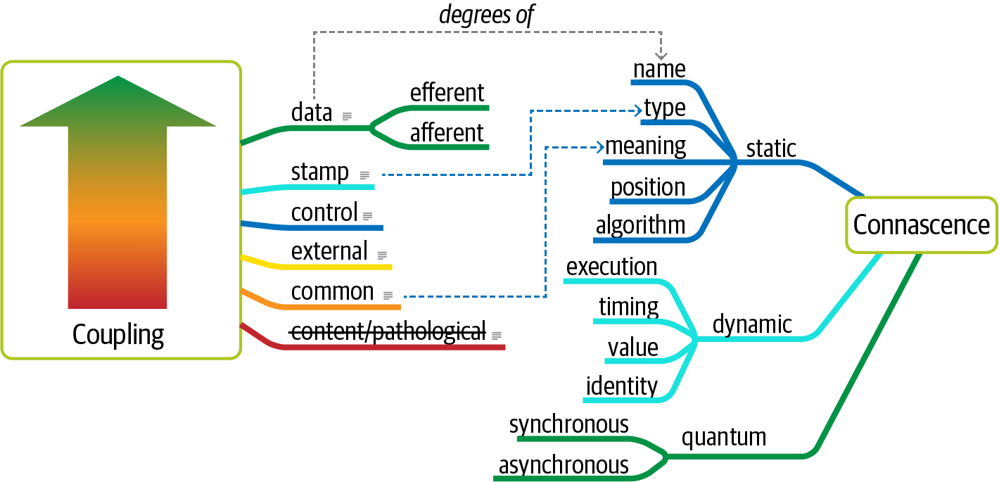

# 第 7 章 架构特性的作用范围

> 原文章名：Scope of Architecture Characteristics
> 来源：英文第一版，书内第 91–98 页，PDF 第 111–118 页。
> 校译进度：本轮已完成全文逐段对照与中文通读；详见[校译记录](../../reviews/chapter-07-review.md)。
> 保留英文原图，中文标签对照见文末；下文页码均指原书书内页码。

<!-- 书内第 91 页，PDF 第 111 页。 -->

<!-- CH07-001 -->

传统上，软件架构领域有一个普遍被视为公理的假设：架构特性的作用范围是整个系统。例如，架构师谈论可扩展性时，通常讨论的是整个系统的可扩展性。十年前，这个假设很稳妥，因为几乎所有系统都是单体。随着现代工程技术及其所支持的架构风格（如微服务）的出现，架构特性的作用范围显著缩小。这正是一个典型例子：软件开发生态系统持续演进，使原本的公理逐渐过时。

<!-- CH07-002 -->

编写[《构建演进式架构》](http://evolutionaryarchitecture.com)时，作者们需要一种技术，衡量特定架构风格在结构上的可演进性。但现有度量都无法提供恰当的细节层次。第 79 页“结构度量”讨论了多种代码级指标，可用于分析架构的结构方面。不过，它们只能揭示代码底层细节，无法评估代码库所依赖的外部组件，例如数据库，而这些组件仍会影响许多架构特性，尤其是运维特性。例如，不论架构师为高性能或弹性代码库付出多少努力，如果数据库不具备相匹配的特性，应用也无法成功。

<!-- CH07-003 -->

评估许多运维架构特性时，架构师必须考虑代码库所依赖、且会影响这些特性的外部组件。因此，需要另一种衡量这类依赖的方法。这促使《构建演进式架构》的作者定义了架构量子这一术语。为理解其定义，我们必须先回顾一个关键指标：共变性。

<!-- 书内第 92 页，PDF 第 112 页。 -->

## 耦合与共变性

<!-- CH07-004 -->

许多代码级耦合指标，例如传入与传出耦合，见第 79 页“结构度量”，所揭示的细节粒度过细，不适合架构分析。1996 年，Meilir Page-Jones 出版《每位程序员都应了解的面向对象设计知识》（What Every Programmer Should Know About Object Oriented Design，Dorset House 出版），提出了几项新的耦合度量，统称共变性，定义如下：

**共变性**

<!-- CH07-005 -->

如果修改一个组件时，必须同时修改另一个组件，才能保持系统整体的正确性，那么这两个组件就具有共变性。

<!-- CH07-006 -->

他定义了两类共变性：可以通过静态代码分析发现的静态共变性，以及涉及运行时行为的动态共变性。为了定义架构量子，我们需要衡量组件如何连接在一起，这与共变性概念相对应。例如，如果微服务架构中的两个服务共享某个类的定义，例如地址类，我们就说它们之间存在静态共变性：修改共享类，就需要修改这两个服务。

<!-- CH07-007 -->

对于动态共变性，我们定义两种类型：同步与异步。两个分布式服务之间的同步调用，会让调用方等待被调用方响应；另一方面，异步调用在事件驱动架构中允许“发送后不等待响应”（fire-and-forget）的语义，使两个服务在运维架构方面可以有所不同。

## 架构量子与粒度

<!-- CH07-008 -->

将软件绑定在一起的，不仅是组件级耦合。许多业务概念还会从语义上将系统各部分关联起来，形成功能内聚。要成功设计、分析和演进软件，开发者必须考虑所有可能出问题的耦合点。

<!-- CH07-009 -->

许多了解科学的开发者都知道物理学中的量子概念：参与某种相互作用的物理实体的最小量。quantum 一词源于拉丁语，意思是“多大”或“多少”。我们借用这个概念，定义架构量子（architecture quantum）：

**架构量子**

<!-- CH07-010 -->

一个可独立部署、具有高功能内聚性和同步共变性的制品。

<!-- 书内第 93 页，PDF 第 113 页。 -->

<!-- CH07-011 -->

这个定义包含几个部分，下面逐一拆解：

**可独立部署**

<!-- CH07-012 -->

架构量子包含独立于架构其他部分运行所需的全部组件。例如，如果应用使用数据库，数据库就是量子的一部分，因为没有它，系统无法工作。这意味着，几乎所有使用单个数据库部署的遗留系统，按定义都只有一个量子。然而，在微服务架构风格中，每个服务包含自己的数据库，这是微服务背后的限界上下文理念的一部分，第 17 章会详细介绍，因此一个架构中会形成多个量子。

**高功能内聚性**

<!-- CH07-013 -->

组件设计中的内聚，指所含代码在目的上的统一程度。例如，客户组件的属性和方法都围绕客户实体，体现高内聚；而工具组件随机收集各种杂项方法，就不具备这种性质。

<!-- CH07-014 -->

高功能内聚性意味着，架构量子具有明确目的。这种区分对采用单个数据库的传统单体应用意义不大。但在微服务架构中，开发者通常设计每个服务对应单一工作流，原文将其称为限界上下文，见第 94 页“领域驱动设计的限界上下文”，从而体现高功能内聚。

> 译注：本段将“单一工作流”与“限界上下文”并列对应，是本版作者的表述；学习领域建模时不应仅凭这句话将两者等同。

**同步共变性**

<!-- CH07-015 -->

同步共变性（synchronous connascence）意味着，在一个应用上下文内部，或在共同构成该架构量子的分布式服务之间，存在同步调用。例如，微服务架构中的一个服务同步调用另一个服务时，两者的运维架构特性不能相差悬殊。如果调用方的可扩展能力远高于被调用方，就会出现超时与其他可靠性问题。因此，同步调用会在调用持续期间产生动态共变性：如果一方等待另一方，那么在调用期间，它们的运维架构特性就必须一致。

<!-- CH07-016 -->

前面第 6 章中，我们定义了传统耦合指标与共变性之间的关系，但没有包含这里新增的通信共变性度量。图 7-1 更新了这张图。

> 译注：原文此处引用第 6 章；对应的统一图实际见第 3 章图 3-6。保留原书章节引用，并在此提示回查位置。

<!-- 书内第 94 页，PDF 第 114 页。 -->

*图 7-1：在统一图中增加量子共变性。*

<!-- CH07-017 -->

再看一个例子：微服务架构包含支付服务与拍卖服务。拍卖结束时，拍卖服务将支付信息发送给支付服务。但假设支付服务每 500 毫秒只能处理一笔支付，当大量拍卖同时结束时会怎样？设计不佳的架构，会让第一个调用通过，其余调用超时。另一种方式是，在拍卖与支付之间设计异步通信链路，让消息队列暂时缓冲两者的差异。在这种情况下，异步共变性使架构更灵活。第 14 章将详细介绍这一主题。

### 领域驱动设计的限界上下文

<!-- CH07-018 -->

Eric Evans 的《领域驱动设计》（Domain-Driven Design，Addison-Wesley Professional 出版）深刻影响了现代架构思维。[领域驱动设计（domain-driven design，DDD）](https://dddcommunity.org)是一种建模技术，支持有组织地分解复杂问题领域。DDD 定义了限界上下文（bounded context）：与该领域相关的一切在内部可见，对其他限界上下文则不透明。在 DDD 之前，开发者试图在整个组织内复用通用实体。但创建公共共享制品会引起许多问题，例如耦合、协调更困难、复杂性增加。限界上下文承认，实体最适合在各自的局部上下文中使用。因此，与其创建整个组织统一的客户类，不如让每个问题领域创建自己的客户类，再在集成点协调差异。

<!-- 书内第 95 页，PDF 第 115 页。 -->

<!-- CH07-019 -->

架构量子为架构特性提供了新的作用范围。在现代系统中，架构师在量子层面，而非系统层面定义架构特性。将重要运维关注点放在更窄的范围内观察，可以更早识别架构挑战，进而形成混合架构。为说明架构量子所提供的范围划分，下面考虑另一个架构 Kata：Going, Going, Gone。

## 案例研究：Going, Going, Gone

<!-- CH07-020 -->

第 5 章介绍了架构 Kata 概念。下面这个练习涉及一家在线拍卖公司，描述如下：

**描述**

<!-- CH07-021 -->

一家拍卖公司希望将拍卖搬到线上，覆盖全国。客户选择参加的拍卖，等待拍卖开始，然后像身处拍卖师所在的现场一样竞价。

**用户**

<!-- CH07-022 -->

每场拍卖可扩展到数百名参与者，可能达到数千名，并支持尽可能多的拍卖同时进行。

**需求**

<!-- CH07-023 -->

- 拍卖应尽可能实时。
- 竞拍者使用信用卡注册；竞拍成功后，系统自动扣款。
- 必须通过信誉指数跟踪参与者。
- 竞拍者能够观看拍卖直播视频，以及实时出现的所有出价。
- 线上和现场的出价，都必须按提交顺序接收。

**补充背景**

<!-- CH07-024 -->

- 拍卖公司正在通过并购较小竞争对手积极扩张。
- 预算不受限制，这是公司的战略方向。
- 公司刚刚通过和解结束一桩涉嫌欺诈的诉讼。

<!-- CH07-025 -->

与第 69 页“案例研究：Silicon Sandwiches”一样，架构师必须考虑每项需求，确定其中的架构特性：

**1. “全国规模”“每场数百人，可能达到数千人，尽可能多场同时进行”“拍卖尽可能实时”。**

<!-- 书内第 96 页，PDF 第 116 页。 -->

<!-- CH07-026 -->

这些需求既意味着支持大量用户的可扩展性，也意味着支持拍卖突发流量的弹性。需求明确提出了可扩展性，弹性则是基于问题领域的隐式特性。拍卖时，用户会在整个竞价期间礼貌地均匀分布，还是越接近结束越急切地出价？要发现隐式架构特性，领域知识至关重要。考虑到拍卖的实时性质，架构师肯定也会将性能视为关键架构特性。

**2. “竞拍者使用信用卡注册，获胜后自动扣款”“公司刚刚通过和解结束涉嫌欺诈的诉讼”。**

<!-- CH07-027 -->

两项要求都明确指向安全性。如第 5 章所述，安全性几乎是每个应用的隐式架构特性。因此，架构师依赖定义中的第二部分：是否影响设计的某个结构方面。应专门设计结构来支持安全，还是基本的设计和编码规范已经足够？架构师已经发展出一些通过设计安全处理信用卡的技术，而不必构建专门结构。例如，只要确保不以明文存储信用卡号、传输时进行加密等，就不应需要特殊的安全结构安排。

<!-- CH07-028 -->

但第二句话应促使架构师停下来，要求进一步澄清。显然，过去某个安全方面，即欺诈，出过问题；因此，不论计划设计什么级别的安全，架构师都应寻求更多信息。

**3. “必须通过信誉指数跟踪参与者”。**

<!-- CH07-029 -->

这项需求可能引出“防捣乱性”等异想天开的名字，但“跟踪”一词，也可能提示可审计性、可日志记录性等架构特性。判断仍回到定义中的关键问题：这是否超出了问题领域的范围？架构师必须记住，产生架构特性的分析，仅占应用整体设计和实现工作的很小一部分，后面还有大量设计工作！在架构定义的这个阶段，架构师寻找的是领域本身没有涵盖、又会影响结构的要求。

<!-- CH07-030 -->

一个有用的判断方法是：实现它是否需要领域知识，还是它属于抽象的架构特性？在 Going, Going, Gone 练习中，架构师遇到“信誉指数”，会找业务分析师或其他领域专家，解释其具体含义。换句话说，它不像常见架构特性那样有标准定义。反过来，讨论弹性，也就是应对突发用户的能力时，可以不依赖具体领域，从抽象层面讨论，无论应用是银行系统、商品目录网站，还是流媒体视频服务。架构师必须判断某项要求是否超出了领域本身的范围，并且需要特定结构支持；如果是，才将其视为架构特性。

<!-- 书内第 97 页，PDF 第 117 页；上一段跨页。 -->

**4. “拍卖公司正在通过并购较小竞争对手积极扩张”。**

<!-- CH07-031 -->

这项要求可能不会立刻影响应用设计，却可能成为几个候选方案之间权衡的决定性因素。例如，架构师经常需要为集成架构选择通信协议等细节。如果不必考虑与新并购公司集成，就可以选择高度贴合当前问题的方案；另一方面，为兼顾互操作性等额外因素，也可能选择某个不那么完美的方案。这种细微的隐式架构特性遍布架构，也说明为什么做好这份工作很有挑战。

**5. “预算不受限制，这是公司的战略方向”。**

<!-- CH07-032 -->

一些架构 Kata 会施加预算限制，体现现实中常见的权衡。但 Going, Going, Gone 没有。这允许架构师选择更复杂或更专门化的架构，考虑到下一组需求，这会很有帮助。

**6. “竞拍者可观看拍卖直播视频及实时出价”“线上与现场出价必须按提交顺序接收”。**

<!-- CH07-033 -->

这些需求提出了一个有趣的架构挑战，肯定影响应用结构，也揭示出仅从系统整体评估架构特性的不足。考虑可用性：整个架构的需要是否一致？换句话说，某一名竞拍者的可用性，是否比数百名竞拍者中一人的可用性更重要？显然，架构师希望两者都有良好的可用性，但其中一方更关键：如果拍卖师无法访问网站，就没有任何人能在线出价。可靠性通常与可用性一起讨论，关注正常运行时间等运维表现，也关注数据完整性及其他反映应用可靠程度的指标。例如，在拍卖网站中，架构师必须确保消息顺序可靠且正确，消除竞态条件与其他问题。

> 译注：原文此处先写“one bidder”，随后以 auctioneer（拍卖师）解释关键一方；前后主体不完全一致，分别保留并注明。

<!-- 书内第 98 页，PDF 第 118 页。 -->

<!-- CH07-034 -->

Going, Going, Gone 的最后一组需求，说明架构特性需要比系统层面更细的作用范围。利用架构量子度量，架构师将架构特性的范围限定在量子层面。例如，本例中不同部分需要不同特性，明显可以区分的是：出价流、在线竞拍者和拍卖师。架构师利用架构量子，思考架构中的部署、耦合、数据应存放在哪里，以及通信风格。在这个 Kata 中，可以分别分析每个量子的特性，从而更早形成混合架构设计。

<!-- CH07-035 -->

因此，对 Going, Going, Gone，我们识别了以下量子及对应架构特性：

**竞拍者反馈（Bidder feedback）**

<!-- CH07-036 -->

涵盖出价流与拍卖视频流。

<!-- CH07-037 -->

- 可用性
- 可扩展性
- 性能

**拍卖师（Auctioneer）**

<!-- CH07-038 -->

现场拍卖师。

<!-- CH07-039 -->

- 可用性
- 可靠性
- 可扩展性
- 弹性
- 性能
- 安全性

**竞拍者（Bidder）**

<!-- CH07-040 -->

在线竞拍者与竞价。

<!-- CH07-041 -->

- 可靠性
- 可用性
- 可扩展性
- 弹性

---

## 图中文字中文对照（译者整理）

### 图 7-1

图沿用图 3-6 的标签：耦合（Coupling）、数据耦合（data）、传出（efferent）、传入（afferent）、印记耦合（stamp）、控制耦合（control）、外部耦合（external）、公共耦合（common）、内容或病态耦合（content/pathological，保留删除线）、“……的程度”（degrees of）；共变性（Connascence）分为静态（static）与动态（dynamic），具体类型为名称（name）、类型（type）、含义（meaning）、位置（position）、算法（algorithm）、执行（execution）、时机（timing）、值（value）、身份（identity）。新增量子（quantum）分支，下分同步（synchronous）与异步（asynchronous）。
