# 第 8 章 基于组件的思维

> 原文章名：Component-Based Thinking
> 来源：英文第一版，书内第 99–116 页，PDF 第 119–136 页。
> 上一轮校译记录：[校译记录](../../reviews/chapter-08-review.md)。
> 独立复审：已完成原文逐段对照、中文通读与相关附件检查，见[本次报告](../../reviews/independent-pass/chapter-08.md)。
> 保留英文原图，中文标签对照见文末；下文页码均指原书书内页码。

<!-- 书内第 99 页，PDF 第 119 页。 -->

<!-- CH08-001 -->

第 3 章将模块描述为相关代码的集合。然而，架构师通常以组件为单位思考，组件是模块的物理表现形式。开发者以不同方式对模块进行物理打包，有时取决于开发平台。我们将模块的物理打包称为组件。大多数语言也支持物理打包，例如 Java 的 JAR 文件、.NET 的 DLL、Ruby 的 gem 等。本章讨论围绕组件的架构考虑，从作用范围到如何发现组件。

## 组件的范围

<!-- CH08-002 -->

开发者发现，根据多种因素进一步区分组件概念很有用，图 8-1 展示了其中一些。

<!-- CH08-003 -->

组件提供特定于语言的机制，将代码制品组织起来，并经常通过嵌套形成层次。如图 8-1 所示，最简单的组件，在比类（非面向对象语言中则是函数）更高的模块化层次上封装代码。这种简单封装通常称为库（library），一般与调用代码运行在同一内存地址空间，通过语言的函数调用机制通信。库通常是编译时依赖，但也有明显例外，例如曾多年困扰 Windows 用户的动态链接库（DLL）。

<!-- 书内第 100 页，PDF 第 120 页。 -->

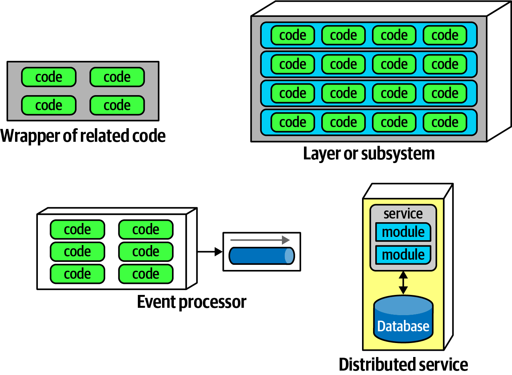

*图 8-1：组件的不同形式。*

<!-- CH08-004 -->

组件还可以表现为架构中的子系统或层，以及许多事件处理器中可部署的工作单元。另一种组件是服务（service），它通常运行在自己的地址空间，通过 TCP/IP 等低层网络协议，或 REST、消息队列等更高层的方式通信，在微服务等架构中形成独立的可部署单元。

<!-- CH08-005 -->

没有什么要求架构师必须使用组件，只是比语言提供的最低层次更高一级的模块化，往往很有用。例如，在微服务架构中，简单性是一项架构原则。因此，一个服务的代码量可能足以需要组件，也可能简单到只有少量代码，如图 8-2 所示。

<!-- CH08-006 -->

组件构成架构中基础的模块化构建单元，因此是架构师必须认真考虑的内容。事实上，架构师必须做出的主要决策之一，就是如何对架构中的组件进行顶层划分。

<!-- 书内第 101 页，PDF 第 121 页。 -->

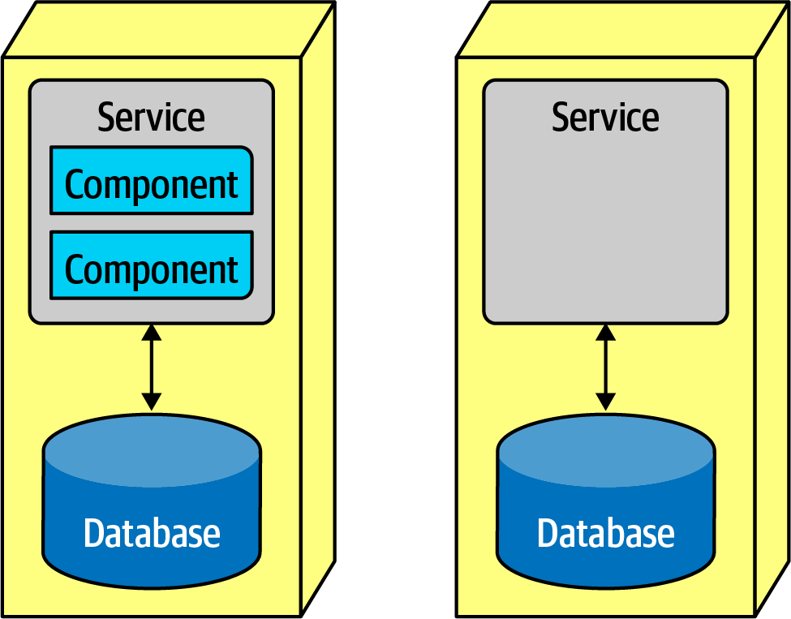

*图 8-2：一个微服务的代码可能少到不需要组件。*

## 架构师的角色

<!-- CH08-007 -->

通常，架构师定义、细化、管理并治理架构中的组件。软件架构师与业务分析师、领域专家、开发者、质量保证工程师、运维人员和企业架构师协作，将第 4 章讨论的架构特性与系统需求纳入考虑，创建初始软件设计。

<!-- CH08-008 -->

本书介绍的几乎所有细节，都独立于团队所采用的软件开发流程：架构独立于开发流程。主要例外是各种敏捷开发方法所开创的工程实践，尤其涉及部署与自动化治理的实践。不过，总体而言，软件架构与流程是分开的。因此，架构师最终无须拘泥于需求的获取流程：正式的联合应用设计（Joint Application Design，JAD）流程、漫长的瀑布式分析与设计、敏捷故事卡，或者它们的混合变体。

<!-- CH08-009 -->

一般来说，组件是架构师直接打交道的软件系统最低层次；第 6 章讨论的许多对代码库有整体影响的代码质量指标是例外。视实现平台而定，组件由类或函数组成；这些类或函数的设计由技术负责人或开发者负责。这不是说架构师不应该参与类设计，尤其在发现或应用设计模式时，而是应避免事无巨细地干预系统中从上到下的每一项决策。如果架构师从不允许其他角色做出有分量的决策，组织就很难让下一代架构师真正拥有决策权。

<!-- 书内第 102 页，PDF 第 122 页。 -->

<!-- CH08-010 -->

识别组件是架构师在新项目中的首要任务之一。但在识别组件之前，必须先知道如何划分架构。

### 架构划分

<!-- CH08-011 -->

软件架构第一定律指出，软件中的一切都是权衡，包括架构师如何创建组件。由于组件是一种通用的代码组织机制，架构师可以采用所需的各种划分方式。有几种常见风格，各自拥有不同的权衡，第二部分会深入讨论。这里重点介绍风格的一个重要方面：架构的顶层划分。

<!-- CH08-012 -->

请看图 8-3 中的两种架构风格。

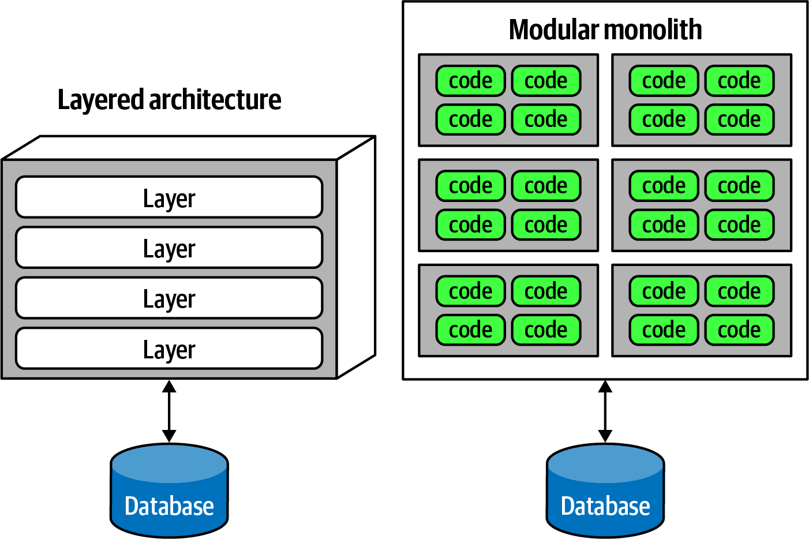

*图 8-3：两种顶层架构划分：分层与模块化。*

<!-- CH08-013 -->

图 8-3 中，一种是许多人熟悉的分层单体，第 10 章会详细讨论。另一种是由 [Simon Brown](https://www.codingthearchitecture.com) 推广的模块化单体（modular monolith）：单个部署单元，关联一个数据库，按领域而非技术能力划分。这两种风格代表架构顶层划分的不同方式。注意，在每种变体中，各顶层组件，无论是层还是组件，内部很可能还包含其他组件。架构师特别关注顶层划分，因为它定义了基本的架构风格与代码组织方式。

<!-- 书内第 103 页，PDF 第 123 页。 -->

<!-- CH08-014 -->

像分层单体那样，基于技术能力组织架构，称为技术顶层划分。图 8-4 展示了一种常见形式。

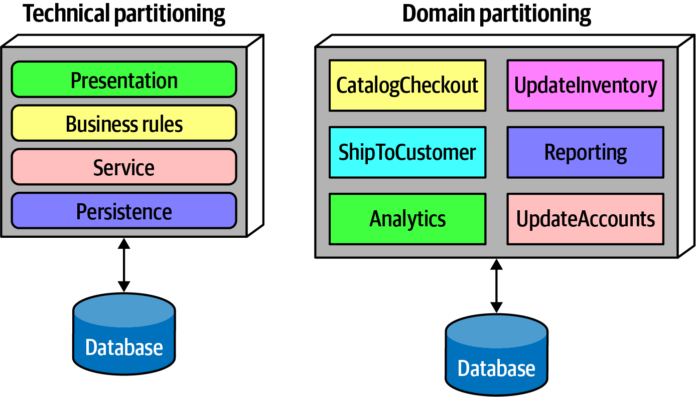

*图 8-4：架构中两种顶层划分方式。*

<!-- CH08-015 -->

图 8-4 中，架构师按技术能力划分系统功能：界面呈现、业务规则、服务、持久化等。这种组织代码库的方式当然有道理。所有持久化代码位于一个架构层中，开发者容易找到相关代码。虽然分层架构的基本概念比模型—视图—控制器（Model-View-Controller，MVC）设计模式早了几十年，但 MVC 与这一架构模式相吻合，使开发者容易理解。因此，它经常成为许多组织的默认架构。

<!-- CH08-016 -->

分层架构占据主导地位，还有一个有趣的副作用：影响公司如何安排项目中的不同角色。采用分层架构时，让所有后端开发者坐在一个部门，数据库管理员在另一个部门，表现层团队在其他地方，似乎有一定道理。从康威定律来看，这在这些组织中是说得通的。

#### 康威定律

<!-- CH08-017 -->

早在 20 世纪 60 年代末，Melvin Conway 提出了一个后来被称为[康威定律（Conway’s law）](https://oreil.ly/z2Swa)的观察：

<!-- CH08-018 -->

> 设计系统的组织……受其自身沟通结构约束，所产生的设计会成为该沟通结构的映像。

<!-- CH08-019 -->

换句话说，一群人设计某个技术制品时，人与人之间的沟通结构最终会复制到设计中。组织各层级的人都能看到这一定律发挥作用，有时也据此做出决策。例如，组织常按技术能力划分员工，纯粹从组织角度看合理，却由于人为拆开共同关注点而妨碍协作。

<!-- 书内第 104 页，PDF 第 124 页；上一段跨页。 -->

<!-- CH08-020 -->

ThoughtWorks 的 Jonny Leroy 提出了一个相关观察，称为逆康威操作（Inverse Conway Maneuver）：让团队与组织结构共同演进，以促进期望的架构。

<!-- CH08-021 -->

图 8-4 中另一种架构变体是领域划分，受到 Eric Evans 的[《领域驱动设计》](https://oreil.ly/9EYd6)启发，这是一种分解复杂软件系统的建模技术。在 DDD 中，架构师识别相互独立、解耦的领域或工作流。第 17 章讨论的微服务架构风格建立在这一理念之上。在模块化单体中，架构师围绕领域或工作流划分架构，而非技术能力。由于组件常常嵌套，图 8-4 领域划分中的每个组件，例如 `CatalogCheckout`，内部仍可以使用持久化库，并拥有独立业务规则层，但顶层划分围绕领域展开。

<!-- CH08-022 -->

不同架构模式的根本区别之一，就是支持哪种顶层划分，我们会在各模式中分别说明。这也极大影响初始组件识别：架构师究竟希望按技术，还是按领域划分？

<!-- CH08-023 -->

采用技术划分的架构师，按界面呈现、业务规则、持久化等技术能力组织组件。因此，其组织原则之一是技术关注点分离。这会带来有益的解耦：如果服务层只连接下方持久化层和上方业务规则层，持久化的变化就只可能影响这些层。这种划分提供了解耦技术，减少对依赖组件的连锁副作用。第 10 章会在分层架构模式中进一步介绍。使用技术划分组织系统当然合理，但和软件架构中的一切一样，它也带来权衡。

<!-- CH08-024 -->

技术划分强制的分离，使开发者能够快速找到某类代码，因为代码按能力组织。然而，大多数实际软件系统需要跨越技术能力的工作流。以常见的商品目录结账工作流 `CatalogCheckout` 为例，在按技术分层的架构中，它的代码遍布各层，如图 8-5 所示。

<!-- 书内第 105 页，PDF 第 125 页。 -->

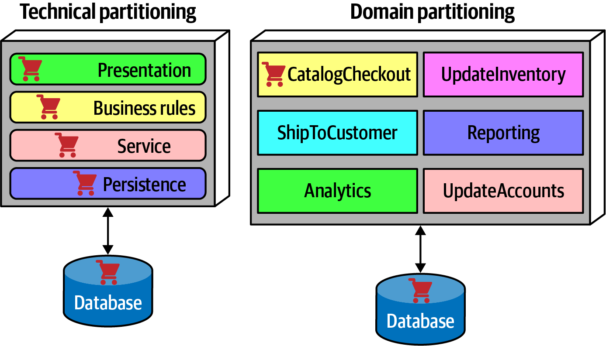

*图 8-5：领域或工作流在技术划分与领域划分架构中的位置。*

<!-- CH08-025 -->

图 8-5 中，技术划分架构的每层都有 `CatalogCheckout`，领域被摊开到各技术层。与之相比，领域划分在顶层按领域而非技术能力组织组件。架构师围绕工作流或领域构建顶层组件。每个组件可以有子组件，包括层，但顶层关注领域，更贴近项目中最常发生的变化类型。

<!-- CH08-026 -->

这两种方式没有谁更正确，仍要回到软件架构第一定律。不过，过去几年，我们观察到行业在单体与分布式架构，例如微服务中，都明显趋向领域划分。无论如何，这都是架构师必须尽早做出的决策之一。

### 案例研究：Silicon Sandwiches 的划分

<!-- CH08-027 -->

考虑第 69 页“案例研究：Silicon Sandwiches”。推导组件时，架构师面对的一项基本决策就是顶层划分。图 8-6 展示了两种方案中的第一种：领域划分。

<!-- 书内第 106 页，PDF 第 126 页。 -->

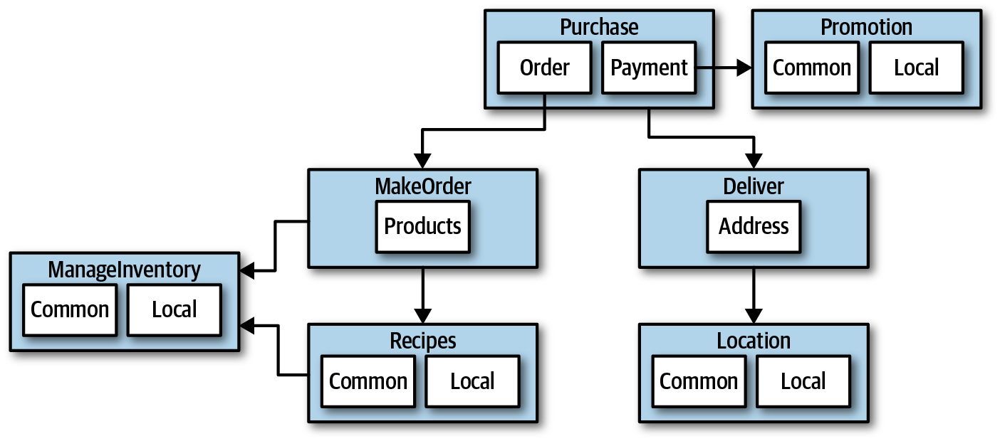

*图 8-6：Silicon Sandwiches 按领域划分的设计。*

<!-- CH08-028 -->

图 8-6 中，架构师围绕领域或工作流设计，分别创建购买（Purchase）、促销（Promotion）、创建订单（MakeOrder）、库存管理（ManageInventory）、配方（Recipes）、配送（Delivery）和位置（Location）组件。许多组件内部有处理不同定制需求的子组件，涵盖通用与本地差异。

<!-- CH08-029 -->

另一种设计，将通用与本地部分隔离到各自的分区，如图 8-7 所示。通用（Common）与本地（Local）成为顶层组件，购买与配送组件保留，负责处理工作流。

<!-- CH08-030 -->

哪种更好？视情况而定！每种划分都有不同优缺点。

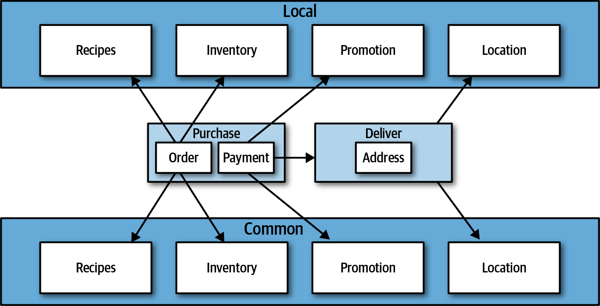

*图 8-7：Silicon Sandwiches 按技术划分的设计。*

<!-- 书内第 107 页，PDF 第 127 页。 -->

**领域划分**

<!-- CH08-031 -->

领域划分架构按工作流或领域区分顶层组件。

优点：

<!-- CH08-032 -->

- 更贴近业务运作方式，而非实现细节。
- 更容易利用逆康威操作，围绕领域构建跨职能团队。
- 更贴合模块化单体与微服务架构风格。
- 消息流与问题领域一致。
- 容易将数据与组件迁移到分布式架构。

缺点：

<!-- CH08-033 -->

- 定制代码分布在多个地方。

**技术划分**

<!-- CH08-034 -->

技术划分架构按技术能力，而非各个工作流来划分顶层组件。它可以采用受 MVC 关注点分离方式启发的分层，也可以采用其他按具体需要形成的技术划分。图 8-7 按定制化能力区分组件。

优点：

<!-- CH08-035 -->

- 清晰地分离定制代码。
- 更贴合分层架构模式。

缺点：

<!-- CH08-036 -->

- 全局耦合更高。通用或本地组件的变化，很可能影响所有其他组件。
- 开发者可能不得不在通用与本地层中重复领域概念。
- 数据层面的耦合通常更高。在这样的系统中，应用架构师与数据架构师很可能协作建立一个同时包含定制和领域数据的单一数据库。如果以后迁移到分布式系统，梳理数据关系就会变得困难。

<!-- CH08-037 -->

还有许多其他因素，会影响架构师选择何种架构风格作为设计基础，第二部分将介绍。

<!-- 书内第 108 页，PDF 第 128 页。 -->

## 开发者的角色

<!-- CH08-038 -->

开发者通常将与架构师共同设计的组件，进一步拆分为类、函数或子组件。总体而言，类与函数设计是架构师、技术负责人和开发者共同的责任，但大部分由开发者承担。

<!-- CH08-039 -->

开发者绝不应把架构师设计的组件当成最终定论，所有软件设计都能受益于迭代。应该将初始设计视为初稿，实现过程会揭示更多细节与改进空间。

## 组件识别流程

<!-- CH08-040 -->

组件识别最适合采用迭代过程，通过反馈产生候选方案并加以细化，如图 8-8 所示。

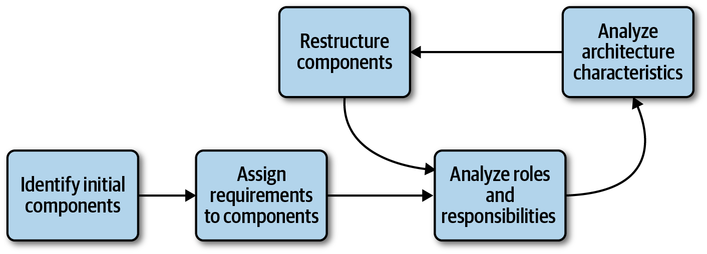

*图 8-8：组件识别循环。*

<!-- CH08-041 -->

这一循环描述了迭代细化架构的通用过程。某些专业领域可能加入其他步骤，或者完全改变流程。例如，有些领域要求部分代码在这一过程中经过安全或审计步骤。下面各节介绍图 8-8 的每个步骤。

### 识别初始组件

<!-- CH08-042 -->

软件项目尚未有代码时，架构师必须根据所选顶层划分，确定从哪些顶层组件开始。除此之外，可以自由提出组件，再将领域功能映射到它们，判断行为应该放在哪里。听起来可能有些随意，但从零设计系统时，很难从更具体的东西开始。初始组件集合直接形成良好设计的可能性低得令人失望，因此必须通过迭代不断改进。

<!-- 书内第 109 页，PDF 第 129 页。 -->

### 将需求分配给组件

<!-- CH08-043 -->

识别初始组件后，下一步是将需求或用户故事与组件对应，观察匹配程度。可能需要创建新组件、合并已有组件，或拆分职责过多的组件。这种映射不必精确，架构师试图找到一个良好的粗粒度基础，供架构师、技术负责人和开发者进一步设计与细化。

### 分析角色与职责

<!-- CH08-044 -->

将故事分配给组件时，架构师也应考察需求中明确的角色与职责，确保粒度匹配。同时考虑应用必须支持的角色与行为，有助于对齐组件和领域的粒度。发现正确的组件粒度，是架构师最大的挑战之一，也进一步说明迭代方法的必要性。

### 分析架构特性

<!-- CH08-045 -->

分配需求时，还应考虑此前发现的架构特性，思考它们如何影响组件划分与粒度。例如，系统的两个部分都处理用户输入，但一个面对数百名并发用户，另一个只需支持少数用户，两者需要的架构特性就不同。因此，单从功能角度可能设计一个组件统一处理用户交互，分析架构特性后却会进一步拆分。

### 重组组件

<!-- CH08-046 -->

反馈对软件设计至关重要，因此架构师必须与开发者持续迭代组件设计。设计软件会带来各种意料之外的困难，没有人能预先知道项目中通常会出现的全部未知问题。因此，迭代式组件设计是关键。首先，几乎不可能事先考虑到所有会促使重新设计的新发现和边界情况。其次，随着架构师与开发者深入构建应用，会更细致地理解行为与角色应该放在哪里。

<!-- 书内第 110 页，PDF 第 130 页。 -->

## 组件粒度

<!-- CH08-047 -->

为组件找到恰当粒度，是架构师最困难的任务之一。太细会导致组件间为了完成工作而进行过多通信；太粗会助长内部高耦合，使部署、测试更困难，并产生与模块化有关的负面影响。

## 组件设计

<!-- CH08-048 -->

没有公认的“正确”组件设计方式。存在多种技术，各有权衡。在所有流程中，架构师都从需求出发，试图确定哪些粗粒度构建单元组成应用。技术多种多样，各自有不同权衡，也与团队和组织采用的软件开发流程有关。下面讨论一些发现组件的通用方式，以及需要避免的陷阱。

### 发现组件

<!-- CH08-049 -->

架构师通常与开发者、业务分析师和领域专家等角色协作，基于对系统的一般认识，以及所选技术或领域划分方式，创建初始组件设计。团队目标是将问题空间分成较粗的块，同时考虑不同架构特性。

#### 实体陷阱

<!-- CH08-050 -->

虽然没有唯一正确的组件识别方式，但存在一个常见反模式：实体陷阱（entity trap）。假设架构师为 Going, Going, Gone 设计组件，得到了图 8-9 这样的方案。

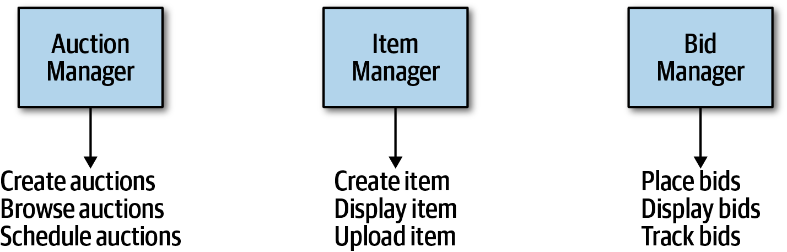

*图 8-9：将架构构建为对象关系映射。*

<!-- 书内第 111 页，PDF 第 131 页。 -->

<!-- CH08-051 -->

图 8-9 中，架构师基本上将需求中识别的每个实体，都转换为对应的 Manager 组件。这不是架构，而是框架到数据库的对象关系映射（object-relational mapping，ORM）。换句话说，如果系统只需要简单的数据库 CRUD，即创建、读取、更新、删除，架构师可以下载一个框架，直接从数据库生成用户界面。许多流行 ORM 框架都用于处理这种常见行为。

#### Naked Objects 与类似框架

<!-- CH08-052 -->

十多年前，出现了一组让简单 CRUD 应用构建变得轻而易举的框架，以 [Naked Objects](https://oreil.ly/RQ8XQ) 为代表。它后来分成两个项目：.NET 版本仍称 NakedObjects，Java 版本转入 Apache 开源基金会，名为 [Isis](http://isis.apache.org)。这些框架的基本思路，是在数据库实体之上构建用户界面。例如，在 Naked Objects 中，开发者将框架指向数据库表，框架就根据表及其定义的关系构建界面。

<!-- CH08-053 -->

还有其他流行框架，基本上也根据数据库表结构提供默认界面。例如，[Ruby on Rails](https://rubyonrails.org) 的脚手架功能提供类似的网站到数据库默认映射，并提供许多扩展方式，以进一步完善生成的应用。

<!-- CH08-054 -->

如果需求仅仅是将数据库简单映射为用户界面，就不必设计一套完整架构；这类框架已经足够。

<!-- CH08-055 -->

当架构师错误地将数据库关系当成应用工作流时，就会出现实体陷阱，而现实中两者很少一一对应。这个反模式通常说明，没有认真思考应用的实际工作流。以这种方式创建的组件也往往过于粗粒度，完全无法指导开发团队如何打包和组织源代码。

#### 参与者 / 动作方法

<!-- CH08-056 -->

参与者 / 动作（actor/actions）方法，是架构师将需求映射为组件的常见方式。它最初由 Rational 统一过程（Rational Unified Process）定义：识别使用应用开展活动的参与者，以及他们可能执行的动作。它提供一种技术，发现系统的典型用户，以及他们可能用系统做什么。

<!-- CH08-057 -->

这一方法伴随特定软件开发流程而流行，尤其是偏好较多前期设计的正式流程。如今仍然常用，在需求包含明确角色及其动作时效果很好。这种组件分解方式适用于单体和分布式等各类系统。

<!-- 书内第 112 页，PDF 第 132 页；上一段跨页。 -->

#### 事件风暴

<!-- CH08-058 -->

作为组件发现技术，事件风暴（event storming）来自领域驱动设计，与同样深受 DDD 影响的微服务一起流行。在事件风暴中，架构师假定项目会通过消息或事件在组件间通信。为此，团队根据需求和已识别角色，确定系统中会发生哪些事件，并围绕事件与消息处理器构建组件。这对使用事件和消息的微服务等分布式架构很有效，有助于定义最终系统采用的消息。

> 译注：以上是本书在组件识别语境下对事件风暴的描述，不将其作为这项建模方法适用范围的完整定义。

#### 工作流方法

<!-- CH08-059 -->

对于不使用 DDD 或消息传递的架构师，还有一种比事件风暴更通用的方式：工作流方法（workflow approach）。它也围绕工作流建模组件，但不明确要求构建基于消息的系统。它识别关键角色，确定这些角色参与的工作流类型，并围绕识别出的活动构建组件。

<!-- CH08-060 -->

这些技术没有谁优于其他技术，每种都提供不同权衡。如果团队采用瀑布式或其他较老开发流程，可能偏爱通用的参与者 / 动作方法；采用 DDD 及微服务等相应架构时，事件风暴则与开发流程完全匹配。

## 案例研究：Going, Going, Gone 的组件发现

<!-- CH08-061 -->

如果团队没有特殊限制，希望找到通用的组件分解方式，参与者 / 动作方法很合适。我们用它分析 Going, Going, Gone。

<!-- CH08-062 -->

第 7 章介绍了 Going, Going, Gone（GGG）的架构 Kata，并发现其架构特性。系统有三个明显角色：竞拍者、拍卖师，以及这种建模方法中常见的、负责内部动作的“系统”。角色与应用交互，而这里用系统角色表示由应用主动发起、而非外部角色触发的事件。例如，拍卖完成后，系统会触发支付系统处理付款。

<!-- 书内第 113 页，PDF 第 133 页。 -->

<!-- CH08-063 -->

还可以为每个角色识别一组初始动作：

**竞拍者**

<!-- CH08-064 -->

观看实时视频流、查看实时出价流、出价。

**拍卖师**

<!-- CH08-065 -->

将现场出价录入系统、接收在线出价、将物品标记为已售。

**系统**

<!-- CH08-066 -->

开始拍卖、付款、跟踪竞拍者活动。

<!-- CH08-067 -->

根据这些动作，可以迭代地构建 GGG 的初始组件集合；图 8-10 展示了一种方案。

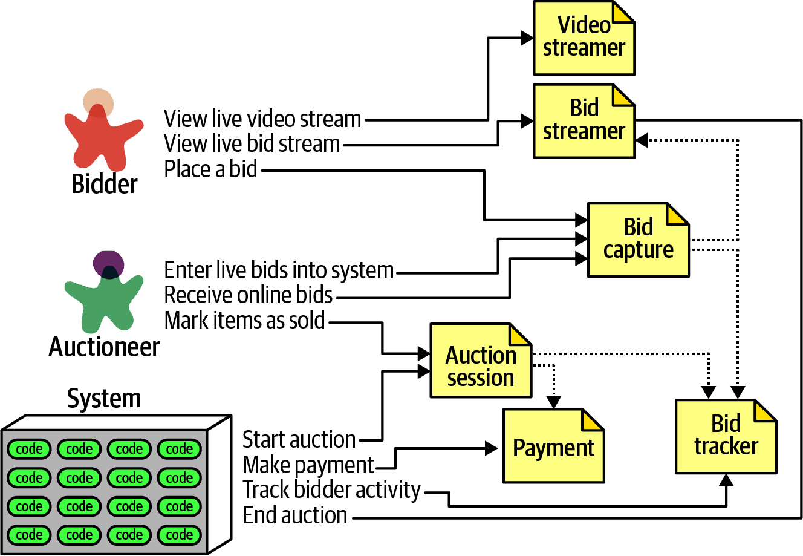

*图 8-10：Going, Going, Gone 的初始组件集合。*

<!-- CH08-068 -->

图 8-10 中，每个角色及动作都映射到组件，组件可能需要协作交换信息。我们为这个方案识别出以下组件：

**VideoStreamer：视频流组件**

<!-- CH08-069 -->

向用户传输拍卖直播。

**BidStreamer：出价流组件**

<!-- CH08-070 -->

向用户传输实时出价。VideoStreamer 与 BidStreamer 都为竞拍者提供拍卖的只读视图。

<!-- 书内第 114 页，PDF 第 134 页。 -->

**BidCapture：出价捕获组件**

<!-- CH08-071 -->

接收拍卖师与竞拍者的出价。

**BidTracker：出价跟踪组件**

<!-- CH08-072 -->

跟踪出价，并充当权威记录系统。

**AuctionSession：拍卖会话组件**

<!-- CH08-073 -->

开始和停止拍卖。竞拍者结束拍卖时，它执行付款与后续处理步骤，包括通知竞拍者拍卖结束。

> 译注：此处原文为 bidder；本章前述拍卖师及系统职责的安排与它不完全一致，保留原文归属供回查。

**Payment：支付组件**

<!-- CH08-074 -->

处理信用卡付款的第三方支付处理方。

<!-- CH08-075 -->

回到图 8-8 的组件识别流程：初步识别组件后，架构师接着分析架构特性，判断是否需要调整设计。在本系统中，可以明确识别不同的特性集合。例如，当前设计用一个 BidCapture 同时接收竞拍者和拍卖师的出价。从功能看很合理：任何人的出价，都可以用相同方式接收。但相关架构特性呢？拍卖师并不需要与数千名竞拍者相同程度的可扩展性和弹性。同样，拍卖师一侧对可靠性（连接不掉线）和可用性（系统保持运行）的要求，可能高于系统其他部分，架构师必须确保设计能够满足这些要求。例如，一位竞拍者无法登录或连接断开，对业务不利；如果发生在拍卖师身上，却会对整场拍卖造成灾难。

<!-- CH08-076 -->

由于架构特性的要求不同，架构师决定将出价捕获拆分为 Bid Capture 与 Auctioneer Capture，让两个组件分别支持不同特性。更新的设计如图 8-11 所示。

<!-- CH08-077 -->

架构师创建拍卖师出价捕获（Auctioneer Capture）组件，并更新通往出价流组件的链路，让在线竞拍者能看到现场出价，同时更新通往管理出价流的出价跟踪组件的链路。注意，出价跟踪组件现在负责统一两种截然不同的信息流：来自拍卖师的单一流，以及来自竞拍者的多个流。

<!-- 书内第 115 页，PDF 第 135 页。 -->

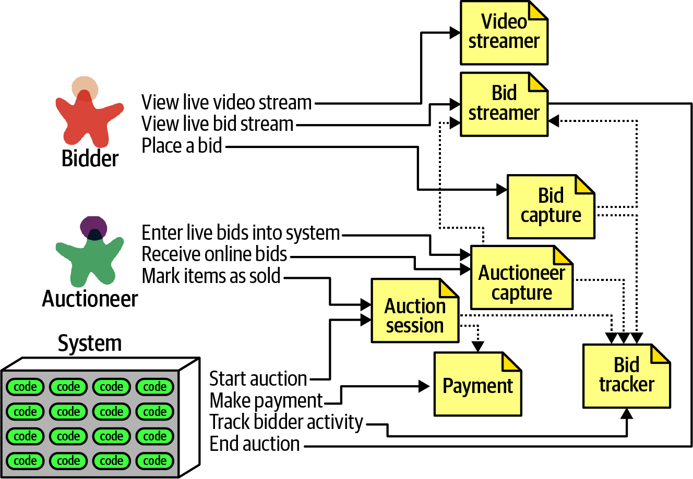

*图 8-11：将架构特性纳入 GGG 组件设计。*

<!-- CH08-078 -->

图 8-11 不太可能是最终设计，还有更多需求需要发掘，例如如何注册、支付相关管理功能等。不过，这个例子提供了一个良好的起点，便于进一步迭代。

<!-- CH08-079 -->

这是一组可能解决 GGG 问题的组件，但未必正确，也不是唯一方案。很少有软件系统只有一种实现方式，每种设计都有不同权衡。作为架构师，不要执着于找到唯一正确的设计，因为许多方案都能满足需要，而且可能更不容易过度设计。应客观评估不同设计决策的权衡，选择其中最不坏的一组。

## 再谈架构量子：在单体与分布式架构之间选择

<!-- CH08-080 -->

回顾第 92 页“架构量子与粒度”，架构量子定义了架构特性的作用范围。这进而引出架构师完成初始组件设计时的一项重要决策：应该采用单体，还是分布式架构？

<!-- 书内第 116 页，PDF 第 136 页。 -->

<!-- CH08-081 -->

单体架构通常只有一个部署单元，包含进程内运行的系统全部功能，并通常连接单个数据库。类型包括分层单体和模块化单体，原文指向第 10 章详细讨论。分布式架构则相反：应用由多个服务组成，运行在各自环境，通过网络协议通信。它可以支持更细粒度的部署模型，每个服务根据所属团队及其优先级，采用自己的发布节奏与工程实践。

> 译注：第10章详细介绍的是分层架构，并未专门展开模块化单体；两种单体的顶层划分对比可回看本章图8-3至图8-7及相关说明。

<!-- CH08-082 -->

每种架构风格都带来多种权衡，第二部分将介绍。但基本决策取决于设计中发现多少个量子。如果系统可以用一个量子，也就是一组架构特性满足需求，单体架构就有许多优势。另一方面，如果像 GGG 组件分析那样，不同组件需要不同架构特性，就需要分布式架构来容纳这些差异。例如，VideoStreamer 与 BidStreamer 都向竞拍者提供只读视图。从设计角度看，架构师不愿将只读流处理与大规模更新混在一起。加上前述竞拍者与拍卖师之间的差异，这些特性会促使选择分布式架构。

<!-- CH08-083 -->

能够在设计早期确定单体还是分布式这一基本架构特征，体现了利用架构量子分析特性作用范围与耦合的一项优势。

---

## 图中文字中文对照（译者整理）

### 图 8-1

相关代码的封装（Wrapper of related code）、层或子系统（Layer or subsystem）、事件处理器（Event processor）、分布式服务（Distributed service）、代码（code）、服务（service）、模块（module）、数据库（Database）。

### 图 8-2

服务（Service）、组件（Component）、数据库（Database）。左侧服务含组件，右侧不显示内部组件。

### 图 8-3

分层架构（Layered architecture）、层（Layer）、模块化单体（Modular monolith）、代码（code）、数据库（Database）。

### 图 8-4

技术划分（Technical partitioning）：表现层（Presentation）、业务规则（Business rules）、服务（Service）、持久化（Persistence）。领域划分（Domain partitioning）：商品目录结账（CatalogCheckout）、更新库存（UpdateInventory）、向客户发货（ShipToCustomer）、报表（Reporting）、分析（Analytics）、更新账户（UpdateAccounts）。数据库（Database）。

### 图 8-5

标签同图 8-4；购物车图标标出结账功能在不同划分下的位置。

### 图 8-6

购买（Purchase）、订单（Order）、支付（Payment）、促销（Promotion）、通用（Common）、本地（Local）、创建订单（MakeOrder）、商品（Products）、配送（Deliver）、地址（Address）、管理库存（ManageInventory）、配方（Recipes）、位置（Location）。

### 图 8-7

标签大体同图 8-6；另有库存（Inventory）。本地与通用为上下两大分区。

### 图 8-8

识别初始组件（Identify initial components）→ 将需求分配给组件（Assign requirements to components）→ 分析角色与职责（Analyze roles and responsibilities）→ 分析架构特性（Analyze architecture characteristics）→ 重组组件（Restructure components），再回到角色与职责分析。

### 图 8-9

拍卖管理器（Auction Manager）：创建拍卖（Create auctions）、浏览拍卖（Browse auctions）、安排拍卖（Schedule auctions）。物品管理器（Item Manager）：创建物品（Create item）、展示物品（Display item）、上传物品（Upload item）。出价管理器（Bid Manager）：出价（Place bids）、展示出价（Display bids）、跟踪出价（Track bids）。

### 图 8-10

竞拍者（Bidder）：观看实时视频流（View live video stream）、查看实时出价流（View live bid stream）、出价（Place a bid）。拍卖师（Auctioneer）：录入现场出价（Enter live bids into system）、接收在线出价（Receive online bids）、标记物品已售（Mark items as sold）。系统（System）：开始拍卖（Start auction）、付款（Make payment）、跟踪竞拍者活动（Track bidder activity）、结束拍卖（End auction）。代码（code）。组件：视频流（Video streamer）、出价流（Bid streamer）、出价捕获（Bid capture）、拍卖会话（Auction session）、支付（Payment）、出价跟踪（Bid tracker）。

### 图 8-11

主要标签同图 8-10，新增拍卖师出价捕获（Auctioneer capture），将拍卖师与竞拍者的接收路径分离。
