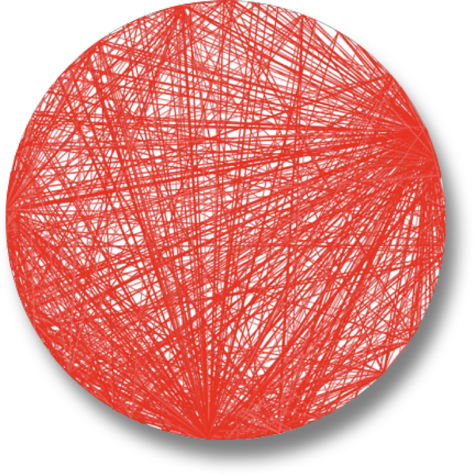
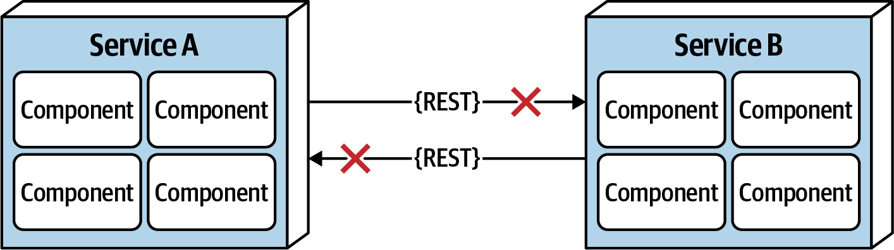
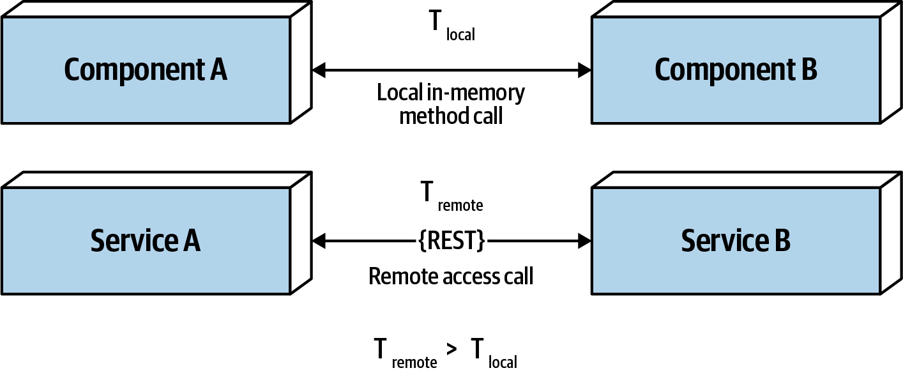
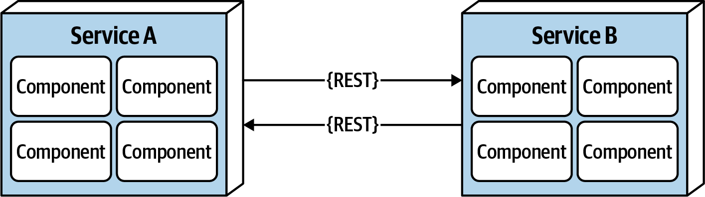
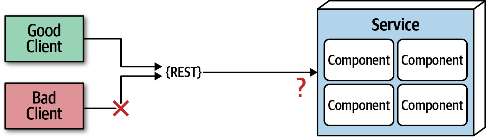
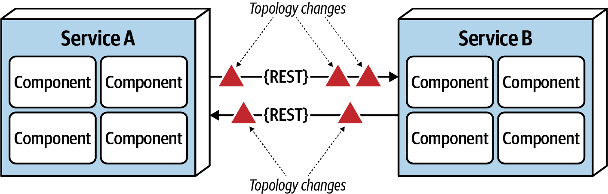
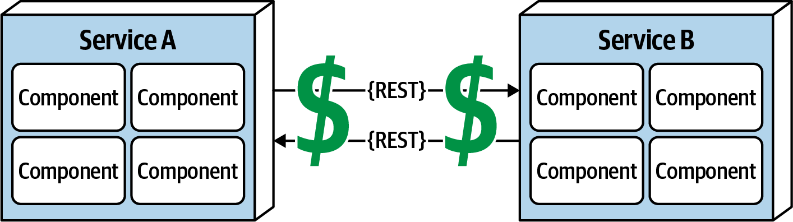
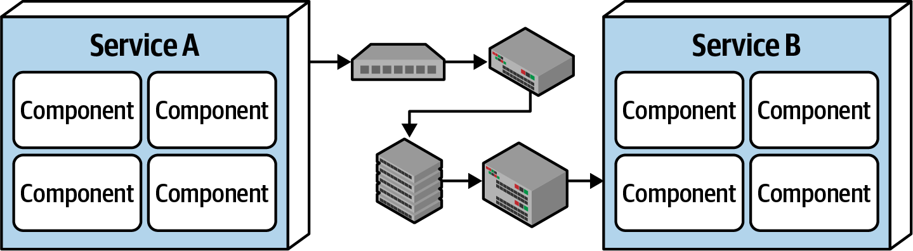

# 第 9 章 基础

> 原文章名：Foundations
> 来源：英文第一版，书内第 119–132 页，PDF 第 139–152 页。
> 进度：第九章全文已翻译并对照原文校订。
> 保留英文原图，中文标签对照见文末；下文页码均指原书书内页码。

<!-- 书内第 119 页，PDF 第 139 页。 -->

架构风格有时也称架构模式，描述组件之间一种有名称的关系，涵盖多种架构特性。像设计模式一样，风格名称成为经验丰富的架构师之间的简写。例如，架构师谈到分层单体时，对方就能理解其结构、哪些架构特性表现良好、哪些可能出问题、典型部署模型、数据策略，以及许多其他信息。因此，架构师应熟悉基础通用架构风格的名称。

每个名称都包含大量已知细节，这也是设计模式的目的之一。架构风格描述拓扑结构，以及假定和默认的架构特性，包括有利与不利的方面。本书第二部分后续将介绍许多常见现代架构模式。不过，架构师还应熟悉几个经常嵌入更大模式的基本模式。

## 基本模式

有几种基本模式在软件架构史上反复出现，因为它们为代码、部署或架构其他方面的组织提供了有用视角。例如，在架构中按功能分离不同关注点的分层概念，几乎与软件本身一样古老。但分层模式仍以不同形式不断出现，包括第 10 章讨论的现代变体。

<!-- 书内第 120 页，PDF 第 140 页。 -->

### 大泥球

如果看不出任何架构结构，架构师就称其为大泥球（Big Ball of Mud）。这个名字来自 Brian Foote 与 Joseph Yoder 于 1997 年论文中定义的同名反模式：

> 大泥球是一个结构随意、蔓延失控、粗糙凌乱、靠胶带和铁丝勉强拼凑的意大利面式代码丛林。这些系统明显经历了不受约束的增长，以及反复的权宜修补。信息在系统中相距遥远的元素之间随意共享，往往到了几乎所有重要信息都成为全局信息或被重复保存的地步。
>
> 系统的整体结构也许从未清晰定义过。
>
> 即使曾经有过，也可能已经侵蚀得面目全非。稍有架构意识的程序员都会避开这些泥潭。只有那些不关心架构、也许习惯了每天给这些不断溃败的堤坝打补丁的人，才会满足于在这样的系统上工作。
>
> ——Brian Foote 与 Joseph Yoder

用现代术语说，大泥球可能是一个简单的脚本应用，事件处理器直接连接数据库调用，没有真正的内部结构。许多小应用一开始如此，随着不断增长，变得难以驾驭。

总体而言，架构师应尽力避免这种架构。缺乏结构，使变更越来越困难；部署、可测试性、可扩展性与性能也都会出问题。

遗憾的是，这种反模式在现实中相当常见。很少有架构师有意创建它，但许多项目缺少针对代码质量和结构的治理，不知不觉就形成一团乱麻。例如，Neal 曾参与一个客户项目，结构如图 9-1 所示。

这位客户的名称因显而易见的原因不予公开。他们数年间一直以尽可能快的速度开发一个 Java Web 应用。技术可视化[^1]显示了架构耦合：圆周每个点代表一个类，每条线代表类之间的连接，线越粗表示连接越强。在这个代码库中，任何类发生变化，都很难预测对其他类产生的连锁副作用，因此变更成为一件可怕的事情。

[^1]: 使用现已退役的 Eclipse 插件 XRay 制作。

<!-- 书内第 121 页，PDF 第 141 页。 -->

*图 9-1：从真实代码库可视化得到的大泥球架构。*

### 单机一体式架构

软件刚出现时，只有计算机，软件就在上面运行。硬件与软件在各个时代演进，两者最初是一个整体，随着对更复杂能力的需求增长，才逐渐分离。例如，大型机最初是单一系统，后来逐渐将数据分离到专门系统中。个人计算机最初出现时，许多商业开发也围绕单台机器。随着 PC 联网变得普遍，客户端 / 服务器等分布式系统开始出现。

嵌入式系统和其他高度受限环境之外，单机一体式架构（unitary architecture）已不多见。总体而言，软件系统的功能会随时间增长，需要通过关注点分离，维持性能和规模等运维架构特性。

### 客户端 / 服务器

随着时间推移，各种力量要求从单一系统中拆分功能，而如何拆分，构成许多架构风格的基础。许多风格关注的就是如何高效分离系统各部分。

一种基本风格将技术功能分为前端和后端，称为两层架构（two-tier），或客户端 / 服务器架构（client/server）。根据时代与计算能力不同，它存在多种变体。

<!-- 书内第 122 页，PDF 第 142 页。 -->

#### 桌面应用 + 数据库服务器

早期个人计算机架构鼓励开发者基于 Windows 等界面环境，编写功能丰富的桌面应用，将数据分离到独立数据库服务器。这与能够通过标准网络协议连接的独立数据库服务器的出现相伴。表现逻辑位于桌面，而在数量与复杂性上都更重的计算工作，由能力更强的数据库服务器完成。

#### 浏览器 + Web 服务器

现代 Web 开发出现后，常见划分变为浏览器连接 Web 服务器，后者再连接数据库服务器。职责分离与桌面版本相似，但浏览器是更轻的客户端，便于在防火墙内外更广泛地使用。尽管数据库独立于 Web 服务器，架构师仍常将它视为两层架构，因为 Web 与数据库服务器都运行在运维中心的一类机器上，用户界面则运行在用户浏览器中。

#### 三层架构

20 世纪 90 年代末，三层架构（three-tier）很流行，提供更多分离层次。随着 Java 和 .NET 应用服务器等工具普及，公司在拓扑中构建更多层次：使用工业级数据库服务器的数据层、由应用服务器管理的应用层，以及通过生成 HTML 编码的前端；随着 JavaScript 能力增强，它也越来越多地用于前端。

三层架构伴随着[公共对象请求代理体系结构（CORBA）](https://www.corba.org)和[分布式组件对象模型（DCOM）](https://oreil.ly/1TEqv)等网络级协议，帮助构建分布式架构。

就像如今开发者通常不必担心 TCP/IP 等网络协议如何工作——它们能够工作就够了——多数架构师也不必操心分布式架构中这一层的底层细节。当时这些工具提供的能力，如今以消息队列等工具，或第 14 章事件驱动架构这样的架构模式形式存在。

<!-- 书内第 123 页，PDF 第 143 页。 -->

#### 三层架构、语言设计与长期影响

Java 设计期间，三层计算风靡一时，因此人们假定未来所有系统都会采用三层架构。当时 C++ 等语言的常见困难，是如何在系统间通过网络一致地移动对象。于是，Java 设计者决定用序列化（serialization）机制，将这一能力内建到语言核心。原文称，Java 中每个 Object 都实现一个要求支持序列化的接口。设计者认为，既然三层架构将永久成为架构风格，将其内建会带来便利。当然，这种架构风格经历了兴衰，但遗留影响仍留在 Java 中，使希望增加现代特性的语言设计者十分沮丧：为了向后兼容，新特性还必须支持原文认为如今已几乎无人使用的序列化。

> 译注：本段对 Java 对象与序列化接口关系的表述存在疑点，已明确其原文归属；不要以此替代语言规范。关于使用程度的判断也保留本版历史语境。

无论软件还是其他工程学科，人们始终很难理解设计决策的长期影响。长期以来强调简单设计的建议，在许多方面都是对未来后果的一种防御。

## 单体与分布式架构

架构风格可以分为两大类：单体，即全部代码作为单一部署单元；分布式，即多个部署单元通过远程访问协议连接。没有分类方案是完美的，但分布式架构共同面临一组单体风格没有的挑战与问题，因此这是区分风格的一种有效方式。本书会详细介绍以下风格：

**单体**

- 分层架构，第 10 章。
- 管道架构，第 11 章。
- 微内核架构，第 12 章。

**分布式**

- 基于服务的架构，第 13 章。
- 事件驱动架构，第 14 章。
- 空间架构，第 15 章。
- 面向服务的架构，第 16 章。
- 微服务架构，第 17 章。

<!-- 书内第 124 页，PDF 第 144 页。 -->

分布式架构在性能、可扩展性与可用性方面，虽然可以比单体风格强大得多，但这种能力也伴随着重大权衡。所有分布式架构面临的第一组问题，是[分布式计算谬误（fallacies of distributed computing）](https://oreil.ly/fVAEY)，由 L. Peter Deutsch 与 Sun Microsystems 的其他同事于 1994 年首先提出。谬误是指被相信或假定为真、实际上却不成立的事情。八个分布式计算谬误至今仍适用于分布式架构，以下逐一介绍。

### 谬误 1：网络可靠

*图 9-2：网络并不可靠。*

开发者与架构师都可能假定网络可靠，但事实并非如此。虽然网络可靠性不断提高，总体上仍不可靠。这对所有分布式架构都很重要，因为服务与外部、服务之间的通信都依赖网络。如图 9-2 所示，服务 B 可能完全正常，但网络问题使服务 A 无法到达它；更糟的是，A 请求 B 处理数据，却因为网络问题没有收到响应。这就是服务间需要超时与熔断器的原因。系统越依赖网络，例如微服务架构，潜在可靠性就可能越低。

<!-- 书内第 125 页，PDF 第 145 页。 -->

### 谬误 2：延迟为零

*图 9-3：延迟并非零。*

如图 9-3 所示，通过方法或函数在本地调用另一个组件时，耗时 `t_local` 以纳秒或微秒计。而经由 REST、消息传递或 RPC 等远程访问方式进行同样调用时，访问服务的耗时 `t_remote` 以毫秒计。因此，`t_remote` 总是大于 `t_local`。任何分布式架构的延迟都不为零，但许多架构师忽略这一点，坚持认为自己的网络很快。问问自己：知道生产环境中一次 RESTful 调用的平均往返延迟吗？是 60 毫秒，还是 500 毫秒？

采用分布式架构时，架构师必须知道平均延迟，才能判断其可行性。由于服务粒度细、通信多，对第 17 章的微服务尤其如此。假设每次请求平均延迟 100 毫秒，完成某项业务功能要串行调用十个服务，就额外增加 1,000 毫秒！

平均延迟重要，知道第 95 到第 99 百分位延迟更重要。平均值也许只有 60 毫秒，表现不错，第 95 百分位却可能是 400 毫秒！这种长尾延迟往往会拖垮分布式架构的性能。多数情况下，架构师可以从网络管理员那里获得延迟数据，见第 129 页“谬误 6：只有一位管理员”。

<!-- 书内第 126 页，PDF 第 146 页。 -->

### 谬误 3：带宽无限

*图 9-4：带宽并非无限。*

单体架构中，带宽通常不是问题，因为请求进入单体后，处理业务很少甚至不再需要网络带宽。但如图 9-4 所示，系统拆成微服务等分布式架构中的较小部署单元后，与服务之间以及服务相互之间的通信会大量消耗带宽，使网络变慢，进而影响延迟，即谬误 2，以及可靠性，即谬误 1。

为说明这一点，考虑图中两个服务。左侧管理网站愿望清单，右侧管理客户资料。每次愿望清单请求到达左侧，它都必须调用右侧客户资料服务，获取响应契约需要的客户姓名，因为左侧自身没有这一数据。客户资料服务返回 45 个属性，总计 500 kb，而愿望清单只需要姓名，200 字节。这是一种称为印记耦合（stamp coupling）的耦合。听起来也许不严重，但愿望清单每秒收到约 2,000 次请求，意味着这次服务间调用每秒发生 2,000 次。每次 500 kb，这一个调用就消耗 1 Gb 带宽，而每秒还存在数百种其他调用！

分布式架构中的印记耦合消耗大量带宽。如果客户资料服务只返回所需数据，即 200 字节，总传输带宽就只有 400 kb。可以通过以下方式解决印记耦合：

<!-- 书内第 127 页，PDF 第 147 页。 -->

- 创建私有 RESTful API 端点。
- 在契约中使用字段选择器。
- 使用 [GraphQL](https://graphql.org) 解耦契约。
- 将以值为导向的契约与消费者驱动契约（consumer-driven contracts，CDC）结合使用。
- 使用内部消息端点。

不论采用哪种技术，确保分布式架构中服务或系统之间只传递最少必要数据，是应对这一谬误的最佳方式。

> 译注：原书使用 kb、Gb 与 bytes 混合描述，单位大小写及带宽的时间维度不够明确；这里保留数值与单位，不静默换算为另一套单位。

### 谬误 4：网络安全

*图 9-5：网络并不安全。*

许多架构师与开发者习惯了虚拟专用网络（VPN）、可信网络和防火墙，因而忘记网络并不安全。在分布式架构中，安全更具挑战。如图 9-5 所示，每个分布式部署单元的每个端点都必须保护，防止未知或恶意请求进入服务。从单体转向分布式时，威胁与攻击面会大幅增加。即使服务间通信，也必须保护每个端点，这也是微服务、基于服务架构等同步且高度分布式的架构，性能往往较慢的一个原因。

<!-- 书内第 128 页，PDF 第 148 页。 -->

### 谬误 5：拓扑永不改变

*图 9-6：网络拓扑总在变化。*

这一谬误涉及整体网络拓扑，包括所有路由器、集线器、交换机、防火墙、网络及网络设备。架构师假定拓扑固定不变，当然不是，它一直在变化。这有什么意义？

假设架构师周一早晨上班，发现大家乱成一团，因为生产环境中的服务不断超时。他与团队拼命排查，周末没有部署新服务，怎么回事？几小时后发现，当天凌晨两点做了一次小型网络升级。这次所谓的“小升级”，使所有延迟假设失效，触发超时与熔断器。

架构师必须持续与运维和网络管理员沟通，了解什么会变化、何时变化，才能相应调整，减少此类意外。看起来明显而简单，实际并不容易。这一谬误也直接引出下一个。

<!-- 书内第 129 页，PDF 第 149 页。 -->

### 谬误 6：只有一位管理员

*图 9-7：网络管理员有很多，而不只一位。*

架构师经常假定，只需与一位管理员协作沟通。如图 9-7 所示，典型大公司有几十位网络管理员。关于延迟，第 125 页谬误 2，或拓扑变化，第 128 页谬误 5，应该找谁？这一谬误体现了分布式架构的复杂性，以及为了让一切正常工作所需的协调量。由于单体风格只有一个部署单元，通常不需要这种程度的沟通协作。

<!-- 书内第 130 页，PDF 第 150 页。 -->

### 谬误 7：传输成本为零

*图 9-8：远程访问需要花钱。*

许多架构师将它与延迟混淆，即第 125 页谬误 2。这里的传输成本不是延迟，而是一次“简单 RESTful 调用”实际带来的金钱成本。架构师错误地假定，必要基础设施已经到位，足够支持简单调用或拆分单体应用。通常并非如此。分布式架构比单体架构昂贵得多，主要因为需要更多硬件、服务器、网关、防火墙、新子网、代理等。

开始采用分布式架构时，我们建议架构师从容量、带宽、延迟和安全区域等方面，分析当前服务器与网络拓扑，避免因此措手不及。

<!-- 书内第 131 页，PDF 第 151 页。 -->

### 谬误 8：网络同构

*图 9-9：网络并非同构。*

多数架构师与开发者假定网络同构，也就是只使用一家网络硬件供应商。事实远非如此，多数公司的基础设施采用多家供应商。

那又怎样？问题在于，这些异构供应商的设备并非都能良好配合。大多数情况下可以工作，但 Juniper 与 Cisco 的硬件真能无缝集成吗？多年演进的网络标准缓解了问题，但不可能测试所有情形、负载与环境，数据包仍会偶尔丢失。进而影响网络可靠性，即谬误 1，延迟假设，即谬误 2，以及带宽假设，即谬误 3。换句话说，这一谬误关联所有其他谬误，让处理网络成为令人困惑、沮丧的循环，而采用分布式架构又必须面对网络。

### 其他分布式考虑因素

除了八个谬误，分布式架构还有单体架构中不存在的其他问题与挑战。虽然细节超出本书范围，下面仍列出并概述。

#### 分布式日志

分布式架构中，由于应用与系统日志分散，要根因分析某个订单为何丢失，很困难且耗时。单体应用通常只有一份日志，容易跟踪请求并确定问题。而分布式架构有几十到几百份日志，位置和格式各不相同，难以追查。

<!-- 书内第 132 页，PDF 第 152 页；上一段跨页。 -->

[Splunk](https://www.splunk.com) 等日志汇总工具，将多个来源和系统的信息集中到统一日志与控制台，但这类工具只触及分布式日志复杂性的表面。详细方案与模式超出本书范围。

#### 分布式事务

在单体架构中，架构师与开发者往往将事务视为理所当然，因为它直接而容易管理。持久化框架执行的标准提交与回滚，利用 ACID，即原子性、一致性、隔离性与持久性，保证正确更新数据，确保较高的数据一致性与完整性。分布式架构则不一样。

分布式架构依赖所谓最终一致性，使由独立部署单元处理的数据，在某个未指定时刻最终同步为一致状态。这是分布式架构的一项权衡：通过牺牲数据一致性与完整性，获得较高的可扩展性、性能和可用性。

事务 Saga 是管理分布式事务的一种方式。原文称，Saga 利用事件溯源进行补偿，或使用有限状态机管理事务状态。此外，还使用 [BASE 事务](https://oreil.ly/1lLmj)。BASE 代表基本可用（Basic availability）、软状态（Soft state）和最终一致性（Eventual consistency）。BASE 事务并不是某个软件，而是一种技术。软状态指数据从来源到目标的迁移过程，以及数据源之间的不一致。基于参与系统或服务的基本可用性，通过架构模式与消息传递，系统最终会达到一致。

> 译注：这些是本版对分布式事务、Saga 与 BASE 的概括。“分布式架构依赖最终一致性”和“Saga 利用事件溯源进行补偿”等表述不宜直接当作所有实现的必要条件；译稿保留作者论述，实际设计需明确事务模型及实现机制。

#### 契约维护与版本管理

分布式架构的另一个特别困难的挑战，是契约创建、维护与版本管理。契约是客户端与服务共同认可的行为和数据。维护之所以困难，主要因为解耦的服务与系统归属不同团队和部门。版本弃用所需的沟通模型，则更加复杂。

---

## 图中文字中文对照（译者整理）

### 图 9-1

无文字标签。圆周上的点表示类，连线表示依赖，粗线表示更强的连接。

### 图 9-2

服务 A（Service A）、服务 B（Service B）、组件（Component）、REST；红叉表示通信失败。

### 图 9-3

组件 A（Component A）、组件 B（Component B）、本地内存方法调用（Local in-memory method call）、本地耗时 T_local；服务 A、服务 B、REST、远程访问调用（Remote access call）、远程耗时 T_remote。底部：T_remote > T_local。

### 图 9-4

服务 A、服务 B、组件、REST，标签同图 9-2。

### 图 9-5

正常客户端（Good Client）、恶意客户端（Bad Client）、服务（Service）、组件（Component）、REST。

### 图 9-6

服务 A、服务 B、组件、REST；拓扑变化（Topology changes）。

### 图 9-7

无文字标签。多个人物说明管理员并非只有一个。

### 图 9-8

服务 A、服务 B、组件、REST；美元符号表示实际金钱成本。

### 图 9-9

服务 A、服务 B、组件；中间图标表示异构网络设备。
