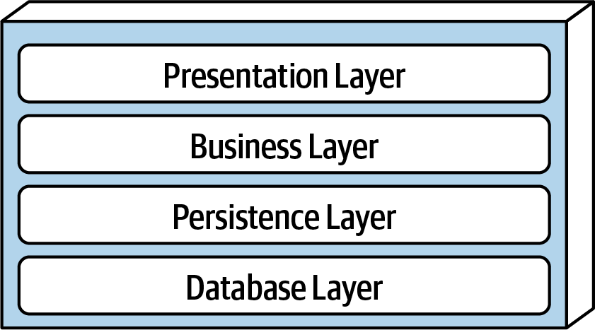
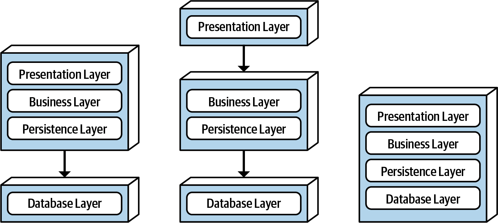
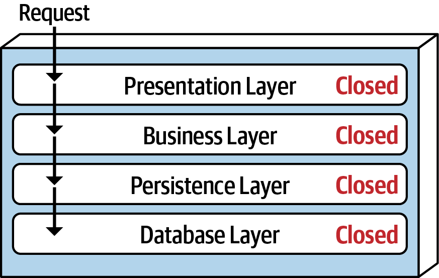
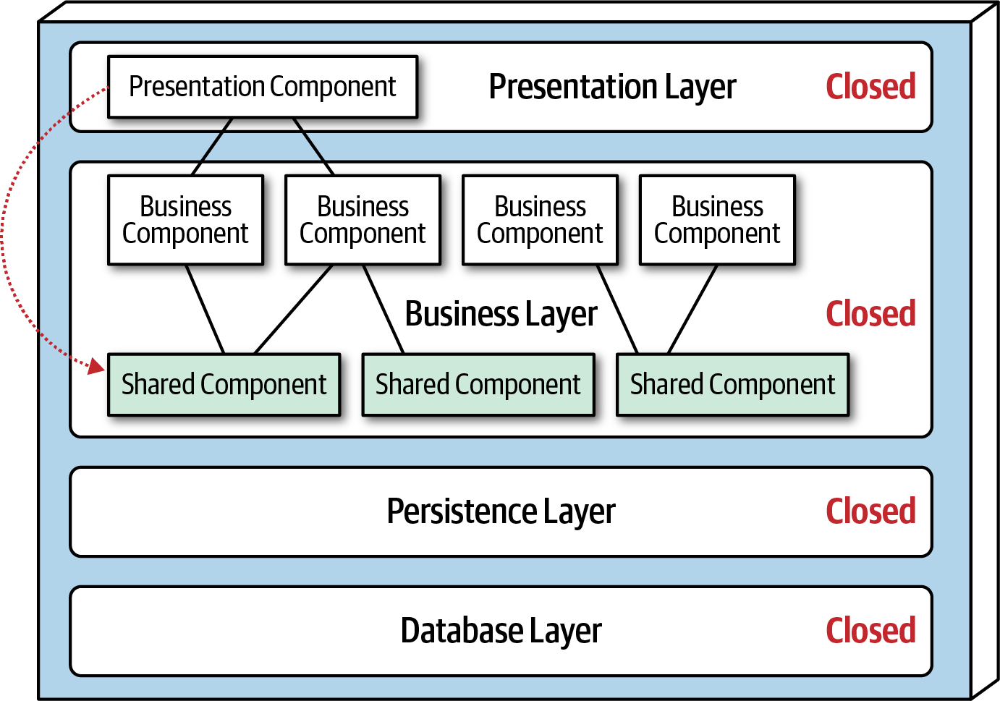
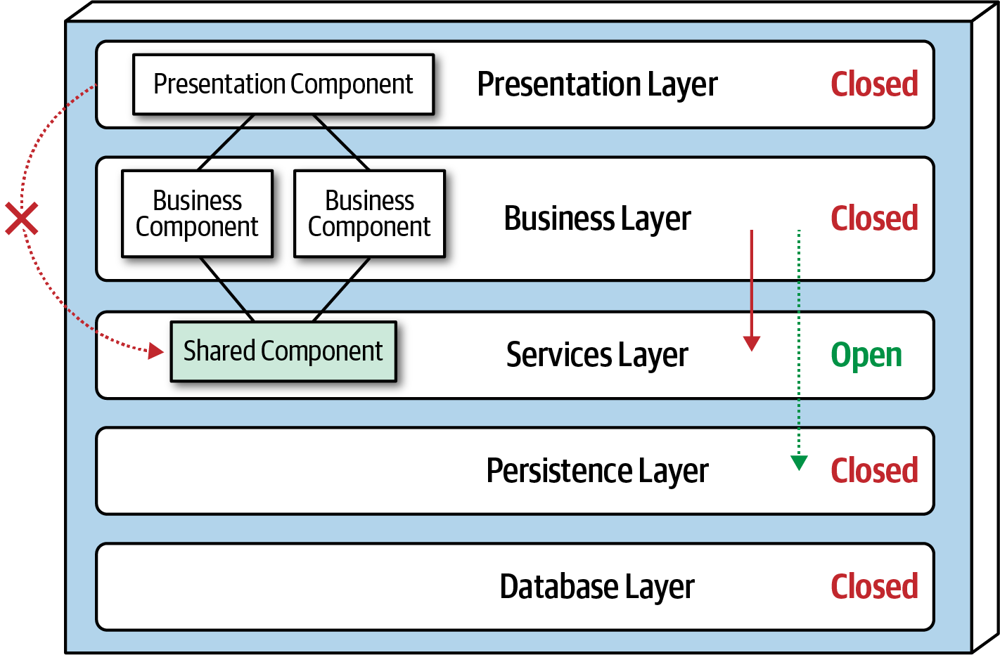
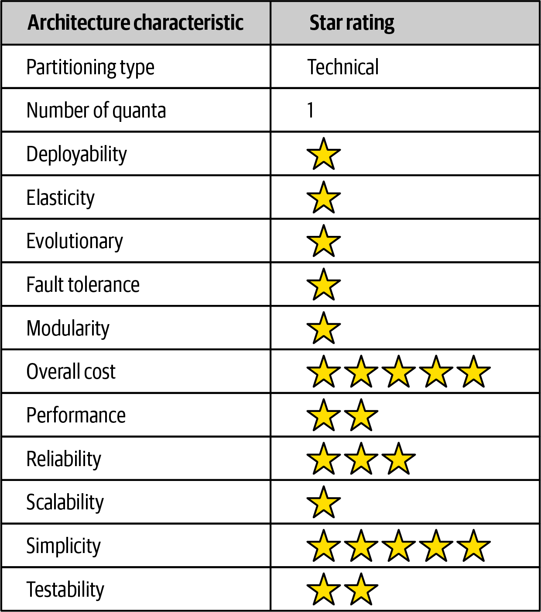

# 第 10 章 分层架构风格

> 原文章名：Layered Architecture Style
> 来源：英文第一版，书内第 133–141 页，PDF 第 153–161 页。
> 进度：第十章全文已完成本轮逐段质量校译；[校译记录](../../reviews/chapter-10-review.md)，独立复审待进行。
> 保留英文原图，并将图 10-6 的评分转录为中文表；标签对照见文末。下文页码均指原书书内页码。

<!-- 书内第 133 页，PDF 第 153 页。 -->

<!-- CH10-001 | PDF p. 133 | 正文 -->

分层架构（layered architecture），也称 n 层架构风格，是最常见的架构风格之一。它因简单、熟悉、成本低，成为大多数应用的事实标准。根据[康威定律](https://oreil.ly/Rb4uN)，设计系统的组织会受到自身沟通结构的约束，因此所设计的系统也会反映这种沟通结构。这也使分层架构成为一种自然的应用开发方式。多数组织有用户界面开发者、后端开发者、规则开发者和数据库专家；这些组织层次恰好对应传统分层架构的各层，使它成为许多业务应用的自然选择。分层架构也会落入一些反模式，包括隐含决策形成的架构（architecture by implication）和无意间形成的架构（accidental architecture）。如果开发者或架构师不确定自己采用哪种风格，或者敏捷团队“直接开始编码”，那么最终实现的很可能就是分层架构。

## 拓扑

<!-- CH10-002 | PDF p. 133 | 正文 -->

分层架构中的组件组织为逻辑上的水平层，每层承担应用中的特定角色，例如表现逻辑或业务逻辑。虽然层数与类型没有具体限制，但多数分层架构由四个标准层组成：表现层、业务层、持久层和数据库层，如图 10-1 所示。有时业务层与持久层会合并为一个业务层，尤其当 SQL 或 HSQL 等持久化逻辑嵌入业务层组件时。因此，小应用可能只有三层，更大、更复杂的业务应用可能有五层或更多。

<!-- 书内第 134 页，PDF 第 154 页。 -->

*图 10-1：分层架构中的标准逻辑层。*

<!-- CH10-003 | PDF p. 134 | 正文 -->

图 10-2 从物理分层，也就是部署角度，展示不同拓扑变体。第一种将表现、业务和持久层合为一个部署单元，数据库层通常是独立的外部物理数据库或文件系统。第二种将表现层作为独立部署单元，业务与持久层合为第二个单元，数据库层同样通常是独立的外部数据库或文件系统。第三种将四层全部合为一个部署单元，包括数据库层。对于使用内部嵌入式数据库或内存数据库的小型应用，这种形式可能很实用。许多本地部署（on-premises，简称 on-prem）产品，就采用第三种形式构建并交付客户。

*图 10-2：物理拓扑，即部署的变体。*

<!-- CH10-004 | PDF p. 134 | 正文 -->

每层在架构中都有特定角色与职责。例如，表现层处理全部用户界面和浏览器通信逻辑，业务层执行与请求有关的具体业务规则。每层围绕完成特定业务请求所需的工作形成抽象。例如，表现层不需要知道或关心如何获取客户数据，只需按特定格式显示在屏幕上。同样，业务层不必关心如何格式化客户数据显示，甚至不必关心数据来自哪里；只需从持久层获取数据，执行计算或聚合等业务逻辑，再将信息向上传给表现层。

<!-- 书内第 135 页，PDF 第 155 页；上一段跨页。 -->

<!-- CH10-005 | PDF p. 135 | 正文 -->

分层架构的关注点分离，使架构中容易建立有效的角色与职责模型。特定层的组件作用范围有限，只处理本层逻辑。例如，表现层组件仅处理表现逻辑，业务层组件仅处理业务逻辑。开发者可以发挥自己的专长，专注领域中的特定技术方面，例如表现或持久化。但这一好处的代价，是整体敏捷性不足，也就是难以快速响应变化。

<!-- CH10-006 | PDF p. 135 | 正文 -->

分层架构按技术划分，而非按领域划分。组件依据表现、业务等技术角色组织，而非客户等领域。因此，某个业务领域会散布于全部架构层中。例如，“客户”领域分布在表现层、业务层、规则层、服务层和数据库层，使该领域的变更更困难。所以，领域驱动设计与分层架构风格并不十分契合。

## 隔离层

<!-- CH10-007 | PDF p. 135 | 正文 -->

分层架构的每层可以是封闭或开放的。封闭层（closed layer）意味着，请求自顶向下穿越各层时不能跳层，必须经过紧邻的下一层，才能到达更下方，见图 10-3。例如，封闭分层架构中，表现层请求必须先经过业务层，再经过持久层，最终到达数据库层。

<!-- 书内第 136 页，PDF 第 156 页。 -->

*图 10-3：分层架构中的封闭层。*

<!-- CH10-008 | PDF p. 136 | 正文 -->

注意，图 10-3 中，对于简单查询，表现层若直接访问数据库、绕过不必要的层，会更快更容易；21 世纪初，这曾被称为快速通道读取器模式（fast-lane reader pattern）。要做到这一点，业务层与持久层必须开放，允许请求绕过。开放层与封闭层哪个更好？答案取决于一个关键概念：隔离层（layers of isolation）。

<!-- CH10-009 | PDF p. 136 | 正文 -->

隔离层意味着，只要层间契约不变，修改某一层，通常就不会影响其他层的组件。各层相互独立，对其他层内部如何工作几乎不了解。但要支持这种隔离，请求主要路径上的层必须封闭。如果表现层能直接访问持久层，那么持久层变化就会同时影响业务层和表现层，形成层间组件相互依赖、紧密耦合的应用。架构会变得脆弱，修改困难且昂贵。

<!-- CH10-010 | PDF p. 136 | 正文 -->

隔离层还允许替换任意一层，而不影响其他层，同样以良好契约及[业务委托模式（business delegate pattern）](https://oreil.ly/WeKWs)为前提。例如，可以利用这一概念，将较老的 JavaServer Faces（JSF）表现层替换为 React.js，而不影响应用的其他层。

## 增加层

<!-- CH10-011 | PDF p. 136 | 正文 -->

封闭层有助于形成隔离，从而隔离架构变化，但有时开放某些层也很合理。例如，业务层存在包含业务组件通用功能的共享对象，诸如日期和字符串工具类、审计类、日志类等。假设架构决策禁止表现层使用这些共享业务对象。图 10-4 用从表现组件指向业务层共享对象的虚线表示这一限制。这个场景很难治理，因为架构上表现层本来就可以访问业务层，因此也能访问其中的共享对象。

<!-- 书内第 137 页，PDF 第 157 页；上一段跨页。 -->

*图 10-4：业务层中的共享对象。*

<!-- CH10-012 | PDF p. 137 | 正文 -->

一种从架构上强制落实限制的方法，是新增服务层，将全部共享业务对象放在其中。由于业务层封闭，新增层就从架构上阻止表现层访问共享业务对象，见图 10-5。但新服务层必须标为开放，否则业务层访问持久层时，也会被迫经过服务层。开放服务层后，业务层既可以访问它，如实线箭头，也可以绕过它，直接访问再下一层，如虚线箭头。

<!-- 书内第 138 页，PDF 第 158 页。 -->

*图 10-5：向架构增加一个新的服务层。*

<!-- CH10-013 | PDF p. 138 | 正文 -->

利用开放与封闭层的概念，可以定义层之间及请求流的关系，也为开发者提供理解访问限制所需的信息和指导。如果不记录、或未正确传达哪些层开放、哪些层封闭以及原因，通常就会形成紧密耦合、脆弱的架构，难以测试、维护和部署。

## 其他考虑因素

<!-- CH10-014 | PDF p. 138 | 正文 -->

当尚不确定最终采用哪种架构风格时，分层架构是多数应用的良好起点。在许多微服务项目中，这很常见：架构师仍在判断微服务是否合适，但开发必须启动。不过，采用这种方法时，应尽量控制复用范围，并保持较浅的对象继承层次（也就是不要让继承树太深），以维持良好的模块化。这有助于以后转向其他架构风格。

<!-- CH10-015 | PDF p. 138 | 正文 -->

分层架构需要警惕架构陷坑（architecture sinkhole）反模式。当请求在各层之间仅仅透传，每层都不执行业务逻辑时，就会发生。例如，用户简单查询客户姓名、地址等基本数据，表现层将请求交给业务层，业务层只转给规则层，规则层只转给持久层，持久层再向数据库层发出简单 SQL。随后，数据逐层返回，没有额外的聚合、计算、规则应用或转换。这造成不必要的对象创建和处理，影响内存消耗与性能。

<!-- 书内第 139 页，PDF 第 159 页；上一段跨页。 -->

<!-- CH10-016 | PDF p. 139 | 正文 -->

每个分层架构至少都有一些陷坑场景。判断反模式是否严重，关键是分析这类请求占比。二八法则通常是可参考的做法：如果只有 20% 请求属于陷坑，可以接受；如果达到 80%，则很可能说明分层架构不适合问题领域。另一个办法是让所有层都开放，当然，代价是更难管理架构中的变化。

## 为什么采用这种架构风格

<!-- CH10-017 | PDF p. 139 | 正文 -->

分层架构适合小型、简单应用或网站，也适合时间和预算非常紧张的情况，尤其可作为起点。由于简单且为开发者、架构师熟悉，它可能是成本最低的风格之一，方便开发小型应用。当架构师仍在分析业务需要与需求，不确定何种风格最好时，它也是不错的选择。

<!-- CH10-018 | PDF p. 139 | 正文 -->

但应用增长时，可维护性、敏捷性、可测试性与可部署性会受到不利影响。因此，采用分层架构的大型应用和系统，可能更适合其他模块化程度更高的风格。

## 架构特性评分

<!-- CH10-019 | PDF p. 139 | 正文 -->

图 10-6 中，一星表示该特性在架构中支持较弱，五星表示它是这种风格最强的特征之一。各特性的定义见第 4 章。

<!-- 书内第 140 页，PDF 第 160 页。 -->

*图 10-6：分层架构特性评分。*

<!-- CH10-020 | PDF p. 140 | 评分表说明 -->

图 10-6 中文转录：

<!-- CH10-021 | PDF p. 140 | 评分表 -->

| 架构特性 | 星级或取值 |
| --- | --- |
| 划分类型 | 技术划分 |
| 量子数量 | 1 |
| 可部署性 | 1 / 5 |
| 弹性 | 1 / 5 |
| 可演进性 | 1 / 5 |
| 容错性 | 1 / 5 |
| 模块化 | 1 / 5 |
| 总体成本 | 5 / 5 |
| 性能 | 2 / 5 |
| 可靠性 | 3 / 5 |
| 可扩展性 | 1 / 5 |
| 简单性 | 5 / 5 |
| 可测试性 | 2 / 5 |

<!-- CH10-022 | PDF p. 140 | 正文 -->

总体成本与简单性，是分层架构的主要优势。由于本质上是单体，它没有分布式风格的复杂性，简单易懂，构建和维护成本相对较低。不过，需要注意，分层单体越大越复杂，这些评分就会迅速下降。

<!-- CH10-023 | PDF p. 140 | 正文 -->

这一风格的可部署性和可测试性都很低。可部署性低，源于部署过程繁重、风险高，以及不频繁发布。只改一个类文件中的三行，也必须重新部署整个单元，同时可能夹带数据库、配置或其他代码变更。而这三行变更通常还会与几十项其他变更捆绑，进一步增加部署风险，原文同时称会增加部署频率。可测试性低也反映这一场景：只改三行时，多数开发者不会花几个小时执行整个回归测试集，即便项目一开始就建立了完整的回归测试集，尤其当单体应用同时还有几十项其他变化。由于可以用 mock（模拟对象）或 stub（桩件）替代组件，甚至对整层进行模拟，从而减轻整体测试工作，我们给可测试性两星，而非一星。

<!-- 书内第 141 页，PDF 第 161 页；上一段跨页。 -->

<!-- CH10-024 | PDF p. 141 | 译注 -->

> 译注：原文先说缺乏频繁部署，随后又说批量变更“增加部署频率”，表述存在张力；分别保留原意，不静默改为降低频率。

<!-- CH10-025 | PDF p. 141 | 正文 -->

整体可靠性中等，三星，主要因为不像大多数分布式架构那样受到网络通信、带宽和延迟的影响。只给三星，是考虑到单体部署性质、测试完整程度低，以及部署风险。

<!-- CH10-026 | PDF p. 141 | 正文 -->

弹性与可扩展性都很低，一星，主要因为单体部署和缺乏架构模块化。虽然可以让单体某些功能比其他功能扩展得更多，但通常需要多线程、内部消息、其他并行处理等复杂设计，而这种风格并不擅长它们。由于单体用户界面、后端处理和单体数据库，使分层架构始终只有一个系统量子，应用在单个量子下的扩展能力存在上限。

<!-- CH10-027 | PDF p. 141 | 正文 -->

性能总是一项有趣的评分。我们只给两星，因为缺乏并行处理、封闭分层和架构陷坑，使这种风格不天然适合高性能系统。与可扩展性一样，可以通过缓存、多线程等改善，但它不是这种风格自然具备的特性，架构师和开发者必须付出很大努力。

<!-- CH10-028 | PDF p. 141 | 正文 -->

由于单体部署和缺乏架构模块化，分层架构不支持容错。某个小部分导致内存耗尽，整个应用单元就会受影响并崩溃。此外，许多单体应用恢复平均耗时较高，也就是平均恢复时间（mean time to recovery，MTTR）较高，影响整体可用性。小应用启动可能需要两分钟，大型应用通常需要十五分钟甚至更久。

---

## 图中文字中文对照（译者整理）

### 图 10-1

表现层（Presentation Layer）、业务层（Business Layer）、持久层（Persistence Layer）、数据库层（Database Layer）。

### 图 10-2

标签同图 10-1；从左到右展示三种部署组合。

### 图 10-3

请求（Request）、封闭（Closed）；各层名称同图 10-1。

### 图 10-4

表现组件（Presentation Component）、业务组件（Business Component）、共享组件（Shared Component）；其余同图 10-1，Closed 为封闭。

### 图 10-5

新增服务层（Services Layer），标为开放（Open）；其余层为封闭（Closed）。

### 图 10-6

表头：架构特性（Architecture characteristic）、星级（Star rating）。各行的中文及对应星数已在正文转录。“总体成本”五星表示成本方面更有优势，不表示费用高。
