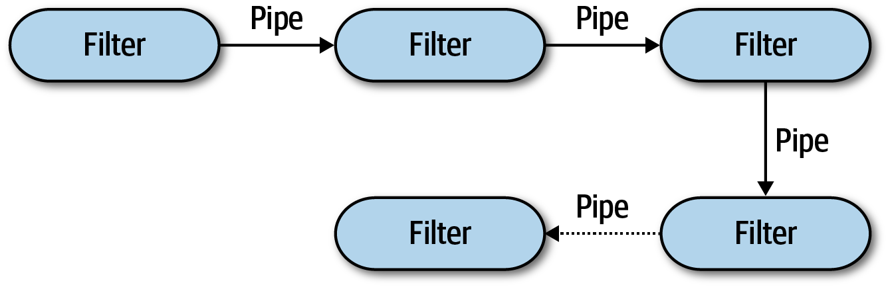
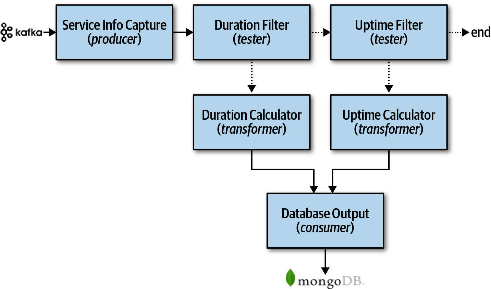
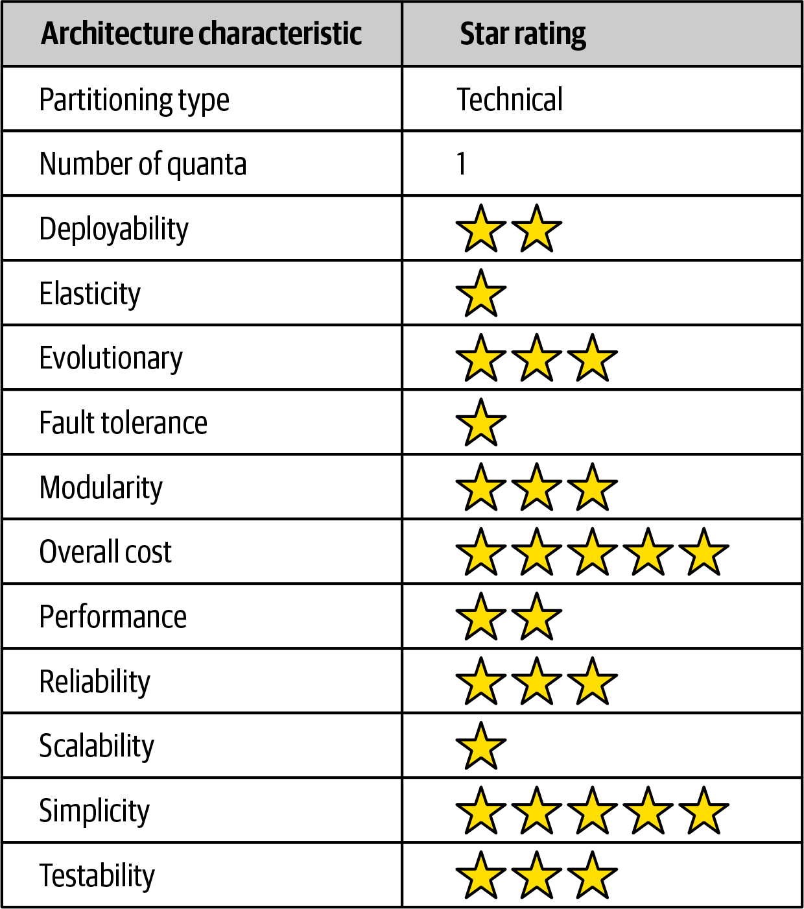

# 第 11 章 管道架构风格

> 原文章名：Pipeline Architecture Style
> 来源：英文第一版，书内第 143–148 页，PDF 第 163–168 页。
> 上一轮校译记录：[校译记录](../../reviews/chapter-11-review.md)。
> 独立复审：已完成原文逐段对照、中文通读与相关附件检查，见[本次报告](../../reviews/independent-pass/chapter-11.md)。
> 保留英文原图及 Shell 示例；图 11-3 的评分附中文转录。下文页码均指原书书内页码。

<!-- 书内第 143 页，PDF 第 163 页。 -->

<!-- CH11-001 | PDF p. 163 | 正文 -->

软件架构中一种反复出现的基本风格是管道架构（pipeline architecture），也称管道与过滤器架构（pipes and filters architecture）。一旦开发者和架构师决定把功能拆分为不同部分，这种模式也就随之出现。多数开发者都熟悉它，因为它是 [Bash](https://oreil.ly/uP2Bo)、[Zsh](https://oreil.ly/40UyF) 等 Unix 终端 Shell 语言背后的基本原理。

<!-- CH11-002 | PDF p. 163 | 正文 -->

使用许多函数式语言的开发者，会发现语言中的构造与这种架构的元素有相似之处。事实上，许多采用 [MapReduce](https://oreil.ly/veX6W) 编程模型的工具，都遵循这一基本拓扑。虽然这些例子展示的是较低层次的实现，但管道架构同样可用于更高层次的业务应用。

## 拓扑

<!-- CH11-003 | PDF p. 163 | 正文 -->

管道架构由管道与过滤器组成，如图 11-1 所示。



*图 11-1：管道架构的基本拓扑。*

<!-- 书内第 144 页，PDF 第 164 页。 -->

<!-- CH11-004 | PDF p. 164 | 正文 -->

管道与过滤器以特定方式协作，管道在过滤器之间形成单向通信，通常为点对点。

### 管道

<!-- CH11-005 | PDF p. 164 | 正文 -->

管道（pipe）构成过滤器之间的通信通道。出于性能考虑，每条管道通常单向且点对点，而非广播，从一个来源接收输入，并将输出送到另一个目标。载荷可以采用任何数据格式，但架构师倾向于使用较小的数据量，以实现高性能。

### 过滤器

<!-- CH11-006 | PDF p. 164 | 正文 -->

过滤器（filter）是自包含的，独立于其他过滤器，而且通常无状态。每个过滤器应只执行一项任务；复合任务应由一系列过滤器完成，而非单个过滤器。

<!-- CH11-007 | PDF p. 164 | 正文 -->

这一风格有四类过滤器：

**生产者（Producer）**

<!-- CH11-008 | PDF p. 164 | 正文 -->

流程起点，只有输出，有时称为源（source）。

**转换器（Transformer）**

<!-- CH11-009 | PDF p. 164 | 正文 -->

接受输入，可选择对部分或全部数据进行转换，然后转发到输出管道。函数式编程者会认出它类似 `map`。

**测试器（Tester）**

<!-- CH11-010 | PDF p. 164 | 正文 -->

接受输入，检查一个或多个条件，再根据检查结果选择是否输出。原文称，函数式编程者会发现它类似 `reduce`。

<!-- CH11-011 | PDF p. 164 | 译注 -->

> 译注：保留原文对 `reduce` 的类比，不将其作为函数式归约操作的严格定义。

**消费者（Consumer）**

<!-- CH11-012 | PDF p. 164 | 正文 -->

管道流终点。有时将最终结果持久化到数据库，也可能将结果显示在用户界面上。

<!-- CH11-013 | PDF p. 164 | 正文 -->

管道和过滤器的单向、简单特性有助于组合式复用。许多开发者在使用 Shell 时都体会到了这一点。博客文章 [More Shell, Less Egg](https://oreil.ly/ljeb5) 中的一个著名故事，展示了这些抽象有多强大。Donald Knuth 应邀解决一个文本处理问题：读取文本文件，找出最常出现的 n 个单词，再按频率排序，输出单词及其出现次数。他写了十多页 Pascal 代码，并在过程中设计、记录了一种新算法。随后，Doug McIlroy 展示了一段短到可以放进一条 Twitter 帖子的 Shell 脚本；只要理解 Shell 命令，就能用更简单、优雅、易懂的方式解决这个问题：

<!-- 书内第 145 页，PDF 第 165 页。 -->

<!-- CH11-014 | PDF p. 165 | Shell 示例 -->

```sh
tr -cs A-Za-z '\n' |
    tr A-Z a-z |
    sort |
    uniq -c |
    sort -rn |
    sed ${1}q
```

<!-- CH11-015 | PDF p. 165 | 正文 -->

即使 Unix Shell 的设计者，也经常惊讶于开发者如何创造性地组合这些简单而强大的抽象。

## 示例

<!-- CH11-016 | PDF p. 165 | 正文 -->

管道架构出现在多种应用中，尤其适合简单、单向处理。例如，许多电子数据交换（Electronic Data Interchange，EDI）工具，用管道与过滤器将一种文档转换为另一种。ETL，即提取、转换、加载工具，也利用它将数据从一个数据库或数据源移动到另一个，并进行修改。[Apache Camel](https://camel.apache.org) 等编排器和中介，则使用管道架构，将业务流程中的信息从一步传到下一步。

<!-- CH11-017 | PDF p. 165 | 正文 -->

为说明如何使用，考虑图 11-2：各种服务遥测信息以流的形式，从服务发送到 [Apache Kafka](https://kafka.apache.org)。



*图 11-2：管道架构示例。*

<!-- 书内第 146 页，PDF 第 166 页。 -->

<!-- CH11-018 | PDF p. 166 | 正文 -->

图 11-2 展示了如何用管道架构处理流入 Kafka 的不同数据。服务信息采集（Service Info Capture）是生产者过滤器，它订阅 Kafka 主题、接收服务信息，再将数据传给耗时过滤器（Duration Filter）。耗时过滤器是测试器，用来判断数据是否涉及以毫秒计的服务请求耗时。

<!-- CH11-019 | PDF p. 166 | 正文 -->

各过滤器体现了关注点分离：采集过滤器只负责连接 Kafka 主题并接收流数据；耗时过滤器只负责判断数据，并决定是否将其路由到下一条管道。如果数据涉及请求耗时，就交给耗时计算器（Duration Calculator）这一转换器；否则，就传给运行时间过滤器（Uptime Filter），检查数据是否属于运行时间指标。如果不是，管道便结束，因为这条数据与当前处理流无关；如果是，就交给运行时间计算器（Uptime Calculator）计算指标。两个转换器会将处理后的数据交给数据库输出（Database Output）这一消费者，再由它持久化到 [MongoDB](https://www.mongodb.com)。

<!-- CH11-020 | PDF p. 166 | 译注 -->

> 译注：原文前面及图中将采集过滤器称为 Service Info Capture，后文却写成 Service Metrics Capture。译文视为同一过滤器，保留两种英文名称以标明原文差异。

<!-- CH11-021 | PDF p. 166 | 正文 -->

这个例子展示了管道架构的可扩充性。例如，在运行时间过滤器之后，很容易增加一个测试器，将数据路由到新增指标的处理流程，例如数据库连接等待时间。

## 架构特性评分

<!-- CH11-022 | PDF p. 166 | 正文 -->

图 11-3 中，一星表示支持较弱，五星表示该特性是风格的强项之一。特性定义见第 4 章。

<!-- CH11-023 | PDF p. 166 | 正文 -->

管道架构将应用逻辑划分为生产者、测试器、转换器和消费者，因此属于技术划分。又因为通常采用单体部署，架构量子始终为一。

<!-- 书内第 147 页，PDF 第 167 页。 -->



*图 11-3：管道架构特性评分。*

<!-- CH11-024 | PDF p. 167 | 评分表说明 -->

图 11-3 中文转录：

<!-- CH11-025 | PDF p. 167 | 评分表 -->

| 架构特性 | 星级或取值 |
| --- | --- |
| 划分类型 | 技术划分 |
| 量子数量 | 1 |
| 可部署性 | 2 / 5 |
| 弹性 | 1 / 5 |
| 可演进性 | 3 / 5 |
| 容错性 | 1 / 5 |
| 模块化 | 3 / 5 |
| 总体成本 | 5 / 5 |
| 性能 | 2 / 5 |
| 可靠性 | 3 / 5 |
| 可扩展性 | 1 / 5 |
| 简单性 | 5 / 5 |
| 可测试性 | 3 / 5 |

<!-- CH11-026 | PDF p. 167 | 正文 -->

总体成本、简单性和模块化是管道架构的主要优势。它本质上是单体，不具有分布式风格的复杂性，简单易懂，构建和维护成本相对较低。通过不同过滤器与转换器之间的关注点分离，可以实现架构模块化。任何过滤器都可以修改或替换，而不影响其他过滤器。例如，图 11-2 的 Kafka 示例中，可以修改耗时计算器的计算方式，而不影响其他过滤器。

<!-- CH11-027 | PDF p. 167 | 正文 -->

可部署性和可测试性虽然大致处于一般水平，但过滤器带来的模块化，使它们略高于分层架构。不过，这仍然是单体，部署工作量、风险、发布频率以及测试完整程度，仍然影响它。

<!-- 书内第 148 页，PDF 第 168 页。 -->

<!-- CH11-028 | PDF p. 168 | 正文 -->

与分层架构一样，整体可靠性中等，三星，主要因为没有大多数分布式架构中常见的网络通信、带宽和延迟问题。只给三星，是因为单体部署，以及测试与部署问题，例如任何变更都必须测试和部署整个单体。

<!-- CH11-029 | PDF p. 168 | 正文 -->

弹性与可扩展性都很低，只有一星，主要原因是采用单体部署。虽然可以让单体中的某些功能比其他功能扩展得更多，但通常需要多线程、内部消息和其他并行处理等复杂技术，而管道架构并不擅长这些做法。由于采用单体用户界面、后端处理和单体数据库，管道架构始终只有一个系统量子，因此应用的扩展能力受单个架构量子的上限约束。

<!-- CH11-030 | PDF p. 168 | 正文 -->

原文称，由于单体部署和缺乏架构模块化，管道架构不支持容错。某个小部分导致内存耗尽，整个应用单元就会受到影响并崩溃。另外，大多数单体应用平均恢复时间较高，会影响整体可用性：小应用启动约需两分钟，大型应用通常十五分钟甚至更久。

<!-- CH11-031 | PDF p. 168 | 译注 -->

> 译注：原文前面强调过滤器带来模块化，末段又称“缺乏架构模块化”，两处表述不完全一致；此处分别保留。评分对应本书以单体为主的管道风格，不自动覆盖所有分布式流处理实现。

---

## 图中文字中文对照（译者整理）

### 图 11-1

过滤器（Filter）、管道（Pipe）。箭头表示单向数据流。

### 图 11-2

Kafka → 服务信息采集（Service Info Capture，生产者 producer）→ 耗时过滤器（Duration Filter，测试器 tester）与运行时间过滤器（Uptime Filter，测试器 tester）；转换器分别为耗时计算器（Duration Calculator，transformer）与运行时间计算器（Uptime Calculator，transformer）；消费者为数据库输出（Database Output，consumer），最终写入 MongoDB；end 表示结束。

### 图 11-3

表头与各项评分已在正文转录。总体成本高星表示成本方面更有优势。
