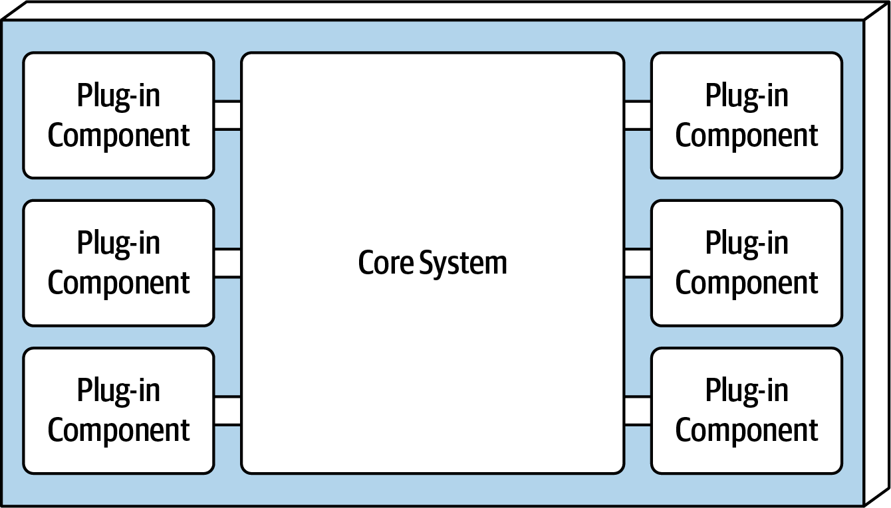
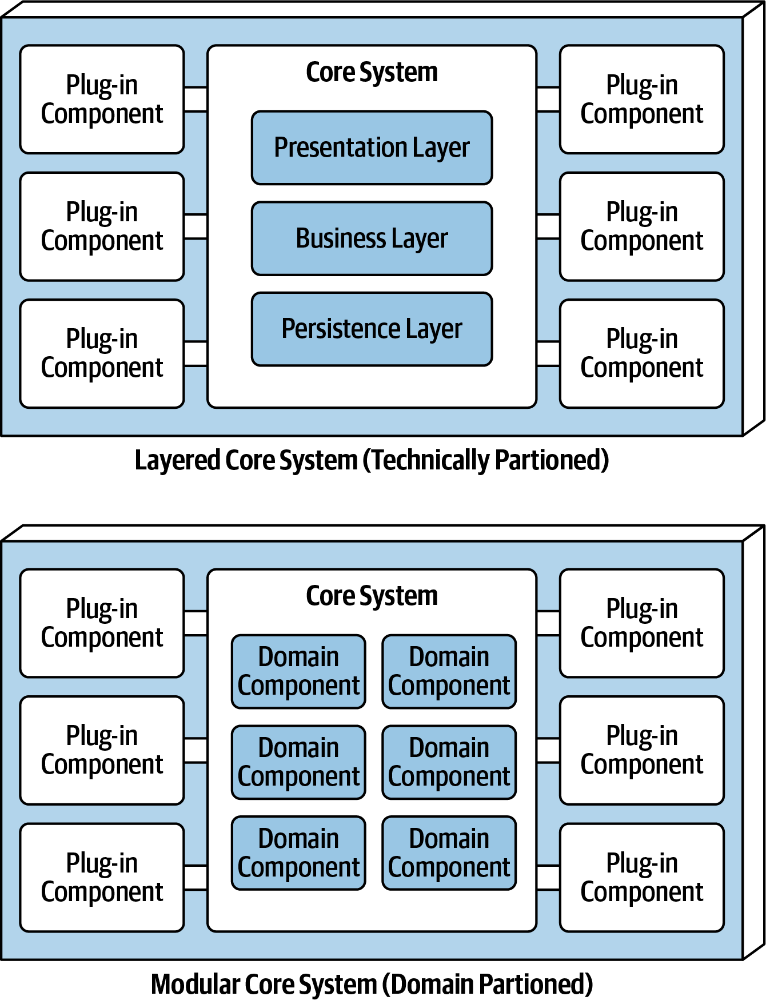
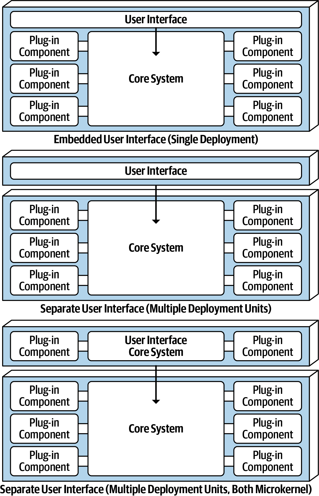
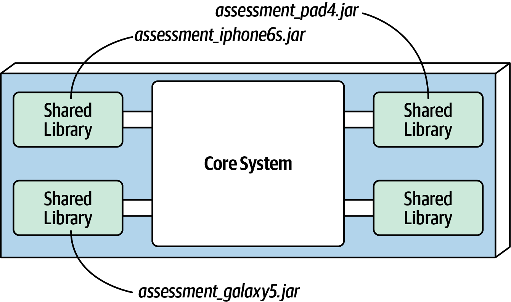
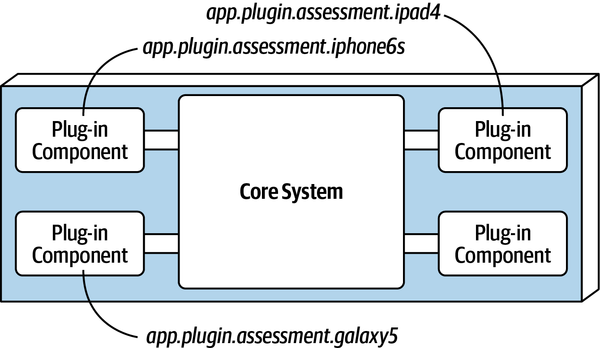
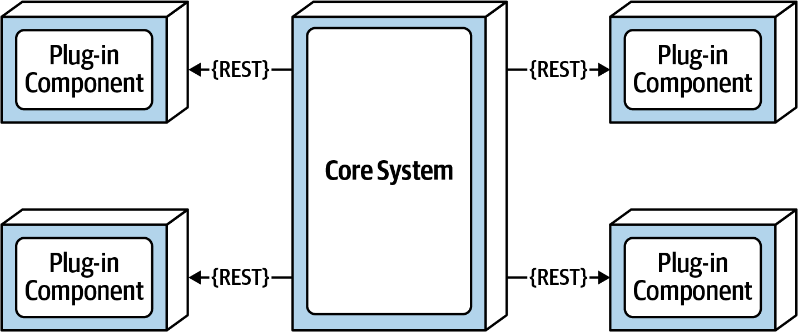
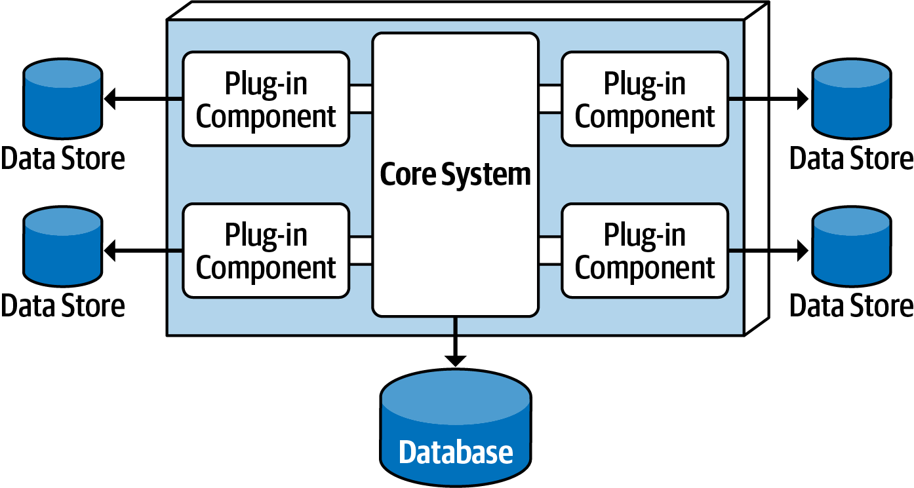
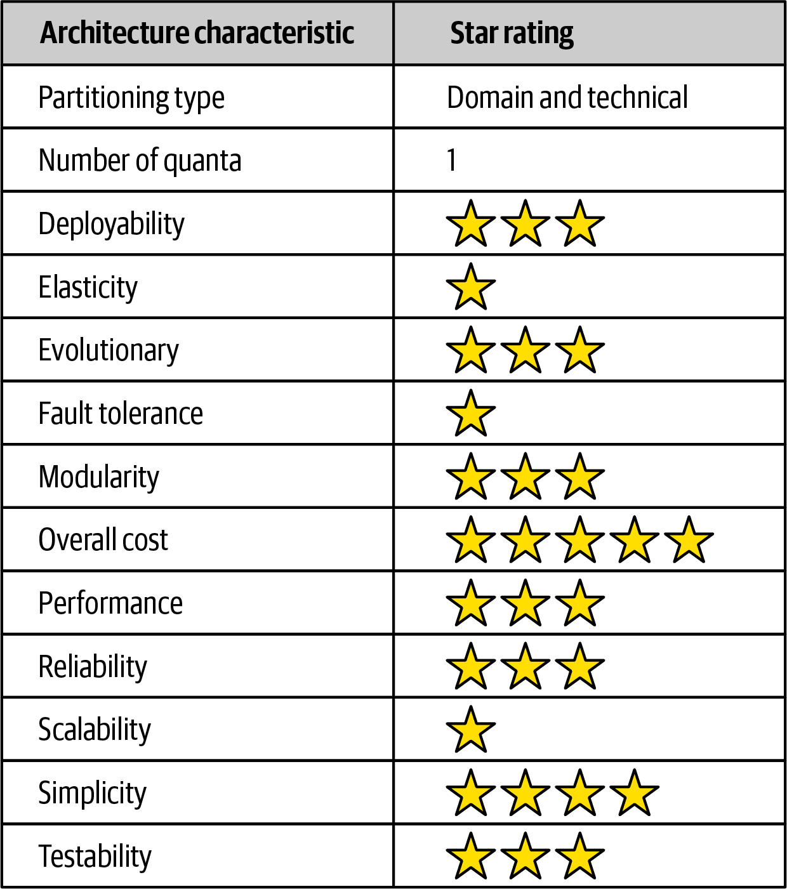

# 第 12 章 微内核架构风格

> 原文章名：Microkernel Architecture Style
> 来源：英文第一版，书内第 149–161 页，PDF 第 169–181 页。
> 进度：第十二章全文已翻译并对照原文校订。
> 保留英文原图及代码片段，评分附中文转录；下文页码均指原书书内页码。代码为原书示意，未作为可运行工程验证。

<!-- 书内第 149 页，PDF 第 169 页。 -->

微内核架构（microkernel architecture），也称插件架构（plug-in architecture），几十年前就已提出，如今仍广泛使用。它天然适合产品型应用：打包为可下载、安装的单体部署，通常作为第三方产品安装在客户现场。许多非产品化的定制业务应用，也广泛采用这种风格。

## 拓扑

微内核是一种相对简单的单体架构，由两类架构组件组成：核心系统与插件组件。应用逻辑在独立插件和基本核心之间划分，为功能与定制处理逻辑提供可扩充性、适应性及隔离。基本拓扑见图 12-1。

<!-- 书内第 150 页，PDF 第 170 页。 -->



*图 12-1：微内核架构风格的基本组件。*

### 核心系统

核心系统（core system）的正式定义，是运行系统所需的最小功能。Eclipse IDE 是一个好例子：其核心只是基本文本编辑器，能够打开文件、修改文本、保存文件；加入插件后，才开始成为可用产品。另一个定义，是应用中几乎不包含定制处理的正常路径（happy path），也就是通用处理流程。将核心中的圈复杂度移入独立插件，可以改善可扩充性、可维护性与可测试性。例如，电子设备回收应用必须针对收到的每种设备执行专门评估规则，Java 代码可能如下：

```java
public void assessDevice(String deviceID) {
    if (deviceID.equals("iPhone6s")) {
        assessiPhone6s();
    } else if (deviceID.equals("iPad1"))
        assessiPad1();
    } else if (deviceID.equals("Galaxy5"))
        assessGalaxy5();
    } else ...
        ...
    }
}
```

> 译注：该片段按原书保留省略号和不配对的花括号，用于说明分支随设备增加而增长，不是可编译实现。

<!-- 书内第 151 页，PDF 第 171 页。 -->

与其将所有客户特定的定制逻辑和大量圈复杂度放在核心里，不如为每种设备创建独立插件。这样不仅将设备逻辑与其他流程隔离，也支持扩充。新增设备，只需增加插件并更新注册表。采用微内核时，核心只需定位并调用对应设备插件，如下：

```java
public void assessDevice(String deviceID) {
    String plugin = pluginRegistry.get(deviceID);
    Class<?> theClass = Class.forName(plugin);
    Constructor<?> constructor = theClass.getConstructor();
    DevicePlugin devicePlugin =
        (DevicePlugin)constructor.newInstance();
    DevicePlugin.assess();
}
```

> 译注：原书先创建实例变量 `devicePlugin`，最后却以 `DevicePlugin.assess()` 调用，类名与实例名不一致，保留原样。

这个例子中，评估特定设备的复杂规则与指令，自包含于独立插件，核心可以通用地执行它。

根据规模与复杂度，核心可以实现为分层架构或模块化单体，如图 12-2。有时，核心也可拆为独立部署的领域服务，每个服务含专属于该领域的插件。例如，支付处理领域服务代表核心，各种支付方法，如信用卡、PayPal、店内信用额度、礼品卡和采购订单，分别作为支付领域插件。上述各种情况，整个单体应用通常共享一个数据库。

<!-- 书内第 152 页，PDF 第 172 页。 -->



*图 12-2：微内核架构核心系统的变体。*

表现层可以嵌入核心，也可以是独立用户界面，由核心提供后端服务。独立界面本身也能采用微内核架构。图 12-3 展示这些界面与核心的组合。

<!-- 书内第 153 页，PDF 第 173 页。 -->



*图 12-3：用户界面变体。*

### 插件组件

插件组件（plug-in components）是独立、自包含的组件，包含专门处理、附加功能和定制代码，用于增强或扩展核心。也可以隔离变化频繁的代码，改善可维护性与可测试性。理想情况下，各插件彼此独立，没有相互依赖。

<!-- 书内第 154 页，PDF 第 174 页；上一段跨页。 -->

插件与核心通常点对点通信，也就是连接两者的“管道”通常是对插件入口类的方法或函数调用。插件还可以分为编译期与运行时两类。运行时插件能够不重新部署核心或其他插件，就在运行中增删，通常由 Java 的 [OSGi](https://www.osgi.org)、[Penrose](https://oreil.ly/J5XZw)、[Jigsaw](https://oreil.ly/wv9bW)，或 .NET 的 [Prism](https://oreil.ly/xmrtY) 等框架管理。编译期插件更容易管理，但修改、添加或移除时，必须重新部署整个单体应用。

点对点插件可以实现为 JAR、DLL 或 Gem 等共享库，也可以是 Java 包或 C# 命名空间。继续电子回收评估的例子，每个设备插件可实现为独立共享库，设备名对应库名，如图 12-4 所示。



*图 12-4：共享库形式的插件实现。*

更简单的替代方式如图 12-5：在同一代码库或 IDE 项目中，将每个插件实现为独立命名空间或包。创建命名空间时，我们建议采用 `app.plug-in.<domain>.<context>` 这样的语义。例如，`app.plugin.assessment.iphone6s`，第二个节点 `plugin` 明确表示它是插件，因此必须严格遵守自包含、与其他插件分离等基本规则。第三个节点描述领域，此处为评估（assessment），便于按共同目的组织插件。第四个节点 `iphone6s` 描述具体上下文，方便定位设备插件进行修改和测试。

<!-- 书内第 155 页，PDF 第 175 页；上一段跨页。 -->

> 译注：原文命名模板写 `plug-in`，具体示例写 `plugin`，两者不同，分别保留；实际命名需符合语言规则。



*图 12-5：包或命名空间形式的插件实现。*

插件不一定只能与核心进行点对点通信。也可通过 REST 或消息调用，每个插件成为独立服务，甚至是容器中的微服务。虽然看起来能提高整体可扩展性，但图 12-6 的拓扑仍只有一个架构量子，因为核心是单体，每个请求都必须先经过核心才能到插件服务。



*图 12-6：通过 REST 远程访问插件。*

将插件实现为独立服务并远程访问，可以更好地解耦组件，改善可扩展性与吞吐量，也可以不依赖 OSGi、Jigsaw 或 Prism 等专门框架，就在运行时修改。还支持异步通信，某些场景下可大幅提高用户响应体验。例如，核心异步启动某个设备评估，不必等待；完成后，插件经另一条异步消息通道通知核心，再由核心通知用户。

<!-- 书内第 156 页，PDF 第 176 页；上一段跨页。 -->

收益伴随权衡。远程插件将微内核从单体变为分布式，使多数第三方本地部署产品更难实现与部署，也增加总体复杂性、成本与部署拓扑的复杂程度。插件无响应或未运行时，尤其采用 REST，整个请求就无法完成；单体部署不会以同样方式出现这一问题。选择核心到插件采用点对点还是远程通信，应依据具体需求，并仔细分析利弊。

插件直接连接中心共享数据库，并不常见。通常由核心承担这一职责，将所需数据传给插件，主要目的是解耦：数据库变更只应影响核心，而非插件。不过，插件可以拥有只有自己能访问的独立数据存储。例如，电子回收系统中，每个设备评估插件都可以有一个简单数据库或规则引擎，保存该产品的评估规则。存储可以是图 12-7 的外部形式，也可以嵌入插件或单体部署，如内存或嵌入式数据库。

<!-- 书内第 157 页，PDF 第 177 页。 -->



*图 12-7：插件组件可以拥有自己的数据存储。*

## 注册表

核心需要知道哪些插件可用，以及如何访问。常见方式是插件注册表（registry），保存插件名称、数据契约和远程访问协议细节等信息，具体取决于连接方式。例如，税务软件中标记高风险审计项的插件，注册项可能包含服务名 `AuditChecker`、输入输出数据契约，以及 XML 契约格式。

注册表可以只是核心内部的映射结构，包含键与插件引用；也可以复杂到采用内嵌或外部部署的注册发现工具，如 [Apache ZooKeeper](https://zookeeper.apache.org) 或 [Consul](https://www.consul.io)。以下 Java 代码为核心实现简单注册表，以 iPhone 6S 评估为例，分别展示点对点、消息和 RESTful 条目：

```java
Map<String, String> registry = new HashMap<String, String>();
static {
    //point-to-point access example
    registry.put("iPhone6s", "Iphone6sPlugin");
    //messaging example
    registry.put("iPhone6s", "iphone6s.queue");
    //restful example
    registry.put("iPhone6s", "https://atlas:443/assess/iphone6s");
}
```

注释依次表示点对点访问、消息、RESTful 三种示例。

> 译注：三个条目演示替代方式，却使用同一个键；实际一起执行时会覆盖。片段还将非 `static` 声明的字段用于静态初始化块，作为完整类实现前需核对。此处保留原书示意。

<!-- 书内第 158 页，PDF 第 178 页。 -->

## 契约

同一领域的插件与核心之间，通常使用标准契约，包含行为、输入数据和返回输出。第三方插件使用无法控制的契约时，可能出现定制契约。这时，常在插件契约与标准契约之间创建适配器，让核心不必为每个插件编写专门代码。

契约可采用 XML、JSON，甚至是核心与插件之间往返传递的对象。继续电子回收应用，以下标准 Java 接口 `AssessmentPlugin` 定义整体行为 `assess()`、`register()`、`deregister()`，及预期输出 `AssessmentOutput`：

```java
public interface AssessmentPlugin {
    public AssessmentOutput assess();
    public String register();
    public String deregister();
}

public class AssessmentOutput {
    public String assessmentReport;
    public Boolean resell;
    public Double value;
    public Double resellPrice;
}
```

这一契约要求设备评估插件返回格式化字符串形式的报告；一个转售标记，真或假，表示设备能否在第三方市场转售，还是应安全处置；如果可以转售，也就是另一种回收形式，还应提供估算价值与建议转售价。

注意核心与插件之间的职责划分，尤其是 `assessmentReport` 字段。核心不负责格式化或理解报告细节，只负责打印或显示给用户。

## 示例与用例

许多用于开发和发布软件的工具都采用微内核，例如 [Eclipse IDE](https://www.eclipse.org/ide)、[PMD](https://pmd.github.io)、[Jira](https://www.atlassian.com/software/jira) 和 [Jenkins](https://jenkins.io)。Chrome、Firefox 等浏览器也是常见产品例子：查看器和其他插件增加基本浏览器核心原本不具备的能力。产品软件的例子不胜枚举，那大型业务应用呢？同样适用。以保险公司的理赔处理为例。

<!-- 书内第 159 页，PDF 第 179 页；上一段跨页。 -->

理赔流程非常复杂。不同司法辖区对允许或不允许理赔的规定不同。例如，某些州允许挡风玻璃被石子损坏后免费更换，其他州却不允许。这给标准理赔流程带来近乎无穷的条件组合。

多数理赔应用利用庞大复杂的规则引擎处理其中大部分复杂性。但规则引擎也可能变成复杂的大泥球：修改一条规则影响其他规则，简单变更也需要大批分析师、开发者与测试人员确保没有破坏其他内容。微内核能解决其中许多问题。

每个司法辖区的规则可以放在独立插件，使用源代码实现，或者由插件访问特定规则引擎实例。这样，可增加、删除或修改某个辖区规则，而不影响其他部分；新增或移除辖区也一样。核心则是较少变化的、提交与处理理赔的标准流程。

另一个大型复杂业务例子是报税软件。例如，美国有一个基本的两页 1040 表格，汇总计算个人纳税额所需信息。每行的单个数字，例如总收入，都要经过许多其他表格与工作表计算。这些附加表格可以分别实现为插件，1040 汇总表成为核心，也就是驱动方。税法变化就能隔离到单个插件，使修改更容易、风险更低。

## 架构特性评分

<!-- 书内第 160 页，PDF 第 180 页。 -->

图 12-8 中，一星表示支持较弱，五星表示该特性是强项之一。各特性定义见第 4 章。



*图 12-8：微内核架构特性评分。*

图 12-8 中文转录：

| 架构特性 | 星级或取值 |
| --- | --- |
| 划分类型 | 领域与技术划分 |
| 量子数量 | 1 |
| 可部署性 | 3 / 5 |
| 弹性 | 1 / 5 |
| 可演进性 | 3 / 5 |
| 容错性 | 1 / 5 |
| 模块化 | 3 / 5 |
| 总体成本 | 5 / 5 |
| 性能 | 3 / 5 |
| 可靠性 | 3 / 5 |
| 可扩展性 | 1 / 5 |
| 简单性 | 4 / 5 |
| 可测试性 | 3 / 5 |

与分层架构类似，简单性与总体成本是主要优势。原文称可扩展性、容错性和可扩充性是主要弱项，归因于典型的单体部署。量子数量也始终为一，因为所有请求都必须经过核心才能访问独立插件。相似之处到此为止。

> 译注：原文此处确实使用 extensibility（可扩充性），但下一页又将其列为较好的特性，与本章前文强调扩充能力不完全一致；分别保留。图表中的 Elasticity（弹性）评分为一星。

<!-- 书内第 161 页，PDF 第 181 页。 -->

微内核独特之处在于，原文称它是唯一能够同时按领域和技术划分的风格。虽然多数微内核按技术划分，但当领域与架构高度同构时，也可以按领域。例如，需要按地点或客户进行不同配置的问题，非常适合它；另一个例子是重视用户定制与功能扩充的产品，如 Jira 或 Eclipse。

可测试性、可部署性和可靠性略高于一般水平，三星，主要因为功能可以隔离在独立插件中。如果处理得当，就能缩小变更测试范围、降低部署风险，尤其在运行时部署插件时。

模块化与可扩充性也略高于一般水平，三星。通过自包含插件增加、删除和修改功能，容易扩展增强应用，也让团队更快响应变化。以报税软件为例，税法变化需要新表格，就能作为新插件加入；不再需要的表格或工作表，可以直接移除其插件。

性能也是一项有趣的评分。我们给三星，主要因为微内核应用通常较小，不像许多分层应用那么庞大，也较少受到第 10 章架构陷坑的影响。还可以移除不必要功能，使应用更快。[WildFly](https://wildfly.org)，前身为 JBoss Application Server，是个好例子：移除不必要的集群、缓存、消息等功能，应用服务器会比保留这些功能时运行得更快。

---

## 图中文字中文对照（译者整理）

### 图 12-1

核心系统（Core System）、插件组件（Plug-in Component）。

### 图 12-2

分层核心系统，技术划分（Layered Core System (Technically Partitioned)）：表现层（Presentation Layer）、业务层（Business Layer）、持久层（Persistence Layer）。模块化核心系统，领域划分（Modular Core System (Domain Partitioned)）：领域组件（Domain Component）。其他标签同图 12-1。

### 图 12-3

用户界面（User Interface）、核心系统与插件组件。三种变体：嵌入式界面，单一部署（Embedded User Interface (Single Deployment)）；独立界面，多个部署单元（Separate User Interface (Multiple Deployment Units)）；独立界面，多个部署单元且双方均为微内核（Separate User Interface (Multiple Deployment Units, Both Microkernel)）。User Interface Core System 为用户界面核心系统。

### 图 12-4

共享库（Shared Library）、核心系统（Core System）；示例文件名保留为 `assessment_iphone6s.jar`、`assessment_ipad4.jar`、`assessment_galaxy5.jar`。

### 图 12-5

核心系统、插件组件；示例命名空间为 `app.plugin.assessment.iphone6s`、`app.plugin.assessment.ipad4`、`app.plugin.assessment.galaxy5`。

### 图 12-6

核心系统通过 REST 访问插件组件。

### 图 12-7

核心系统（Core System）、插件组件（Plug-in Component）、数据存储（Data Store）、数据库（Database）。

### 图 12-8

评分各行已在正文转录。总体成本高星表示成本优势。
