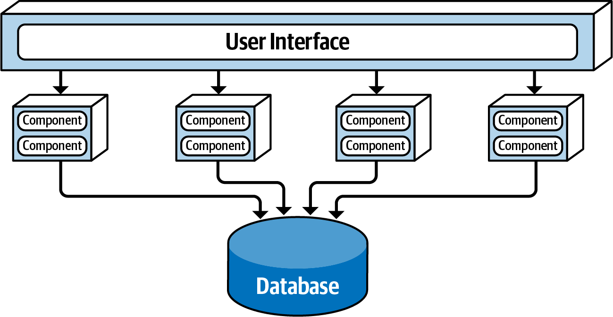
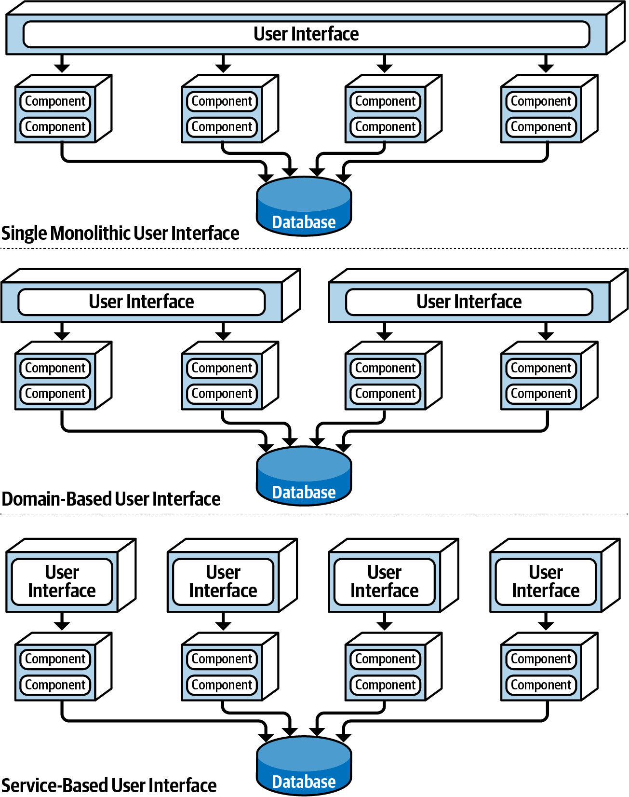
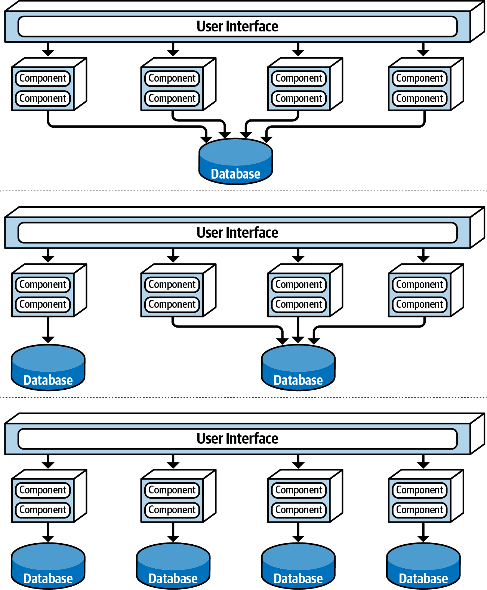
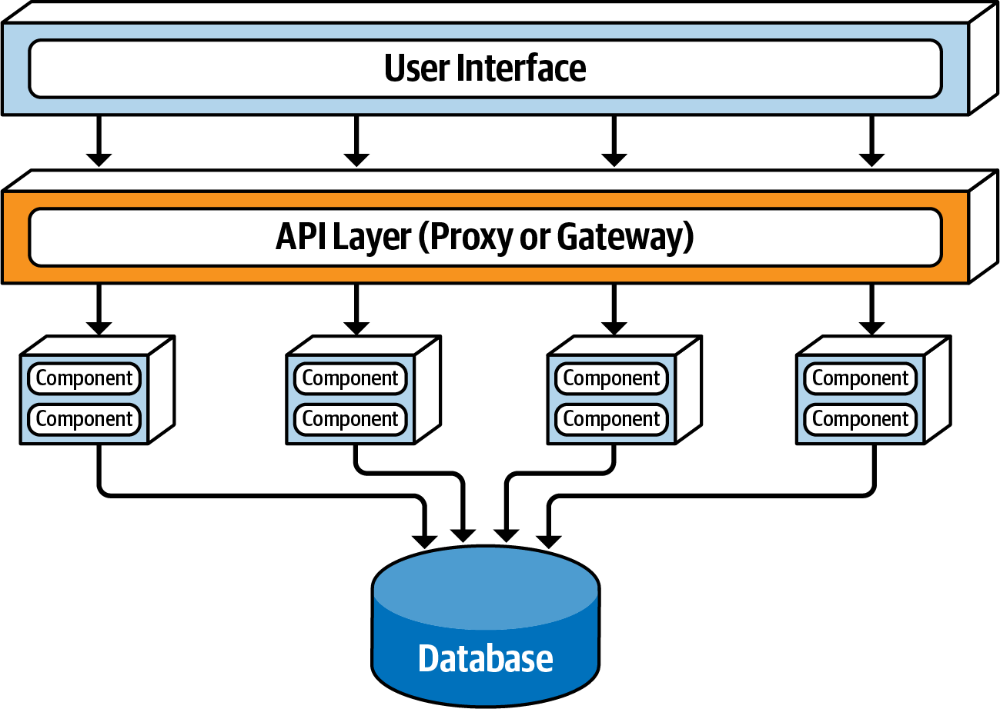
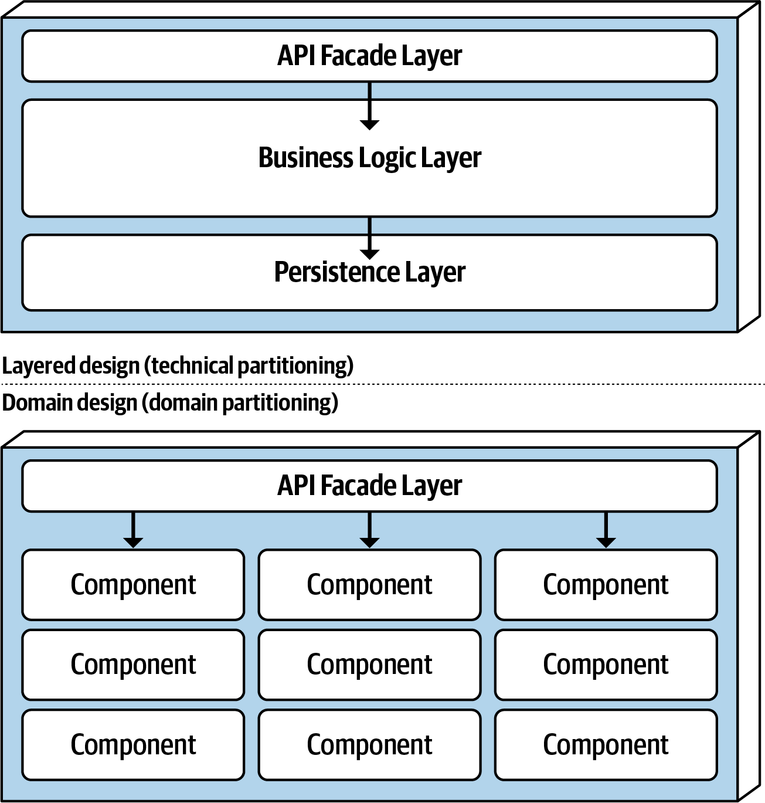
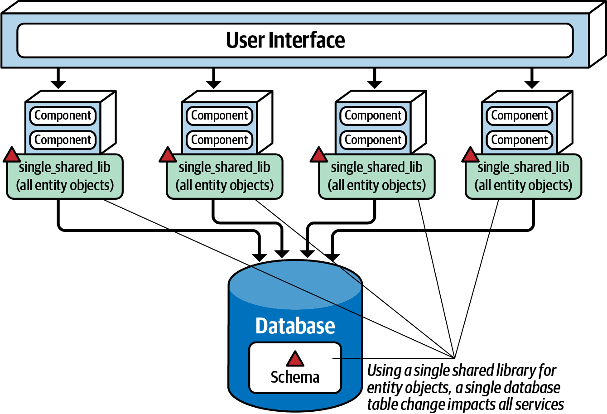
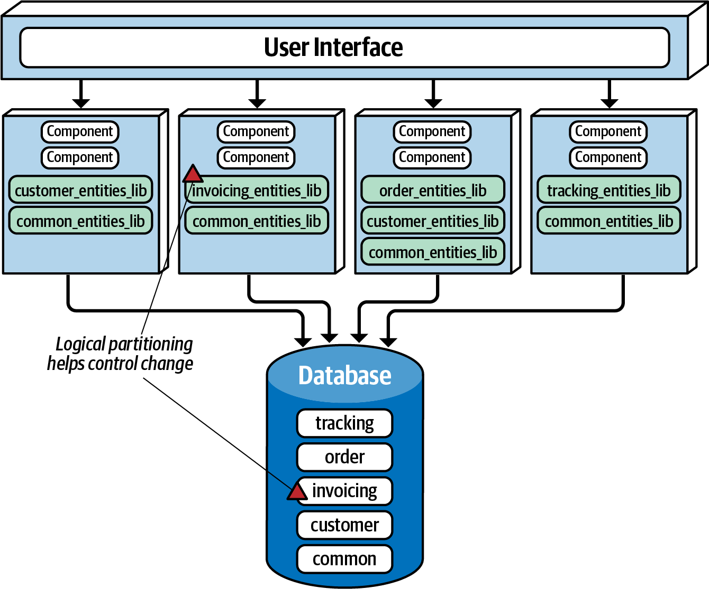
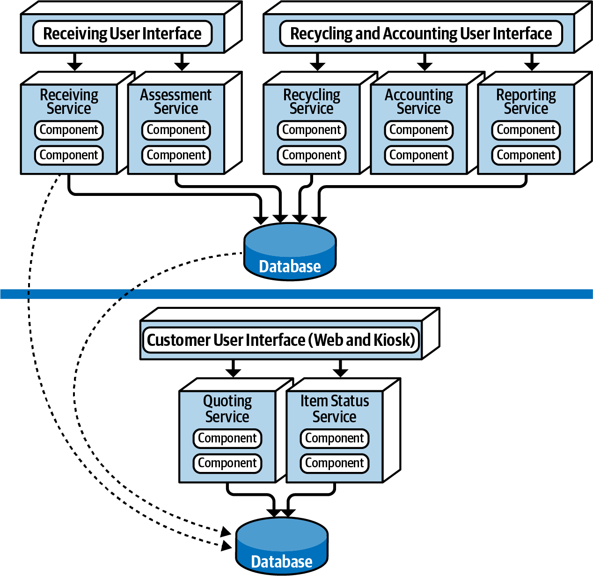
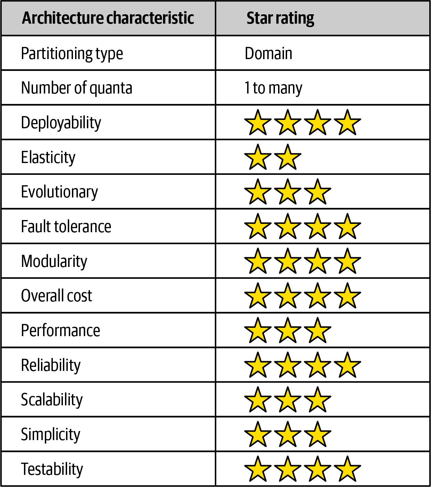
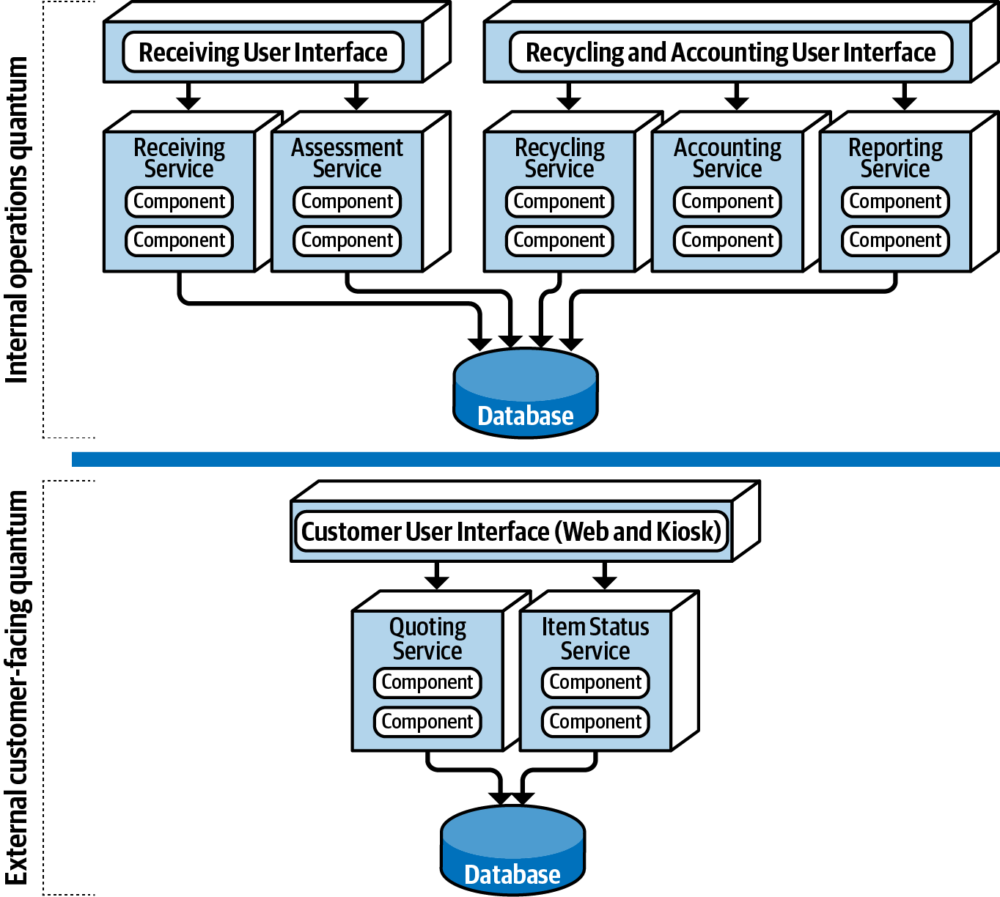

# 第 13 章 基于服务的架构风格

> 原文章名：Service-Based Architecture Style
> 来源：英文第一版，书内第 163–177 页，PDF 第 183–197 页。
> 进度：第十三章全文已完成本轮逐段质量校译；[校译记录](../../reviews/chapter-13-review.md)，独立复审待进行。
> 保留英文原图，评分附中文转录，图中文字对照见文末；下文页码均指原书书内页码。

<!-- 书内第 163 页，PDF 第 183 页。 -->

<!-- CH13-001 | PDF p. 183 | 正文 -->

基于服务的架构（service-based architecture）是微服务架构风格的一种混合形式，被认为是最务实的架构风格之一，主要得益于其灵活性。虽然它属于分布式架构，但复杂性和成本都低于微服务、事件驱动架构等其他分布式风格，因此成为许多业务应用的热门选择。

## 拓扑

<!-- CH13-002 | PDF p. 183 | 正文 -->

基本拓扑遵循分布式的宏观分层结构：独立部署的用户界面、独立部署的远程粗粒度服务，以及单体数据库，如图 13-1 所示。

<!-- CH13-003 | PDF p. 183 | 正文 -->

这种风格中的服务，通常是粗粒度的“应用的一部分”，常称领域服务（domain services），彼此独立，分别部署。部署方式通常与单体应用一样，例如 EAR、WAR 文件或程序集，不要求容器化，当然也可以部署在 Docker 等容器中。由于通常共享一个单体数据库，应用上下文中的服务数量一般为 4 到 12 个，平均约 7 个。

<!-- 书内第 164 页，PDF 第 184 页。 -->

*图 13-1：基于服务架构风格的基本拓扑。*

<!-- CH13-004 | PDF p. 184 | 正文 -->

多数情况下，每个领域服务只有一个实例。不过，根据扩展、容错和吞吐需求，也可以有多个实例。这通常要求在界面与服务之间提供某种负载均衡，将界面请求导向健康、可用的实例。

<!-- CH13-005 | PDF p. 184 | 正文 -->

界面通过远程访问协议调用服务，通常使用 REST，也可以使用消息、RPC，甚至 SOAP。虽然可以经由代理或网关组成的 API 层访问服务，包括来自其他外部请求的访问，但多数情况下，界面通过嵌入在界面、API 网关或代理中的[服务定位器模式（service locator pattern）](https://oreil.ly/wYLF2)，直接访问服务。

<!-- CH13-006 | PDF p. 184 | 正文 -->

这一风格的重要方面，是通常使用中心共享数据库。服务可以像传统单体分层架构一样，使用 SQL 查询与连接。服务少，通常为 4 到 12 个，所以数据库连接通常不是问题；但数据库变更可能是问题。第 169 页“数据库划分”介绍应对和管理数据库变化的技术。

## 拓扑变体

<!-- 书内第 165 页，PDF 第 185 页。 -->

<!-- CH13-007 | PDF p. 185 | 正文 -->

这一风格有许多拓扑变体，可能是最灵活的风格之一。例如，图 13-1 的单体界面，可以按界面领域拆开，甚至细到与每个领域服务一一对应，如图 13-2。

*图 13-2：用户界面变体。*

<!-- 书内第 166 页，PDF 第 186 页。 -->

<!-- CH13-008 | PDF p. 186 | 正文 -->

类似地，单体数据库也可能拆成多个独立数据库，甚至像微服务一样，为每个领域服务配置一个领域范围数据库。此时，应确保每个数据库中的数据不会被其他领域服务需要，从而避免领域服务之间的通信——这是这种架构风格中必须避免的情况，同时也能避免数据库之间重复存储数据。图 13-3 展示了数据库变体。

*图 13-3：数据库变体。*

<!-- 书内第 167 页，PDF 第 187 页。 -->

<!-- CH13-009 | PDF p. 187 | 正文 -->

最后，还可以在界面与服务之间加入反向代理或网关组成的 API 层，见图 13-4。向外部系统暴露领域功能，或者希望将度量、安全、审计和服务发现等横切关注点从界面中提取并集中时，这是良好做法。

*图 13-4：在用户界面与领域服务之间增加 API 层。*

## 服务设计与粒度

<!-- CH13-010 | PDF p. 187 | 正文 -->

由于领域服务通常粗粒度，内部经常采用分层架构，包括 API 外观层、业务层和持久层。另一种常见方式，是像模块化单体一样，按子领域组织服务内部。两种设计见图 13-5。

<!-- 书内第 168 页，PDF 第 188 页。 -->

*图 13-5：领域服务设计变体。*

<!-- CH13-011 | PDF p. 188 | 正文 -->

不论采用哪种内部设计，领域服务都必须提供某种 API 访问外观，供用户界面调用以执行业务功能。它通常负责编排来自界面的业务请求。例如，用户界面发出下单请求（catalog checkout），该请求到达 `OrderService` 领域服务的 API 外观后，会在服务内部编排整个业务流程：创建订单、生成订单 ID、完成支付，并更新订单中每件商品的库存。在微服务架构中，完成同一请求很可能需要编排多个独立部署、可远程调用、各自只负责单一功能的服务。服务内部的类级编排与跨服务编排之间的差异，体现了这两种架构风格在粒度上的一个重要区别。

<!-- CH13-012 | PDF p. 188 | 正文 -->

由于领域服务粗粒度，单个服务内部可以使用传统 ACID 数据库事务，通过提交与回滚保证数据库完整性。而微服务等高度分布式架构，通常采用细粒度服务，以及所谓 BASE 分布式事务技术，即基本可用、软状态、最终一致性。它依赖最终一致性，因此不能提供与基于服务架构中 ACID 事务相同级别的数据库完整性。

<!-- 书内第 169 页，PDF 第 189 页；上一段跨页。 -->

<!-- CH13-013 | PDF p. 189 | 正文 -->

例如，基于服务架构中的客户下单，付款信用卡却已过期。由于是同一服务内的原子事务，可以通过回滚移除全部新增数据库内容，并通知客户无法支付。再看细粒度微服务：`OrderPlacement` 接收请求、创建订单、生成 ID 并插入订单表，然后远程调用 `PaymentService`。如果信用卡过期，无法支付，订单无法完成，数据却已插入而未批准，处于不一致状态。库存怎么办？应标记为已订购并扣减吗？如果库存不足，另一位客户想买，是否允许购买，还是保留给那位信用卡过期的客户？这些只是多细粒度服务编排业务流程时需要回答的部分问题。

<!-- CH13-014 | PDF p. 189 | 正文 -->

领域服务粒度较粗，便于保持更好的数据完整性与一致性，但有代价。修改 `OrderService` 下单逻辑时，需要测试整个粗粒度服务，包括支付处理；微服务中，相同变更只影响较小的 `OrderPlacement`，不必修改 `PaymentService`。另外，部署代码更多，发生问题的风险也更大，可能影响支付等其他功能；微服务职责单一，修改时破坏其他功能的机会较少。

## 数据库划分

<!-- CH13-015 | PDF p. 189 | 正文 -->

虽然不是强制要求，但由于应用上下文中只有 4 到 12 个服务，它们通常共享一个单体数据库。数据库耦合会给表结构变更带来问题：处理不当，一张表的变化可能影响每个服务，使变更在工作量和协调成本上都很昂贵。

<!-- 书内第 170 页，PDF 第 190 页。 -->

<!-- CH13-016 | PDF p. 190 | 正文 -->

代表数据库表结构的共享类文件，通常称实体对象，保存在所有领域服务使用的自定义共享库，如 JAR 或 DLL 中；库中也可能包含 SQL。为全部实体创建单一共享库，是实现这一风格最不有效的方式。任何表结构变化，都需要修改对应实体所在的单一库，进而要求所有服务变更并重新部署，不论它是否访问该表。库版本管理可以缓解，但若没有详细人工分析，仍很难知道哪些服务实际受影响。图 13-6 展示这种情况。

*图 13-6：使用单一共享库保存数据库实体对象。*

<!-- CH13-017 | PDF p. 190 | 正文 -->

降低数据库变更影响和风险的一种方式，是对数据库进行逻辑划分，并通过一组按领域拆分的共享库体现这种划分。图 13-7 中有五个数据领域：通用、客户、发票、订单和跟踪，也有对应的五个共享库，供领域服务按需使用。修改某一逻辑领域中的表（例如发票表），只需修改相应的实体库（其中可能也包含 SQL），因此只会影响使用该库的服务。本例中受影响的是发票服务，不会波及其他服务。

<!-- 书内第 171 页，PDF 第 191 页；上一段跨页。 -->

*图 13-7：使用多个共享库保存数据库实体对象。*

<!-- CH13-018 | PDF p. 191 | 正文 -->

注意通用领域及所有服务共同使用的 `common_entities_lib`，这相当常见。修改公共表，需要协调所有访问共享数据库的服务。缓解公共表及实体变化的一种方式，是在版本控制中锁定公共实体对象，只让数据库团队修改，以控制变更，并强调公共表变化的重要性。

<!-- CH13-019 | PDF p. 191 | 引文／建议 -->

> 在维持清晰数据领域的同时，让数据库的逻辑划分尽可能细，以更好地控制基于服务架构中的数据库变更。

## 示例架构

<!-- 书内第 172 页，PDF 第 192 页。 -->

<!-- CH13-020 | PDF p. 192 | 正文 -->

为说明灵活性与能力，考虑一个现实中的电子回收系统，用于回收旧 iPhone、Galaxy 等设备。流程如下：客户先通过网站或自助终端询问旧设备能换多少钱，称为报价（quoting）；满意后将设备寄给公司，公司收货（receiving）；随后评估设备是否正常工作，称为评估（assessment）；如果状态良好，公司向客户支付约定金额，称为账务处理（accounting）；客户随时可以在线查询物品状态（item status）；根据评估结果，设备通过安全销毁或转售回收（recycling）；公司还定期按需或按计划生成基于回收活动的财务与运营报表（reporting）。

<!-- CH13-021 | PDF p. 192 | 正文 -->

图 13-8 使用基于服务架构实现系统。每个领域都作为独立部署的领域服务。只扩展需要更高吞吐量的服务即可，本例为面向客户的报价与物品状态服务。其他服务无需扩展，只需单实例。

<!-- CH13-022 | PDF p. 192 | 正文 -->

用户界面也按领域拆分为面向客户、收货、回收与账务三个部分，支持界面容错、扩展与安全：外部客户没有通往内部功能的网络路径。还有两个物理数据库，分别用于外部客户操作和内部操作。内部数据与操作位于独立网络区域，原文说用竖线表示，从而提供更强的访问限制与数据保护。防火墙只允许内部服务单向访问并更新外部客户信息，不允许反方向访问。根据数据库，也可以使用内部表镜像或表同步。

<!-- 书内第 173 页，PDF 第 193 页。 -->

*图 13-8：使用基于服务架构的电子回收示例。*

<!-- CH13-023 | PDF p. 193 | 译注 -->

> 译注：原文说网络区域由“竖线”表示，原图实际为横向分隔线，分别保留并注明。

<!-- CH13-024 | PDF p. 193 | 正文 -->

这个例子体现了可扩展性、容错、安全，包括数据和功能保护及访问，以及敏捷性、可测试性和可部署性。例如，新产品不断到来，评估服务经常要新增规则。频繁变更隔离在单个服务中，支持快速响应变化，便于完整测试，也便于降低风险、更频繁地部署。

## 架构特性评分

<!-- 书内第 174 页，PDF 第 194 页。 -->

<!-- CH13-025 | PDF p. 194 | 正文 -->

图 13-9 中，一星表示支持较弱，五星表示该特性是强项之一。定义见第 4 章。

*图 13-9：基于服务架构特性评分。*

<!-- CH13-026 | PDF p. 194 | 评分表说明 -->

图 13-9 中文转录：

<!-- CH13-027 | PDF p. 194 | 评分表 -->

| 架构特性 | 星级或取值 |
| --- | --- |
| 划分类型 | 领域划分 |
| 量子数量 | 1 到多个 |
| 可部署性 | 4 / 5 |
| 弹性 | 2 / 5 |
| 可演进性 | 3 / 5 |
| 容错性 | 4 / 5 |
| 模块化 | 4 / 5 |
| 总体成本 | 4 / 5 |
| 性能 | 3 / 5 |
| 可靠性 | 4 / 5 |
| 可扩展性 | 3 / 5 |
| 简单性 | 3 / 5 |
| 可测试性 | 4 / 5 |

<!-- CH13-028 | PDF p. 194 | 正文 -->

基于服务架构按领域划分，结构由领域驱动，而非表现或持久化等技术考虑。例如，电子回收中，每个独立部署的服务对应特定领域，如物品评估。领域内变化只影响对应服务、界面与数据库，不必修改其他内容。

<!-- 书内第 175 页，PDF 第 195 页；上一段跨页。 -->

<!-- CH13-029 | PDF p. 195 | 正文 -->

作为分布式架构，量子数量可大于等于一。即使有 4 到 12 个独立服务，如果共享数据库或用户界面，整个系统仍只有一个量子。但如第 165 页“拓扑变体”，界面和数据库都可以分散，形成多个量子。电子回收中有两个，如图 13-10：客户侧量子包括独立客户界面、数据库，以及报价和物品状态服务；内部量子包括收货、评估和回收等操作。内部虽然有多个独立服务和两个界面，却共享同一数据库，因此仍是一个量子。

*图 13-10：基于服务架构中的独立量子。*

<!-- 书内第 176 页，PDF 第 196 页。 -->

<!-- CH13-030 | PDF p. 196 | 正文 -->

虽然没有五星，但许多关键方面有四星。将应用拆成独立部署的领域服务，可以更快变更，提高敏捷性；缩小领域范围，改善测试覆盖；比大型单体更频繁、低风险地部署。这三项提升上市速度，让组织较快交付新功能和缺陷修复。

<!-- CH13-031 | PDF p. 196 | 正文 -->

容错和整体可用性也较高。领域服务虽粗，但通常自包含，通过共享数据库和代码，避免服务间通信。因此，一个服务宕机，如回收系统的收货服务，不会影响其他六个。

<!-- CH13-032 | PDF p. 196 | 正文 -->

由于服务粒度较粗，可扩展性只有三星，弹性只有两星。以程序方式实现扩展与弹性伸缩当然可行，但与微服务等细粒度服务相比，需要复制更多功能，因此机器资源利用率和成本效率较低。通常只有在需要更高吞吐量或故障转移能力时，才部署多个服务实例。例如，回收系统只有报价和物品状态服务需要支撑大量客户，其余操作服务部署单个实例即可，也更容易使用单实例内存缓存和数据库连接池。

<!-- CH13-033 | PDF p. 196 | 正文 -->

简单性与总体成本，是它区别于微服务、事件驱动、空间架构等更昂贵复杂分布式风格的另外两项因素，使其成为较易实现且成本有效的分布式架构之一。不过，这种节省和简单，也对应那些四星指标上的取舍：投入更高成本与复杂性，相关评分也可能改善。

<!-- CH13-034 | PDF p. 196 | 正文 -->

粗粒度领域服务还使它通常比分布式风格中的其他方案更可靠。服务较大，意味着服务间网络流量更少、分布式事务更少、带宽占用更低，从网络角度提升整体可靠性。

## 何时采用这种架构风格

<!-- 书内第 177 页，PDF 第 197 页。 -->

<!-- CH13-035 | PDF p. 197 | 正文 -->

灵活拓扑，以及许多三星、四星指标，使它成为最务实的风格之一。其他分布式风格当然更强大，但一些公司觉得代价太高，另一些根本不需要那么强。就像拥有法拉利的动力、速度与灵活性，却只在高峰期以每小时 50 公里通勤：看起来很酷，却浪费资源和金钱！

<!-- CH13-036 | PDF p. 197 | 正文 -->

它也天然适合领域驱动设计。服务粗粒度且以领域为边界，每个领域都能对应一个独立部署的领域服务。例如，回收应用的回收领域封装在单个软件单元中，便于修改。

<!-- CH13-037 | PDF p. 197 | 正文 -->

维护和协调数据库事务始终是分布式架构的问题，因为它们通常依赖最终一致性，而非传统 ACID。不过，由于领域服务粗粒度，原文认为基于服务架构比其他分布式风格更容易保留 ACID。界面或 API 网关有时仍需编排多个领域服务，这时就需要 Saga 与 BASE。但多数事务限定在单个领域服务中，可以采用多数单体应用中的传统提交与回滚。

<!-- CH13-038 | PDF p. 197 | 正文 -->

最后，它适合在不陷入粒度复杂性与陷阱的情况下，实现良好模块化。服务越细，越会出现编排与协同问题。多个服务必须共同完成业务事务时，需要协调。编排（orchestration）通过独立中介服务控制和管理工作流，像乐队指挥；协同（choreography）则由服务彼此通信，没有中央中介，像舞者合作。随着粒度变细，这两类方式用于将服务组织起来完成业务。但本风格服务较粗，所需协调远少于其他分布式架构。

<!-- CH13-039 | PDF p. 197 | 译注 -->

> 译注：原文使用“both ... necessary”描述编排与协同；这里按其总体讨论译出，不将两者理解为每个工作流必须同时使用的机制。事务论述同样依赖具体边界与实现，不代表共享数据库可以自动消除跨服务事务问题。

---

## 图中文字中文对照（译者整理）

### 图 13-1

用户界面（User Interface）、组件（Component）、数据库（Database）。

### 图 13-2

单体用户界面（Single Monolithic User Interface）、基于领域的用户界面（Domain-Based User Interface）、基于服务的用户界面（Service-Based User Interface）；其他标签同图 13-1。

### 图 13-3

用户界面、组件、数据库，展示单库、部分拆分、按服务拆分三种组合。

### 图 13-4

新增 API 层，代理或网关（API Layer (Proxy or Gateway)）。

### 图 13-5

API 外观层（API Facade Layer）、业务逻辑层（Business Logic Layer）、持久层（Persistence Layer）；分层设计，技术划分（Layered design (technical partitioning)）；领域设计，领域划分（Domain design (domain partitioning)）；组件（Component）。

### 图 13-6

单一共享库（single_shared_lib），包含全部实体对象（all entity objects）；数据库模式（Schema）。说明文字：“使用单一实体共享库时，一张数据库表的变化会影响全部服务。”

### 图 13-7

共享库：客户实体库（customer_entities_lib）、发票实体库（invoicing_entities_lib）、订单实体库（order_entities_lib）、跟踪实体库（tracking_entities_lib）、公共实体库（common_entities_lib）。数据库内的领域：跟踪（tracking）、订单（order）、发票（invoicing）、客户（customer）、通用（common）。说明文字：“逻辑划分有助于控制变化”（Logical partitioning helps control change）。

### 图 13-8

收货用户界面（Receiving User Interface）、回收与账务用户界面（Recycling and Accounting User Interface）、客户界面，Web 与自助终端（Customer User Interface (Web and Kiosk)）。服务：收货（Receiving Service）、评估（Assessment Service）、回收（Recycling Service）、账务（Accounting Service）、报表（Reporting Service）、报价（Quoting Service）、物品状态（Item Status Service）。组件、数据库。

### 图 13-9

评分已在正文转录；总体成本高星表示成本优势。

### 图 13-10

标签同图 13-8，新增内部操作量子（Internal operations quantum）、外部客户侧量子（External customer-facing quantum）。
