# 第 14 章 事件驱动架构风格

> 原文章名：Event-Driven Architecture Style
> 来源：英文第一版，书内第 179–209 页，PDF 第 199–229 页。
> 进度：第十四章全文已完成本轮逐段质量校译；[校译记录](../../reviews/chapter-14-review.md)，独立复审待进行。
> 保留英文原图，中文标签对照见文末；下文页码均指原书书内页码。

<!-- 书内第 179 页，PDF 第 199 页。 -->

<!-- CH14-001 | PDF p. 199 | 正文 -->

事件驱动架构（event-driven architecture）是一种流行的分布式异步风格，用于构建高可扩展、高性能应用。它也高度灵活，既能用于小应用，也能用于大型复杂应用。它由解耦的事件处理组件构成，异步接收和处理事件，可以独立采用，也可以嵌入其他风格，例如事件驱动的微服务架构。

<!-- CH14-002 | PDF p. 199 | 正文 -->

多数应用采用图 14-1 所示的基于请求模型（request-based model）。用户向系统发送请求，要求执行某种动作；请求会交给请求编排器，通常由用户界面承担，也可以通过 API 层或企业服务总线实现。请求编排器以确定、同步的方式将请求分派给各请求处理器；处理器负责从数据库读取或更新信息。

<!-- CH14-003 | PDF p. 199 | 正文 -->

例如，客户要求查询过去六个月的订单历史。这是数据驱动、确定性的请求，要求系统提供特定上下文中的数据，而不是发生了某个必须响应的事件。

<!-- CH14-004 | PDF p. 199 | 正文 -->

基于事件模型（event-based model）则对特定情况作出反应，依据事件采取行动。例如，在线拍卖中对某件物品出价。出价不是向系统查询某件事，而是当前要价公布后发生的事件。系统必须响应，将它与同时收到的其他出价比较，判断谁是当前最高出价者。

<!-- 书内第 180 页，PDF 第 200 页。 -->

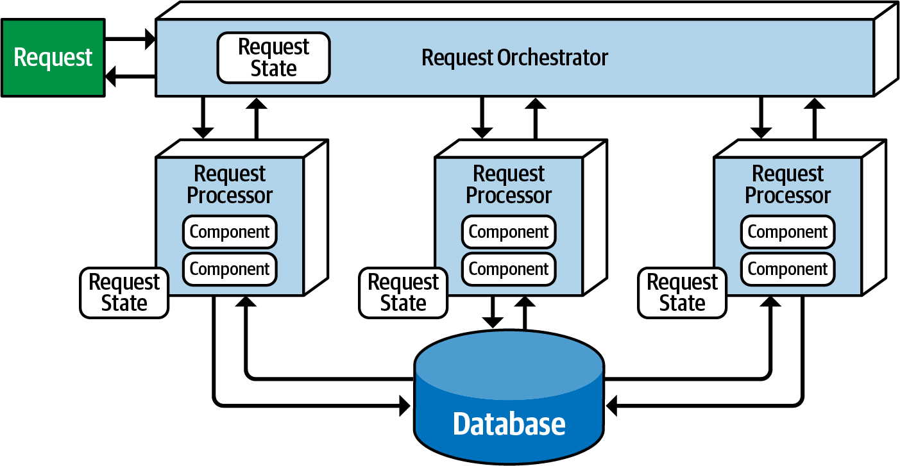

*图 14-1：基于请求的模型。*

## 拓扑

<!-- CH14-005 | PDF p. 200 | 正文 -->

事件驱动架构有两种主要拓扑：中介者拓扑（mediator topology）和代理拓扑（broker topology）。需要控制事件处理工作流时，通常使用中介者；需要较高响应能力和动态事件处理控制时，则使用代理。两者的架构特性与实现策略不同，因此需要理解各自特点，判断适用情形。

## 代理拓扑

<!-- CH14-006 | PDF p. 200 | 正文 -->

代理拓扑与中介者的区别，是没有中央事件中介者。消息流通过 RabbitMQ、ActiveMQ、HornetQ 等轻量消息代理，以链式广播方式分布在事件处理组件中。它适合相对简单、不需要中央编排协调的事件处理流程。

<!-- 书内第 181 页，PDF 第 201 页。 -->

<!-- CH14-007 | PDF p. 201 | 正文 -->

代理拓扑包含四个主要架构要素：初始事件（initiating event）、事件代理（event broker）、事件处理器（event processor）和处理事件（processing event）。初始事件启动整个流程，可以是在线拍卖出价这样的简单事件，也可以是医疗福利系统中换工作、结婚等较复杂事件。它被发送到代理中的事件通道。由于没有中介者管理控制，一个处理器从代理接收初始事件并开始处理，执行相关的特定任务，再创建处理事件，异步告诉系统其他部分自己做了什么。该事件发送到代理，供进一步处理。其他处理器监听后，采取行动，再用新的处理事件宣布完成的工作。如此持续，直到再没有处理器关心最后一项动作。流程见图 14-2。

<!-- CH14-008 | PDF p. 201 | 正文 -->

事件代理通常按领域分散部署为多个集群实例，每个实例包含对应领域流程所需的全部通道。由于代理拓扑采用解耦、异步、发出即不等待的广播方式，通常使用发布订阅模型中的主题，AMQP 中则可使用主题交换器。

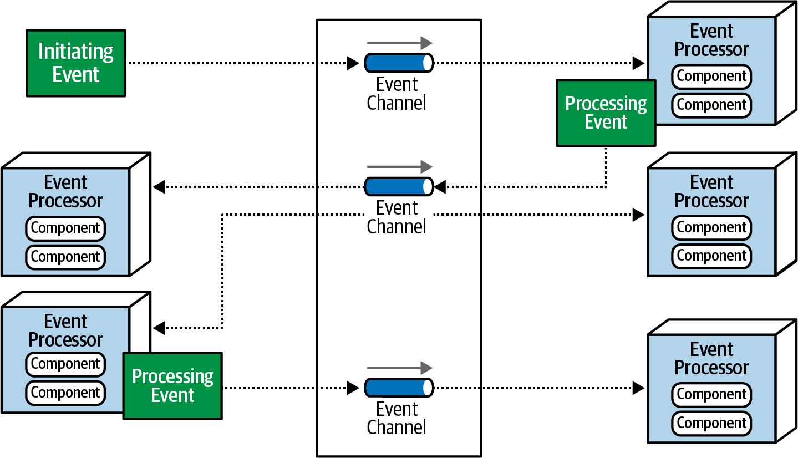

*图 14-2：代理拓扑。*

<!-- 书内第 182 页，PDF 第 202 页。 -->

<!-- CH14-009 | PDF p. 202 | 正文 -->

在代理拓扑中，每个处理器都向系统其他部分宣布自己做了什么，是一种良好实践，不论当前是否有其他处理器关心。它为未来增加功能提供可扩充性。例如，图 14-3 的复杂流程中，需要给客户发邮件通知某个动作。通知处理器生成并发送邮件，再向主题发送一个新的处理事件。但当前没有其他处理器监听这个主题，因此消息直接消失。

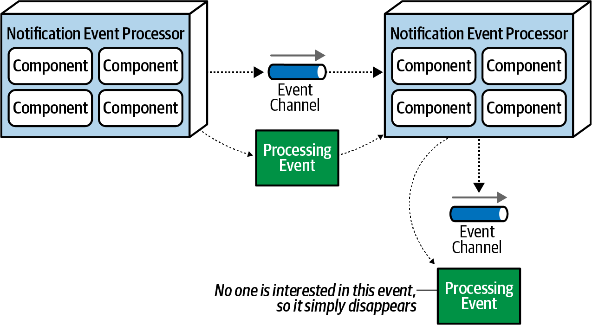

*图 14-3：通知事件已发送，但被忽略。*

<!-- CH14-010 | PDF p. 202 | 正文 -->

这体现了架构可扩充性。发送无人理会的消息看似浪费资源，其实不然。假设新需求是分析发给客户的邮件，新处理器可以较容易加入，因为邮件信息已经通过主题提供，不需要新增基础设施或修改其他处理器。

<!-- CH14-011 | PDF p. 202 | 正文 -->

为说明代理拓扑，图 14-4 展示典型零售下单系统，客户购买一件物品，例如本书。下单处理器 `OrderPlacement` 接收初始事件 `PlaceOrder`，向数据库插入订单，并返回订单 ID；随后通过 `order-created` 事件宣布订单已创建。通知、支付和库存三个处理器都关心它，并行执行自己的任务。

<!-- 书内第 183 页，PDF 第 203 页。 -->

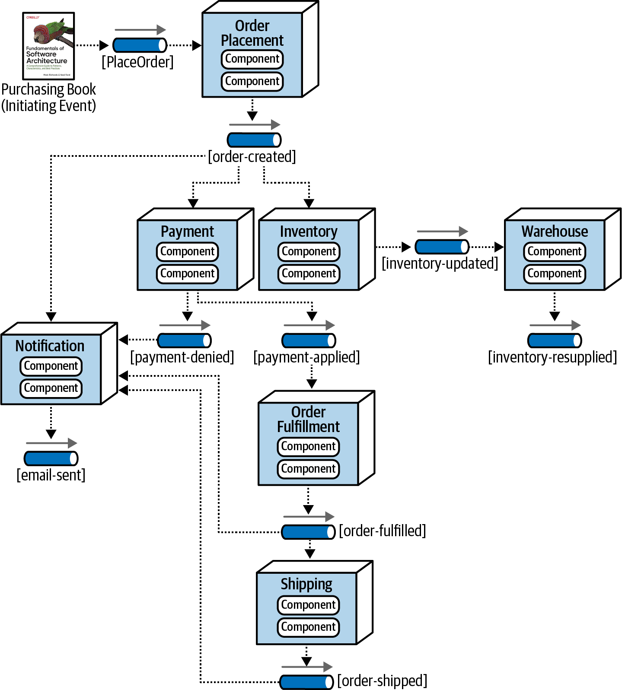

*图 14-4：代理拓扑示例。*

<!-- CH14-012 | PDF p. 203 | 正文 -->

通知处理器接收 `order-created`，给客户发送邮件，再生成 `email-sent`。没有其他处理器监听它，这是正常的，也说明前述可扩充性：提前提供一个接入点，未来需要时，其他处理器可以订阅这一事件流。

<!-- 书内第 184 页，PDF 第 204 页。 -->

<!-- CH14-013 | PDF p. 204 | 正文 -->

库存处理器也监听 `order-created`，扣减对应书籍库存，再用 `inventory-updated` 宣布。仓库处理器接收该事件，管理仓库间库存，库存过低时重新订货。

<!-- CH14-014 | PDF p. 204 | 正文 -->

支付处理器同样接收 `order-created`，对刚创建订单的信用卡扣款。图 14-4 中，它的动作可能产生两类事件：`payment-applied` 表示支付成功，`payment-denied` 表示支付被拒绝。通知处理器关心后者，向客户发邮件，要求更新信用卡信息或选择其他支付方式。

<!-- CH14-015 | PDF p. 204 | 正文 -->

订单履行处理器监听 `payment-applied`，进行拣货与打包。完成后，通过 `order-fulfilled` 宣布履行完毕。通知与发运处理器都监听这一事件，并发执行：通知客户已准备发货，同时发运处理器选择运输方式。订单发出后，再发送 `order-shipped`，通知处理器监听并告知客户状态变化。

<!-- CH14-016 | PDF p. 204 | 正文 -->

分析这个例子，可以看到每个处理器高度解耦、彼此独立。理解代理拓扑最好的比喻，是接力赛：选手拿着接力棒跑一段距离，例如 1.5 公里，再交给下一位，直到最后一位冲线。交棒后，选手就完成了自己的比赛，可以做其他事情。处理器也是如此，交出事件后，不再参与该事件后续处理，可以响应其他初始或处理事件。此外，各处理器可以独立扩展，应对负载变化或积压。如果某个处理器停机或因环境问题变慢，主题就提供背压点。

<!-- 书内第 185 页，PDF 第 205 页。 -->

<!-- CH14-017 | PDF p. 205 | 正文 -->

性能、响应能力和可扩展性虽是重要收益，但也有缺点。首先，没有人控制与初始事件相关的整体工作流，本例为下单。流程随条件动态变化，系统中没有人真正知道下单业务事务何时完成。

<!-- CH14-018 | PDF p. 205 | 正文 -->

错误处理也是大挑战。没有中介者监控或控制业务事务时，如果支付处理器崩溃，未完成任务，系统中其他部分并不知道。业务流程卡住，需要某种自动或人工干预才能继续。而其他流程仍继续执行：库存照样扣减，其他处理器仿佛一切正常。

<!-- CH14-019 | PDF p. 205 | 正文 -->

代理拓扑也不支持重新启动业务事务，也就是可恢复性。初始事件处理后，其他动作已经异步发生，无法简单重新提交初始事件。没有组件知道或拥有原始请求状态，也就没有谁负责重启业务事务并知道从哪里继续。表 14-1 总结其利弊。

<!-- CH14-020 | PDF p. 205 | 正文 -->

*表 14-1：代理拓扑的权衡。*

<!-- CH14-021 | PDF p. 205 | 表格 -->

| 优点 | 缺点 |
| --- | --- |
| 事件处理器高度解耦 | 工作流控制 |
| 高可扩展性 | 错误处理 |
| 高响应能力 | 可恢复性 |
| 高性能 | 重启能力 |
| 高容错性 | 数据不一致 |

## 中介者拓扑

<!-- CH14-022 | PDF p. 205 | 正文 -->

中介者拓扑解决了代理拓扑前述的一些不足。其核心是事件中介者（event mediator），管理和控制需要多个处理器协调的初始事件工作流。组成要素包括初始事件、事件队列、事件中介者、事件通道和事件处理器。

<!-- 书内第 186 页，PDF 第 206 页。 -->

<!-- CH14-023 | PDF p. 206 | 正文 -->

与代理拓扑一样，初始事件启动全部流程。但它先发送到初始事件队列，由中介者接收。中介者了解处理步骤，生成相应处理事件，以点对点方式发送到专用通道，通常是队列。处理器监听通道、执行工作，通常再向中介者确认完成。与代理不同，它们不向系统其他部分宣布动作。图 14-5 展示这一拓扑。

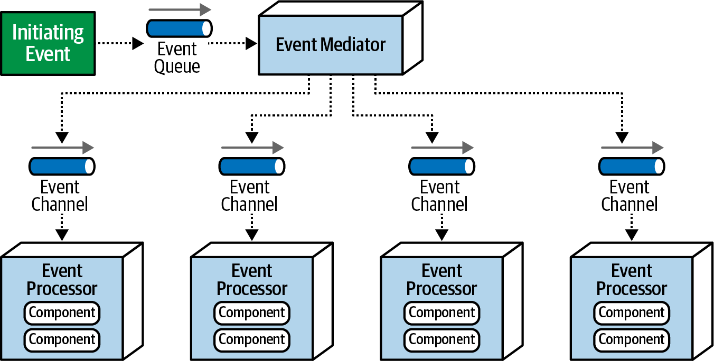

*图 14-5：中介者拓扑。*

<!-- CH14-024 | PDF p. 206 | 正文 -->

多数实现包含多个中介者，通常按领域或事件分组，减少单点故障问题，并提高吞吐与性能。例如，客户中介者处理注册、资料更新等客户事件，订单中介者处理购物车和结账活动。

<!-- CH14-025 | PDF p. 206 | 正文 -->

实现方式取决于事件性质与复杂程度。对于简单错误处理和编排，[Apache Camel](https://camel.apache.org)、[Mule ESB](https://www.mulesoft.com) 或 [Spring Integration](https://oreil.ly/r2e4r) 通常足够。这类中介者的消息流和路由，往往通过 Java、C# 等代码定制，控制事件处理工作流。

<!-- CH14-026 | PDF p. 206 | 正文 -->

如果流程含大量条件处理、多个动态路径与复杂错误处理指令，则 [Apache ODE](https://ode.apache.org) 或 [Oracle BPEL Process Manager](https://oreil.ly/jMtta) 是不错的选择。它们基于[业务流程执行语言（Business Process Execution Language，BPEL）](https://oreil.ly/Uu-Fo)，以类似 XML 的结构描述步骤，还包含错误处理、重定向、多播等结构元素。BPEL 强大但学习复杂，因此通常使用引擎套件提供的图形工具创建。

<!-- 书内第 187 页，PDF 第 207 页；上一段跨页。 -->

<!-- CH14-027 | PDF p. 207 | 正文 -->

BPEL 适合复杂、动态工作流，但不擅长涉及人工干预的长事务。例如，收到 `place-trade` 初始事件后，中介者发现交易股数超限，需要人工批准，就必须暂停、通知高级交易员，并等待批准。这种情况需要 [jBPM](https://www.jbpm.org) 等业务流程管理（Business Process Management，BPM）引擎。

<!-- CH14-028 | PDF p. 207 | 正文 -->

要正确选择中介者实现，必须了解事件类型。使用 Apache Camel 编写和维护涉及人工交互、复杂且长时间运行的事件，会很困难；反过来，简单流程在 Camel 中几天可完成，若使用 BPM 引擎，可能浪费数月。

<!-- CH14-029 | PDF p. 207 | 正文 -->

实际事件很少具有同一种复杂度，因此我们建议分为简单、困难、复杂三类，所有事件先进入 Camel 或 Mule 等简单中介者，由它检查分类，自己处理或转交更复杂的中介者。这样，每类事件都由适合的工具处理。图 14-6 展示这一委派模型。

<!-- 书内第 188 页，PDF 第 208 页。 -->

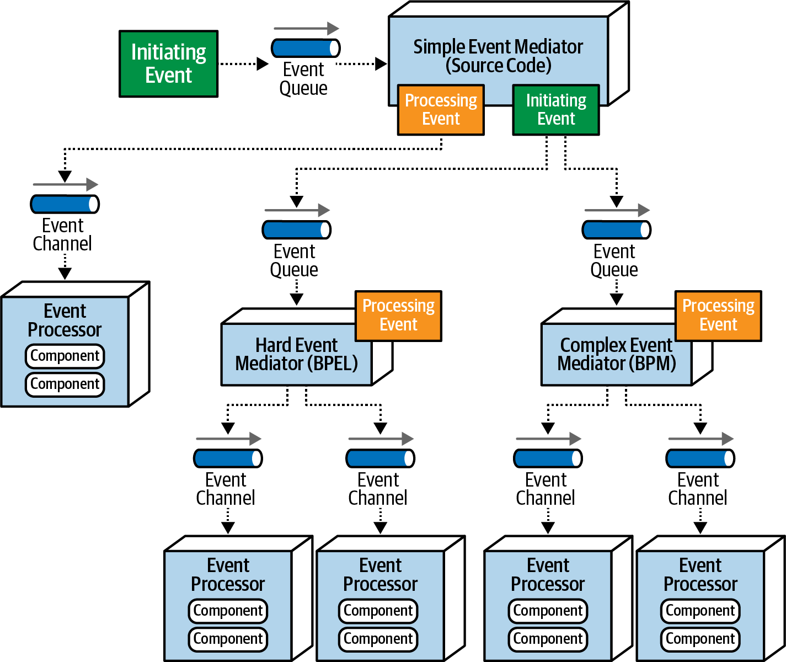

*图 14-6：将事件委派给适当类型的事件中介者。*

<!-- CH14-030 | PDF p. 208 | 正文 -->

图中，简单中介者能够处理的工作流，由它生成并发送处理事件；分类为困难或复杂的初始事件，则原样转交相应 BPEL 或 BPM 中介者。原文此处将 BPM 写作 BMP。简单中介者拦截原始事件后，可能仍负责知道何时完成，也可能连同客户通知，将整个工作流完全委派出去。

<!-- CH14-031 | PDF p. 208 | 正文 -->

为说明工作方式，再看前面的零售下单系统，这次采用中介者。它知道处理特定事件所需步骤，其内部流程如图 14-7。

<!-- 书内第 189 页，PDF 第 209 页。 -->

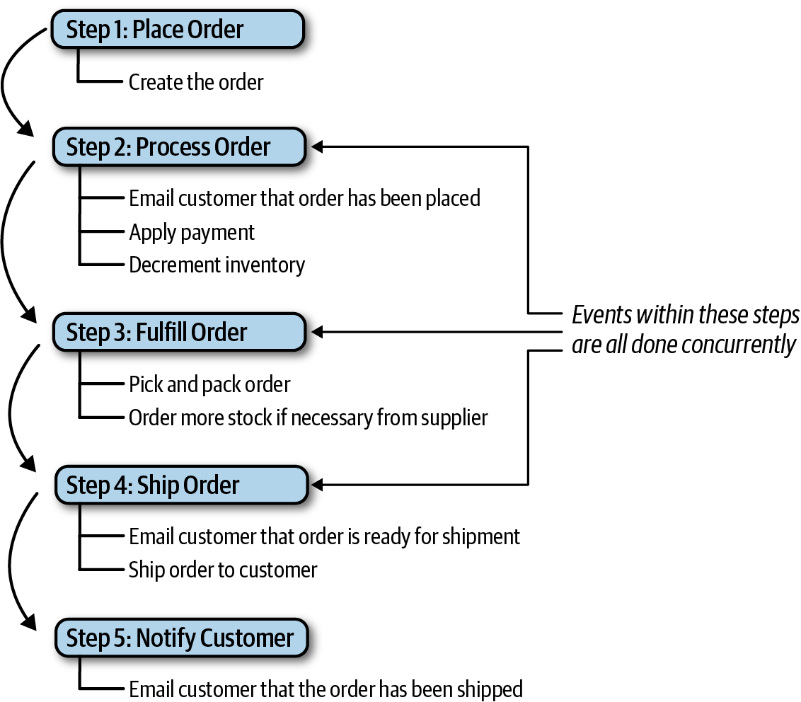

*图 14-7：下单时的中介者步骤。*

<!-- CH14-032 | PDF p. 209 | 正文 -->

同样的 `PlaceOrder` 初始事件发送到 `customer-event-queue`，客户中介者接收，并按图 14-7 生成处理事件。注意，第 2、3、4 步各自内部的多个事件并发执行，但步骤之间串行。例如，第 3 步履行订单必须完成并确认，才能在第 4 步发运中通知客户准备发货。

<!-- CH14-033 | PDF p. 209 | 正文 -->

收到初始事件后，客户中介者生成 `create-order`，发送到 `order-placement-queue`，见图 14-8。下单处理器验证并创建订单，将确认和订单 ID 返回中介者。这时，中介者可以将 ID 返回客户表示下单成功，也可能根据业务规则继续等待全部步骤完成。

<!-- 书内第 190 页，PDF 第 210 页。 -->

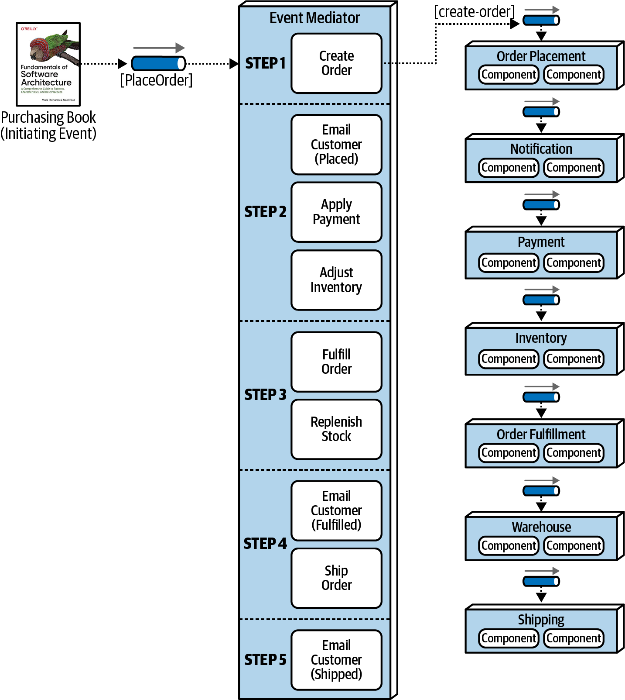

*图 14-8：中介者示例第 1 步。*

<!-- CH14-034 | PDF p. 210 | 正文 -->

第 1 步完成后，进入第 2 步，见图 14-9，同时生成 `email-customer`、`apply-payment`、`adjust-inventory`，发到各自队列。三个处理器执行并通知完成。中介者必须收到全部三个并行任务的确认，才能进入第 3 步。任一处理器报错，中介者都可采取纠正措施，本节稍后进一步介绍。

<!-- 书内第 191 页，PDF 第 211 页。 -->

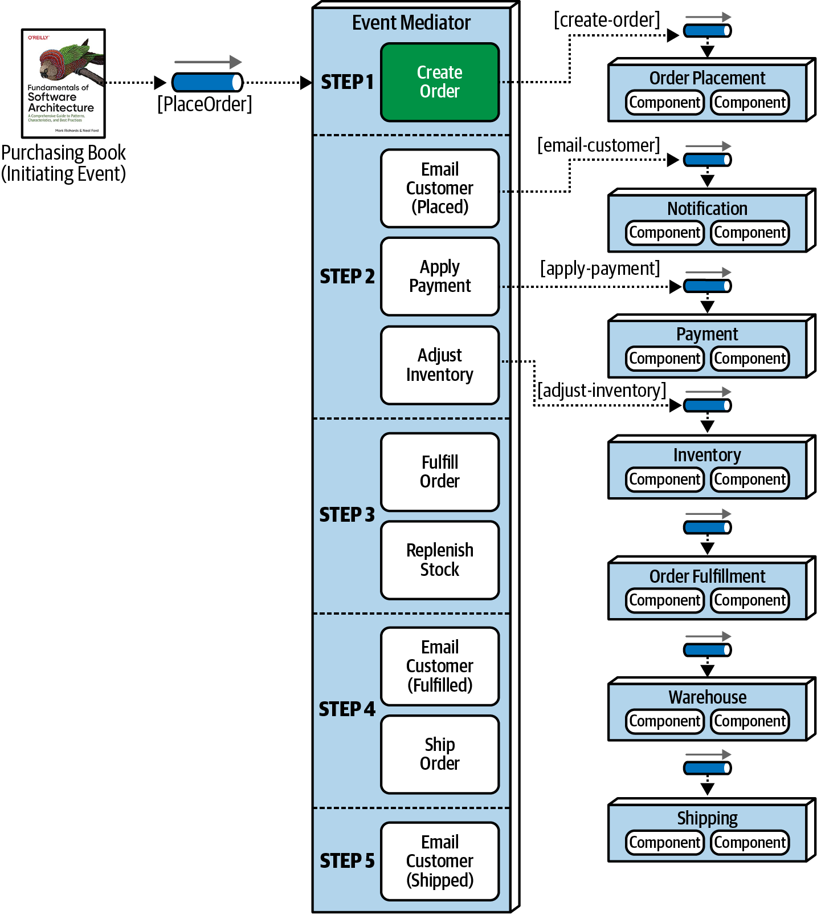

*图 14-9：中介者示例第 2 步。*

<!-- 书内第 192 页，PDF 第 212 页。 -->

<!-- CH14-035 | PDF p. 212 | 正文 -->

收到第 2 步所有处理器的成功确认后，进入第 3 步履行订单，见图 14-10。`fulfill-order` 与 `order-stock` 可以同时进行，订单履行和仓库处理器分别执行，向中介者返回确认。

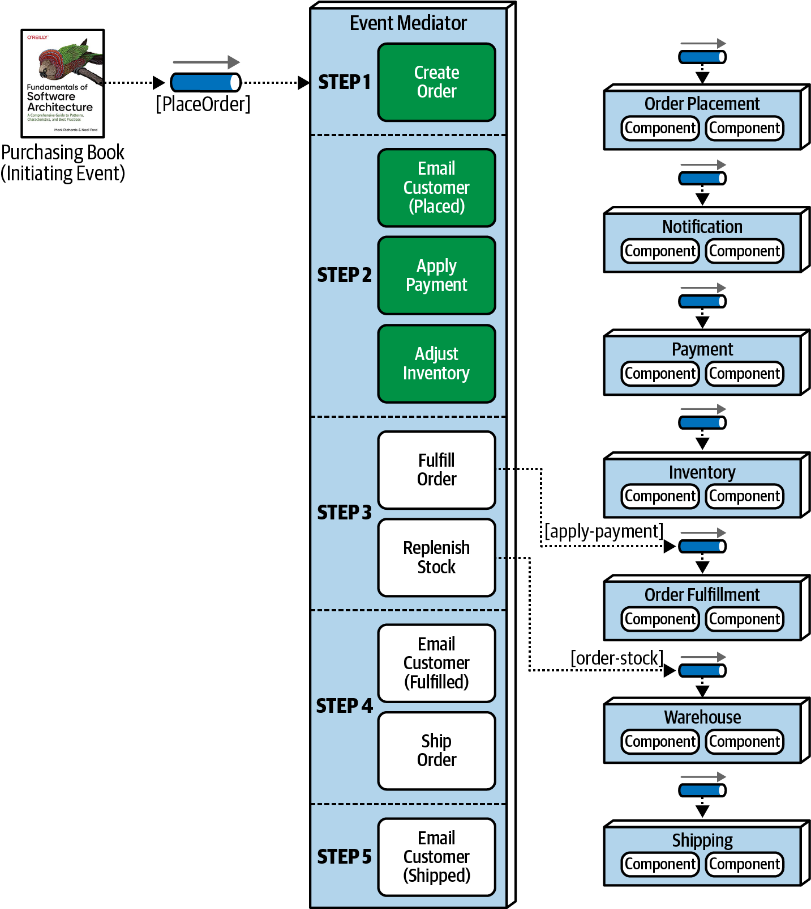

*图 14-10：中介者示例第 3 步。*

<!-- 书内第 193 页，PDF 第 213 页。 -->

<!-- CH14-036 | PDF p. 213 | 正文 -->

完成后，进入第 4 步发运，见图 14-11，再生成包含具体指令的 `email-customer`，此时为通知客户订单准备发运，同时生成 `ship-order`。

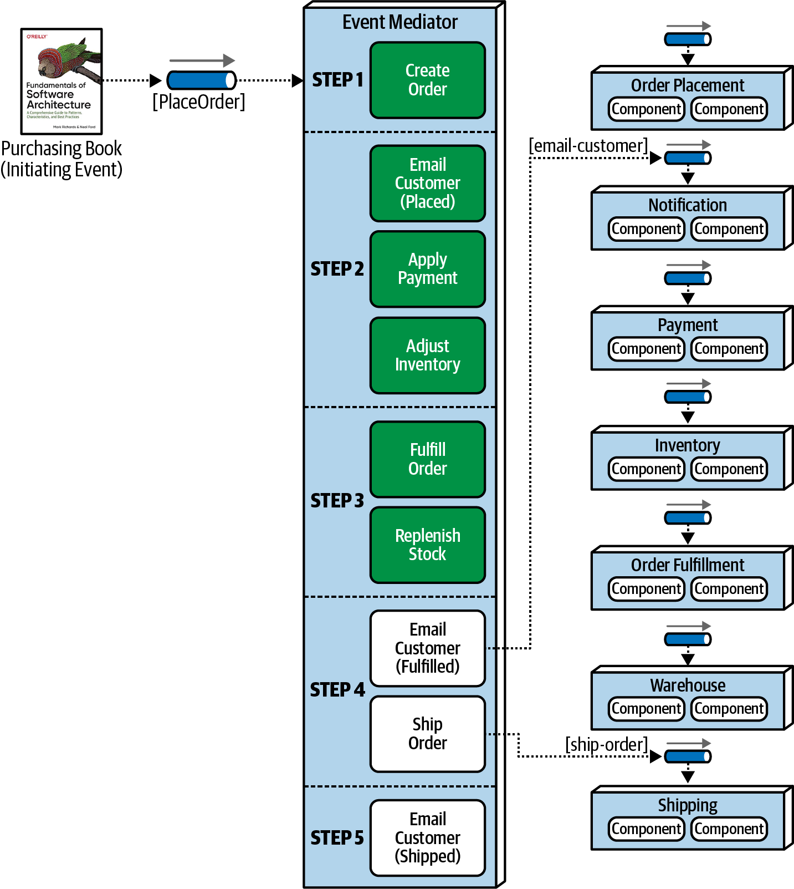

*图 14-11：中介者示例第 4 步。*

<!-- CH14-037 | PDF p. 213 | 正文 -->

最后进入第 5 步，见图 14-12，再生成带有相应上下文的 `email-customer`，通知已发货。工作流完成，中介者将初始事件流程标记为完成，移除相关状态。

<!-- 书内第 194 页，PDF 第 214 页。 -->

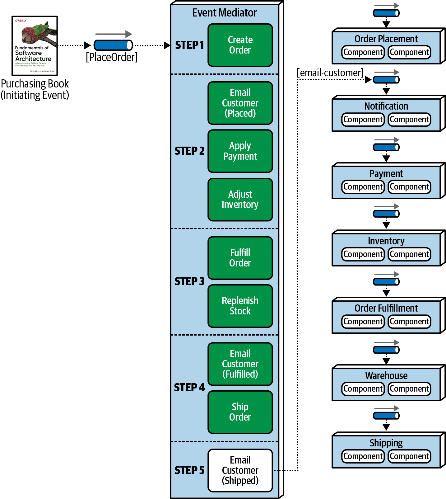

*图 14-12：中介者示例第 5 步。*

<!-- CH14-038 | PDF p. 214 | 正文 -->

中介者了解并控制工作流，这是代理拓扑没有的。它因而可以维护事件状态，处理错误、恢复和重启。例如，信用卡过期，支付失败，中介者收到错误，知道只有支付成功才能进入第 3 步，于是停止工作流，将请求状态保存在自身持久化存储中。最终支付成功后，可以从中断位置，也就是第 3 步开始处继续。

<!-- 书内第 195 页，PDF 第 215 页。 -->

<!-- CH14-039 | PDF p. 215 | 正文 -->

另一个根本区别，是处理事件的含义和用途。在代理例子中，发布的是已发生的事实，如 `order-created`、`payment-applied`、`email-sent`；其他处理器对动作作出反应。而中介者中的 `place-order`、`send-email`、`fulfill-order` 等，实际上是命令，即需要发生的事情，而非已经发生的事件。此外，中介者中的命令必须处理，代理拓扑中的事件则可以忽略。

<!-- CH14-040 | PDF p. 215 | 正文 -->

中介者解决了代理的问题，也有缺点。首先，很难以声明式方式建模复杂事件流中的动态处理。因此，中介者中的许多工作流只覆盖一般情况，缺货或其他非典型错误等动态情况，则采用代理与中介者混合模型。其次，处理器可以像代理拓扑一样扩展，但中介者也必须扩展，有时成为整个流程瓶颈。最后，由于它控制事件处理，处理器解耦程度和性能都不如代理。表 14-2 总结这些权衡。

<!-- CH14-041 | PDF p. 215 | 正文 -->

*表 14-2：中介者拓扑的权衡。*

<!-- CH14-042 | PDF p. 215 | 表格 -->

| 优点 | 缺点 |
| --- | --- |
| 工作流控制 | 事件处理器耦合更多 |
| 错误处理 | 可扩展性较低 |
| 可恢复性 | 性能较低 |
| 重启能力 | 容错性较低 |
| 数据一致性更好 | 复杂工作流建模困难 |

<!-- CH14-043 | PDF p. 215 | 正文 -->

两种拓扑的选择，本质上是工作流控制与错误处理能力，和高性能、可扩展性之间的权衡。中介者的性能和扩展能力仍然不错，只是不及代理。

<!-- 书内第 196 页，PDF 第 216 页。 -->

## 异步能力

<!-- CH14-044 | PDF p. 216 | 正文 -->

事件驱动风格的一项独特之处，是无论无需响应的发出即不等待处理，还是需要消费者返回信息的请求—应答，都依靠异步通信。异步通信可以大幅改善系统整体响应能力。

<!-- CH14-045 | PDF p. 216 | 正文 -->

图 14-13 中，用户给商品评价发表评论。假设评论服务需要 3,000 毫秒，因为必须经过多个解析引擎：不当词语检查、检查句子是否含侮辱内容的语法检查，以及确认评论关于商品而非政治宣泄的上下文检查。上方同步 RESTful 路径包含 50 毫秒请求延迟、3,000 毫秒处理、50 毫秒响应延迟，用户等待 3,100 毫秒。下方采用异步消息，用户感知的响应只有 25 毫秒。真正发表评论仍需 3,025 毫秒，包括 25 毫秒接收及 3,000 毫秒处理，但用户看来已经完成。

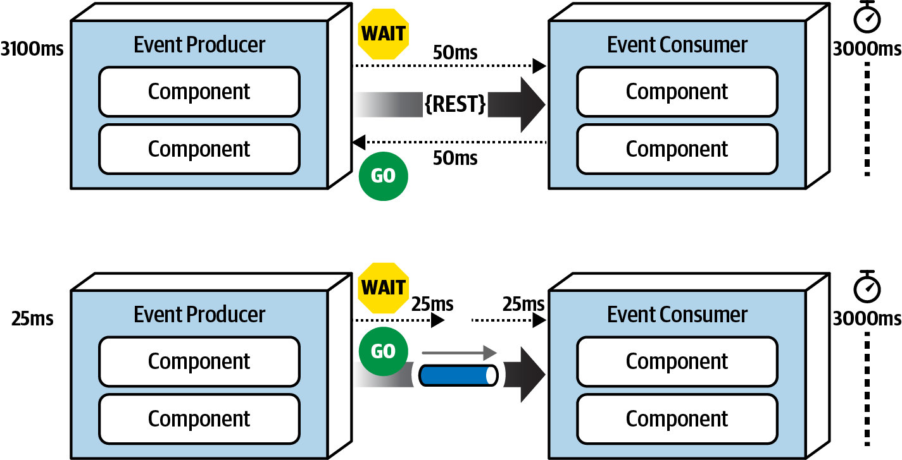

*图 14-13：同步与异步通信。*

<!-- 书内第 197 页，PDF 第 217 页。 -->

<!-- CH14-046 | PDF p. 217 | 正文 -->

这很好地说明了响应能力（responsiveness）与性能的区别。如果用户只需要确认或感谢信息，为何还要等待？响应能力关注的是告诉用户动作已被接受、稍后处理；性能则关注端到端过程更快。两种情况下，评论处理均为 3,000 毫秒，未做优化。真正优化性能，可以让文本和语法解析并行，结合缓存等技术。图中下方改善了响应能力，而非系统处理性能。

<!-- CH14-047 | PDF p. 217 | 正文 -->

从 3,100 到 25 毫秒，差异惊人，但有一个前提。上方同步路径保证评论已发布；下方只是确认收到，并承诺未来最终发布。用户以为已经成功，但如果包含不当词语，评论被拒，如何通知？假设用户已注册，发表评论通常要求如此，就可以发消息说明问题，并建议修改。这个例子简单；如果是异步股票交易，无法回到用户身边，又怎么办？

<!-- CH14-048 | PDF p. 217 | 正文 -->

异步通信的主要问题是错误处理。响应改善了，却更难处理错误，增加系统复杂性。下一节介绍响应式架构中的工作流事件模式。

## 错误处理

<!-- CH14-049 | PDF p. 217 | 正文 -->

工作流事件模式（workflow event pattern）是处理异步工作流错误的一种方法，同时关注韧性与响应能力：系统能够妥善处理错误，而不影响响应。

<!-- CH14-050 | PDF p. 217 | 正文 -->

它通过工作流委派者（workflow delegate），实现委派、隔离与修复，见图 14-14。生产者异步发送数据，消费者处理出错时，立即将错误委派给工作流处理器，再继续处理队列下一条消息。这样不影响整体响应。如果消费者停下来研究错误，就无法读取后续消息，影响下一条及所有等待消息的响应。

<!-- 书内第 198 页，PDF 第 218 页；上一段跨页。 -->

<!-- CH14-051 | PDF p. 218 | 正文 -->

工作流处理器分析消息问题，可能根据静态、确定性规则，也可能用机器学习检查数据异常。随后以程序方式、无需人工干预，修改原数据尝试修复，再发回原队列。消费者将其视为新消息，再试处理，希望成功。若仍无法判断问题，就发送到另一个队列，由通常称为仪表板的应用接收，界面类似 Outlook 或 Apple Mail。相关负责人查看并人工修复，再提交回原队列，通常通过 `reply-to` 消息头指定。

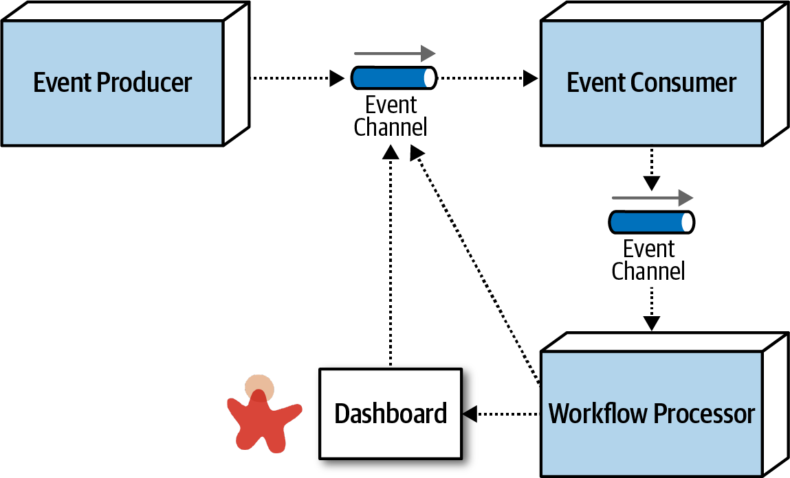

*图 14-14：响应式架构的工作流事件模式。*

<!-- CH14-052 | PDF p. 218 | 正文 -->

例如，一地交易顾问代表另一地大型交易公司接收指令，包括股票与股数，将其组成通常称为篮子的一批订单，异步发送给交易公司，再交经纪商购买。为简化，假定指令契约如下：

<!-- 书内第 199 页，PDF 第 219 页。 -->

<!-- CH14-053 | PDF p. 219 | 代码或日志示例 -->

```text
ACCOUNT(String),SIDE(String),SYMBOL(String),SHARES(Long)
```

<!-- CH14-054 | PDF p. 219 | 正文 -->

交易公司收到以下 Apple（AAPL）指令：

<!-- CH14-055 | PDF p. 219 | 代码或日志示例 -->

```text
12654A87FR4,BUY,AAPL,1254
87R54E3068U,BUY,AAPL,3122
6R4NB7609JJ,BUY,AAPL,5433
2WE35HF6DHF,BUY,AAPL,8756 SHARES
764980974R2,BUY,AAPL,1211
1533G658HD8,BUY,AAPL,2654
```

<!-- CH14-056 | PDF p. 219 | 正文 -->

第四条在股数后多了 `SHARES`。没有错误处理能力时，交易提交服务出现以下错误：

<!-- CH14-057 | PDF p. 219 | 代码或日志示例 -->

```text
Exception in thread "main" java.lang.NumberFormatException:
 For input string: "8756 SHARES"
 at java.lang.NumberFormatException.forInputString
 (NumberFormatException.java:65)
 at java.lang.Long.parseLong(Long.java:589)
 at java.lang.Long.<init>(Long.java:965)
 at trading.TradePlacement.execute(TradePlacement.java:23)
 at trading.TradePlacement.main(TradePlacement.java:29)
```

<!-- CH14-058 | PDF p. 219 | 正文 -->

由于请求异步，除了记录日志，服务似乎无能为力，没有用户可以同步回应并修正。

<!-- CH14-059 | PDF p. 219 | 正文 -->

应用工作流事件模式，就可以程序化修复。交易公司无法控制顾问及其发送的数据，必须自行响应，见图 14-15。同样错误出现时，`Trade Placement` 立即将消息及异常信息异步委派给 `Trade Placement Error` 服务：

<!-- CH14-060 | PDF p. 219 | 代码或日志示例 -->

```text
Trade Placed: 12654A87FR4,BUY,AAPL,1254
Trade Placed: 87R54E3068U,BUY,AAPL,3122
Trade Placed: 6R4NB7609JJ,BUY,AAPL,5433
Error Placing Trade: "2WE35HF6DHF,BUY,AAPL,8756 SHARES"
Sending to trade error processor  <-- delegate the error fixing and move on
Trade Placed: 764980974R2,BUY,AAPL,1211
...
```

<!-- CH14-061 | PDF p. 219 | 正文 -->

箭头注释意为：委派修复，然后继续处理。

<!-- 书内第 200 页，PDF 第 220 页。 -->

<!-- CH14-062 | PDF p. 220 | 正文 -->

错误服务作为工作流委派者，检查异常，发现股数字段包含 `SHARES`，移除该词后重新提交：

<!-- CH14-063 | PDF p. 220 | 代码或日志示例 -->

```text
Received Trade Order Error: 2WE35HF6DHF,BUY,AAPL,8756 SHARES
Trade fixed: 2WE35HF6DHF,BUY,AAPL,8756
Resubmitting Trade For Re-Processing
```

<!-- CH14-064 | PDF p. 220 | 正文 -->

修复后的指令成功处理：

<!-- CH14-065 | PDF p. 220 | 代码或日志示例 -->

```text
...
trade placed: 1533G658HD8,BUY,AAPL,2654
trade placed: 2WE35HF6DHF,BUY,AAPL,8756 <-- this was the original trade in error
```

<!-- CH14-066 | PDF p. 220 | 正文 -->

末行注释意为：这就是原先出错的交易。

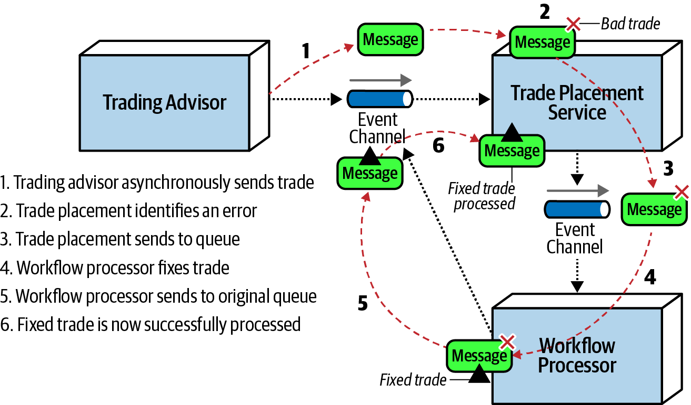

*图 14-15：通过工作流事件模式处理错误。*

<!-- CH14-067 | PDF p. 220 | 正文 -->

其后果之一，是修复重提交后消息会乱序。本例中顺序重要，同账户所有交易必须依次处理，例如先卖 IBM，再买 AAPL。维持特定上下文，此处是账户号，内的顺序并非不可能，但很复杂。一种方式是记录出错指令的账户号，同账户后续交易放入临时队列，按先进先出保存。原指令修好并处理后，再依次取出该账户其他交易。

## 防止数据丢失

<!-- 书内第 201 页，PDF 第 221 页。 -->

<!-- CH14-068 | PDF p. 221 | 正文 -->

异步通信中，数据丢失始终是主要关注点。事件驱动架构里有许多可能丢失的位置，指消息被丢弃或从未到达最终目的地。幸运的是，有一些基础、现成的消息技术可以预防。

<!-- CH14-069 | PDF p. 221 | 正文 -->

假设 A 异步发消息到队列，B 接收后将数据插入数据库。图 14-16 有三个丢失点：

<!-- CH14-070 | PDF p. 221 | 列表项 -->

1. A 的消息没有到队列；或者虽到达，代理在 B 取消息前宕机。
2. B 取走下一条消息，处理前崩溃。
3. B 因数据错误，无法将消息持久化到数据库。

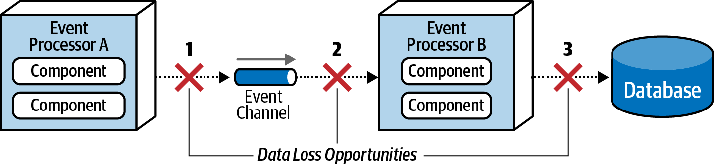

*图 14-16：事件驱动架构中可能发生数据丢失的位置。*

<!-- CH14-071 | PDF p. 221 | 正文 -->

这些都可通过基础消息技术缓解。问题 1 可采用持久化队列与同步发送。持久化队列支持保证交付：代理收到消息，不只存在内存，还写入文件系统或数据库。代理宕机后，消息仍在磁盘，重启后继续处理。同步发送让生产者阻塞等待，直到代理确认消息已经持久化。原文认为，两者结合后，生产者到队列之间不会丢失，因为消息要么仍由生产者持有，要么已存入队列。

<!-- 书内第 202 页，PDF 第 222 页；上一段跨页。 -->

<!-- CH14-072 | PDF p. 222 | 正文 -->

问题 2 可用客户端确认模式（client acknowledge mode）解决。原文说，默认自动确认模式下，出队就立即移除。客户端确认则让消息保留在队列，并附客户端 ID，阻止其他消费者读取。这样 B 崩溃时，消息仍在，避免此处丢失。

<!-- CH14-073 | PDF p. 222 | 正文 -->

问题 3 使用数据库提交的 ACID 事务解决。提交完成，数据就已持久化。利用最后参与者支持（last participant support，LPS），在确认处理完成、数据持久化后，将消息从持久化队列移除，原文认为由此保证 A 到数据库的全过程不丢消息。技术见图 14-17。

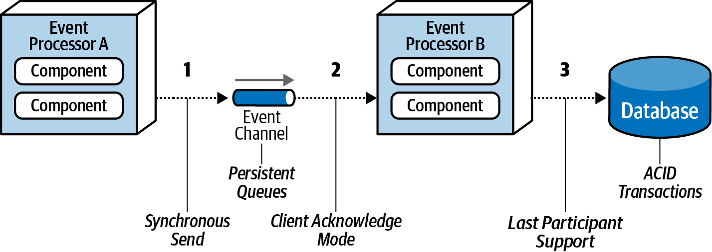

*图 14-17：防止事件驱动架构中的数据丢失。*

<!-- CH14-074 | PDF p. 222 | 译注 -->

> 译注：本节的“保证”是作者对所述机制的概括。实际保障依赖生产者、代理持久化配置、确认与事务边界及故障模型；不能仅凭名称推断端到端恰好一次处理，也需考虑重复交付、提交后确认前崩溃等情况。

## 广播能力

<!-- 书内第 203 页，PDF 第 223 页。 -->

<!-- CH14-075 | PDF p. 223 | 正文 -->

另一项独特能力，是广播事件而不必知道谁接收、是否有人接收、以及如何处理。如图 14-18，生产者发布后，多个订阅者接收同一消息。

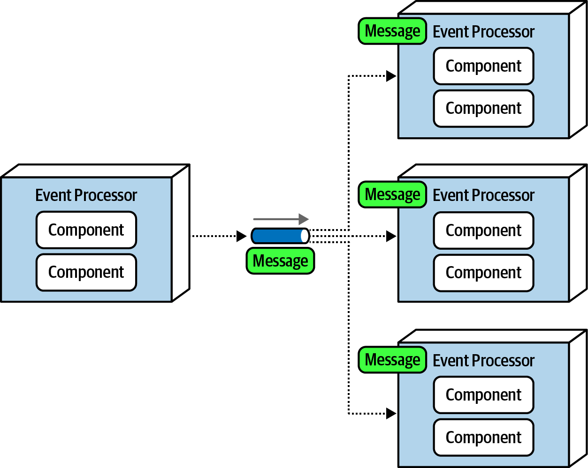

*图 14-18：向其他事件处理器广播事件。*

<!-- CH14-076 | PDF p. 223 | 正文 -->

广播可能是处理器之间最高程度的解耦，因为生产者通常不知道哪些处理器会接收，更不知道它们如何使用。广播是最终一致性、复杂事件处理（complex event processing，CEP）及许多其他模式的重要部分。例如，股票市场的最新价格频繁变化，每个价格更新可能影响很多事情；发布最新价格的服务只需广播，不必知道用途。

## 请求—应答

<!-- 书内第 204 页，PDF 第 224 页。 -->

<!-- CH14-077 | PDF p. 224 | 正文 -->

此前讨论的异步请求，不需要消费者立即响应。但买书需要订单 ID，订机票需要确认号时怎么办？这些通信需要某种同步。

<!-- CH14-078 | PDF p. 224 | 正文 -->

事件驱动中，通过请求—应答消息（request-reply messaging），有时称伪同步通信，实现这种同步。每个通道由请求队列和应答队列组成。初始请求异步发到请求队列，控制权返回生产者；随后生产者在应答队列阻塞等待。消费者处理后，将结果发到应答队列，再由生产者接收，如图 14-19。

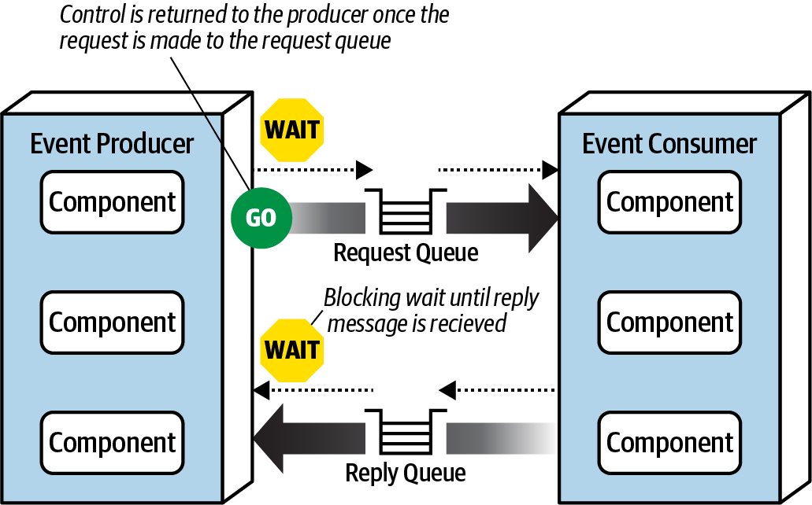

*图 14-19：请求—应答消息处理。*

<!-- CH14-079 | PDF p. 224 | 正文 -->

主要有两种实现。第一种，也是最常用的，是消息头关联 ID（correlation ID）。应答中的这一字段，通常设为原始请求消息 ID。图 14-20 用 ID 表示消息 ID，CID 表示关联 ID，流程如下：

<!-- CH14-080 | PDF p. 224 | 列表项 -->

1. 生产者发送请求并记录唯一消息 ID，此处为 124，CID 为 null。

<!-- 书内第 205 页，PDF 第 225 页。 -->

<!-- CH14-081 | PDF p. 225 | 列表项 -->

2. 生产者在应答队列阻塞等待，用消息过滤器或选择器，选择 CID 等于原 ID 124 的消息。当前队列中 ID 855 的 CID 为 120，ID 856 的 CID 为 122，都不匹配，因此不会读取。原文此处将等待方写作消费者。
3. 消费者收到 ID 124，处理请求。
4. 消费者创建应答，将 CID 设为 124。
5. 将新消息 ID 857 发到应答队列。
6. 生产者因为 CID 124 匹配选择器而收到应答。

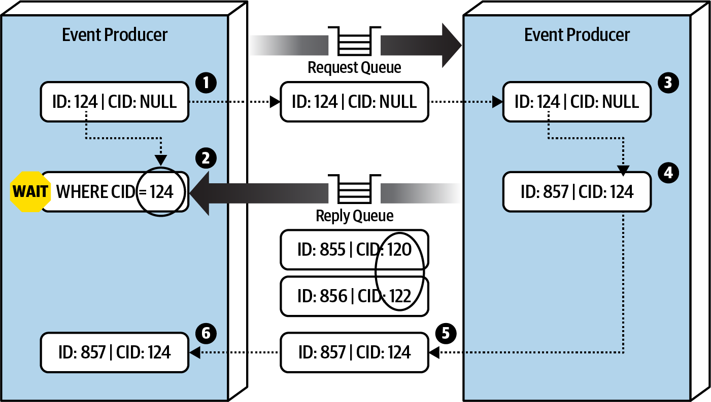

*图 14-20：使用关联 ID 的请求—应答消息处理。*

<!-- CH14-082 | PDF p. 225 | 正文 -->

第二种使用临时应答队列，针对特定请求创建，请求结束时删除。图 14-21 中不需要关联 ID，因为临时队列专属于该生产者的这次请求：

<!-- CH14-083 | PDF p. 225 | 列表项 -->

1. 生产者创建临时队列，或由代理自动创建，将请求发到请求队列，并在 `reply-to` 头，或其他约定属性中传递临时队列名。

<!-- 书内第 206 页，PDF 第 226 页；上一项跨页。 -->

<!-- CH14-084 | PDF p. 226 | 列表项 -->

2. 生产者在临时队列阻塞等待，无需选择器，因为所有消息都属于原发送者。
3. 消费者处理请求，将应答发到 `reply-to` 指定队列。
4. 事件处理器收到应答并删除临时队列。

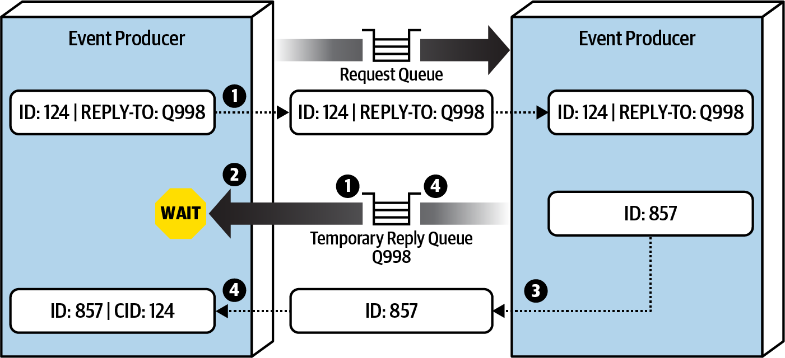

*图 14-21：使用临时队列的请求—应答消息处理。*

<!-- CH14-085 | PDF p. 226 | 正文 -->

临时队列更简单，但每个请求都要创建并立即删除队列。消息量大时，可能显著降低代理速度，影响性能与响应，因此我们通常建议关联 ID。

## 选择基于请求还是基于事件

<!-- CH14-086 | PDF p. 226 | 正文 -->

两者都可用于设计系统，但选对模型至关重要。对于结构清楚、数据驱动的请求（如查询客户资料），如果需要确定性和流程控制，建议采用基于请求的模型。对于灵活、基于动作的事件，如果需要高响应能力和可扩展性，且用户触发的处理流程复杂多变，则建议采用基于事件的模型。

<!-- 书内第 207 页，PDF 第 227 页。 -->

<!-- CH14-087 | PDF p. 227 | 正文 -->

理解事件模型的权衡，也有助于选型。表 14-3 列出其利弊。

<!-- CH14-088 | PDF p. 227 | 正文 -->

*表 14-3：事件驱动模型的权衡。*

<!-- CH14-089 | PDF p. 227 | 表格 -->

| 相比基于请求的优势 | 代价 |
| --- | --- |
| 更善于响应动态变化的用户内容 | 仅支持最终一致性 |
| 更好的可扩展性与弹性 | 对处理流程控制更少 |
| 更好的敏捷性与变更管理 | 对事件流结果的确定性更低 |
| 更好的适应性与可扩充性 | 难以测试和调试 |
| 更好的响应能力与性能 | |
| 更好的实时决策 | |
| 更能根据情境感知结果作出响应 | |

## 混合事件驱动架构

<!-- CH14-090 | PDF p. 227 | 正文 -->

许多应用以事件驱动为总体风格，也常与其他风格组合，形成混合架构。常见的是微服务与空间架构，也可有事件驱动微内核或管道架构。

<!-- CH14-091 | PDF p. 227 | 正文 -->

加入事件驱动，有助于消除瓶颈、在请求积压时提供背压点，并提高用户响应能力。微服务和空间架构都可以用消息将数据异步传送给另一个处理器，再由它更新数据库；服务间采用消息通信时，也都能以程序方式扩展微服务中的服务或空间架构中的处理单元。

## 架构特性评分

<!-- CH14-092 | PDF p. 227 | 正文 -->

图 14-22 中，一星表示支持较弱，五星表示强项。定义见第 4 章。

<!-- 书内第 208 页，PDF 第 228 页。 -->

<!-- CH14-093 | PDF p. 228 | 正文 -->

事件驱动主要按技术划分，因为某个领域散布于多个处理器，通过中介者、队列与主题连接。领域变化通常影响多个处理器、中介者和其他消息制品，因此本书不将它归为领域划分。

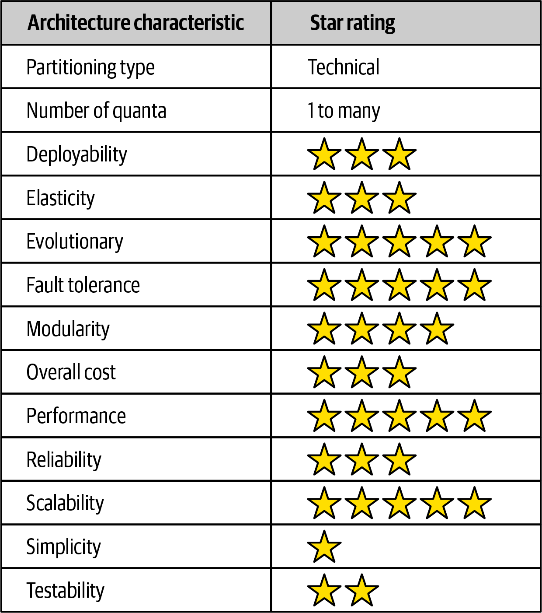

*图 14-22：事件驱动架构特性评分。*

<!-- CH14-094 | PDF p. 228 | 评分表说明 -->

图 14-22 中文转录：

<!-- CH14-095 | PDF p. 228 | 表格 -->

| 架构特性 | 星级或取值 |
| --- | --- |
| 划分类型 | 技术划分 |
| 量子数量 | 1 到多个 |
| 可部署性 | 3 / 5 |
| 弹性 | 3 / 5 |
| 可演进性 | 5 / 5 |
| 容错性 | 5 / 5 |
| 模块化 | 4 / 5 |
| 总体成本 | 3 / 5 |
| 性能 | 5 / 5 |
| 可靠性 | 3 / 5 |
| 可扩展性 | 5 / 5 |
| 简单性 | 1 / 5 |
| 可测试性 | 2 / 5 |

<!-- CH14-096 | PDF p. 228 | 正文 -->

量子数量从一到多个，通常取决于各处理器的数据库交互及请求—应答。即使通信异步，共享同一数据库实例的多个处理器也属于同一量子。请求—应答亦然：底层消息虽异步，但消费者结果必须立即返回时，处理器在逻辑上同步绑定，因而属于同一量子。

<!-- 书内第 209 页，PDF 第 229 页。 -->

<!-- CH14-097 | PDF p. 229 | 正文 -->

例如，一个处理器要求另一个下单，必须等订单 ID 才能继续。后者宕机，前者就无法继续，因此即使双方使用异步消息，也属于同一量子，拥有相同架构特性。

<!-- CH14-098 | PDF p. 229 | 正文 -->

性能、可扩展性与容错性得到五星，是这一风格的主要优势。异步通信与高度并行带来性能；通过对处理器进行程序化负载均衡，也称竞争消费者（competing consumers），可以在负载增加时增添实例，实现扩展；高度解耦的异步处理器依靠最终一致性，并让工作流最终得到处理，从而支持容错。只要用户界面或发出请求的处理器不需要立即得到响应，下游处理器暂时不可用时，就可以使用 promise、future 等机制稍后处理。

<!-- CH14-099 | PDF p. 229 | 正文 -->

简单性和可测试性较低，主要因为事件流动态且非确定。基于请求模型的路径和结果通常已知，较易测试；事件模型中，处理器如何响应、产生什么消息，有时不明确。事件树可能生成数百乃至数千场景，难以治理和测试。

<!-- CH14-100 | PDF p. 229 | 正文 -->

最后，事件驱动高度可演进，获得五星。通过现有或新增处理器扩展功能相对直接，代理拓扑尤其如此。事先发布消息形成接入点，数据已经可用，新增功能时就不必修改基础设施或已有处理器。

---

## 图中文字中文对照（译者整理）

### 图 14-1

请求（Request）、请求状态（Request State）、请求编排器（Request Orchestrator）、请求处理器（Request Processor）、组件（Component）、数据库（Database）。

### 图 14-2

初始事件（Initiating Event）、事件通道（Event Channel）、事件处理器（Event Processor）、处理事件（Processing Event）、组件（Component）。

### 图 14-3

通知事件处理器（Notification Event Processor）、事件通道、处理事件、组件。说明：“没有人关心这个事件，因此它直接消失。”

### 图 14-4

购书，初始事件（Purchasing Book (Initiating Event)）；下单（Order Placement）、通知（Notification）、支付（Payment）、库存（Inventory）、仓库（Warehouse）、订单履行（Order Fulfillment）、发运（Shipping）。事件标签保留：`PlaceOrder`（下单）、`order-created`（订单已创建）、`email-sent`（邮件已发送）、`payment-denied`（支付被拒）、`payment-applied`（支付已成功）、`inventory-updated`（库存已更新）、`inventory-resupplied`（库存已补充）、`order-fulfilled`（订单已履行）、`order-shipped`（订单已发运）。

### 图 14-5

初始事件（Initiating Event）、事件队列（Event Queue）、事件中介者（Event Mediator）、事件通道（Event Channel）、事件处理器（Event Processor）、组件（Component）。

### 图 14-6

简单事件中介者，以源代码实现（Simple Event Mediator (Source Code)）；困难事件中介者，BPEL（Hard Event Mediator (BPEL)）；复杂事件中介者，BPM（Complex Event Mediator (BPM)）；其余标签为初始事件、处理事件、队列、通道、处理器与组件。

### 图 14-7

第 1 步下单（Place Order）：创建订单。第 2 步处理订单（Process Order）：邮件告知已下单、支付、扣减库存。第 3 步履行订单（Fulfill Order）：拣货打包、必要时向供应商补货。第 4 步发运（Ship Order）：通知准备发运、发货。第 5 步通知客户（Notify Customer）：告知已发运。说明：“这些步骤内部的事件都并发执行”，指第 2–4 步各自内部。

### 图 14-8 至图 14-12

五张图依次高亮五个处理步骤，其余共同标签为：事件中介者（Event Mediator）、下单（Order Placement）、通知（Notification）、支付（Payment）、库存（Inventory）、订单履行（Order Fulfillment）、仓库（Warehouse）、发运（Shipping）、组件（Component）；动作包括创建订单（Create Order）、邮件通知客户已下单（Email Customer (Placed)）、支付（Apply Payment）、调整库存（Adjust Inventory）、履行订单（Fulfill Order）、补货（Replenish Stock）、邮件通知订单已履行（Email Customer (Fulfilled)）、发运订单（Ship Order）、邮件通知已发运（Email Customer (Shipped)）。

队列或命令标签保留：`PlaceOrder`（下单初始事件）、`create-order`（创建订单）、`email-customer`（邮件通知）、`apply-payment`（支付）、`adjust-inventory`（调整库存）、`order-stock`（订货补充库存）、`ship-order`（发运）。图 14-10 将通往订单履行的命令标成 `apply-payment`，与正文的 `fulfill-order` 不同；原图保留，勿据此误认二者相同。

### 图 14-13

事件生产者（Event Producer）、事件消费者（Event Consumer）、组件（Component）、等待（WAIT）、继续（GO）、REST；时间数值原样保留，单位 ms 为毫秒。

### 图 14-14

事件生产者、事件消费者、事件通道（Event Channel）、工作流处理器（Workflow Processor）、仪表板（Dashboard）。

### 图 14-15

交易顾问（Trading Advisor）、交易提交服务（Trade Placement Service）、工作流处理器、事件通道、消息（Message）；错误交易（Bad trade）、已修复交易（Fixed trade）、已修复交易被处理（Fixed trade processed）。六步：顾问异步发送 → 识别错误 → 发到错误队列 → 修复 → 送回原队列 → 成功处理。

### 图 14-16

事件处理器 A、B（Event Processor A / B）、组件、事件通道、数据库；可能丢失数据的位置（Data Loss Opportunities）。

### 图 14-17

同步发送（Synchronous Send）、持久化队列（Persistent Queues）、客户端确认模式（Client Acknowledge Mode）、ACID 事务（ACID Transactions）、最后参与者支持（Last Participant Support）。

### 图 14-18

事件处理器（Event Processor）、组件（Component）、消息（Message），箭头表示广播到多个接收者。

### 图 14-19

事件生产者、事件消费者、请求队列（Request Queue）、应答队列（Reply Queue）、等待、继续；“请求发到请求队列后，控制权返回生产者”；“阻塞等待直到收到应答”。

### 图 14-20

ID 为消息标识，CID 为关联标识，NULL 为空；WHERE CID=124 表示消息选择条件；其余为请求与应答队列。原图右侧标为 Event Producer，按流程它承担消费者角色，原图保留。

### 图 14-21

临时应答队列（Temporary Reply Queue）Q998；REPLY-TO 为应答目标，WAIT 为等待。右侧同样标为 Event Producer；左下还保留 CID 字段，尽管正文说临时队列方案不必关联 ID。原图保留并提示这些差异。

### 图 14-22

各项评分已在正文转录。总体成本高星表示成本优势。
