<!-- CH15-001 | PDF p. 231 | 标题 -->
# 第 15 章 空间架构风格

> 原文章名：Space-Based Architecture Style
> 来源：英文第一版，书内第 211–234 页，PDF 第 231–254 页。
> 上一轮校译记录：[校译记录](../../reviews/chapter-15-review.md)。
> 独立复审：已完成原文逐段对照、中文通读与相关附件检查，见[本次报告](../../reviews/independent-pass/chapter-15.md)。
> 保留英文原图，中文标签对照见文末；下文页码均指原书书内页码。

<!-- 书内第 211 页，PDF 第 231 页。 -->

<!-- CH15-002 | PDF p. 231 | 正文 -->
大多数基于 Web 的业务应用都遵循相同的大体请求流程：来自浏览器的请求先到达 Web 服务器，再到达应用服务器，最后到达数据库服务器。对于少量用户，这种模式运行得很好；但随着用户负载增加，瓶颈开始出现，先是在 Web 服务器层，然后是应用服务器层，最后是数据库服务器层。面对用户负载增加造成的瓶颈，通常的应对办法是横向扩展 Web 服务器。这相对容易，成本也低，有时确实能解决瓶颈问题。然而，在大多数高用户负载情况下，横向扩展 Web 服务器层只是把瓶颈下移到了应用服务器。扩展应用服务器可能比扩展 Web 服务器更复杂、成本更高，而且通常只是把瓶颈下移到了更难扩展、扩展成本也更高的数据库服务器。即使能够扩展数据库，最终得到的也会是一种三角形拓扑：三角形最宽的一端是最容易扩展的 Web 服务器，最窄的一端则是最难扩展的数据库，如图 15-1 所示。

<!-- CH15-003 | PDF p. 231 | 正文 -->
对于任何具有大量并发用户的高流量应用，数据库通常都是限制并发事务处理数量的最后一道关卡。尽管各种缓存技术和数据库扩展产品有助于解决这些问题，但一个事实依然存在：要横向扩展普通应用以应对极端负载，是一件非常困难的事。

<!-- 书内第 212 页，PDF 第 232 页。 -->

<!-- CH15-004 | PDF p. 232 | 图表 -->
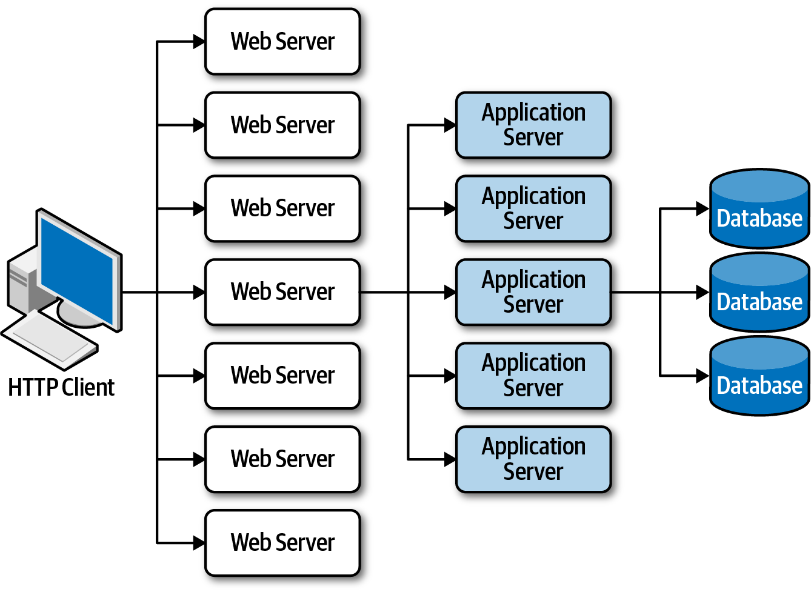

<!-- CH15-005 | PDF p. 232 | 图表 -->
*图 15-1：传统 Web 拓扑中的可扩展性限制。*

<!-- CH15-006 | PDF p. 232 | 正文 -->
空间架构风格（space-based architecture style）专门用于解决高可扩展性、弹性和高并发方面的问题。对于并发用户量变化不定、无法预测的应用，它也是一种有用的架构风格。通过架构来解决极端且变化不定的扩展需求，往往比尝试扩展数据库，或向不可扩展的架构中追加缓存技术更合适。

<!-- CH15-007 | PDF p. 232 | 标题 -->
## 通用拓扑

<!-- CH15-008 | PDF p. 232 | 正文 -->
空间架构的名称源自[元组空间（tuple space）](https://oreil.ly/XVJ_D)这一概念，即多个并行处理器通过共享内存进行通信的技术。它通过移除系统中作为同步约束的中央数据库，转而使用复制式内存数据网格，来实现高可扩展性、高弹性和高性能。应用数据保存在内存中，并在所有活动的处理单元之间复制。当某个处理单元更新数据时，它会异步将数据发送到数据库，通常使用具有持久化队列的消息机制。随着用户负载增加和减少，处理单元动态启动和关闭，从而满足变化的扩展需求。由于应用的常规事务处理中不涉及中央数据库，数据库瓶颈便被消除了，因而能使应用获得近乎无限的可扩展性。

<!-- CH15-009 | PDF p. 232 | 译注 -->
> 译注：“近乎无限”是原文对这种风格扩展能力的描述，不是对具体系统容量的保证；本章后面还会讨论内存、复制延迟、数据冲突和成本等限制。

<!-- 书内第 213 页，PDF 第 233 页。 -->

<!-- CH15-010 | PDF p. 233 | 正文 -->
空间架构由几个架构组件组成：包含应用代码的处理单元；用于管理和协调处理单元的虚拟化中间件；将更新后的数据异步发送到数据库的数据泵；将数据泵传来的更新写入数据库的数据写入器；以及在启动时读取数据库数据并将其交给处理单元的数据读取器。图 15-2 展示了这些主要架构组件。

<!-- CH15-011 | PDF p. 233 | 图表 -->
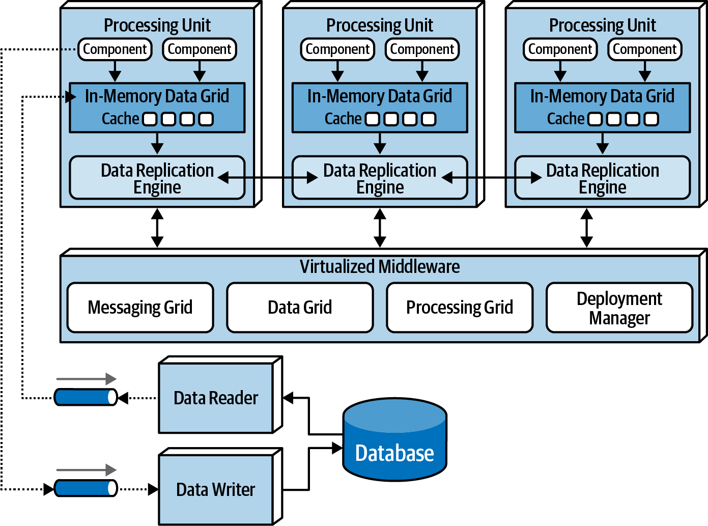

<!-- CH15-012 | PDF p. 233 | 图表 -->
*图 15-2：空间架构的基本拓扑。*

<!-- CH15-013 | PDF p. 233 | 标题 -->
### 处理单元

<!-- CH15-014 | PDF p. 233 | 正文 -->
处理单元（processing unit），如图 15-3 所示，包含应用逻辑或其中一部分，通常既包括 Web 组件，也包括后端业务逻辑。处理单元包含什么，取决于应用类型。较小的 Web 应用很可能整体部署到一个处理单元中；较大的应用则可能根据功能领域，将应用功能拆分到多个处理单元中。处理单元也可以包含小型、单一用途的服务，就像微服务那样。除了应用逻辑，处理单元还包含内存数据网格和复制引擎，通常通过 [Hazelcast](https://hazelcast.com)、[Apache Ignite](https://ignite.apache.org) 和 [Oracle Coherence](https://oreil.ly/XOUJL) 等产品实现。

<!-- 书内第 214 页，PDF 第 234 页。 -->

<!-- CH15-015 | PDF p. 234 | 图表 -->
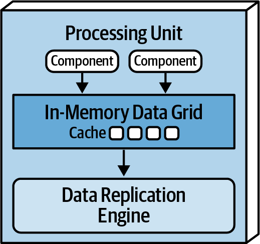

<!-- CH15-016 | PDF p. 234 | 图表 -->
*图 15-3：处理单元。*

<!-- CH15-017 | PDF p. 234 | 标题 -->
### 虚拟化中间件

<!-- CH15-018 | PDF p. 234 | 正文 -->
虚拟化中间件（virtualized middleware）处理架构中的基础设施关注点，控制数据同步和请求处理的各个方面。组成虚拟化中间件的组件包括消息网格、数据网格、处理网格和部署管理器。接下来几节将详细介绍这些组件；它们既可以自行编写，也可以购买第三方产品。

<!-- CH15-019 | PDF p. 234 | 标题 -->
#### 消息网格

<!-- CH15-020 | PDF p. 234 | 正文 -->
图 15-4 中的消息网格（messaging grid）负责管理输入请求和会话状态。当请求进入虚拟化中间件时，消息网格组件会确定哪些活动处理组件能够接收请求，并将请求转发给其中一个处理单元。消息网格的复杂程度可以从简单的轮询算法，到更复杂的“下一个可用”算法；后者会跟踪每个请求正在由哪个处理单元处理。这个组件通常使用具有负载均衡功能的常规 Web 服务器实现，例如 HA Proxy 和 Nginx。

<!-- 书内第 215 页，PDF 第 235 页。 -->

<!-- CH15-021 | PDF p. 235 | 图表 -->
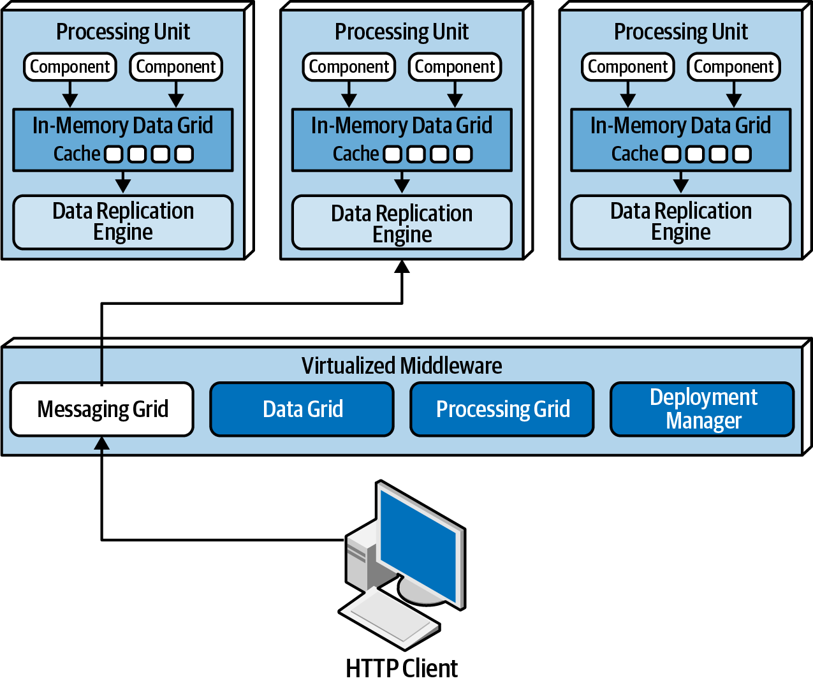

<!-- CH15-022 | PDF p. 235 | 图表 -->
*图 15-4：消息网格。*

<!-- CH15-023 | PDF p. 235 | 标题 -->
#### 数据网格

<!-- CH15-024 | PDF p. 235 | 正文 -->
数据网格（data grid）组件也许是这种架构风格中最重要、最关键的组件。在大多数现代实现中，数据网格完全在处理单元内部以复制式缓存的形式实现。不过，对于需要外部控制器的复制式缓存实现，或者采用分布式缓存时，这项功能会同时存在于处理单元和虚拟化中间件的数据网格组件中。由于消息网格可以把请求转发给任何可用的处理单元，每个处理单元的内存数据网格中都包含完全相同的数据至关重要。尽管图 15-5 画出的是处理单元之间同步的数据复制，实际复制却是异步进行的，而且速度非常快，通常不到 100 毫秒就能完成数据同步。

<!-- 书内第 216 页，PDF 第 236 页。 -->

<!-- CH15-025 | PDF p. 236 | 图表 -->
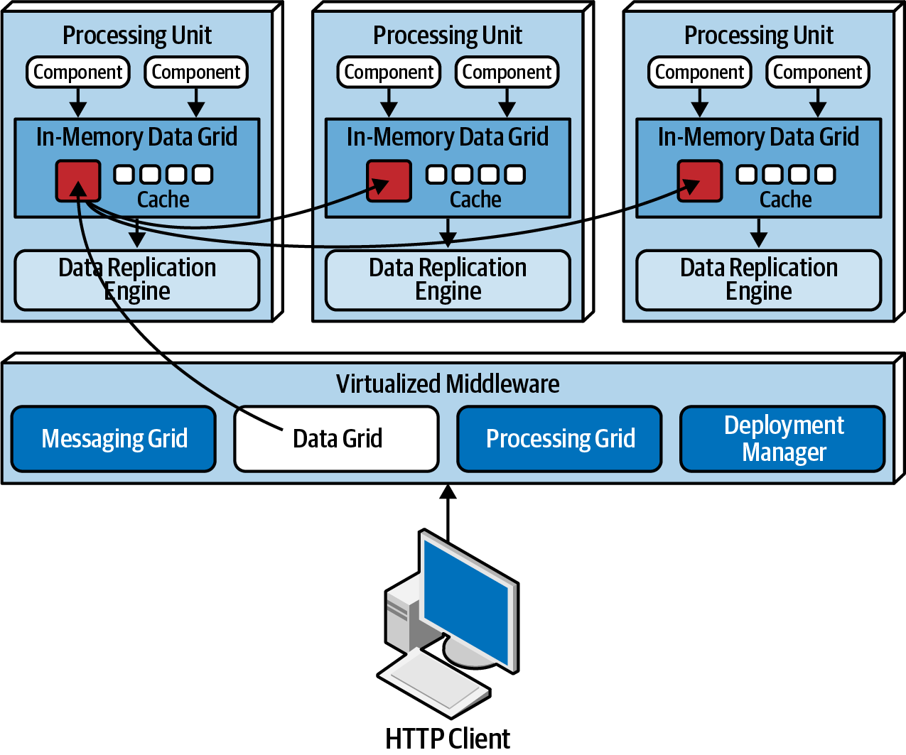

<!-- CH15-026 | PDF p. 236 | 图表 -->
*图 15-5：数据网格。*

<!-- CH15-027 | PDF p. 236 | 正文 -->
数据会在包含同名数据网格的处理单元之间同步。为说明这一点，请看下面使用 Hazelcast 的 Java 代码，它为包含客户档案信息的处理单元创建一个内部复制式数据网格：

<!-- CH15-028 | PDF p. 236 | 代码／日志 -->
```java
HazelcastInstance hz = Hazelcast.newHazelcastInstance();
Map<String, CustomerProfile> profileCache =
    hz.getReplicatedMap("CustomerProfile");
```

<!-- CH15-029 | PDF p. 236 | 正文 -->
所有需要访问客户档案信息的处理单元都会包含这段代码。任何一个处理单元对名为 `CustomerProfile` 的缓存进行修改时，修改都会被复制到所有包含同名缓存的其他处理单元。处理单元可以根据完成工作所需，包含任意多个复制式缓存。另一种做法是，一个处理单元远程调用另一个处理单元来请求数据，以协同方式（choreography）完成协作；也可以利用下一节介绍的处理网格来编排请求。

<!-- 书内第 217 页，PDF 第 237 页。 -->

<!-- CH15-030 | PDF p. 237 | 正文 -->
只要至少还有一个实例包含该命名复制式缓存，处理单元内部的数据复制还允许服务实例启动和关闭，而无须从数据库读取数据。处理单元实例启动时，会连接到缓存提供方（例如 Hazelcast），并请求获取命名缓存。一旦与其他处理单元建立连接，就会从另一个实例加载缓存。

<!-- CH15-031 | PDF p. 237 | 正文 -->
每个处理单元通过成员列表了解所有其他处理单元实例。成员列表包含所有使用同名缓存的处理单元实例的 IP 地址和端口，包括自身。例如，假设只有一个处理实例，其中包含客户档案相关的代码和复制式缓存数据。这时只有一个实例，因此它的成员列表仅包含自身，如以下 Hazelcast 生成的日志所示：

<!-- CH15-032 | PDF p. 237 | 代码／日志 -->
```text
Instance 1:
Members {size:1, ver:1} [
    Member [172.19.248.89]:5701 - 04a6f863-dfce-41e5-9d51-9f4e356ef268 this
]
```

<!-- CH15-033 | PDF p. 237 | 正文 -->
当另一个使用同名缓存的处理单元实例启动时，这两个实例的成员列表都会更新，以反映各处理单元的 IP 地址和端口：

<!-- CH15-034 | PDF p. 237 | 代码／日志 -->
```text
Instance 1:
Members {size:2, ver:2} [
    Member [172.19.248.89]:5701 - 04a6f863-dfce-41e5-9d51-9f4e356ef268 this
    Member [172.19.248.90]:5702 - ea9e4dd5-5cb3-4b27-8fe8-db5cc62c7316
]
Instance 2:
Members {size:2, ver:2} [
    Member [172.19.248.89]:5701 - 04a6f863-dfce-41e5-9d51-9f4e356ef268
    Member [172.19.248.90]:5702 - ea9e4dd5-5cb3-4b27-8fe8-db5cc62c7316 this
]
```

<!-- CH15-035 | PDF p. 237 | 正文 -->
第三个处理单元启动时，实例 1 和实例 2 的成员列表都会更新，以反映新增的第三个实例：

<!-- CH15-036 | PDF p. 237 | 代码／日志 -->
```text
Instance 1:
Members {size:3, ver:3} [
    Member [172.19.248.89]:5701 - 04a6f863-dfce-41e5-9d51-9f4e356ef268 this
    Member [172.19.248.90]:5702 - ea9e4dd5-5cb3-4b27-8fe8-db5cc62c7316
    Member [172.19.248.91]:5703 - 1623eadf-9cfb-4b83-9983-d80520cef753
]
Instance 2:
Members {size:3, ver:3} [
    Member [172.19.248.89]:5701 - 04a6f863-dfce-41e5-9d51-9f4e356ef268
    Member [172.19.248.90]:5702 - ea9e4dd5-5cb3-4b27-8fe8-db5cc62c7316 this
    Member [172.19.248.91]:5703 - 1623eadf-9cfb-4b83-9983-d80520cef753
]
```

<!-- 书内第 218 页，PDF 第 238 页；上页日志续。 -->

<!-- CH15-037 | PDF p. 238 | 代码／日志 -->
```text
Instance 3:
Members {size:3, ver:3} [
    Member [172.19.248.89]:5701 - 04a6f863-dfce-41e5-9d51-9f4e356ef268
    Member [172.19.248.90]:5702 - ea9e4dd5-5cb3-4b27-8fe8-db5cc62c7316
    Member [172.19.248.91]:5703 - 1623eadf-9cfb-4b83-9983-d80520cef753 this
]
```

<!-- CH15-038 | PDF p. 238 | 正文 -->
注意，三个实例都知道彼此的存在，也包括自身。假设实例 1 收到一个更新客户档案信息的请求。当实例 1 通过 `cache.put()` 或类似的缓存更新方法更新缓存时，数据网格（例如 Hazelcast）会异步将相同更新应用到其他复制式缓存，使三个客户档案缓存保持一致。

<!-- CH15-039 | PDF p. 238 | 正文 -->
处理单元实例停止运行时，所有其他处理单元都会自动更新，以反映成员的丢失。例如，实例 2 停止运行后，实例 1 和实例 3 的成员列表会更新如下：

<!-- CH15-040 | PDF p. 238 | 代码／日志 -->
```text
Instance 1:
Members {size:2, ver:4} [
    Member [172.19.248.89]:5701 - 04a6f863-dfce-41e5-9d51-9f4e356ef268 this
    Member [172.19.248.91]:5703 - 1623eadf-9cfb-4b83-9983-d80520cef753
]
Instance 3:
Members {size:2, ver:4} [
    Member [172.19.248.89]:5701 - 04a6f863-dfce-41e5-9d51-9f4e356ef268
    Member [172.19.248.91]:5703 - 1623eadf-9cfb-4b83-9983-d80520cef753 this
]
```

<!-- CH15-041 | PDF p. 238 | 标题 -->
#### 处理网格

<!-- CH15-042 | PDF p. 238 | 正文 -->
图 15-6 所示的处理网格（processing grid）是虚拟化中间件中的可选组件。当一个业务请求涉及多个处理单元时，它负责管理请求处理的编排。如果收到的请求需要协调不同类型的处理单元，例如订单处理单元和支付处理单元，处理网格就会在这两个处理单元之间中介并编排该请求。

<!-- 书内第 219 页，PDF 第 239 页。 -->

<!-- CH15-043 | PDF p. 239 | 图表 -->
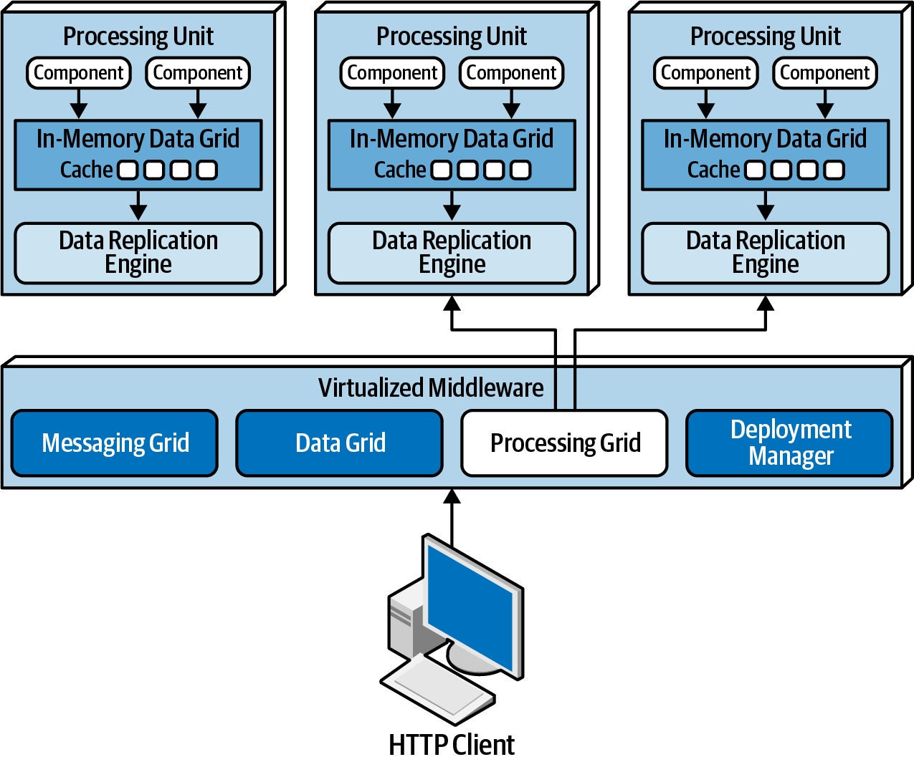

<!-- CH15-044 | PDF p. 239 | 图表 -->
*图 15-6：处理网格。*

<!-- CH15-045 | PDF p. 239 | 标题 -->
#### 部署管理器

<!-- CH15-046 | PDF p. 239 | 正文 -->
部署管理器（deployment manager）组件根据负载情况，管理处理单元实例的动态启动和关闭。它持续监控响应时间和用户负载，在负载增加时启动新的处理单元，在负载降低时关闭处理单元。它是满足应用可变扩展需求（弹性）的关键组件。

<!-- CH15-047 | PDF p. 239 | 标题 -->
### 数据泵

<!-- CH15-048 | PDF p. 239 | 正文 -->
数据泵（data pump）是一种将数据发送给另一个处理器，再由后者更新数据库数据的方式。数据泵是空间架构中的必需组件，因为处理单元不直接读写数据库。空间架构中的数据泵始终是异步的，使内存缓存与数据库之间实现最终一致性。当处理单元实例收到请求并更新其缓存时，该处理单元就成为这次更新的所有者，因此负责通过数据泵发送更新，以便最终更新数据库。

<!-- 书内第 220 页，PDF 第 240 页。 -->

<!-- CH15-049 | PDF p. 240 | 正文 -->
数据泵通常使用消息机制实现，如图 15-7 所示。在空间架构中，消息机制是实现数据泵的良好选择。它不仅支持异步通信，还支持保证交付，并通过先进先出（FIFO）队列保持消息顺序。此外，消息机制使处理单元与数据写入器解耦，因此即使数据写入器不可用，处理单元内部仍然可以不中断地继续处理。

<!-- CH15-050 | PDF p. 240 | 图表 -->
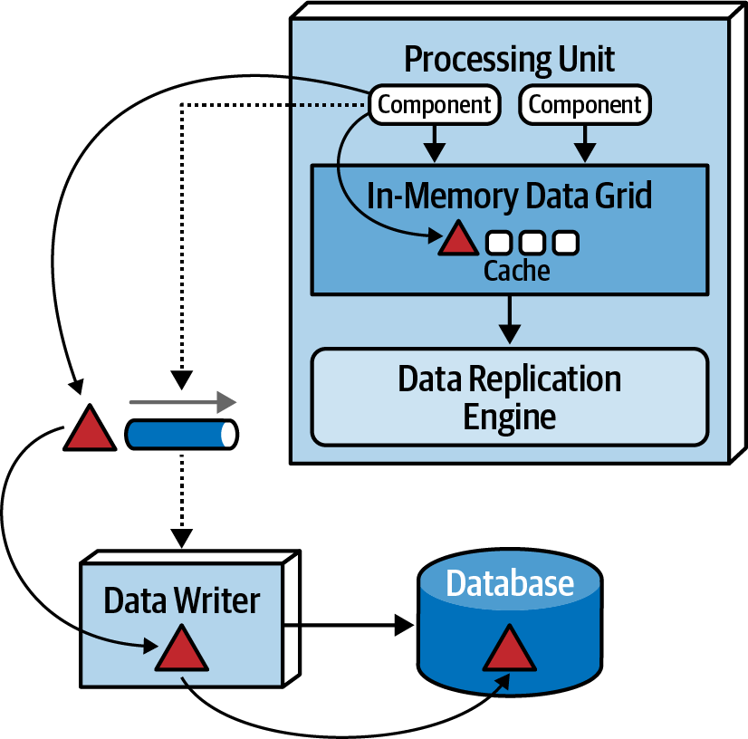

<!-- CH15-051 | PDF p. 240 | 图表 -->
*图 15-7：用于向数据库发送数据的数据泵。*

<!-- CH15-052 | PDF p. 240 | 正文 -->
多数情况下会有多个数据泵，每个通常专用于一个特定领域或子领域，例如客户或库存。数据泵可以分别专用于每种缓存，例如 `CustomerProfile`、`CustomerWishlist` 等；也可以专用于某个处理单元领域，例如 `Customer`，其中包含更大、更通用的缓存。

<!-- CH15-053 | PDF p. 240 | 正文 -->
数据泵通常具有相应的契约，其中包括与契约数据关联的操作：添加、删除或更新。契约可以是 JSON Schema、XML Schema、对象，甚至是值驱动消息，即包含名称—值对的 Map 消息。对于更新，数据泵消息中的数据通常只包含新的数据值。例如，客户修改档案中的电话号码时，只会发送新的电话号码，以及客户 ID 和更新数据的操作。

<!-- 书内第 221 页，PDF 第 241 页。 -->

<!-- CH15-054 | PDF p. 241 | 标题 -->
### 数据写入器

<!-- CH15-055 | PDF p. 241 | 正文 -->
数据写入器（data writer）组件接收数据泵的消息，根据消息中的信息更新数据库，参见图 15-7。数据写入器可以实现为服务、应用或数据枢纽，例如 [Ab Initio](https://www.abinitio.com/en)。数据写入器的粒度可以根据数据泵和处理单元的作用范围而变化。

<!-- CH15-056 | PDF p. 241 | 正文 -->
基于领域的数据写入器包含处理特定领域（例如客户）内全部更新所需的数据库逻辑，无论它接收多少个数据泵的数据。注意图 15-8：其中有四种不同的处理单元和四个不同的数据泵，分别代表客户领域中的档案（Profile）、愿望清单（WishList）、钱包（Wallet）和偏好（Preferences），但只有一个数据写入器。这个唯一的客户数据写入器监听全部四个数据泵，并包含更新数据库中客户相关数据所需的数据库逻辑，例如 SQL。

<!-- CH15-057 | PDF p. 241 | 图表 -->
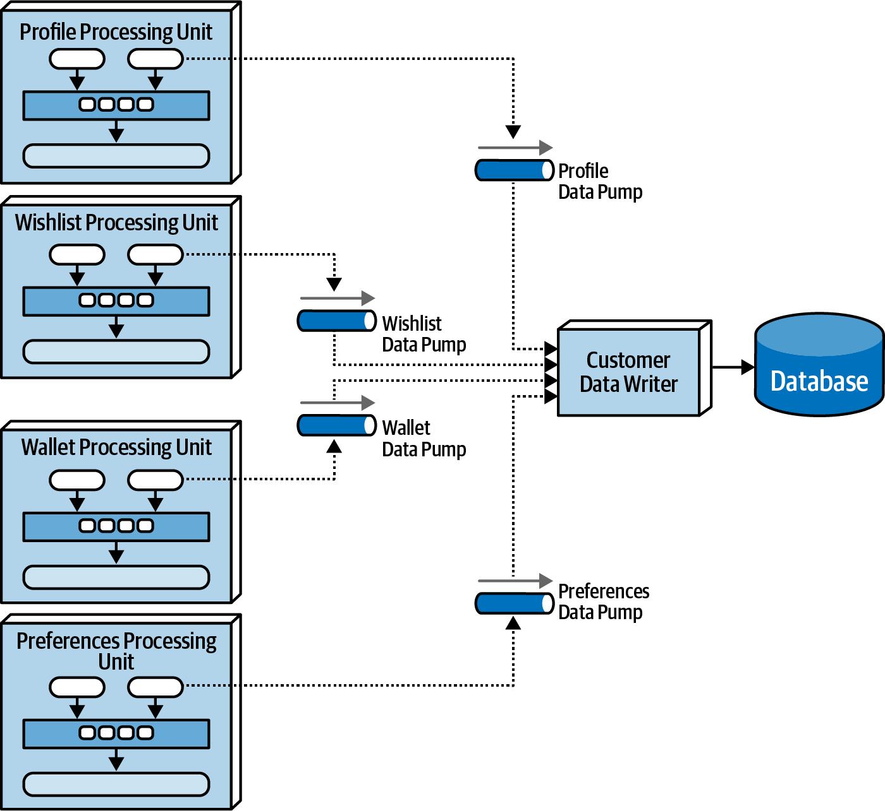

<!-- CH15-058 | PDF p. 241 | 图表 -->
*图 15-8：基于领域的数据写入器。*

<!-- 书内第 222 页，PDF 第 242 页。 -->

<!-- CH15-059 | PDF p. 242 | 正文 -->
另一种做法是让每类处理单元都有自己专用的数据写入器组件，如图 15-9 所示。在这种模型中，数据写入器专用于各自对应的数据泵，只包含该特定处理单元（例如钱包）的数据库处理逻辑。尽管这种模型容易产生过多的数据写入器组件，但由于处理单元、数据泵和数据写入器彼此对应，它能提供更好的可扩展性和敏捷性。

<!-- CH15-060 | PDF p. 242 | 图表 -->
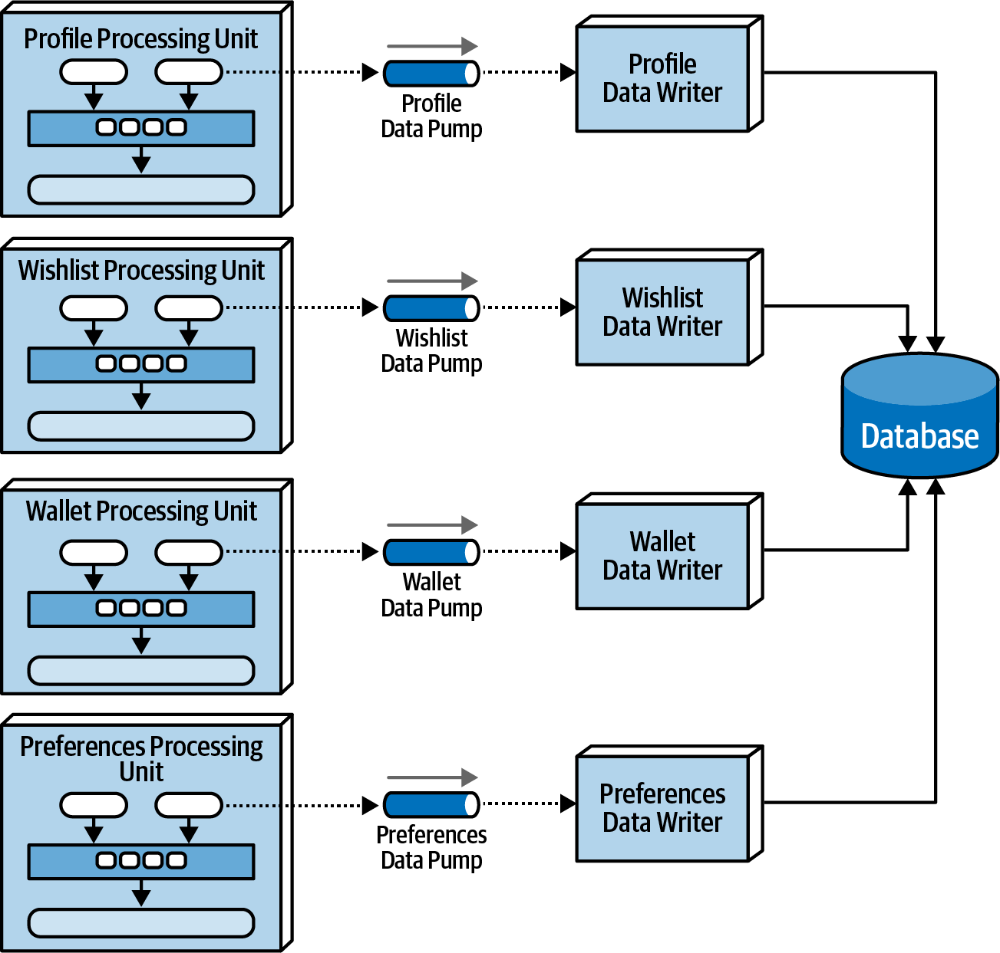

<!-- CH15-061 | PDF p. 242 | 图表 -->
*图 15-9：每个数据泵都有专用的数据写入器。*

<!-- CH15-062 | PDF p. 242 | 标题 -->
### 数据读取器

<!-- CH15-063 | PDF p. 242 | 正文 -->
数据写入器负责更新数据库，数据读取器（data reader）则负责从数据库读取数据，再通过反向数据泵发送给处理单元。在空间架构中，只有三种情况会调用数据读取器：具有同名缓存的全部处理单元实例崩溃；具有同名缓存的全部处理单元重新部署；或者需要获取复制式缓存中不包含的归档数据。

<!-- 书内第 223 页，PDF 第 243 页。 -->

<!-- CH15-064 | PDF p. 243 | 正文 -->
如果所有实例都停止了运行，无论是由于系统整体崩溃，还是全部实例重新部署，就必须从数据库读取数据，而这通常是空间架构中要避免的。当某一类处理单元的实例开始启动时，每个实例都会尝试取得缓存的锁。第一个拿到锁的实例成为临时缓存所有者，其他实例进入等待状态，直到锁被释放。具体过程可能因所用缓存实现的类型而异，但无论如何，在这种情况下会有一个主要的缓存所有者。为了加载缓存，取得临时缓存所有者身份的实例会向队列发送一条请求数据的消息。数据读取器组件接收读取请求，执行所需的数据库查询逻辑，以获取处理单元需要的数据。数据读取器从数据库查询数据时，会将数据发送到另一个队列，称为反向数据泵。作为临时缓存所有者的处理单元接收来自反向数据泵的数据，并加载缓存。全部数据加载完成后，临时所有者释放缓存锁，其他所有实例随之同步，随后便可以开始处理。图 15-10 展示了这一流程。

<!-- CH15-065 | PDF p. 243 | 图表 -->
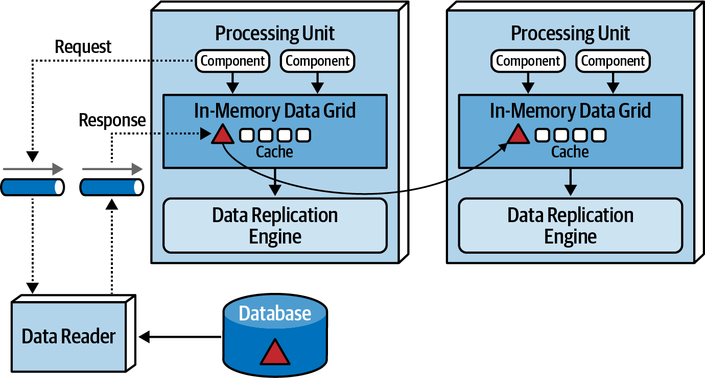

<!-- CH15-066 | PDF p. 243 | 图表 -->
*图 15-10：带有反向数据泵的数据读取器。*

<!-- CH15-067 | PDF p. 243 | 正文 -->
与数据写入器一样，数据读取器既可以基于领域，也可以专用于某一类处理单元，通常采用后者。它们的实现方式也与数据写入器相同：服务、应用或数据枢纽。

<!-- CH15-068 | PDF p. 243 | 正文 -->
数据写入器和数据读取器实质上构成了通常所说的数据抽象层，有时也称为数据访问层。这两者的差异在于，处理单元对数据库中表结构或模式的细节了解多少。数据访问层意味着处理单元与数据库底层数据结构耦合，只是通过数据读取器和写入器间接访问数据库。

<!-- 书内第 224 页，PDF 第 244 页；上段跨页，已连读。 -->

<!-- CH15-069 | PDF p. 244 | 正文 -->
另一方面，数据抽象层意味着处理单元通过独立的契约，与底层数据库表结构解耦。空间架构通常依赖数据抽象层模型，因此每个处理单元中的复制式缓存模式可以与底层数据库表结构不同。这使数据库可以渐进式修改，而不一定影响处理单元。为了支持这种渐进式变更，数据写入器和读取器包含转换逻辑：如果列类型改变，或某个列、某张表被删除，它们可以缓冲数据库变更的影响，直到能够对处理单元缓存做出必要的修改。

<!-- CH15-070 | PDF p. 244 | 标题 -->
## 数据冲突

<!-- CH15-071 | PDF p. 244 | 正文 -->
在主动—主动状态下使用复制式缓存时，任何包含同名缓存的服务实例都可能发生更新，因此复制延迟可能造成数据冲突（data collision）。当一个缓存实例（缓存 A）中的数据被更新，并正在复制到另一个缓存实例（缓存 B），而缓存 B 又更新了相同数据时，就会发生数据冲突。在这种情况下，来自缓存 A 的旧数据会通过复制覆盖缓存 B 的本地更新；与此同时，来自缓存 B 的更新又会通过复制覆盖缓存 A 中的相同数据。

<!-- CH15-072 | PDF p. 244 | 正文 -->
为说明这个问题，假设有两个服务实例，服务 A 和服务 B，都包含产品库存的复制式缓存。下面的流程展示了数据冲突问题：

<!-- CH15-073 | PDF p. 244 | 列表 -->
- 蓝色小部件的当前库存为 500 件。
- 服务 A 将蓝色小部件的库存缓存更新为 490 件，即售出 10 件。
- 在复制期间，服务 B 将蓝色小部件的库存缓存更新为 495 件，即售出 5 件。
- 由于服务 A 更新的复制，服务 B 的缓存被更新为 490 件。
- 由于服务 B 更新的复制，服务 A 的缓存被更新为 495 件。
- 服务 A 和服务 B 中的缓存都不正确，而且彼此不同步；库存本应为 485 件。

<!-- CH15-074 | PDF p. 244 | 正文 -->
有几个因素会影响可能发生的数据冲突数量：包含同一缓存的处理单元实例数量、缓存更新速率、缓存大小，以及缓存产品的复制延迟。根据这些因素，从概率角度估算潜在数据冲突数量的公式如下：

<!-- 书内第 225 页，PDF 第 245 页。 -->

<!-- CH15-075 | PDF p. 245 | 正文 -->
$$
\mathrm{CollisionRate}=N\times\frac{UR^{2}}{S}\times RL
$$

<!-- CH15-076 | PDF p. 245 | 正文 -->
其中，$N$ 表示使用同名缓存的服务实例数量；$UR$ 表示以毫秒计的更新速率，并取平方；$S$ 表示缓存大小，以行数计；$RL$ 表示缓存产品的复制延迟。

<!-- CH15-077 | PDF p. 245 | 正文 -->
这个公式可用于确定可能发生的数据冲突百分比，进而判断使用复制式缓存是否可行。例如，考虑参与计算的各因素采用以下数值：

<!-- CH15-078 | PDF p. 245 | 表格 -->
| 因素或结果 | 数值 |
| --- | --- |
| 更新速率（UR） | 20 次更新/秒 |
| 实例数量（N） | 5 |
| 缓存大小（S） | 50,000 行 |
| 复制延迟（RL） | 100 毫秒 |
| 更新次数 | 每小时 72,000 次 |
| 冲突率 | 每小时 14.4 次 |
| 百分比 | 0.02% |

<!-- CH15-079 | PDF p. 245 | 正文 -->
将这些因素代入公式，每小时有 72,000 次更新，其中很可能有约 14 次对同一数据的更新发生冲突。由于百分比很低，只有 0.02%，因此复制是可行的选择。

<!-- CH15-080 | PDF p. 245 | 正文 -->
复制延迟的变化会显著影响数据一致性。复制延迟取决于许多因素，包括网络类型，以及处理单元之间的物理距离。因此，复制延迟的数值很少公开发布，必须在生产环境中通过实际测量来计算和推导。如果无法获得实际复制延迟（这是我们经常用来估算数据冲突数量的数值），前例的 100 毫秒可作为不错的规划估值。例如，将复制延迟从 100 毫秒改为 1 毫秒，更新次数仍然相同，即每小时 72,000 次，但可能发生的冲突只有每小时 0.1 次！下表展示了这种情形：

<!-- CH15-081 | PDF p. 245 | 表格 -->
| 因素或结果 | 数值 |
| --- | --- |
| 更新速率（UR） | 20 次更新/秒 |
| 实例数量（N） | 5 |
| 缓存大小（S） | 50,000 行 |
| 复制延迟（RL） | 1 毫秒（由 100 毫秒改为 1 毫秒） |
| 更新次数 | 每小时 72,000 次 |
| 冲突率 | 每小时 0.1 次 |
| 百分比 | 0.0002% |

<!-- CH15-082 | PDF p. 245 | 译注 -->
> 译注：公式已对照页面原图，$RL$ 是乘数，不在分母。原文把 $UR$ 描述为“以毫秒计的更新速率”，但算例使用的是“次更新/秒”，存在单位表述歧义。若采用 $UR=20$ 次/秒、$RL=0.1$ 秒，公式结果为每秒 $0.004$ 次，即每小时 $14.4$ 次，与首例吻合；改用 $RL=0.001$ 秒，结果为每小时 $0.144$ 次，原表显示为 $0.1$ 次，百分比约为 $0.0002\%$。这里保留原书数值与表述；公式的适用假设和概率模型并未在原文展开，不宜直接当作生产容量保证。

<!-- 书内第 226 页，PDF 第 246 页。 -->

<!-- CH15-083 | PDF p. 246 | 正文 -->
包含同名缓存的处理单元数量，也就是实例数量这一因素，与可能发生的数据冲突数量也存在直接的正比关系。例如，将处理单元从 5 个实例减少到 2 个实例，在每小时 72,000 次更新中，数据冲突率就会降至每小时约 6 次：

<!-- CH15-084 | PDF p. 246 | 表格 -->
| 因素或结果 | 数值 |
| --- | --- |
| 更新速率（UR） | 20 次更新/秒 |
| 实例数量（N） | 2（由 5 改为 2） |
| 缓存大小（S） | 50,000 行 |
| 复制延迟（RL） | 100 毫秒 |
| 更新次数 | 每小时 72,000 次 |
| 冲突率 | 每小时 5.8 次 |
| 百分比 | 0.008% |

<!-- CH15-085 | PDF p. 246 | 正文 -->
缓存大小是唯一与冲突率成反比的因素。缓存越小，冲突率越高。在我们的例子中，将缓存从 50,000 行缩小为 10,000 行，其他条件与第一个例子保持一致，会得到每小时 72 次的冲突率，明显高于 50,000 行时：

<!-- CH15-086 | PDF p. 246 | 表格 -->
| 因素或结果 | 数值 |
| --- | --- |
| 更新速率（UR） | 20 次更新/秒 |
| 实例数量（N） | 5 |
| 缓存大小（S） | 10,000 行（由 50,000 改为 10,000） |
| 复制延迟（RL） | 100 毫秒 |
| 更新次数 | 每小时 72,000 次 |
| 冲突率 | 每小时 72.0 次 |
| 百分比 | 0.1% |

<!-- CH15-087 | PDF p. 246 | 正文 -->
正常情况下，大多数系统不会在如此长的时间内保持恒定的更新速率。因此，使用这一计算方法时，了解使用高峰期间的最大更新速率，并计算最小、正常和峰值冲突率，会很有帮助。

<!-- CH15-088 | PDF p. 246 | 标题 -->
## 云端与本地部署实现

<!-- CH15-089 | PDF p. 246 | 正文 -->
在部署环境方面，空间架构提供了一些独特选择。整个拓扑，包括处理单元、虚拟化中间件、数据泵、数据读取器和写入器，以及数据库，都可以部署在云环境或本地环境（on-premises，简称 on-prem）中。不过，这种架构风格也可以横跨这两类环境部署，提供其他架构风格所不具备的一项独特能力。

<!-- CH15-090 | PDF p. 246 | 译注 -->
> 译注：本段原文在“cloud-based environments”和“on-premises”之间缺少连接词；结合本节下文，按“云端或本地”理解。“其他架构风格所不具备”是作者原文的比较性判断，译文予以保留。

<!-- 书内第 227 页，PDF 第 247 页。 -->

<!-- CH15-091 | PDF p. 247 | 正文 -->
这种架构风格的一项强大能力，如图 15-11 所示，是通过处理单元和虚拟化中间件，将应用部署到托管的云环境中，同时把物理数据库及其数据保留在本地。由于这种架构风格使用异步数据泵和最终一致性模型，该拓扑能够非常有效地支持基于云的数据同步。事务处理可以在动态、富有弹性的云环境中进行，而物理数据管理、报表和数据分析仍保留在安全的本地环境中。

<!-- CH15-092 | PDF p. 247 | 图表 -->
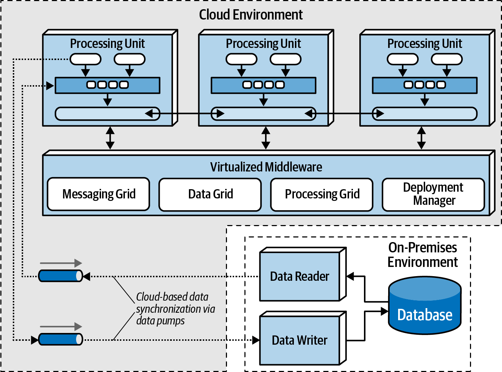

<!-- CH15-093 | PDF p. 247 | 图表 -->
*图 15-11：云端与本地混合拓扑。*

<!-- CH15-094 | PDF p. 247 | 标题 -->
## 复制式缓存与分布式缓存

<!-- CH15-095 | PDF p. 247 | 正文 -->
空间架构依赖缓存来处理应用事务。消除直接读写数据库的需要，正是空间架构能够支持高可扩展性、高弹性和高性能的原因。空间架构主要依赖复制式缓存（replicated caching），不过也可以使用分布式缓存（distributed caching）。

<!-- CH15-096 | PDF p. 247 | 正文 -->
使用复制式缓存时，如图 15-12 所示，每个处理单元都包含自己的内存数据网格，并在使用同名缓存的所有处理单元之间同步。当任何处理单元中的缓存发生更新时，其他处理单元都会自动更新为新信息。

<!-- 书内第 228 页，PDF 第 248 页；上段跨页，已连读。 -->

<!-- CH15-097 | PDF p. 248 | 图表 -->
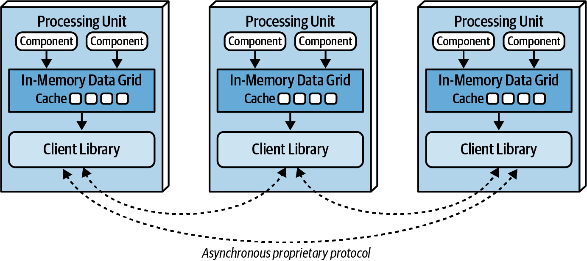

<!-- CH15-098 | PDF p. 248 | 图表 -->
*图 15-12：处理单元之间的复制式缓存。*

<!-- CH15-099 | PDF p. 248 | 正文 -->
复制式缓存不仅速度极快，而且支持高水平的容错性。由于不存在保存缓存的中央服务器，复制式缓存没有单点故障。不过，这一规则可能因所用缓存产品的实现而有例外。一些缓存产品要求有一个外部控制器，监控并控制处理单元之间的数据复制，但大多数产品公司正在逐渐离开这种模型。

<!-- CH15-100 | PDF p. 248 | 正文 -->
尽管复制式缓存是空间架构的标准缓存模型，但有些情况下无法使用它，包括数据量大，也就是缓存很大，以及缓存数据更新速率很高。每个处理单元都要为缓存占用内存，因此内部缓存超过 100 MB 时，可能开始影响弹性和高可扩展性。处理单元通常部署在虚拟机内，有时处理单元本身就代表一台虚拟机。每台虚拟机只有一定数量的内存可供内部缓存使用，这限制了为应对高吞吐量场景而能够启动的处理单元实例数。此外，如第 224 页“数据冲突”一节所示，如果缓存数据的更新速率过高，数据网格可能无法跟上如此高的更新速率，从而无法确保所有处理单元实例间的数据一致性。出现这些情况时，可以使用分布式缓存。

<!-- CH15-101 | PDF p. 248 | 正文 -->
图 15-13 所示的分布式缓存需要一台外部服务器或一个外部服务，专门保存集中式缓存。在这种模型中，处理单元不在内部内存中存储数据，而是使用专有协议访问中央缓存服务器中的数据。由于所有数据都保存在一个地方，不需要复制，分布式缓存可以支持高水平的数据一致性。

<!-- 书内第 229 页，PDF 第 249 页；上段跨页，已连读。 -->

<!-- CH15-102 | PDF p. 249 | 正文 -->
不过，这种模型的性能不如复制式缓存，因为必须远程访问缓存数据，增加了系统整体延迟。容错性也是分布式缓存的一个问题。如果保存数据的缓存服务器停止运行，任何处理单元都无法访问或更新数据，因而无法工作。可以通过镜像分布式缓存来缓解容错问题，但如果主缓存服务器意外停止运行，而数据尚未到达镜像缓存服务器，就可能出现一致性问题。

<!-- CH15-103 | PDF p. 249 | 图表 -->
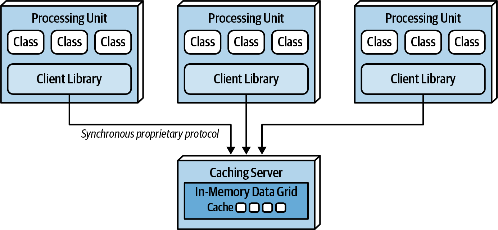

<!-- CH15-104 | PDF p. 249 | 图表 -->
*图 15-13：处理单元之间的分布式缓存。*

<!-- CH15-105 | PDF p. 249 | 正文 -->
如果缓存相对较小，低于 100 MB，而且缓存更新速率低到缓存产品的复制引擎足以跟上，那么选择复制式缓存还是分布式缓存，就变成了数据一致性与性能、容错性之间的权衡。分布式缓存的数据集中在一个地方，而不是分散在多个处理单元中，因此它的数据一致性始终优于复制式缓存。不过，使用复制式缓存时，性能和容错性始终更好。很多时候，这一决定取决于处理单元缓存的数据类型。对数据高度一致的需要，例如可用产品的库存数量，通常意味着应采用分布式缓存；而不经常变化的数据，例如名称—值对、产品代码和产品描述等参考数据，通常适合采用复制式缓存，以便快速查询。表 15-1 列出了一些可用于指导两种缓存选择的标准。

<!-- CH15-106 | PDF p. 249 | 译注 -->
> 译注：本节的“分布式缓存”特指图 15-13 的集中式外部缓存模型；不要据此把所有分片、多节点或具有复制机制的分布式缓存产品都视为同一拓扑。“始终更好”及 100 MB、500 MB 等数值均保留作者在本书模型下的表述，未经当前产品实测，不是通用阈值。

<!-- 书内第 230 页，PDF 第 250 页。 -->

<!-- CH15-107 | PDF p. 250 | 表格 -->
*表 15-1：分布式缓存与复制式缓存。*

<!-- CH15-108 | PDF p. 250 | 表格 -->
| 决策标准 | 复制式缓存 | 分布式缓存 |
| --- | --- | --- |
| 优化目标 | 性能 | 一致性 |
| 缓存大小 | 小（<100 MB） | 大（>500 MB） |
| 数据类型 | 相对静态 | 高度动态 |
| 更新频率 | 相对较低 | 更新速率高 |
| 容错性 | 高 | 低 |

<!-- CH15-109 | PDF p. 250 | 正文 -->
为空间架构选择缓存模型时，要记住，在大多数情况下，这两种模型都会适用于某个给定应用上下文中的不同部分。换句话说，复制式缓存和分布式缓存都无法解决所有问题。不要试图让整个应用采用同一种缓存模型并为此做出妥协，而应发挥两者各自的优势。例如，对于维护当前库存的处理单元，选择分布式缓存模型来保证数据一致性；对于维护客户档案的处理单元，选择复制式缓存来获得性能和容错性。

<!-- CH15-110 | PDF p. 250 | 标题 -->
## 近端缓存的考虑

<!-- CH15-111 | PDF p. 250 | 正文 -->
近端缓存（near-cache）是一种将内存数据网格与分布式缓存结合起来的混合缓存模型。在图 15-14 所示的模型中，分布式缓存称为完整后备缓存（full backing cache），而每个处理单元中的内存数据网格称为前端缓存（front cache）。前端缓存始终只包含完整后备缓存的一个较小子集，并使用淘汰策略移除较旧的条目，为新条目腾出空间。前端缓存可以是包含最近使用条目的最近使用（MRU，most recently used）缓存，也可以是包含最常使用条目的最常使用（MFU，most frequently used）缓存。另一种选择是在前端缓存中采用随机替换淘汰策略，在需要空间添加新条目时随机移除条目。如果无法通过明确的数据分析来决定保留最近使用还是最常使用的条目，随机替换（RR，random replacement）是一种不错的淘汰策略。

<!-- CH15-112 | PDF p. 250 | 译注 -->
> 译注：本段 MRU、MFU 描述的是缓存中保留的条目集合；不要未经区分就把它们理解为“优先淘汰最近/最常使用条目”的策略名称。此处按原文保留其“保留什么”的含义。

<!-- 书内第 231 页，PDF 第 251 页。 -->

<!-- CH15-113 | PDF p. 251 | 图表 -->
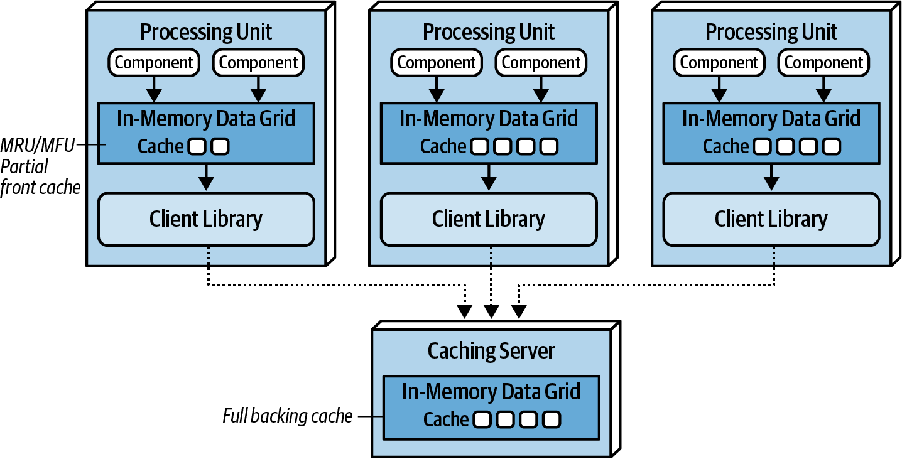

<!-- CH15-114 | PDF p. 251 | 图表 -->
*图 15-14：近端缓存拓扑。*

<!-- CH15-115 | PDF p. 251 | 正文 -->
虽然前端缓存始终与完整后备缓存保持同步，但各处理单元的前端缓存之间，并不会因为共享相同数据而彼此同步。这意味着，共享相同数据上下文，例如客户档案的多个处理单元，其前端缓存中很可能各自保存不同的数据。由于各处理单元的前端缓存内容不同，处理单元之间的性能和响应能力便会不一致。因此，我们不建议在空间架构中使用近端缓存模型。

<!-- CH15-116 | PDF p. 251 | 标题 -->
## 实现示例

<!-- CH15-117 | PDF p. 251 | 正文 -->
空间架构非常适合用户量或请求量会大幅突增的应用，也适合并发用户数超过 10,000 的应用。空间架构的例子包括在线演唱会售票系统和在线拍卖系统。这两类应用都要求高性能、高可扩展性和高水平的弹性。

<!-- CH15-118 | PDF p. 251 | 标题 -->
### 演唱会售票系统

<!-- CH15-119 | PDF p. 251 | 正文 -->
演唱会售票系统具有独特的问题领域：在热门演唱会公布之前，并发用户量相对较低。一旦门票开售，用户量通常会从几百名并发用户突增到几千名，甚至可能达到几万名，具体取决于演唱会。所有人都试图买到一张票，最好还能买到好座位！门票通常会在几分钟内售罄，因此需要空间架构所支持的那些架构特性。

<!-- 书内第 232 页，PDF 第 252 页。 -->

<!-- CH15-120 | PDF p. 252 | 正文 -->
这类系统有许多挑战。首先，无论用户偏好什么座位，可售门票的数量都是有限的。面对大量并发请求，座位可用情况必须不断更新，并尽快提供给用户。此外，假设系统允许指定座位，也必须尽快更新座位可用情况。这类系统若持续同步访问中央数据库，很可能无法奏效：在这样的规模和更新频率下，普通数据库很难通过标准数据库事务处理数万个并发请求。

<!-- CH15-121 | PDF p. 252 | 正文 -->
由于这类应用有很高的弹性要求，空间架构很适合演唱会售票系统。想要购票的并发用户数瞬间增加时，部署管理器会立即发现，随后启动大量处理单元来处理海量请求。最理想的做法，是配置部署管理器，在门票开售前不久就启动所需数量的处理单元，让这些实例在用户负载大幅增加之前待命。

<!-- CH15-122 | PDF p. 252 | 标题 -->
### 在线拍卖系统

<!-- CH15-123 | PDF p. 252 | 正文 -->
在线拍卖系统，即在拍卖中对物品出价的系统，与前面描述的在线演唱会售票系统具有相同的特征：两者都要求高水平的性能和弹性，也都会遇到无法预测的用户负载和请求负载突增。拍卖开始时，无法确定会有多少人参与，也无法确定对于每个当前出价档位，会有多少人同时竞价。

<!-- CH15-124 | PDF p. 252 | 正文 -->
空间架构很适合这类问题领域：负载增加时可以启动多个处理单元；拍卖接近结束时，可以销毁不再使用的处理单元。可以为每场拍卖分配专门的处理单元，确保竞价数据的一致性。此外，由于数据泵具有异步特性，竞价数据可以以很小的延迟发送给其他处理流程，例如出价历史、竞价分析和审计，从而提高竞价过程的整体性能。

<!-- 书内第 233 页，PDF 第 253 页。 -->

<!-- CH15-125 | PDF p. 253 | 标题 -->
## 架构特性评分

<!-- CH15-126 | PDF p. 253 | 正文 -->
图 15-15 的架构特性评分表中，一星表示架构对相应特性的支持较弱，五星则表示该特性是这种架构风格最突出的优势之一。评分表中各特性的定义见第 4 章。

<!-- CH15-127 | PDF p. 253 | 图表 -->
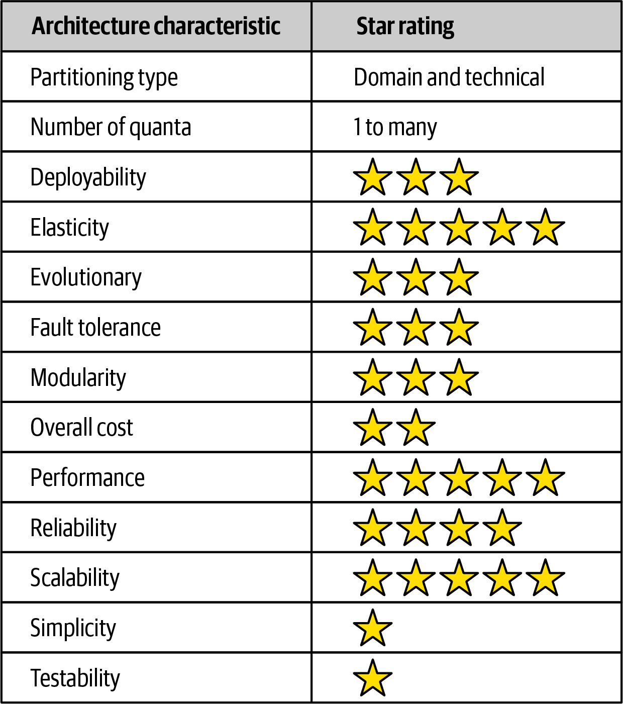

<!-- CH15-128 | PDF p. 253 | 图表 -->
*图 15-15：空间架构的架构特性评分。*

<!-- CH15-129 | PDF p. 253 | 正文 -->
图中评分的中文转录如下：

<!-- CH15-130 | PDF p. 253 | 表格 -->
| 架构特性 | 评分或类型 |
| --- | --- |
| 划分类型 | 领域划分与技术划分 |
| 架构量子数量 | 1 至多个 |
| 可部署性 | ★★★ |
| 弹性 | ★★★★★ |
| 可演进性 | ★★★ |
| 容错性 | ★★★ |
| 模块化 | ★★★ |
| 总体成本 | ★★ |
| 性能 | ★★★★★ |
| 可靠性 | ★★★★ |
| 可扩展性 | ★★★★★ |
| 简单性 | ★ |
| 可测试性 | ★ |

<!-- CH15-131 | PDF p. 253 | 译注 -->
> 译注：“总体成本”的星级表示成本方面的有利程度；两星与下文“相对昂贵”的描述一致。评分是作者对架构风格的一般比较，不是具体产品的基准测试。

<!-- CH15-132 | PDF p. 253 | 正文 -->
注意，空间架构将弹性、可扩展性和性能推到了最高水平，三项均为五星。这些是这种架构风格的驱动属性和主要优势。它通过利用内存数据缓存，并移除数据库这一约束，来实现这三项架构特性的高水平支持。因此，使用这种架构风格，有可能处理数百万并发用户。

<!-- 书内第 234 页，PDF 第 254 页。 -->

<!-- CH15-133 | PDF p. 254 | 正文 -->
尽管高水平的弹性、可扩展性和性能是这种架构风格的优势，但获得这些优势需要付出代价，尤其是在整体简单性和可测试性方面。空间架构是一种非常复杂的架构风格，因为它使用缓存，并且主数据存储这个最终的权威记录系统采用最终一致性。必须谨慎处理，确保这种架构中众多活动部件中的任何一个崩溃时都不会丢失数据，参见第 14 章第 201 页“防止数据丢失”。

<!-- CH15-134 | PDF p. 254 | 正文 -->
可测试性得到一星，是因为模拟这种架构风格所支持的高可扩展性和高弹性非常复杂。在峰值负载下测试几十万并发用户，是一项非常复杂且昂贵的任务。因此，大多数高流量测试都在生产环境中，使用实际的极端负载进行。这会给生产环境的正常运行带来显著风险。

<!-- CH15-135 | PDF p. 254 | 正文 -->
选择这种架构风格时，成本也是一个因素。空间架构相对昂贵，主要原因是缓存产品的许可费用，以及为实现高可扩展性和高弹性而消耗的大量云端与本地系统资源。

<!-- CH15-136 | PDF p. 254 | 正文 -->
空间架构的划分类型很难界定，因此我们将它同时归为领域划分和技术划分。空间架构属于领域划分，不仅因为它适合某种特定类型的领域，即高弹性、高可扩展性的系统，还因为处理单元具有灵活性。处理单元可以充当领域服务，其方式与基于服务的架构或微服务架构中服务的定义相同。与此同时，空间架构将使用缓存的事务处理，与通过数据泵在数据库中实际存储数据这两个关注点分离，因此也属于技术划分。就请求处理方式而言，处理单元、数据泵、数据读取器和写入器，以及数据库共同构成了技术分层，与单体多层架构的组织方式十分相似。

<!-- CH15-137 | PDF p. 254 | 正文 -->
空间架构中的架构量子数量会随用户界面的设计方式，以及处理单元之间的通信方式而变化。由于处理单元不与数据库同步通信，数据库本身不纳入架构量子的判断。因此，空间架构中的量子通常由各用户界面与处理单元之间的关联来界定。彼此同步通信的处理单元，或者通过处理网格同步进行编排的处理单元，都属于同一个架构量子。

<!-- CH15-138 | PDF p. 254 | 分隔符 -->
---

<!-- CH15-139 | PDF p. 254 | 标题 -->
## 图中文字中文对照（译者整理）

<!-- CH15-140 | PDF p. 254 | 正文 -->
以下按图号列出原图标签；重复标签沿用相同译法。

<!-- CH15-141 | PDF p. 254 | 表格 -->
| 图号 | 英文标签 → 中文 |
| --- | --- |
| 图 15-1 | HTTP Client → HTTP 客户端；Web Server → Web 服务器；Application Server → 应用服务器；Database → 数据库 |
| 图 15-2 | Processing Unit → 处理单元；Component → 组件；In-Memory Data Grid → 内存数据网格；Cache → 缓存；Data Replication Engine → 数据复制引擎；Virtualized Middleware → 虚拟化中间件；Messaging Grid → 消息网格；Data Grid → 数据网格；Processing Grid → 处理网格；Deployment Manager → 部署管理器；Data Reader → 数据读取器；Data Writer → 数据写入器；Database → 数据库 |
| 图 15-3 | Processing Unit → 处理单元；Component → 组件；In-Memory Data Grid → 内存数据网格；Cache → 缓存；Data Replication Engine → 数据复制引擎 |
| 图 15-4 | 处理单元内部及中间件标签同图 15-2；HTTP Client → HTTP 客户端；图中突出 Messaging Grid → 消息网格 |
| 图 15-5 | 标签同图 15-2、15-4；图中突出 Data Grid → 数据网格及缓存复制路径 |
| 图 15-6 | 标签同图 15-2、15-4；图中突出 Processing Grid → 处理网格及处理单元间的编排路径 |
| 图 15-7 | Processing Unit → 处理单元；Component → 组件；In-Memory Data Grid → 内存数据网格；Cache → 缓存；Data Replication Engine → 数据复制引擎；Data Writer → 数据写入器；Database → 数据库 |
| 图 15-8 | Profile / Wishlist / Wallet / Preferences Processing Unit → 档案 / 愿望清单 / 钱包 / 偏好处理单元；Profile / Wishlist / Wallet / Preferences Data Pump → 对应领域的数据泵；Customer Data Writer → 客户数据写入器；Database → 数据库 |
| 图 15-9 | 四类 Processing Unit、Data Pump 标签同图 15-8；Profile / Wishlist / Wallet / Preferences Data Writer → 档案 / 愿望清单 / 钱包 / 偏好数据写入器；Database → 数据库 |
| 图 15-10 | Request → 请求；Response → 响应；Data Reader → 数据读取器；其余处理单元、缓存、复制引擎和数据库标签同图 15-2 |
| 图 15-11 | Cloud Environment → 云环境；On-Premises Environment → 本地环境；Cloud-based data synchronization via data pumps → 通过数据泵进行云端数据同步；其余标签同图 15-2 |
| 图 15-12 | Client Library → 客户端库；Asynchronous proprietary protocol → 异步专有协议；其余处理单元内部标签同图 15-3 |
| 图 15-13 | Class → 类；Client Library → 客户端库；Synchronous proprietary protocol → 同步专有协议；Caching Server → 缓存服务器；Processing Unit → 处理单元；In-Memory Data Grid → 内存数据网格；Cache → 缓存 |
| 图 15-14 | MRU/MFU Partial front cache → 保留最近 / 最常使用条目的局部前端缓存；Full backing cache → 完整后备缓存；Client Library → 客户端库；Caching Server → 缓存服务器；其余标签同图 15-3 |
| 图 15-15 | Architecture characteristic → 架构特性；Star rating → 星级评分；各行中文与星级见正文转录表 |
