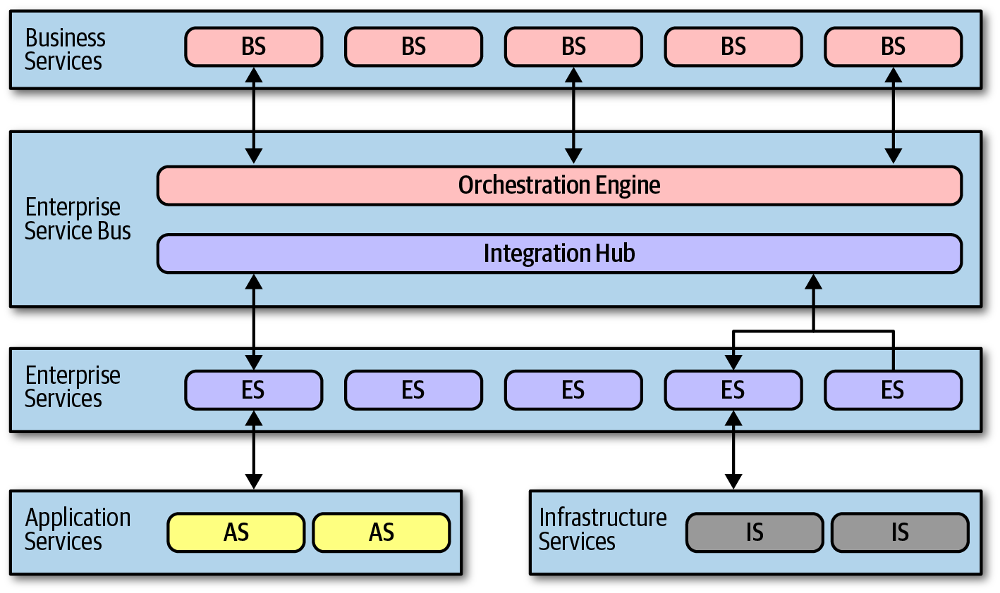
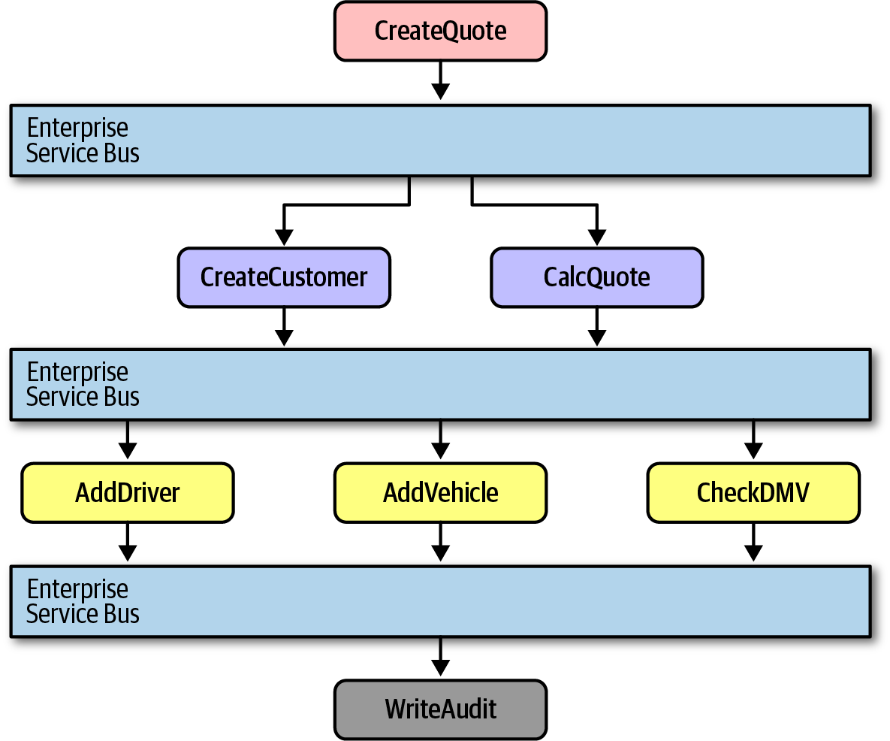
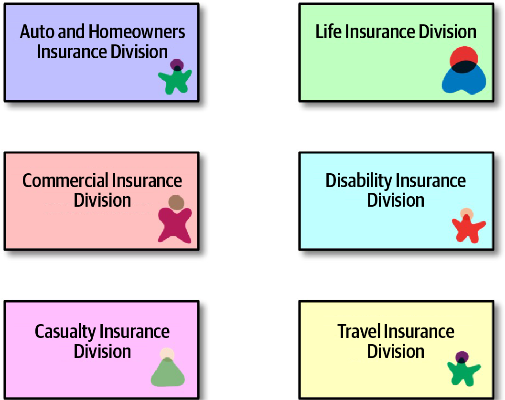
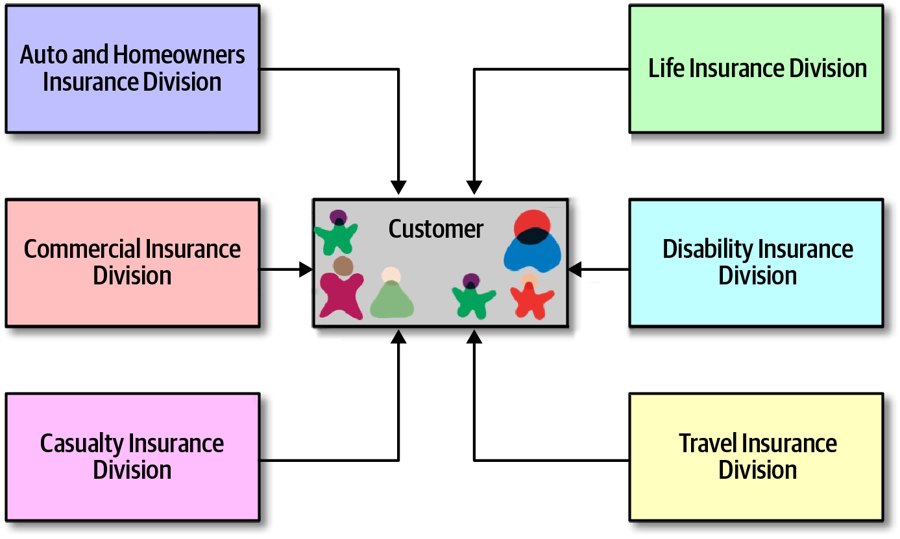
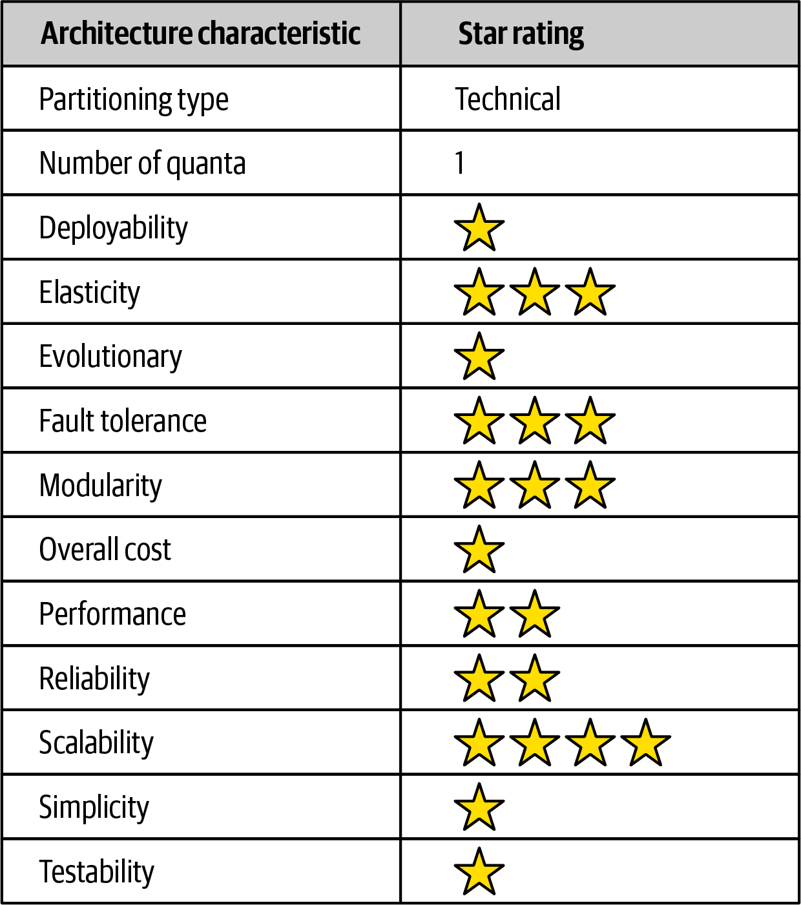

<!-- CH16-001 | PDF p. 255 | 标题 -->
# 第 16 章 编排驱动的面向服务架构

> 原文章名：Orchestration-Driven Service-Oriented Architecture
> 来源：英文第一版，书内第 235–243 页，PDF 第 255–263 页。
> 进度：本轮逐段质量校译完成；详见 [校译记录](../../reviews/chapter-16-review.md)。
> 保留英文原图，中文标签对照见文末；下文页码均指原书书内页码。

<!-- 书内第 235 页，PDF 第 255 页。 -->

<!-- CH16-002 | PDF p. 255 | 正文 -->
架构风格与艺术运动一样，必须放在它们演变时所处的时代背景中理解，而这种架构比任何其他架构都更能说明这一点。经常影响架构决策的外部力量，与一种看似合理、最终却带来灾难的组织理念结合在一起，注定使这种架构失去意义。不过，它也提供了一个很好的例子：某种组织理念在逻辑上可以说得通，却会妨碍开发过程中最重要的部分。

<!-- CH16-003 | PDF p. 255 | 标题 -->
## 历史与理念

<!-- CH16-004 | PDF p. 255 | 正文 -->
这种面向服务架构风格出现于 20 世纪 90 年代末，当时公司正在成长为大型企业：它们兼并较小的公司，以惊人的速度增长，需要更复杂的 IT 来支撑这种增长。然而，当时的计算资源稀缺且昂贵，通常只能通过商业渠道获得。分布式计算刚刚变得既可行又必要，许多公司都需要可变的扩展能力，以及其他有益特性。

<!-- CH16-005 | PDF p. 255 | 正文 -->
许多外部驱动因素迫使那个时代的架构师在重大约束下走向分布式架构。在开源操作系统被认为足够可靠、能够承担严肃工作之前，操作系统价格昂贵，而且按机器授权。同样，商业数据库服务器采用极其繁复的许可方案，导致提供数据库连接池的应用服务器厂商与数据库厂商发生争斗。因此，人们期待架构师尽可能复用。事实上，各种形式的复用都成了这种架构的主导理念；我们将在第 239 页“复用……以及耦合”一节讨论它的副作用。

<!-- 书内第 236 页，PDF 第 256 页。 -->

<!-- CH16-006 | PDF p. 256 | 正文 -->
这种架构风格还展示了架构师能把技术划分的思想推向多远：出发点很好，后果却不好。

<!-- CH16-007 | PDF p. 256 | 标题 -->
## 拓扑

<!-- CH16-008 | PDF p. 256 | 正文 -->
这种面向服务架构的拓扑如图 16-1 所示。

<!-- CH16-009 | PDF p. 256 | 图表 -->

<!-- CH16-010 | PDF p. 256 | 图表 -->
*图 16-1：编排驱动的面向服务架构拓扑。*

<!-- CH16-011 | PDF p. 256 | 正文 -->
并非这种架构风格的所有实例都具有图 16-1 中完全相同的层次，但它们都遵循相同的思想：在架构内建立服务分类体系，每一层具有特定职责。

<!-- CH16-012 | PDF p. 256 | 正文 -->
面向服务架构是一种分布式架构；图 16-1 没有画出确切的边界划分，因为边界会因组织而异。

<!-- CH16-013 | PDF p. 256 | 标题 -->
## 分类体系

<!-- CH16-014 | PDF p. 256 | 正文 -->
在这种架构中，架构师的主导理念围绕企业级复用展开。许多大公司对不得不持续重写大量软件感到不满，于是提出一种逐步解决这一问题的策略。分类体系中的每一层都服务于这个目标。

<!-- 书内第 237 页，PDF 第 257 页。 -->

<!-- CH16-015 | PDF p. 257 | 标题 -->
### 业务服务

<!-- CH16-016 | PDF p. 257 | 正文 -->
业务服务（business services）位于这种架构的顶层，提供入口。例如，`ExecuteTrade` 或 `PlaceOrder` 这样的服务代表领域行为。当时常用的一种检验方法是：对于每项服务，架构师能否肯定地回答“我们经营的业务是否包括……？”

<!-- CH16-017 | PDF p. 257 | 正文 -->
这些服务定义不包含代码，只有输入、输出，有时还有模式信息。它们通常由业务用户定义，因此称为业务服务。

<!-- CH16-018 | PDF p. 257 | 标题 -->
### 企业服务

<!-- CH16-019 | PDF p. 257 | 正文 -->
企业服务（enterprise services）包含细粒度、共享的实现。通常，一个开发团队负责围绕特定业务领域构建原子行为，例如 `CreateCustomer`、`CalculateQuote` 等。这些服务是构成粗粒度业务服务的积木，由编排引擎连接起来。

<!-- CH16-020 | PDF p. 257 | 正文 -->
这种职责划分来自该架构的复用目标。如果开发者能够以恰到好处的粒度构建细粒度企业服务，那么企业就不必再重写业务工作流的这一部分。企业将逐渐积累一批可复用资产，其形式就是可复用的企业服务。

<!-- CH16-021 | PDF p. 257 | 正文 -->
遗憾的是，现实的动态本质使这些尝试难以奏效。业务组件不像建筑材料，不能指望一种方案持续适用几十年。市场、技术变化、工程实践，以及大量其他因素，都会挫败试图强行让软件世界保持稳定的努力。

<!-- CH16-022 | PDF p. 257 | 标题 -->
### 应用服务

<!-- CH16-023 | PDF p. 257 | 正文 -->
架构中的服务并非都需要与企业服务相同的粒度或复用程度。应用服务（application services）是专用服务，通常只有一个实现。例如，某个应用可能需要地理定位，但组织不想投入时间和精力把它做成可复用服务。通常由单个应用团队拥有的应用服务，可以解决这类问题。

<!-- CH16-024 | PDF p. 257 | 标题 -->
### 基础设施服务

<!-- CH16-025 | PDF p. 257 | 正文 -->
基础设施服务（infrastructure services）提供运行方面的关注点，例如监控、日志、身份认证和授权。这些服务往往是具体实现，由与运维密切合作的共享基础设施团队拥有。

<!-- 书内第 238 页，PDF 第 258 页。 -->

<!-- CH16-026 | PDF p. 258 | 标题 -->
### 编排引擎

<!-- CH16-027 | PDF p. 258 | 正文 -->
编排引擎（orchestration engine）构成这种分布式架构的核心，通过编排将业务服务的实现拼接起来，并提供事务协调和消息转换等功能。这种架构通常绑定到一个或少数几个关系数据库，而不是像微服务架构那样每个服务都有自己的数据库。因此，事务行为在编排引擎中以声明方式处理，而不是在数据库中处理。

<!-- CH16-028 | PDF p. 258 | 正文 -->
编排引擎定义业务服务和企业服务之间的关系、两者如何映射，以及事务边界在哪里。它还充当集成枢纽，让架构师能够把定制代码与套装软件、遗留软件系统集成起来。

<!-- CH16-029 | PDF p. 258 | 正文 -->
由于这一机制构成架构的核心，康威定律，参见第 103 页“康威定律”，准确地预测了：负责该引擎的集成架构师团队会成为组织内的一股政治力量，并最终成为官僚化的瓶颈。

<!-- CH16-030 | PDF p. 258 | 正文 -->
尽管这种做法听起来可能很有吸引力，但在实践中，它大多是一场灾难。将事务行为转交给编排工具听起来不错，但找到恰当的事务粒度却变得越来越困难。把少数几个服务包在一个分布式事务中是可行的，但随着开发者必须弄清服务之间合适的事务边界究竟在哪里，架构会变得越来越复杂。

<!-- CH16-031 | PDF p. 258 | 译注 -->
> 译注：这里关于数据库和事务处理的描述针对本章的中央编排模型；它不表示数据库自身不再执行事务。本章对 SOA 的评价也限于题名所指的编排驱动风格与其历史背景。

<!-- CH16-032 | PDF p. 258 | 标题 -->
## 消息流

<!-- CH16-033 | PDF p. 258 | 正文 -->
所有请求都经过编排引擎——它是这种架构中逻辑所在的位置。因此，即使是内部调用，消息流也会经过该引擎，如图 16-2 所示。

<!-- 书内第 239 页，PDF 第 259 页。 -->

<!-- CH16-034 | PDF p. 259 | 图表 -->

<!-- CH16-035 | PDF p. 259 | 图表 -->
*图 16-2：面向服务架构中的消息流。*

<!-- CH16-036 | PDF p. 259 | 正文 -->
在图 16-2 中，业务层服务 `CreateQuote` 调用服务总线。服务总线定义工作流，其中包括对 `CreateCustomer` 和 `CalculateQuote` 的调用，而这两者又分别调用应用服务。服务总线充当这种架构中所有调用的中介，同时承担集成枢纽和编排引擎的角色。

<!-- CH16-037 | PDF p. 259 | 译注 -->
> 译注：图 16-2 中的报价服务标为 `CalcQuote`，正文写作 `CalculateQuote`；保留原图与正文各自的写法。

<!-- CH16-038 | PDF p. 259 | 标题 -->
## 复用……以及耦合

<!-- CH16-039 | PDF p. 259 | 正文 -->
这种架构的一项主要目标是服务级复用：逐步构建业务行为，并随着时间推移逐步复用的能力。采用这种架构的架构师被要求尽可能积极地寻找复用机会。例如，考虑图 16-3 所示的情况。

<!-- 书内第 240 页，PDF 第 260 页。 -->

<!-- CH16-040 | PDF p. 260 | 图表 -->

<!-- CH16-041 | PDF p. 260 | 图表 -->
*图 16-3：在面向服务架构中寻找复用机会。*

<!-- CH16-042 | PDF p. 260 | 正文 -->
图 16-3 中，一位架构师意识到，保险公司的每个事业部都包含客户（Customer）这个概念。因此，按照面向服务架构的策略，应把客户相关部分提取成一个可复用服务，让原来的服务引用这个规范化的 `Customer` 服务，如图 16-4 所示。

<!-- CH16-043 | PDF p. 260 | 图表 -->

<!-- CH16-044 | PDF p. 260 | 图表 -->
*图 16-4：在面向服务架构中构建规范化表示。*

<!-- 书内第 241 页，PDF 第 261 页。 -->

<!-- CH16-045 | PDF p. 261 | 正文 -->
在图 16-4 中，架构师将所有客户行为隔离到单个 `Customer` 服务中，达成了显而易见的复用目标。

<!-- CH16-046 | PDF p. 261 | 正文 -->
不过，架构师只是逐渐才认识到这种设计的负面权衡。首先，当团队主要围绕复用构建系统时，也会在组件之间引入大量耦合。例如，图 16-4 中，`Customer` 服务的一次修改会波及所有其他服务，使变更充满风险。因此，在面向服务架构中，架构师很难进行渐进式变更：每次修改都可能产生巨大的连锁影响。这又导致必须协调部署、进行整体测试，以及其他拖累工程效率的活动。

<!-- CH16-047 | PDF p. 261 | 正文 -->
将行为集中到一个地方，还有另一种负面副作用。考虑图 16-4 中的汽车保险和伤残保险。为了支持单一的 `Customer` 服务，它必须包含组织所知道的全部客户细节。汽车保险需要驾驶执照，而驾驶执照是人的属性，不是车辆的属性。因此，`Customer` 服务必须包含驾驶执照的细节，尽管伤残保险事业部对此毫不关心。然而，处理伤残保险的团队仍不得不面对单一客户定义带来的额外复杂性。

<!-- CH16-048 | PDF p. 261 | 正文 -->
也许这种架构带来的最具破坏性的认识，是人们终于意识到，构建一种如此专注于技术划分的架构并不切实际。虽然从分离与复用理念的角度看，它有一定道理，但实践中却是一场噩梦。`CatalogCheckout` 这样的领域概念在整个架构中被分摊得过于零碎，几乎被碾成了粉末。开发者经常要处理“给 `CatalogCheckout` 增加一行地址”之类的任务。在面向服务架构中，这可能牵涉几个不同层次中的数十个服务，还要修改单一数据库的模式。而且，如果当前企业服务没有按正确的事务粒度定义，开发者就必须修改设计，或者构建一个几乎完全相同的新服务来改变事务行为。所谓复用，也就不过如此。

<!-- CH16-049 | PDF p. 261 | 标题 -->
## 架构特性评分

<!-- CH16-050 | PDF p. 261 | 正文 -->
我们如今用来评价架构的许多现代标准，在这种架构流行时并不是优先事项。事实上，敏捷软件运动当时才刚刚开始，还没有渗透到那些很可能采用这种架构的大型组织中。

<!-- CH16-051 | PDF p. 261 | 正文 -->
图 16-5 的架构特性评分表中，一星表示架构对相应特性的支持较弱，五星则表示该特性是这种架构风格最突出的优势之一。评分表中各特性的定义见第 4 章。

<!-- 书内第 242 页，PDF 第 262 页。 -->

<!-- CH16-052 | PDF p. 262 | 正文 -->
面向服务架构也许是人们尝试过的技术划分程度最高的通用架构！事实上，对这种结构弊端的反弹促成了微服务等更现代的架构。尽管它是一种分布式架构，却只有一个架构量子，原因有二。首先，它通常使用单一数据库，或只有少数几个数据库，这在架构中跨越许多不同关注点形成了耦合点。其次，也是更重要的，编排引擎充当了巨大的耦合点：架构中任何部分的架构特性，都无法与负责编排所有行为的中介者不同。因此，这种架构设法同时集齐了单体架构和分布式架构的缺点。

<!-- CH16-053 | PDF p. 262 | 图表 -->

<!-- CH16-054 | PDF p. 262 | 图表 -->
*图 16-5：面向服务架构的评分。*

<!-- CH16-055 | PDF p. 262 | 正文 -->
图中评分的中文转录如下：

<!-- CH16-056 | PDF p. 262 | 表格 -->
| 架构特性 | 评分或类型 |
| --- | --- |
| 划分类型 | 技术划分 |
| 架构量子数量 | 1 |
| 可部署性 | ★ |
| 弹性 | ★★★ |
| 可演进性 | ★ |
| 容错性 | ★★★ |
| 模块化 | ★★★ |
| 总体成本 | ★ |
| 性能 | ★★ |
| 可靠性 | ★★ |
| 可扩展性 | ★★★★ |
| 简单性 | ★ |
| 可测试性 | ★ |

<!-- CH16-057 | PDF p. 262 | 正文 -->
可部署性和可测试性等现代工程目标，在这种架构中的得分惨不忍睹，既因为架构对它们支持不佳，也因为它们在那个时代并非重要目标，甚至还不是人们追求的目标。

<!-- 书内第 243 页，PDF 第 263 页。 -->

<!-- CH16-058 | PDF p. 263 | 正文 -->
尽管实现这些行为很困难，这种架构确实支持了弹性和可扩展性等目标，因为工具厂商投入了巨大精力，借助跨应用服务器的会话复制及其他技术，使这些系统具备可扩展性。不过，作为一种分布式架构，性能从来不是这种架构风格的亮点，而且表现非常差，因为每个业务请求都被拆分到架构中如此多的部分。

<!-- CH16-059 | PDF p. 263 | 正文 -->
由于所有这些因素，简单性与成本之间的关系，恰好与大多数架构师期望的相反。这种架构是一个重要的里程碑，因为它让架构师认识到，现实世界中的分布式事务有多么困难，以及技术划分在实践中的极限。

<!-- CH16-060 | PDF p. 263 | 译注 -->
> 译注：总体成本一星表示成本方面不利，不是“开销很低”。评分是作者对这一历史架构风格的一般比较，不是具体系统的实测结果。

<!-- CH16-061 | PDF p. 263 | 分隔符 -->
---

<!-- CH16-062 | PDF p. 263 | 标题 -->
## 图中文字中文对照（译者整理）

<!-- CH16-063 | PDF p. 263 | 表格 -->
| 图号 | 英文标签 → 中文 |
| --- | --- |
| 图 16-1 | Business Services / BS → 业务服务；Enterprise Service Bus → 企业服务总线；Orchestration Engine → 编排引擎；Integration Hub → 集成枢纽；Enterprise Services / ES → 企业服务；Application Services / AS → 应用服务；Infrastructure Services / IS → 基础设施服务 |
| 图 16-2 | CreateQuote → 创建报价；CreateCustomer → 创建客户；CalcQuote → 计算报价；AddDriver → 添加驾驶员；AddVehicle → 添加车辆；CheckDMV → 查询机动车管理部门信息；WriteAudit → 写入审计记录；Enterprise Service Bus → 企业服务总线 |
| 图 16-3 | Auto and Homeowners Insurance Division → 汽车与房主保险事业部；Life Insurance Division → 人寿保险事业部；Commercial Insurance Division → 商业保险事业部；Disability Insurance Division → 伤残保险事业部；Casualty Insurance Division → 意外事故保险事业部；Travel Insurance Division → 旅行保险事业部 |
| 图 16-4 | 六个事业部标签同图 16-3；Customer → 客户 |
| 图 16-5 | Architecture characteristic → 架构特性；Star rating → 星级评分；各行中文与星级见正文转录表 |
