<!-- CH17-001 | PDF p. 265 | 标题 -->
# 第 17 章 微服务架构

> 原文章名：Microservices Architecture
> 来源：英文第一版，书内第 245–265 页，PDF 第 265–285 页。
> 进度：本轮逐段质量校译完成；详见 [校译记录](../../reviews/chapter-17-review.md)。
> 保留英文原图，中文标签对照见文末；下文页码均指原书书内页码。

<!-- 书内第 245 页，PDF 第 265 页。 -->

<!-- CH17-002 | PDF p. 265 | 正文 -->
微服务是一种极受欢迎的架构风格，近年来发展势头强劲。本章将概述使这种架构在拓扑和理念两方面与众不同的重要特征。

<!-- CH17-003 | PDF p. 265 | 标题 -->
## 历史

<!-- CH17-004 | PDF p. 265 | 正文 -->
大多数架构风格都是事后才获得名称的：架构师注意到某种模式反复出现，于是为其命名，并不存在一个决定下一场重大运动是什么的秘密架构师团体。实际情况是，随着软件开发生态系统演变，许多架构师最终会做出相同的决定。应对这些变化并从中获益的共同最佳方式，就成了其他人效仿的架构风格。

<!-- CH17-005 | PDF p. 265 | 正文 -->
微服务在这一点上有所不同：它在使用初期就获得了名称，并通过 Martin Fowler 与 James Lewis 于 2014 年 3 月发表的一篇著名博文[《Microservices》](https://oreil.ly/Px3Wk)而流行起来。他们识别并阐述了这种相对较新的架构风格的许多共同特征。这篇博文帮助充满好奇的架构师界定这种架构，并理解其底层理念。

<!-- CH17-006 | PDF p. 265 | 正文 -->
微服务深受领域驱动设计（DDD）思想的启发；DDD 是一种用于软件项目的逻辑设计过程。DDD 中的一个概念，限界上下文（bounded context），尤其明显地启发了微服务。限界上下文代表一种解耦方式。开发者定义领域时，该领域包含许多实体和行为，它们体现在代码、数据库模式等制品中。例如，一个应用可能有名为 `CatalogCheckout` 的领域，其中包括目录条目、客户和支付等概念。在传统单体架构中，开发者会共享其中许多概念，构建可复用的类和相互关联的数据库。在限界上下文中，代码和数据模式等内部部分耦合在一起以完成工作，但绝不与限界上下文外部的任何东西耦合，例如另一个限界上下文中的数据库或类定义。这使每个上下文可以只定义自己需要的内容，而不必迁就其他组成部分。

<!-- 书内第 246 页，PDF 第 266 页；上段跨页，已连读。 -->

<!-- CH17-007 | PDF p. 266 | 正文 -->
虽然复用有益，但请记住软件架构第一定律所说的权衡。复用的负面代价是耦合。当架构师设计一个偏向复用的系统时，也就偏向通过继承或组合引入耦合，以实现复用。

<!-- CH17-008 | PDF p. 266 | 正文 -->
然而，如果架构师的目标要求高度解耦，他们就会偏向重复而非复用。微服务的首要目标是高度解耦，将限界上下文这一逻辑概念建模为物理结构。

<!-- CH17-009 | PDF p. 266 | 标题 -->
## 拓扑

<!-- CH17-010 | PDF p. 266 | 正文 -->
微服务的拓扑如图 17-1 所示。

<!-- CH17-011 | PDF p. 266 | 图表 -->
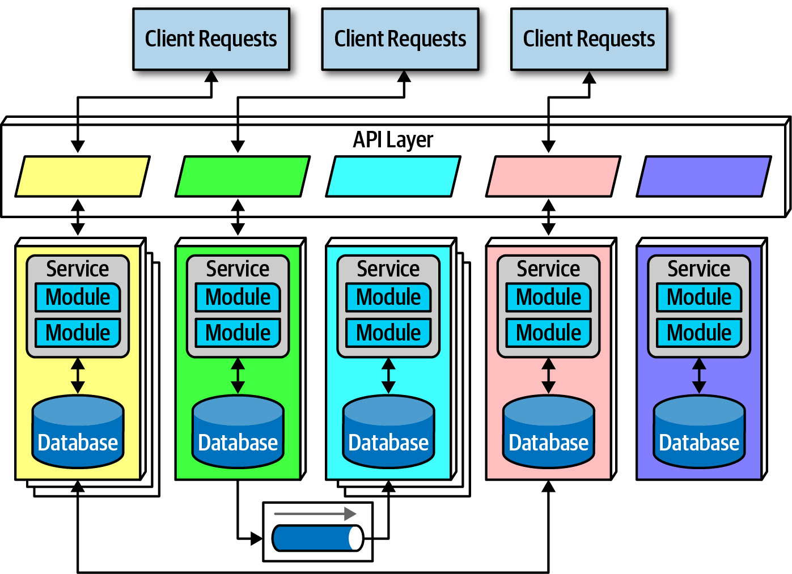

<!-- CH17-012 | PDF p. 266 | 图表 -->
*图 17-1：微服务架构风格的拓扑。*

<!-- CH17-013 | PDF p. 266 | 正文 -->
如图 17-1 所示，由于用途单一，微服务中的服务规模远小于编排驱动的面向服务架构等其他分布式架构中的服务。架构师期望每个服务都包含独立运行所需的全部部分，包括数据库和其他依赖组件。接下来几节将介绍它的各项特征。

<!-- 书内第 247 页，PDF 第 267 页；上段跨页，已连读。 -->

<!-- CH17-014 | PDF p. 267 | 标题 -->
## 分布式

<!-- CH17-015 | PDF p. 267 | 正文 -->
微服务构成一种分布式架构：每个服务在自己的进程中运行。最初，这意味着一台物理计算机，但很快就演变为虚拟机和容器。把服务解耦到这种程度，为那些大量使用多租户基础设施托管应用的架构中的常见问题，提供了简单的解决办法。例如，使用应用服务器管理多个运行中的应用，可以在运行层面复用网络带宽、内存、磁盘空间，并获得许多其他好处。不过，如果所有受支持的应用都持续增长，共享基础设施上的某种资源最终就会受限。另一个问题是，共享环境中的应用之间可能缺乏恰当隔离。

<!-- CH17-016 | PDF p. 267 | 正文 -->
让每个服务分别运行在自己的进程中，可以解决共享所带来的这些问题。在可免费获得的开源操作系统逐步发展成熟，并与自动化机器配置结合之前，让每个领域都有自己的基础设施是不切实际的。然而，如今借助云资源和容器技术，团队能够在领域和运行两个层面获得极度解耦的好处。

<!-- CH17-017 | PDF p. 267 | 正文 -->
微服务的分布式本质常常会带来性能这一负面副作用。网络调用比方法调用耗时长得多，而且每个端点的安全验证都会增加处理时间，因此架构师在设计系统时，必须认真考虑服务粒度的影响。

<!-- CH17-018 | PDF p. 267 | 正文 -->
由于微服务是分布式架构，有经验的架构师建议不要跨服务边界使用事务，这使得确定服务粒度成为这种架构成功的关键。

<!-- CH17-019 | PDF p. 267 | 标题 -->
## 限界上下文

<!-- CH17-020 | PDF p. 267 | 正文 -->
微服务的主导理念是限界上下文：每个服务为一个领域或工作流建模。因此，每个服务都包含在应用内运行所需的一切，包括类、其他子组件，以及数据库模式。这一理念驱动着架构师在这种架构中的许多决策。例如，在单体中，开发者通常会在应用的不同部分之间共享 `Address` 等公共类。然而，微服务试图避免耦合，因此构建这种架构风格的架构师宁可重复，也不愿耦合。

<!-- 书内第 248 页，PDF 第 268 页。 -->

<!-- CH17-021 | PDF p. 268 | 正文 -->
微服务把领域划分架构的概念推向了极致。每个服务都应代表一个领域或子领域；在许多方面，微服务就是领域驱动设计中逻辑概念的物理体现。

<!-- CH17-022 | PDF p. 268 | 标题 -->
### 粒度

<!-- CH17-023 | PDF p. 268 | 正文 -->
架构师很难为微服务中的服务找到正确粒度，而且经常犯下服务过小的错误，结果不得不重新建立服务间通信链路，才能完成有用的工作。

<!-- CH17-024 | PDF p. 268 | 译注 -->
> “微服务”这个词是一个标签，不是一种描述。
>
> ——Martin Fowler

<!-- CH17-025 | PDF p. 268 | 正文 -->
换句话说，创造这个术语的人需要为这种新风格取个名字，于是选择了“微服务”，以区别于当时占主导的面向服务架构——后者本来可以叫作“巨型服务”。然而，许多开发者把“微服务”一词当成一条戒律，而非一个描述，从而创建了粒度过细的服务。

<!-- CH17-026 | PDF p. 268 | 正文 -->
微服务中的服务边界，目的是捕捉一个领域或工作流。在某些应用中，系统某些部分的自然边界可能很大，因为有些业务流程比其他流程耦合得更紧。架构师可以参考以下指导原则，寻找合适的边界：

<!-- CH17-027 | PDF p. 268 | 正文 -->
**目的**

<!-- CH17-028 | PDF p. 268 | 正文 -->
最明显的边界来自这种架构风格的灵感来源，也就是领域。理想情况下，每个微服务都应具有极高的功能内聚性，为整个应用贡献一项重要行为。

<!-- CH17-029 | PDF p. 268 | 正文 -->
**事务**

<!-- CH17-030 | PDF p. 268 | 正文 -->
限界上下文是业务工作流，而那些需要在事务中协作的实体，往往会向架构师揭示良好的服务边界。由于事务会给分布式架构带来问题，如果架构师能通过系统设计避免跨服务事务，往往就能得到更好的设计。

<!-- CH17-031 | PDF p. 268 | 正文 -->
**协同**

<!-- CH17-032 | PDF p. 268 | 正文 -->
如果架构师构建的一组服务具有出色的领域隔离性，却必须大量通信才能工作，就可以考虑把这些服务重新组合成一个更大的服务，以避免通信开销。

<!-- CH17-033 | PDF p. 268 | 正文 -->
迭代是确保良好服务设计的唯一方式。架构师很少能在第一次尝试时，就找到完美的粒度、数据依赖和通信风格。不过，在各种选项之间反复迭代后，架构师很有机会改进自己的设计。

<!-- CH17-034 | PDF p. 268 | 标题 -->
### 数据隔离

<!-- 书内第 249 页，PDF 第 269 页。 -->

<!-- CH17-035 | PDF p. 269 | 正文 -->
由限界上下文概念驱动的另一项微服务要求是数据隔离。许多其他架构风格使用单一数据库进行持久化。然而，微服务试图避免各种耦合，包括共享模式，以及作为集成点使用的数据库。

<!-- CH17-036 | PDF p. 269 | 正文 -->
数据隔离是架构师考虑服务粒度时必须考虑的另一因素。架构师必须警惕第 110 页“实体陷阱”一节讨论的实体陷阱，不能简单地按照数据库中的单个实体来建立服务模型。

<!-- CH17-037 | PDF p. 269 | 正文 -->
架构师习惯用关系数据库统一系统中的值，建立单一事实来源；当数据分散到整个架构中时，这种做法就不再可用。因此，架构师必须决定如何处理这个问题：或者把某个领域指定为某一事实的权威来源，并与之协调来获取值；或者通过数据库复制或缓存来分发信息。

<!-- CH17-038 | PDF p. 269 | 正文 -->
尽管这种程度的数据隔离会让人头疼，它也提供了机会。既然团队不再被迫统一使用单一数据库，每个服务就可以根据价格、存储类型，以及许多其他因素，选择最合适的工具。在高度解耦的系统中，团队可以改变想法，选择更合适的数据库或其他依赖，而不影响其他团队，因为其他团队不允许与其实现细节耦合。

<!-- CH17-039 | PDF p. 269 | 标题 -->
## API 层

<!-- CH17-040 | PDF p. 269 | 正文 -->
大多数微服务示意图都包含一个位于系统消费者与服务之间的 API 层，消费者可能是用户界面，也可能是来自其他系统的调用，但这一层是可选的。它之所以常见，是因为它在架构中为执行有用任务提供了一个合适的位置：可以作为代理提供间接访问，也可以连接到命名服务等运行设施，参见第 250 页“运行层面的复用”。

<!-- CH17-041 | PDF p. 269 | 正文 -->
虽然 API 层有多种用途，但如果架构师想忠实遵循这种架构的底层理念，就不应把它用作中介者或编排工具：这种架构中所有实质性的逻辑都应位于限界上下文内部，而把编排或其他逻辑放进中介者中，会违反这一规则。这也展示了技术划分与领域划分的区别：架构师通常在技术划分架构中使用中介者，而微服务则坚定地采用领域划分。

<!-- 书内第 250 页，PDF 第 270 页。 -->

<!-- CH17-042 | PDF p. 270 | 标题 -->
## 运行层面的复用

<!-- CH17-043 | PDF p. 270 | 正文 -->
既然微服务宁可重复也不愿耦合，那么架构师如何处理那些确实能从耦合中受益的架构部分，例如监控、日志和熔断器等运行关注点？传统面向服务架构的一个理念，是尽可能复用功能，无论是领域功能还是运行功能。在微服务中，架构师试图把这两类关注点分开。

<!-- CH17-044 | PDF p. 270 | 正文 -->
团队构建几个微服务后，就会意识到每个服务都包含一些公共元素，而保持这些元素相似是有益的。例如，如果组织允许每个服务团队自行实现监控，如何确保每个团队都这样做了？升级之类的事情又该如何处理？升级到新版监控工具是否成了每个团队自己的责任，需要多长时间才能完成？

<!-- CH17-045 | PDF p. 270 | 正文 -->
边车模式（sidecar pattern）为这一问题提供了解决方案，如图 17-2 所示。

<!-- CH17-046 | PDF p. 270 | 图表 -->
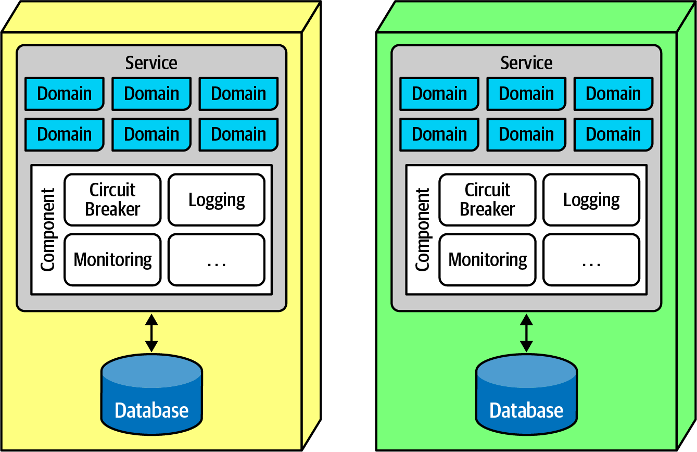

<!-- CH17-047 | PDF p. 270 | 图表 -->
*图 17-2：微服务中的边车模式。*

<!-- CH17-048 | PDF p. 270 | 正文 -->
图 17-2 中，共同的运行关注点作为独立组件出现在每个服务中，可以由各自的团队拥有，也可以由共享基础设施团队拥有。边车组件集中处理那些适合由各团队统一管理的运行关注点。因此，当需要升级监控工具时，共享基础设施团队可以更新边车，每个微服务都能获得新功能。

<!-- 书内第 251 页，PDF 第 271 页。 -->

<!-- CH17-049 | PDF p. 271 | 正文 -->
一旦团队知道每个服务都包含一个公共边车，就可以构建服务网格（service mesh），在整个架构中统一控制日志和监控等关注点。公共边车组件连接起来，为所有微服务提供一致的运行接口，如图 17-3 所示。

<!-- CH17-050 | PDF p. 271 | 图表 -->
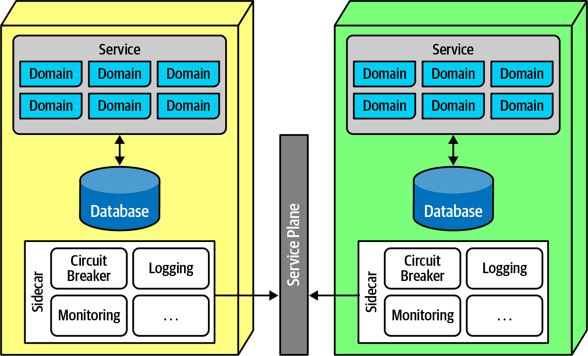

<!-- CH17-051 | PDF p. 271 | 图表 -->
*图 17-3：服务平面连接服务网格中的边车。*

<!-- CH17-052 | PDF p. 271 | 正文 -->
在图 17-3 中，每个边车都接入服务平面（service plane），由它构成面向每个服务的一致接口。

<!-- 书内第 252 页，PDF 第 272 页。 -->

<!-- CH17-053 | PDF p. 272 | 正文 -->
服务网格本身形成一个控制台，允许开发者从整体上访问服务，如图 17-4 所示。

<!-- CH17-054 | PDF p. 272 | 图表 -->
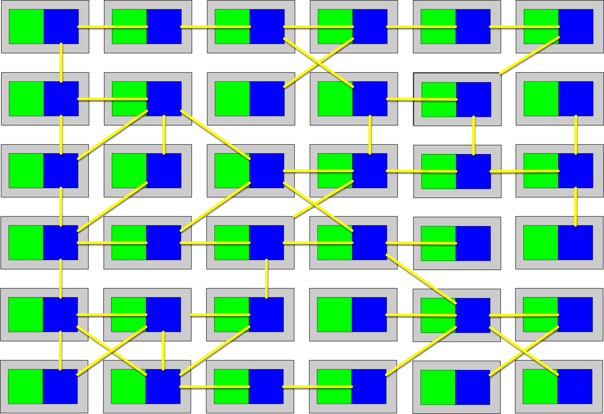

<!-- CH17-055 | PDF p. 272 | 图表 -->
*图 17-4：服务网格提供微服务运行方面的整体视图。*

<!-- CH17-056 | PDF p. 272 | 正文 -->
如图 17-4 所示，每个服务构成整个网格中的一个节点。服务网格形成一个控制台，让团队能够统一管控运行层面的共性关注点，例如监控级别、日志及其他横切关注点。

<!-- CH17-057 | PDF p. 272 | 正文 -->
架构师使用服务发现，作为向微服务架构中引入弹性的一种方式。请求不会直接调用某个单一服务，而是经过服务发现工具；该工具可以监控请求的数量和频率，也可以启动新的服务实例，以应对扩展或弹性需求。架构师常常把服务发现纳入服务网格，使它成为每个微服务的一部分。API 层也经常被用来承载服务发现，让用户界面或其他调用系统能够在同一个位置，以有弹性、一致的方式查找和创建服务。

<!-- CH17-058 | PDF p. 272 | 译注 -->
> 译注：本节按作者原文保留“服务平面”及服务发现、实例启动之间的职责描述。这里是架构层面的概括，不表示任意服务发现工具本身都负责自动扩容，也未核验当前服务网格产品的部署方式。

<!-- 书内第 253 页，PDF 第 273 页。 -->

<!-- CH17-059 | PDF p. 273 | 标题 -->
## 前端

<!-- CH17-060 | PDF p. 273 | 正文 -->
微服务倾向于解耦，理想情况下，这既应涵盖后端关注点，也应涵盖用户界面。事实上，微服务最初的愿景把用户界面也包含在限界上下文中，忠实遵循 DDD 的原则。不过，Web 应用所要求的划分方式，以及其他外部约束，使这一目标在实践中难以实现。因此，微服务架构中通常会出现两种用户界面风格；第一种如图 17-5 所示。

<!-- CH17-061 | PDF p. 273 | 图表 -->
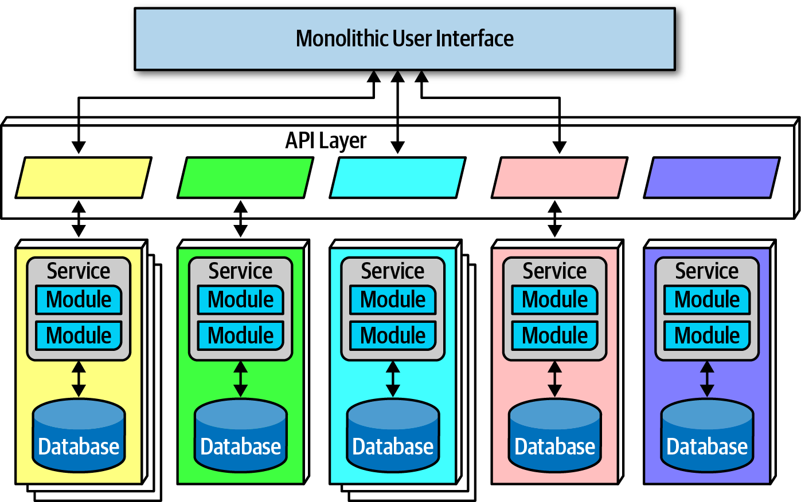

<!-- CH17-062 | PDF p. 273 | 图表 -->
*图 17-5：具有单体用户界面的微服务架构。*

<!-- CH17-063 | PDF p. 273 | 正文 -->
图 17-5 中，单体前端具有一个统一的用户界面，通过 API 层调用服务来满足用户请求。前端可以是富桌面应用、移动应用或 Web 应用。例如，如今许多 Web 应用使用 JavaScript Web 框架来构建单一用户界面。

<!-- 书内第 254 页，PDF 第 274 页。 -->

<!-- CH17-064 | PDF p. 274 | 正文 -->
用户界面的第二种选择是微前端（microfrontends），如图 17-6 所示。

<!-- CH17-065 | PDF p. 274 | 图表 -->
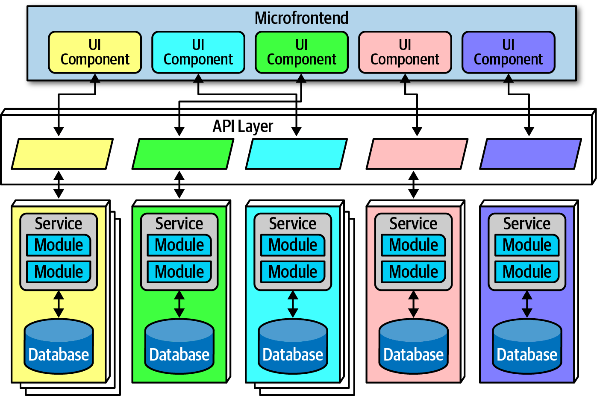

<!-- CH17-066 | PDF p. 274 | 图表 -->
*图 17-6：微服务中的微前端模式。*

<!-- CH17-067 | PDF p. 274 | 正文 -->
图 17-6 中，这种方式在用户界面层使用组件，使用户界面具有与后端服务相对应的粒度和隔离程度。每个服务输出属于自身的用户界面，前端再将它与其他输出的界面组件协调起来。采用这种模式，团队可以从用户界面一直到后端服务隔离服务边界，将整个领域统一在一个团队内。

<!-- CH17-068 | PDF p. 274 | 正文 -->
开发者可以用多种方式实现微前端模式，例如使用 [React](https://reactjs.org) 这样的组件化 Web 框架，或者使用若干支持这种模式的开源框架之一。

<!-- CH17-069 | PDF p. 274 | 标题 -->
## 通信

<!-- CH17-070 | PDF p. 274 | 正文 -->
在微服务中，架构师和开发者都很难把握恰当的粒度，而粒度同时影响数据隔离和通信。找到正确的通信风格，有助于团队让服务保持解耦，同时仍能以有用的方式协调工作。

<!-- CH17-071 | PDF p. 274 | 正文 -->
从根本上说，架构师必须决定采用同步通信还是异步通信。同步通信要求调用方等待被调用方的响应。微服务架构通常采用“协议感知的异构互操作性”（protocol-aware heterogeneous interoperability）。我们来拆解这个术语：

<!-- 书内第 255 页，PDF 第 275 页。 -->

<!-- CH17-072 | PDF p. 275 | 正文 -->
**协议感知**

<!-- CH17-073 | PDF p. 275 | 正文 -->
为了避免运行层面的耦合，微服务通常不包含中央集成枢纽，因此每个服务都应该知道如何调用其他服务。所以，架构师通常会为特定服务之间的调用方式制定标准，例如采用某种形式的 REST 或消息队列。这意味着服务必须知道，或者发现，调用其他服务时应使用哪种协议。

<!-- CH17-074 | PDF p. 275 | 正文 -->
**异构**

<!-- CH17-075 | PDF p. 275 | 正文 -->
由于微服务是一种分布式架构，每个服务都可以用不同的技术栈编写。“异构”意味着微服务完全支持多技术环境，不同服务可以使用不同平台。

<!-- CH17-076 | PDF p. 275 | 正文 -->
**互操作性**

<!-- CH17-077 | PDF p. 275 | 正文 -->
它描述服务彼此调用的能力。虽然微服务架构师试图避免带有事务语义的方法调用，但服务通常仍会通过网络调用其他服务，以协作和收发信息。

<!-- CH17-078 | PDF p. 275 | 标题 -->
### 强制异构

<!-- CH17-079 | PDF p. 275 | 正文 -->
一位以微服务风格先驱身份闻名的架构师，曾是一家面向移动设备的个人信息管理器初创公司的首席架构师。由于问题领域变化迅速，他希望确保开发团队不会意外地在彼此之间建立耦合点，从而妨碍团队独立推进的能力。恰好各团队拥有非常多样的技术技能，因此，他要求每个开发团队使用不同的技术栈。如果一个团队使用 Java，另一个使用 .NET，就不可能意外共享类了！

<!-- CH17-080 | PDF p. 275 | 正文 -->
这种做法与多数企业治理政策截然相反，后者坚持统一技术栈。微服务世界的目标不是创造尽可能复杂的生态系统，而是为范围狭窄的问题选择规模适当的技术。并非每个服务都需要工业级关系数据库，强迫小团队使用它，带来的不是好处，而是拖慢速度。这一理念利用了微服务高度解耦的本质。

<!-- CH17-081 | PDF p. 275 | 正文 -->
对于异步通信，架构师经常使用事件和消息，因而在内部采用第 14 章介绍的事件驱动架构；代理模式和中介者模式，在微服务中体现为协同和编排。

<!-- 书内第 256 页，PDF 第 276 页。 -->

<!-- CH17-082 | PDF p. 276 | 标题 -->
### 协同与编排

<!-- CH17-083 | PDF p. 276 | 正文 -->
协同采用与代理式事件驱动架构相同的通信风格。换句话说，这种架构中不存在中央协调器，尊重了限界上下文的理念。因此，架构师很自然地会在服务之间实现解耦的事件。

<!-- CH17-084 | PDF p. 276 | 正文 -->
领域与架构的同构性（domain/architecture isomorphism）是架构师评估某种架构风格是否适合特定问题时，应当寻找的一项关键特征。这个术语描述架构的形状如何映射到某种特定的架构风格。例如，图 8-7 中，Silicon Sandwiches 的技术划分架构在结构上支持可定制性，而微内核架构风格提供了相同的大体结构。因此，需要高度定制的问题，在微内核中实现起来会更容易。

<!-- CH17-085 | PDF p. 276 | 正文 -->
同样，由于微服务架构师的目标偏向解耦，微服务的形状类似于代理式 EDA，使这两种模式能够相互促进。

<!-- CH17-086 | PDF p. 276 | 正文 -->
在协同中，每个服务根据需要调用其他服务，没有中央中介者。例如，考虑图 17-7 所示的情形。

<!-- CH17-087 | PDF p. 276 | 图表 -->
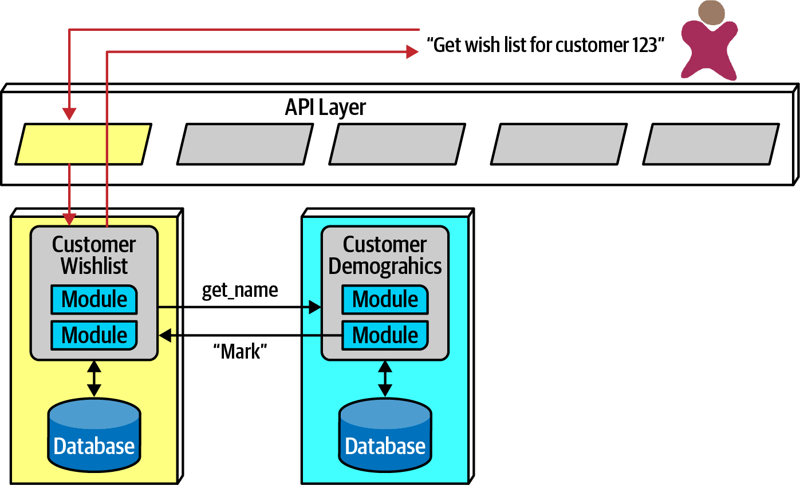

<!-- CH17-088 | PDF p. 276 | 图表 -->
*图 17-7：在微服务中使用协同管理协调。*

<!-- 书内第 257 页，PDF 第 277 页。 -->

<!-- CH17-089 | PDF p. 277 | 正文 -->
图 17-7 中，用户请求查看某个用户的愿望清单详情。由于 `CustomerWishList` 服务不包含所有必要信息，它会调用 `CustomerDemographics`，获取缺失信息，然后将结果返回给用户。

<!-- CH17-090 | PDF p. 277 | 正文 -->
由于微服务架构不像其他面向服务架构那样包含全局中介者，如果架构师需要协调多个服务，就可以创建自己的局部中介者，如图 17-8 所示。

<!-- CH17-091 | PDF p. 277 | 图表 -->
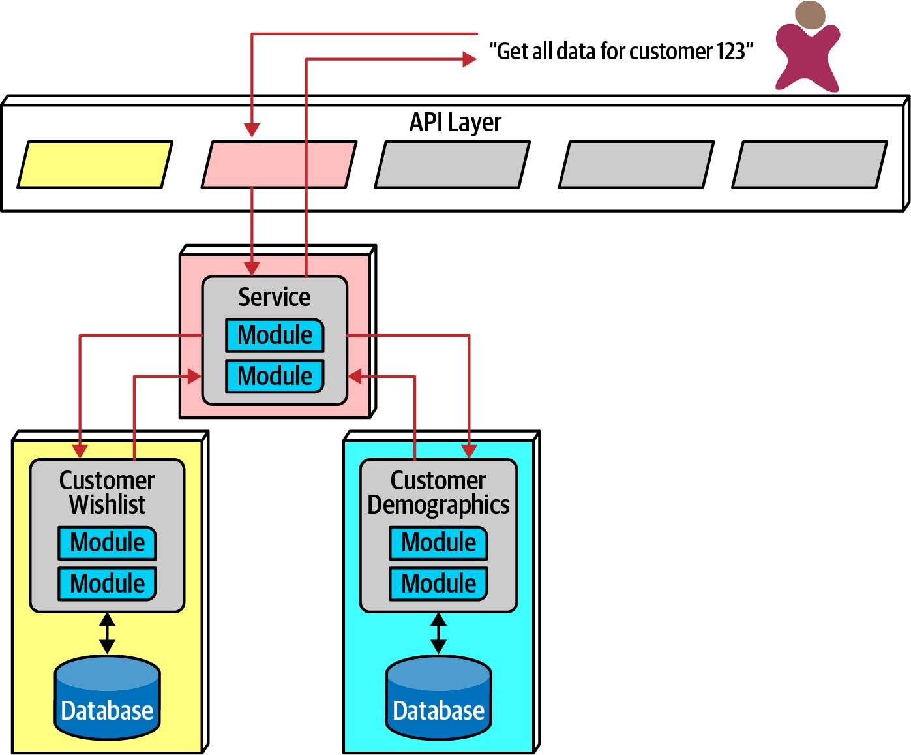

<!-- CH17-092 | PDF p. 277 | 图表 -->
*图 17-8：在微服务中使用编排。*

<!-- CH17-093 | PDF p. 277 | 正文 -->
在图 17-8 中，开发者创建了一个服务，其唯一职责是协调调用，以获取某个客户的全部信息。用户调用 `ReportCustomerInformation` 中介者，由它调用所需的其他服务。

<!-- 书内第 258 页，PDF 第 278 页。 -->

<!-- CH17-094 | PDF p. 278 | 正文 -->
软件架构第一定律表明，这两种方案都不完美，各自都有权衡。在协同中，架构师保留了这种架构风格高度解耦的理念，从而最大程度地获得这一风格所宣称的好处。不过，在协同环境中，错误处理和协调等常见问题会变得更加复杂。

<!-- CH17-095 | PDF p. 278 | 正文 -->
考虑一个具有更复杂工作流的例子，如图 17-9 所示。

<!-- CH17-096 | PDF p. 278 | 图表 -->

<!-- CH17-097 | PDF p. 278 | 图表 -->
*图 17-9：对复杂业务流程使用协同。*

<!-- CH17-098 | PDF p. 278 | 正文 -->
图 17-9 中，第一个被调用的服务必须协调许多其他服务，实际上是在履行自身领域职责的同时，充当中介者。这种模式称为前端控制器模式（front controller pattern）：一个名义上采用协同的服务，在处理某个问题时变成了更复杂的中介者。这种模式的缺点，是增加了该服务的复杂性。

<!-- 书内第 259 页，PDF 第 279 页。 -->

<!-- CH17-099 | PDF p. 279 | 正文 -->
另一种选择是，架构师对复杂业务流程使用编排，如图 17-10 所示。

<!-- CH17-100 | PDF p. 279 | 图表 -->
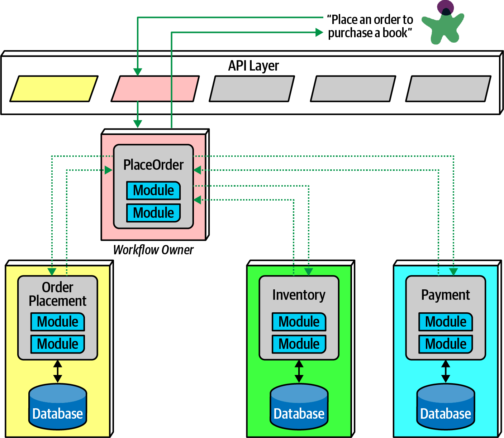

<!-- CH17-101 | PDF p. 279 | 图表 -->
*图 17-10：对复杂业务流程使用编排。*

<!-- CH17-102 | PDF p. 279 | 正文 -->
在图 17-10 中，架构师构建一个中介者，处理业务工作流要求的复杂性和协调。虽然这会在这些服务之间创建耦合，但它让架构师能够把协调工作集中在单一服务中，让其他服务受到较小影响。领域工作流往往天然就是耦合的；架构师的工作，是找到表达这种耦合的最佳方式，同时支持领域目标和架构目标。

<!-- 书内第 260 页，PDF 第 280 页。 -->

<!-- CH17-103 | PDF p. 280 | 标题 -->
### 事务与 Saga

<!-- CH17-104 | PDF p. 280 | 正文 -->
架构师在微服务中追求极度解耦，却常常随后遇到如何跨服务协调事务的问题。由于架构层面的解耦也鼓励数据库采用同等程度的解耦，在单体应用中很容易实现的原子性，在分布式应用中就成了问题。

<!-- CH17-105 | PDF p. 280 | 正文 -->
跨服务边界构建事务，违反微服务架构的核心解耦原则，而且会产生最糟糕的一类动态共变性，即值共变性。对于想跨服务执行事务的架构师，最好的建议是：不要这样做！应重新调整服务粒度。很多时候，架构师构建微服务架构后，发现必须用事务把服务连接起来，是因为设计中的粒度过细。事务边界是判断服务粒度的常见指标之一。

<!-- CH17-106 | PDF p. 280 | 译注 -->
> 不要在微服务中做事务——应该修正粒度！

<!-- CH17-107 | PDF p. 280 | 正文 -->
总会存在例外。例如，两个不同的服务可能需要差异很大的架构特性，因而必须保留各自的服务边界，却仍需要事务协调。针对这些情况，存在处理事务编排的模式，但它们伴随着重大的权衡。

<!-- CH17-108 | PDF p. 280 | 译注 -->
> 译注：这里的“不要做事务”指跨服务边界的事务协调，不是禁止每个服务内部使用数据库事务。以下 Saga 的原文描述也不应直接等同于数据库提供的原子提交或隔离保证。

<!-- 书内第 261 页，PDF 第 281 页。 -->

<!-- CH17-109 | PDF p. 281 | 正文 -->
微服务中一种常见的分布式事务模式是 Saga 模式，如图 17-11 所示。

<!-- CH17-110 | PDF p. 281 | 图表 -->
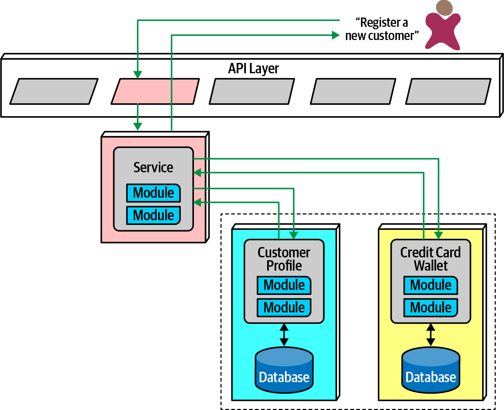

<!-- CH17-111 | PDF p. 281 | 图表 -->
*图 17-11：微服务架构中的 Saga 模式。*

<!-- CH17-112 | PDF p. 281 | 正文 -->
在图 17-11 中，一个服务充当跨多个服务调用的中介者，并协调事务。中介者调用事务的各个部分，记录成功或失败，并协调结果。如果一切按计划进行，服务及其所包含数据库中的所有值都会同步更新。

<!-- 书内第 262 页，PDF 第 282 页。 -->

<!-- CH17-113 | PDF p. 282 | 正文 -->
在出错情况下，中介者必须确保：只要事务的一部分失败，就没有任何部分成功。考虑图 17-12 所示的情况。

<!-- CH17-114 | PDF p. 282 | 图表 -->

<!-- CH17-115 | PDF p. 282 | 图表 -->
*图 17-12：Saga 模式在出错情况下的补偿事务。*

<!-- CH17-116 | PDF p. 282 | 正文 -->
图 17-12 中，如果事务的第一部分成功，而第二部分失败，中介者就必须向事务中所有成功的部分发送请求，要求它们撤销先前的请求。这种事务协调方式称为补偿事务框架（compensating transaction framework）。开发者实现这种模式时，通常让来自中介者的每个请求进入待定状态，直到中介者表明整体成功。不过，如果必须同时处理异步请求，这种设计就会变得复杂，尤其是在出现依赖于待定事务状态的新请求时。这还会在网络层产生大量协调流量。

<!-- CH17-117 | PDF p. 282 | 译注 -->
> 译注：上面“同步更新”“没有任何部分成功”保留原书措辞。紧接着的流程依靠对已成功操作进行补偿；业务补偿与数据库回滚不是同一机制。原书在这里没有展开中间状态可见性、补偿失败、重试及幂等保障，不能仅凭这几段推导出跨服务的 ACID 保证。

<!-- 书内第 263 页，PDF 第 283 页。 -->

<!-- CH17-118 | PDF p. 283 | 正文 -->
补偿事务框架的另一种实现方式，是让开发者为每个可能涉及事务的操作构建执行（do）和撤销（undo）功能。这会减少事务期间的协调工作，但撤销操作往往比执行操作复杂得多，使设计、实现和调试工作增加到两倍以上。

<!-- CH17-119 | PDF p. 283 | 正文 -->
虽然架构师可以跨服务构建事务行为，但这违背了选择微服务模式的初衷。总会有例外，因此给架构师的最佳建议是谨慎、少量使用 Saga 模式。

<!-- CH17-120 | PDF p. 283 | 译注 -->
> 有时确实需要少量跨服务事务；如果它们成了架构的主要特征，就说明设计出了问题！

<!-- CH17-121 | PDF p. 283 | 标题 -->
## 架构特性评分

<!-- CH17-122 | PDF p. 283 | 正文 -->
微服务架构风格在我们的标准评分尺度上有几项极端表现，如图 17-13 所示。一星表示架构对相应特性的支持较弱，五星则表示该特性是这种架构风格最突出的优势之一。评分表中各特性的定义见第 4 章。

<!-- CH17-123 | PDF p. 283 | 正文 -->
值得注意的是，它高度支持自动化部署、可测试性，以及其他未列出的现代工程实践。如果没有 DevOps 革命，以及运行关注点持续不断走向自动化的进程，就不会有微服务。

<!-- CH17-124 | PDF p. 283 | 正文 -->
由于微服务是分布式架构，它也承受着由运行时连接起来的部件构成的架构所固有的许多缺陷。因此，过多的服务间通信会影响容错性和可靠性。不过，这些评分只是指出架构的倾向；开发者会通过冗余，以及借助服务发现进行扩展，解决其中许多问题。然而，在正常情况下，独立、单一用途的服务通常能带来高容错性，因此微服务架构的这一特性获得了较高评分。

<!-- 书内第 264 页，PDF 第 284 页。 -->

<!-- CH17-125 | PDF p. 284 | 图表 -->
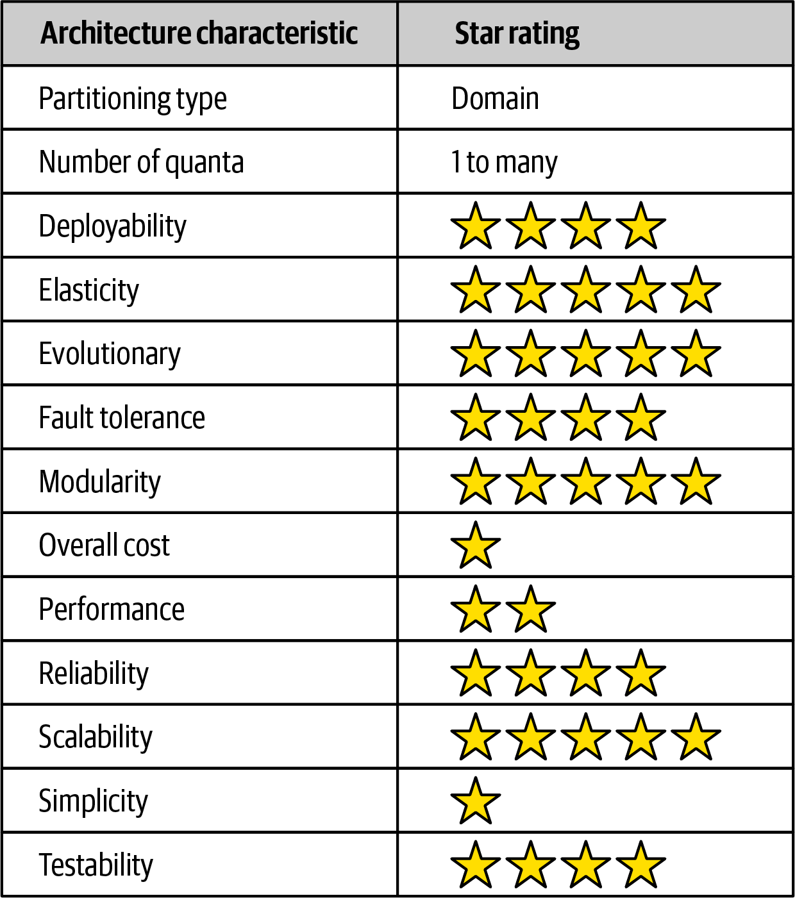

<!-- CH17-126 | PDF p. 284 | 图表 -->
*图 17-13：微服务的评分。*

<!-- CH17-127 | PDF p. 284 | 正文 -->
图中评分的中文转录如下：

<!-- CH17-128 | PDF p. 284 | 表格 -->
| 架构特性 | 评分或类型 |
| --- | --- |
| 划分类型 | 领域划分 |
| 架构量子数量 | 1 至多个 |
| 可部署性 | ★★★★ |
| 弹性 | ★★★★★ |
| 可演进性 | ★★★★★ |
| 容错性 | ★★★★ |
| 模块化 | ★★★★★ |
| 总体成本 | ★ |
| 性能 | ★★ |
| 可靠性 | ★★★★ |
| 可扩展性 | ★★★★★ |
| 简单性 | ★ |
| 可测试性 | ★★★★ |

<!-- CH17-129 | PDF p. 284 | 正文 -->
这种架构的突出优势是可扩展性、弹性和可演进性。迄今一些最具可扩展性的系统，已成功采用这种风格。同样，由于这种架构高度依赖自动化，以及与运维的智能集成，开发者也能在架构中建立弹性支持。由于这种架构倾向于在可渐进变更的层面保持高度解耦，它支持现代企业的演进式变更实践，甚至可以在架构层面进行演进。现代企业行动迅速，软件开发一直努力追赶。通过构建一种部署单元极小、且高度解耦的架构，架构师得到了一种能够支持更快变更速度的结构。

<!-- CH17-130 | PDF p. 284 | 正文 -->
性能常常是微服务中的问题：分布式架构必须进行许多网络调用才能完成工作，性能开销很高；而且，它们必须调用安全检查，验证每个端点的身份和访问权限。微服务世界中有许多提高性能的模式，包括智能的数据缓存和复制，以防止过多的网络调用。

<!-- 书内第 265 页，PDF 第 285 页。 -->

<!-- CH17-131 | PDF p. 285 | 正文 -->
性能也是微服务经常使用协同而非编排的另一个原因，因为更少的耦合允许更快的通信和更少的瓶颈。

<!-- CH17-132 | PDF p. 285 | 正文 -->
微服务是一种鲜明地以领域为中心的架构，每个服务边界都应对应领域。它也具有现代架构中最清晰的量子划分；在许多方面，它正体现了量子度量所评估的内容。极度解耦的主导理念给这种架构带来许多麻烦，但如果做得好，也会产生巨大收益。与任何架构一样，架构师必须先理解规则，才能明智地打破规则。

<!-- CH17-133 | PDF p. 285 | 标题 -->
## 补充参考资料

<!-- CH17-134 | PDF p. 285 | 正文 -->
本章的目标是介绍这种架构风格的一些重要方面，但还有许多优秀资源，可以帮助你更深入、更详细地了解它。关于微服务的补充信息和更详细的信息，可以参考以下资料：

<!-- CH17-135 | PDF p. 285 | 列表 -->
- Sam Newman 著，*Building Microservices*（O’Reilly）。
- Mark Richards 著，*Microservices vs. Service-Oriented Architecture*（O’Reilly）。
- Mark Richards 著，*Microservices AntiPatterns and Pitfalls*（O’Reilly）。

<!-- CH17-136 | PDF p. 285 | 分隔符 -->
---

<!-- CH17-137 | PDF p. 285 | 标题 -->
## 图中文字中文对照（译者整理）

<!-- CH17-138 | PDF p. 285 | 表格 -->
| 图号 | 英文标签 → 中文 |
| --- | --- |
| 图 17-1 | Client Requests → 客户端请求；API Layer → API 层；Service → 服务；Module → 模块；Database → 数据库 |
| 图 17-2 | Service → 服务；Domain → 领域；Component → 组件；Circuit Breaker → 熔断器；Logging → 日志；Monitoring → 监控；Database → 数据库 |
| 图 17-3 | Sidecar → 边车；Service Plane → 服务平面；其他领域、服务、数据库和运行标签同图 17-2 |
| 图 17-4 | 无文字标签；示意各服务节点通过网格连接形成整体运行视图 |
| 图 17-5 | Monolithic User Interface → 单体用户界面；API Layer → API 层；Service → 服务；Module → 模块；Database → 数据库 |
| 图 17-6 | Microfrontend → 微前端；UI Component → 用户界面组件；其余标签同图 17-5 |
| 图 17-7 | Get wish list for customer 123 → 获取客户 123 的愿望清单；Customer Wishlist → 客户愿望清单；Customer Demographics → 客户人口统计信息；get_name → 获取姓名；Mark → 人名 Mark；API、模块、数据库标签同图 17-1 |
| 图 17-8 | Get all data for customer 123 → 获取客户 123 的全部数据；其他服务、客户、模块和数据库标签同图 17-1、17-7；中介服务正文命名为 ReportCustomerInformation，图内仅标 Service |
| 图 17-9 | Place an order to purchase a book → 下单购买一本书；Order Placement → 订单提交；Payment → 支付；Inventory → 库存；pay_for_order → 支付订单；update_inventory → 更新库存；Workflow Owner → 工作流所有者；其他标签同图 17-1 |
| 图 17-10 | PlaceOrder → 下单；其余标签同图 17-9；工作流所有者转移到专门的编排服务 |
| 图 17-11 | Register a new customer → 注册新客户；Customer Profile → 客户档案；Credit Card Wallet → 信用卡钱包；其他标签同图 17-1 |
| 图 17-12 | 文字标签同图 17-11；1–7 为原图流程编号，红色虚线表示失败或补偿相关路径 |
| 图 17-13 | Architecture characteristic → 架构特性；Star rating → 星级评分；各行中文与星级见正文转录表 |

<!-- CH17-139 | PDF p. 285 | 译注 -->
> 译注：本章的历史与流行程度表述均对应本书 2020 年版本的语境；参考链接按 PDF 保留。总体成本一星表示成本方面不利；评分不是具体系统或当前产品的性能基准。
