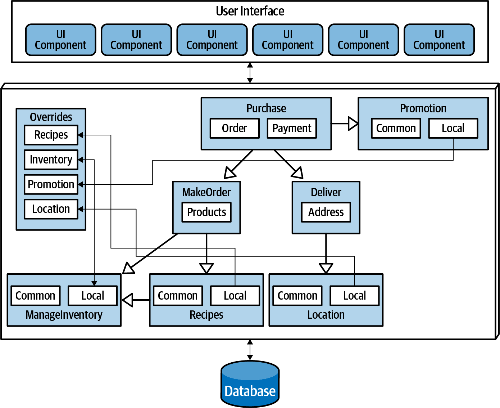
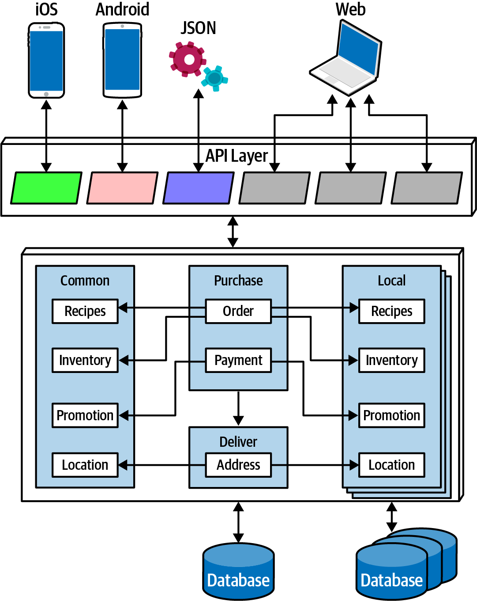
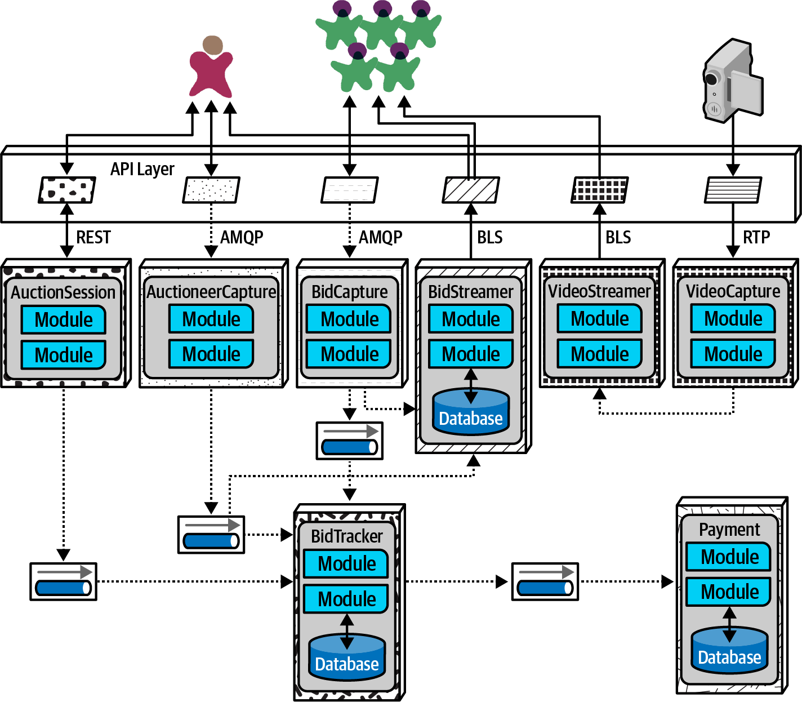

<!-- CH18-001 | PDF p. 287 | 标题 -->
# 第 18 章 选择合适的架构风格

> 原文章名：Choosing the Appropriate Architecture Style
> 来源：英文第一版，书内第 267–277 页，PDF 第 287–297 页。
> 进度：本轮逐段质量校译完成；详见 [校译记录](../../reviews/chapter-18-review.md)。
> 保留英文原图，中文标签对照见文末；下文页码均指原书书内页码。

<!-- 书内第 267 页，PDF 第 287 页。 -->

<!-- CH18-002 | PDF p. 287 | 正文 -->
这要看情况！面对所有这些选择，而且几乎每天都有新选择出现，我们很想告诉你应该使用哪一种，但我们做不到。没有什么比这个问题更依赖组织内的多种因素，以及它所构建的软件。选择架构风格，是分析和思考架构特性权衡、领域考量、战略目标，以及许多其他事情之后的综合结果。

<!-- CH18-003 | PDF p. 287 | 正文 -->
不管这个决定多么依赖具体情境，关于如何选择合适的架构风格，仍然存在一些通用建议。

<!-- CH18-004 | PDF p. 287 | 标题 -->
## 架构中不断变化的“时尚”

<!-- CH18-005 | PDF p. 287 | 正文 -->
人们偏爱的架构风格会随着时间变化，其背后有多种驱动因素：

<!-- CH18-006 | PDF p. 287 | 正文 -->
**对过去的观察**

<!-- CH18-007 | PDF p. 287 | 正文 -->
新的架构风格通常源自过去经验中的观察与痛点。架构师以往接触系统的经验，会影响他们对未来系统的思考。架构师必须依赖过去的经验；毕竟，正是这些经验让他们成为了架构师。新的架构设计往往反映了过去架构风格的具体缺陷。例如，架构师先构建了以代码复用为特色的架构，随后认识到其负面权衡，因而认真重新思考代码复用的影响。

<!-- CH18-008 | PDF p. 287 | 正文 -->
**生态系统的变化**

<!-- CH18-009 | PDF p. 287 | 正文 -->
持续变化是软件开发生态系统一个可以确定的特征：一切始终都在变化。我们的生态系统中的变化尤其混乱，甚至连变化的类型都无法预测。例如，几年前还没有人知道 Kubernetes 是什么，如今却在世界各地出现了多个有数千名开发者参加的相关大会。再过几年，Kubernetes 可能会被某种尚未编写出来的工具取代。

<!-- 书内第 268 页，PDF 第 288 页；上段跨页，已连读。 -->

<!-- CH18-010 | PDF p. 288 | 正文 -->
**新能力**

<!-- CH18-011 | PDF p. 288 | 正文 -->
新能力出现时，架构可能不只是用一个工具替换另一个，而是转向全新的范式。例如，很少有架构师或开发者预料到，Docker 这样的容器出现后，会给软件开发世界带来如此巨大的变化。虽然它是一个演进步骤，但它对架构师、工具、工程实践，以及许多其他因素的影响，仍然令业内大多数人震惊。生态系统的持续变化也会定期带来新的一批工具和能力。架构师不仅必须敏锐关注新工具，也必须关注新范式。某种东西看起来可能只是“我们已有某种工具的又一个版本”，但它可能包含细微差别或其他变化，使其改变游戏规则。新能力甚至不必撼动整个开发世界；一项新特性可能只是一个小变化，却恰好符合架构师的目标。

<!-- CH18-012 | PDF p. 288 | 正文 -->
**加速**

<!-- CH18-013 | PDF p. 288 | 正文 -->
生态系统不仅持续变化，变化速度也在不断提高。新工具产生新工程实践，进而带来新设计和新能力。架构师始终处于变动之中，因为变化既无处不在，又持续不断。

<!-- CH18-014 | PDF p. 288 | 正文 -->
**领域变化**

<!-- CH18-015 | PDF p. 288 | 正文 -->
开发者为之编写软件的领域不断演变，原因可能是业务持续发展，也可能是与其他公司合并等因素。

<!-- CH18-016 | PDF p. 288 | 正文 -->
**技术变化**

<!-- CH18-017 | PDF p. 288 | 正文 -->
随着技术持续演进，组织会努力跟上至少一部分变化，尤其是那些明显有利于财务收益的变化。

<!-- CH18-018 | PDF p. 288 | 正文 -->
**外部因素**

<!-- CH18-019 | PDF p. 288 | 正文 -->
许多与软件开发仅有间接关系的外部因素，也可能推动组织内部发生变化。例如，架构师和开发者可能对某个工具非常满意，但许可费用已经高到难以承受，迫使他们迁移到另一种选择。

<!-- CH18-020 | PDF p. 288 | 正文 -->
无论组织处于当前架构潮流中的哪个位置，架构师都应该了解行业趋势，以便明智地决定何时跟随、何时例外。

<!-- CH18-021 | PDF p. 288 | 译注 -->
> 译注：本节 Kubernetes、Docker 及“几年前”“如今”的表述属于本书 2020 年版本的历史语境，按原文保留。

<!-- 书内第 269 页，PDF 第 289 页。 -->

<!-- CH18-022 | PDF p. 289 | 标题 -->
## 决策标准

<!-- CH18-023 | PDF p. 289 | 正文 -->
选择架构风格时，架构师必须考虑所有影响领域设计结构的因素。从根本上说，架构师设计两样东西：指定的领域，以及使系统取得成功所需的全部其他结构元素。

<!-- CH18-024 | PDF p. 289 | 正文 -->
进入设计决策阶段时，架构师应当对以下事项已有充分把握：

<!-- CH18-025 | PDF p. 289 | 正文 -->
**领域**

<!-- CH18-026 | PDF p. 289 | 正文 -->
架构师应该理解领域中的许多重要方面，尤其是那些影响运维架构特性的方面。架构师不必成为业务专家，但至少必须对所设计领域的主要方面有良好的整体理解。

<!-- CH18-027 | PDF p. 289 | 正文 -->
**影响结构的架构特性**

<!-- CH18-028 | PDF p. 289 | 正文 -->
架构师必须发现并阐明支持领域及其他外部因素所需的架构特性。

<!-- CH18-029 | PDF p. 289 | 正文 -->
**数据架构**

<!-- CH18-030 | PDF p. 289 | 正文 -->
架构师与 DBA 必须合作处理数据库、模式及其他数据相关关注点。本书没有大量讨论数据架构，因为它本身就是一个专门领域。不过，架构师必须理解数据设计可能给自身设计带来的影响，尤其是在新系统必须与较旧和／或正在使用的数据架构交互时。

<!-- CH18-031 | PDF p. 289 | 正文 -->
**组织因素**

<!-- CH18-032 | PDF p. 289 | 正文 -->
许多外部因素可能影响设计。例如，某个云厂商的费用可能使理想设计无法采用。又或者，公司计划开展并购，这会促使架构师倾向于开放式解决方案和集成架构。

<!-- CH18-033 | PDF p. 289 | 正文 -->
**对流程、团队和运行关注点的了解**

<!-- CH18-034 | PDF p. 289 | 正文 -->
许多具体的项目因素都会影响架构师的设计，例如软件开发流程、与运维的互动或缺乏互动，以及 QA 流程。例如，如果组织在敏捷工程实践上尚不成熟，那么依赖这些实践才能成功的架构风格就会带来困难。

<!-- CH18-035 | PDF p. 289 | 正文 -->
**领域与架构的同构性**

<!-- CH18-036 | PDF p. 289 | 正文 -->
有些问题领域与架构的拓扑相匹配。例如，微内核架构风格非常适合需要可定制性的系统，架构师可以把定制设计成插件。另一个例子可能是基因组分析，它需要大量离散操作，而空间架构能够提供大量离散处理器。

<!-- 书内第 270 页，PDF 第 290 页；上段跨页，已连读。 -->

<!-- CH18-037 | PDF p. 290 | 正文 -->
同样，有些问题领域可能特别不适合某些架构风格。例如，需要高度扩展的系统很难采用大型单体设计，因为架构师很难在高度耦合的代码库中支持大量并发用户。包含大量语义耦合的问题领域，与高度解耦的分布式架构并不匹配。例如，某个保险公司的应用由多页表单组成，每一页都基于前面页面的上下文，这就很难用微服务建模。这是一个高度耦合的问题，在解耦架构中会给架构师带来设计挑战；像基于服务的架构这样耦合较少的架构，会更适合这一问题。

<!-- CH18-038 | PDF p. 290 | 译注 -->
> 译注：上一句“耦合较少”对应原文 less coupled，与前文对高度解耦架构不适用的论述存在措辞上的张力。此处保留原文；结合第 13 章，作者提出的候选方案是粗粒度的基于服务的架构，不擅自将该比较改写为另一种表述。

<!-- CH18-039 | PDF p. 290 | 正文 -->
考虑所有这些因素后，架构师必须做出几项判断：

<!-- CH18-040 | PDF p. 290 | 正文 -->
**单体还是分布式**

<!-- CH18-041 | PDF p. 290 | 正文 -->
利用前面讨论的架构量子概念，架构师必须确定：一组架构特性是否足以满足设计，还是系统的不同部分需要不同的架构特性？单一的一组特性意味着单体可能适合，尽管其他因素可能仍会推动架构师选择分布式架构；而不同的架构特性则意味着应采用分布式架构。

<!-- CH18-042 | PDF p. 290 | 正文 -->
**数据应该放在哪里？**

<!-- CH18-043 | PDF p. 290 | 正文 -->
如果架构是单体，架构师通常假设使用一个或少数几个关系数据库。在分布式架构中，架构师必须决定哪些服务应该持久化数据，这也意味着要思考数据必须如何流经整个架构来构建工作流。设计架构时，架构师必须同时考虑结构与行为，而且不要害怕反复迭代设计，以寻找更好的组合。

<!-- CH18-044 | PDF p. 290 | 正文 -->
**服务之间采用哪种通信风格——同步还是异步？**

<!-- CH18-045 | PDF p. 290 | 正文 -->
一旦架构师确定了数据划分，下一个设计考量就是服务之间的通信：同步还是异步？同步通信在大多数情况下更加方便，但可能带来可扩展性、可靠性等方面的不利特性。异步通信在性能和扩展方面可以提供独特优势，却也可能带来许多麻烦：数据同步、死锁、竞态条件、调试等。

<!-- 书内第 271 页，PDF 第 291 页。 -->

<!-- CH18-046 | PDF p. 291 | 正文 -->
由于同步通信在设计、实现和调试方面带来的挑战较少，架构师应该在可能时默认使用同步，在必要时使用异步。

<!-- CH18-047 | PDF p. 291 | 译注 -->
> 默认同步，必要时异步。

<!-- CH18-048 | PDF p. 291 | 正文 -->
这一设计过程的产出，是考虑所选架构风格及其混合形式后的架构拓扑；记录那些需要架构师投入最多精力的设计部分的架构决策记录；以及用于保护重要原则和运维架构特性的架构适应度函数。

<!-- CH18-049 | PDF p. 291 | 标题 -->
## 单体案例研究：Silicon Sandwiches

<!-- CH18-050 | PDF p. 291 | 正文 -->
在 Silicon Sandwiches 架构练习中，调查架构特性后，我们确定单个量子就足以实现该系统。此外，这是一个预算不高的简单应用，因此单体的简单性很有吸引力。

<!-- CH18-051 | PDF p. 291 | 正文 -->
不过，我们为 Silicon Sandwiches 创建了两种不同的组件设计：一种按领域划分，另一种按技术划分。考虑到解决方案较简单，我们将分别为两者创建设计，并讨论权衡。

<!-- CH18-052 | PDF p. 291 | 标题 -->
### 模块化单体

<!-- CH18-053 | PDF p. 291 | 正文 -->
模块化单体使用单一数据库，构建以领域为中心的组件，并作为单个架构量子部署。Silicon Sandwiches 的模块化单体设计如图 18-1 所示。

<!-- CH18-054 | PDF p. 291 | 正文 -->
这是一个使用单一关系数据库的单体，通过单一 Web 用户界面实现，并仔细考虑移动设备的设计，以降低总体成本。架构师之前识别的各个领域都表现为组件。如果时间和资源充足，架构师应该考虑让表及其他数据库资产采用与领域组件相同的划分，以便将来需求需要时，更容易把这一架构迁移为分布式架构。

<!-- 书内第 272 页，PDF 第 292 页。 -->

<!-- CH18-055 | PDF p. 292 | 图表 -->

<!-- CH18-056 | PDF p. 292 | 图表 -->
*图 18-1：Silicon Sandwiches 的模块化单体实现。*

<!-- CH18-057 | PDF p. 292 | 正文 -->
由于这种架构风格本身并不内在地处理定制，架构师必须确保定制成为领域设计的一部分。在这个例子中，架构师设计了一个 `Override` 端点，开发者可以向它上传各项定制。相应地，架构师必须确保，每个领域组件都会针对每项可定制特性引用 `Override` 组件；这非常适合用适应度函数来保护。

<!-- CH18-058 | PDF p. 292 | 标题 -->
### 微内核

<!-- CH18-059 | PDF p. 292 | 正文 -->
架构师在 Silicon Sandwiches 中识别的一项架构特性是可定制性。从领域与架构同构性的角度出发，架构师可能选择使用微内核实现，如图 18-2 所示。

<!-- 书内第 273 页，PDF 第 293 页。 -->

<!-- CH18-060 | PDF p. 293 | 图表 -->

<!-- CH18-061 | PDF p. 293 | 图表 -->
*图 18-2：Silicon Sandwiches 的微内核实现。*

<!-- CH18-062 | PDF p. 293 | 正文 -->
在图 18-2 中，核心系统由领域组件和单一关系数据库组成。与前一个设计一样，仔细协调领域与数据设计，将允许核心未来迁移到分布式架构。每项定制都表现为一个插件：通用定制放在同一组插件中，拥有相应数据库；另有一系列本地定制，每个都有自己的数据。由于插件之间不需要耦合，各自可以维护自己的数据，从而保持解耦。

<!-- CH18-063 | PDF p. 293 | 正文 -->
这里另一个独特设计元素采用[面向前端的后端（Backends for Frontends，BFF）模式](https://oreil.ly/i3Hsc)，使 API 层成为一个轻量的微内核适配器。它从后端提供通用信息，再由 BFF 适配器把这些通用信息转换成适合前端设备的格式。例如，iOS 的 BFF 会接收后端的通用输出，并根据 iOS 原生应用的预期进行定制：数据格式、分页、延迟，以及其他因素。分别构建 BFF 适配器，可以提供最丰富的用户界面，并支持未来扩展到其他设备；这是微内核风格的好处之一。

<!-- 书内第 274 页，PDF 第 294 页；上段跨页，已连读。 -->

<!-- CH18-064 | PDF p. 294 | 正文 -->
Silicon Sandwiches 的这两种架构，内部通信都可以采用同步方式：它们没有极端性能或弹性需求，而且所有操作都不会持续很长时间。

<!-- CH18-065 | PDF p. 294 | 标题 -->
## 分布式案例研究：Going, Going, Gone

<!-- CH18-066 | PDF p. 294 | 正文 -->
Going, Going, Gone（GGG）练习带来了更有趣的架构挑战。根据第 112 页“案例研究：Going, Going, Gone：发现组件”一节的组件分析，这种架构的不同部分需要不同的架构特性。例如，拍卖师和竞拍者等角色，对可用性和可扩展性等架构特性的要求就不同。

<!-- CH18-067 | PDF p. 294 | 正文 -->
GGG 的需求还明确提出了较高的扩展规模、弹性、性能，以及许多其他棘手的运维架构特性。架构师需要选择一种能够在架构内部以细粒度实现高度定制的模式。在候选分布式架构中，底层采用事件驱动或采用微服务，都符合大多数架构特性。两者之中，微服务更好地支持差异化的运维架构特性：纯事件驱动架构通常不是根据这些运维架构特性来分离各部分，而是基于通信风格，即编排或协同。

<!-- CH18-068 | PDF p. 294 | 正文 -->
要在微服务中达到指定性能，会面临挑战，但架构师通常可以通过有针对性的设计来弥补架构弱点。例如，虽然微服务天然提供高度可扩展性，但架构师通常仍必须解决过多编排、过度激进的数据拆分等造成的特定性能问题。

<!-- 书内第 275 页，PDF 第 295 页。 -->

<!-- CH18-069 | PDF p. 295 | 正文 -->
图 18-3 展示了使用微服务实现 GGG 的方案。

<!-- CH18-070 | PDF p. 295 | 图表 -->

<!-- CH18-071 | PDF p. 295 | 图表 -->
*图 18-3：Going, Going, Gone 的微服务实现。*

<!-- CH18-072 | PDF p. 295 | 正文 -->
图 18-3 中，每个识别出的组件都成了架构中的服务，使组件粒度与服务粒度匹配。GGG 有三个不同的用户界面：

<!-- CH18-073 | PDF p. 295 | 正文 -->
**竞拍者**

<!-- CH18-074 | PDF p. 295 | 正文 -->
在线拍卖中的大量竞拍者。

<!-- CH18-075 | PDF p. 295 | 正文 -->
**拍卖师**

<!-- CH18-076 | PDF p. 295 | 正文 -->
每场拍卖一位。

<!-- CH18-077 | PDF p. 295 | 正文 -->
**流服务**

<!-- CH18-078 | PDF p. 295 | 正文 -->
负责向竞拍者传输视频和竞价流的服务。注意，这是只读流，因此可以进行在需要更新时无法进行的优化。

<!-- 书内第 276 页，PDF 第 296 页。 -->

<!-- CH18-079 | PDF p. 296 | 正文 -->
GGG 架构的这一设计包含以下服务：

<!-- CH18-080 | PDF p. 296 | 正文 -->
**BidCapture（出价捕获）**

<!-- CH18-081 | PDF p. 296 | 正文 -->
捕获在线竞拍者的出价，并异步发送给 Bid Tracker。该服务不需要持久化，因为它只是在线竞价的传递通道。

<!-- CH18-082 | PDF p. 296 | 正文 -->
**BidStreamer（出价流传输）**

<!-- CH18-083 | PDF p. 296 | 正文 -->
通过高性能、只读的数据流，将出价回传给在线参与者。

<!-- CH18-084 | PDF p. 296 | 正文 -->
**BidTracker（出价跟踪）**

<!-- CH18-085 | PDF p. 296 | 正文 -->
跟踪来自 Auctioneer Capture 和 Bid Capture 的出价。这个组件汇合两种不同的信息流，并尽可能接近实时地对出价排序。注意，该服务的两个入站连接都是异步的，因此开发者可以用消息队列作为缓冲，处理速率相差很大的消息流。

<!-- CH18-086 | PDF p. 296 | 正文 -->
**Auctioneer Capture（拍卖师出价捕获）**

<!-- CH18-087 | PDF p. 296 | 正文 -->
为拍卖师捕获出价。第 112 页“案例研究：Going, Going, Gone：发现组件”一节中的量子分析结果，使架构师将 Bid Capture 与 Auctioneer Capture 分开，因为它们的架构特性非常不同。

<!-- CH18-088 | PDF p. 296 | 正文 -->
**Auction Session（拍卖会话）**

<!-- CH18-089 | PDF p. 296 | 正文 -->
管理每场拍卖的工作流。

<!-- CH18-090 | PDF p. 296 | 正文 -->
**Payment（支付）**

<!-- CH18-091 | PDF p. 296 | 正文 -->
第三方支付提供方，在 Auction Session 完成拍卖后处理支付信息。

<!-- CH18-092 | PDF p. 296 | 正文 -->
**Video Capture（视频捕获）**

<!-- CH18-093 | PDF p. 296 | 正文 -->
捕获现场拍卖的视频流。

<!-- CH18-094 | PDF p. 296 | 正文 -->
**Video Streamer（视频流传输）**

<!-- CH18-095 | PDF p. 296 | 正文 -->
向在线竞拍者传输拍卖视频。

<!-- CH18-096 | PDF p. 296 | 正文 -->
架构师仔细标明了这种架构中的同步和异步通信方式。选择异步通信，主要是为了适应服务之间不同的运维架构特性。例如，如果 Payment 服务每 500 毫秒只能处理一笔新支付，而大量拍卖同时结束，服务间同步通信就会造成超时及其他可靠性问题。通过使用消息队列，架构师可以为架构中这一脆弱而关键的部分增加可靠性。

<!-- 书内第 277 页，PDF 第 297 页。 -->

<!-- CH18-097 | PDF p. 297 | 正文 -->
最终分析结果表明，这一设计形成五个架构量子，如图 18-4 所标示。

<!-- CH18-098 | PDF p. 297 | 图表 -->

<!-- CH18-099 | PDF p. 297 | 图表 -->
*图 18-4：GGG 的架构量子边界。*

<!-- CH18-100 | PDF p. 297 | 正文 -->
图 18-4 中，设计包含 Payment、Auctioneer、Bidder、Bidder Streams 和 Bid Tracker 这几个量子，大致对应各服务。图中堆叠的容器表示多个实例。在组件设计阶段使用量子分析，让架构师更容易识别服务、数据和通信边界。

<!-- CH18-101 | PDF p. 297 | 正文 -->
注意，这不是 GGG 的“正确”设计，当然也不是唯一设计。我们甚至不认为它是可能的最佳设计，但它似乎在各种权衡中做到了相对减少弊端。选择微服务，再明智地使用事件和消息，可以让架构充分利用通用架构模式，同时为未来开发和扩展建立基础。

<!-- CH18-102 | PDF p. 297 | 分隔符 -->
---

<!-- CH18-103 | PDF p. 297 | 标题 -->
## 图中文字中文对照（译者整理）

<!-- CH18-104 | PDF p. 297 | 表格 -->
| 图号 | 英文标签 → 中文 |
| --- | --- |
| 图 18-1 | User Interface → 用户界面；UI Component → 用户界面组件；Overrides → 定制覆盖；Recipes → 配方；Inventory → 库存；Promotion → 促销；Location → 位置；Purchase → 购买；Order → 订单；Payment → 支付；MakeOrder → 制作订单；Products → 产品；Deliver → 配送；Address → 地址；Common → 通用；Local → 本地；ManageInventory → 库存管理；Database → 数据库 |
| 图 18-2 | API Layer → API 层；iOS、Android、JSON、Web 保留原标签；其余业务和数据库标签同图 18-1 |
| 图 18-3 | AuctionSession → 拍卖会话；AuctioneerCapture → 拍卖师出价捕获；BidCapture → 出价捕获；BidStreamer → 出价流传输；VideoStreamer → 视频流传输；VideoCapture → 视频捕获；BidTracker → 出价跟踪；Payment → 支付；Module → 模块；Database → 数据库；API Layer → API 层；REST、AMQP、BLS、RTP 保留原图协议或通信标记 |
| 图 18-4 | 标签同图 18-3；不同纹理标记原图的量子边界，堆叠表示多实例 |

<!-- CH18-105 | PDF p. 297 | 译注 -->
> 译注：GGG 的同步、异步选择及五个量子是作者对本例的设计分析，不是“用了消息队列就必然独立”的通用判断。原图的 BLS 标记在本章正文未展开，故保留，不猜测其全称。
