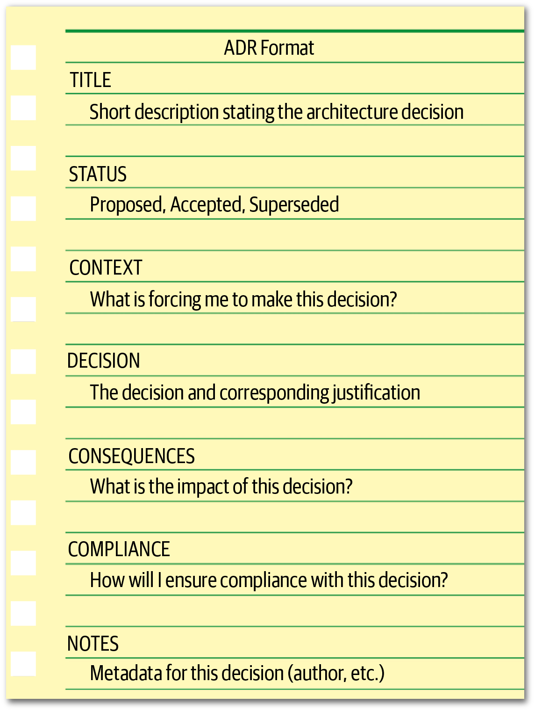
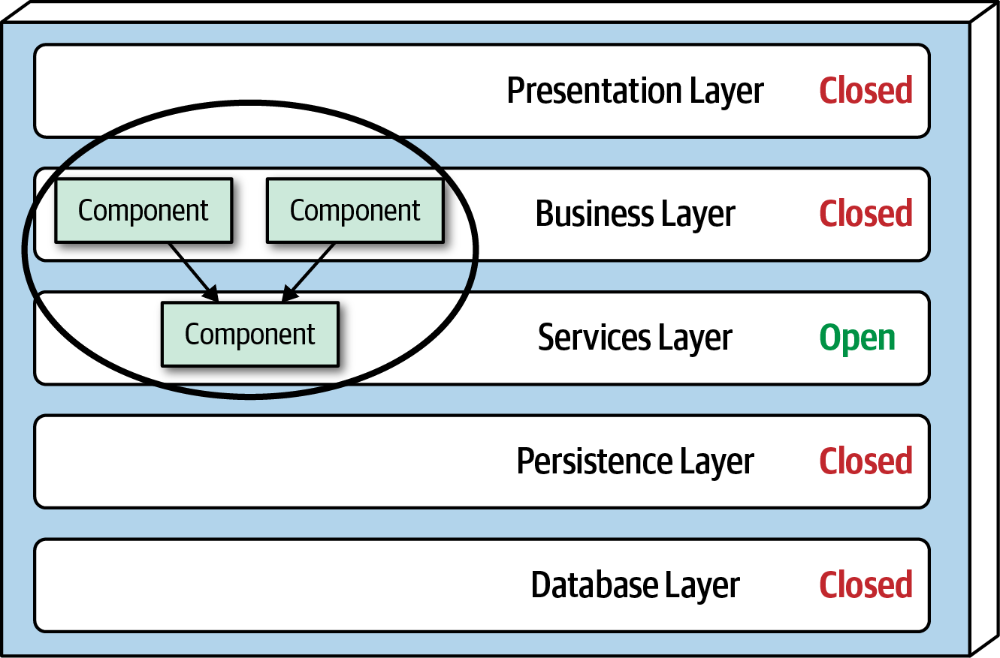
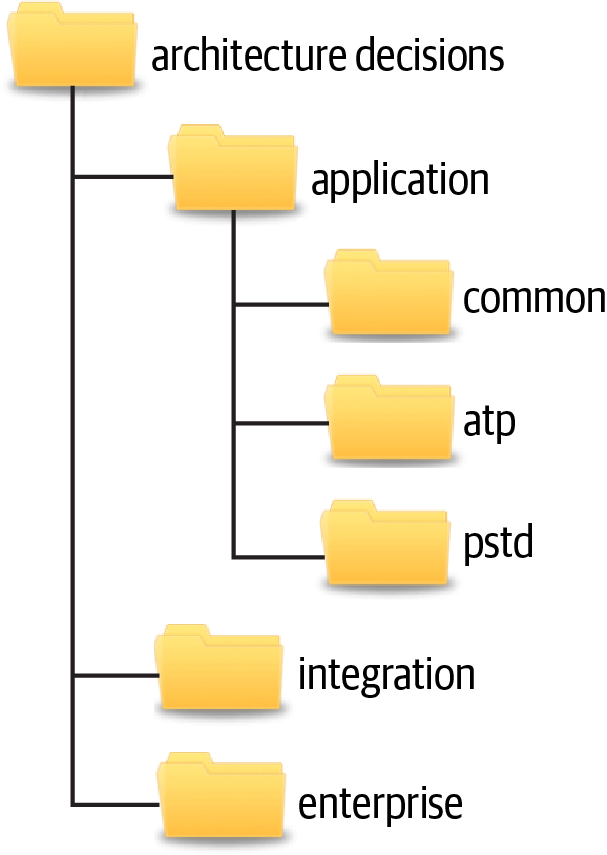
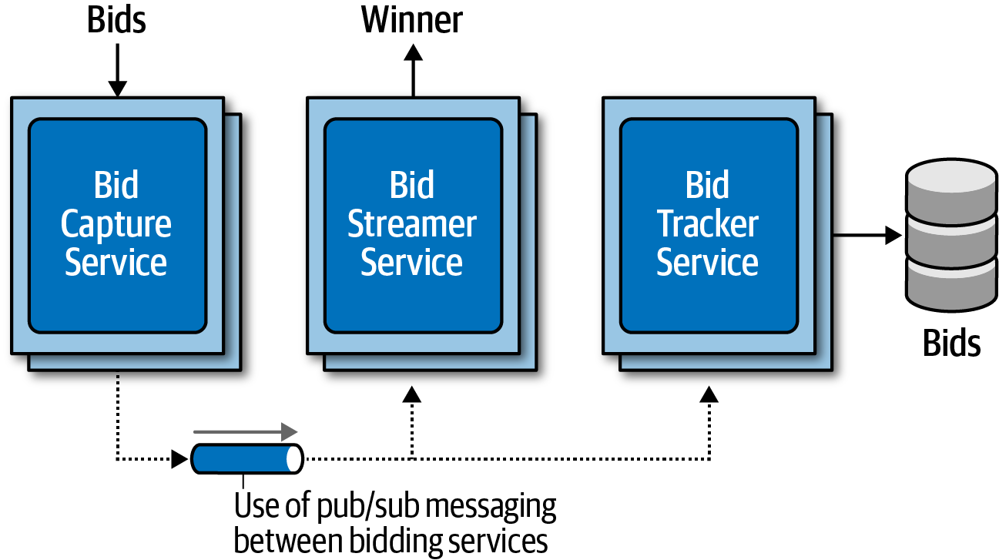
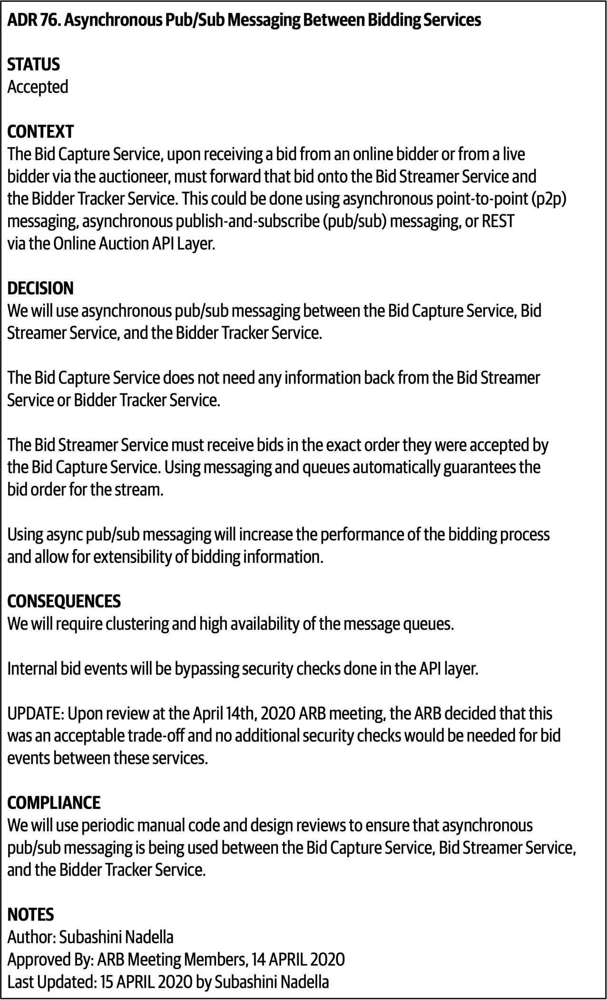

<!-- CH19-001 | PDF p. 301 | 标题 -->
# 第 19 章 架构决策

> 原文章名：Architecture Decisions
> 来源：英文第一版，书内第 281–295 页，PDF 第 301–315 页。
> 进度：上一轮校译记录见 [原校译记录](../../reviews/chapter-19-review.md)；本次独立复审完成，见 [独立复审记录](../../reviews/independent-pass/chapter-19.md)。
> 保留英文原图，中文标签对照与图内 ADR 全文翻译见文末；下文页码均指原书书内页码。

<!-- 书内第 281 页，PDF 第 301 页。 -->

<!-- CH19-002 | PDF p. 301 | 正文 -->
对架构师的一项核心期望，是做出架构决策。架构决策通常涉及应用或系统的结构，但也可能涉及技术决策，尤其是那些影响架构特性的技术决策。无论具体背景如何，好的架构决策都应该帮助指导开发团队做出正确的技术选择。做架构决策涉及收集足够的相关信息、说明决策依据、记录决策，以及向适当的利益相关者有效传达决策。

<!-- CH19-003 | PDF p. 301 | 标题 -->
## 架构决策反模式

<!-- CH19-004 | PDF p. 301 | 正文 -->
做架构决策是一门艺术。不出所料，架构师在做决策时会出现几种架构反模式。程序员 [Andrew Koenig](https://oreil.ly/p9i_Y) 将反模式定义为：开始时看似是个好主意，却会让你陷入麻烦的东西。反模式的另一种定义，是产生负面结果的可重复过程。在做架构决策时，可能而且通常会出现的三种主要架构反模式，是“明哲保身”（Covering Your Assets）、“土拨鼠之日”（Groundhog Day）和“邮件驱动架构”（Email-Driven Architecture）。这三种反模式通常呈现一种递进关系：克服明哲保身反模式后，会遇到土拨鼠之日反模式；克服后者后，又会遇到邮件驱动架构反模式。要做出有效、准确的架构决策，架构师必须克服全部三种反模式。

<!-- 书内第 282 页，PDF 第 302 页。 -->

<!-- CH19-005 | PDF p. 302 | 标题 -->
### 明哲保身反模式

<!-- CH19-006 | PDF p. 302 | 正文 -->
尝试做架构决策时，首先出现的是明哲保身反模式。它发生在架构师因为害怕做出错误选择，而回避或推迟架构决策时。

<!-- CH19-007 | PDF p. 302 | 正文 -->
有两种方式可以克服这一反模式。第一种，是等到最后负责任时点（last responsible moment），再做重要的架构决策。最后负责任时点是指：等到信息足以说明和验证决策时再作决定，但又不能拖得太久，以免阻碍开发团队，或者陷入分析瘫痪（Analysis Paralysis）反模式。第二种，是持续与开发团队合作，确保做出的决策能够按预期实施。这一点至关重要，因为作为架构师，不可能知道某项技术的每一个细节及其所有相关问题。通过与开发团队密切合作，发生问题时，架构师可以迅速调整架构决策。

<!-- CH19-008 | PDF p. 302 | 正文 -->
为说明这一点，假设架构师决定：所有需要产品信息的服务实例，都使用只读复制式缓存来缓存产品相关参考数据，包括产品描述、重量和尺寸，主副本由目录服务拥有。复制式缓存意味着，如果产品信息发生变化，或者添加了新产品，目录服务会更新自己的缓存，然后通过复制式内存缓存产品，把更新复制到需要这些数据的所有其他服务。这一决策的良好依据，是降低服务间耦合，并在无须服务间调用的情况下有效共享数据。不过，实施该决策的开发团队发现，由于某些服务的特定可扩展性要求，这个决定需要的进程内内存超过了可用数量。通过与开发团队密切合作，架构师能够迅速了解这一问题，并调整架构决策以适应这些情况。

<!-- CH19-009 | PDF p. 302 | 标题 -->
### 土拨鼠之日反模式

<!-- CH19-010 | PDF p. 302 | 正文 -->
架构师一旦克服明哲保身反模式并开始做决策，第二种反模式便会出现：土拨鼠之日反模式。当人们不知道为什么做出某个决定时，就会一次又一次、没完没了地重复讨论它。这一反模式的名称来自 Bill Murray 主演的电影《土拨鼠之日》；在电影中，每一天都反复是 2 月 2 日。

<!-- CH19-011 | PDF p. 302 | 正文 -->
土拨鼠之日反模式之所以发生，是因为架构师做出架构决策后，没有给出依据，或者依据不完整。说明架构决策依据时，重要的是同时提供技术依据和业务依据。例如，架构师可能决定把单体应用拆成独立服务，使应用的功能方面解耦，让每个部分使用更少的虚拟机资源，并能够独立维护和部署。

<!-- 书内第 283 页，PDF 第 303 页；上段跨页，已连读。 -->

<!-- CH19-012 | PDF p. 303 | 正文 -->
虽然这是技术依据的一个好例子，但它缺少业务依据：换句话说，企业为什么要为这种架构重构付钱？这一决策的良好业务依据，可以是更快交付新的业务功能，从而缩短上市时间；另一个依据，可以是降低开发和发布新功能的成本。

<!-- CH19-013 | PDF p. 303 | 正文 -->
说明架构决策依据时，提供业务价值至关重要。这也是判断是否应该做出某项架构决策的良好检验。如果某项架构决策没有提供任何业务价值，那么它也许不是一个好决定，应该重新考虑。

<!-- CH19-014 | PDF p. 303 | 正文 -->
四种最常见的业务依据包括成本、上市时间、用户满意度和战略定位。围绕这些常见业务依据思考时，重要的是考虑业务利益相关者在意什么。如果业务利益相关者不太关心成本，而更关心上市时间，那么仅以节省成本为依据做出某个决定，可能并不正确。

<!-- CH19-015 | PDF p. 303 | 标题 -->
### 邮件驱动架构反模式

<!-- CH19-016 | PDF p. 303 | 正文 -->
架构师做出决策，并充分说明依据后，第三种架构反模式便会出现：邮件驱动架构。它指人们丢失、忘记，甚至根本不知道某项架构决策已经做出，因此不可能实施它。这一反模式的核心，在于有效传达架构决策。电子邮件是很好的沟通工具，却不是好的文档存储库系统。

<!-- CH19-017 | PDF p. 303 | 正文 -->
有许多方式可以提高架构决策的沟通效果，从而避免邮件驱动架构反模式。沟通架构决策的第一条规则，是不要把架构决策本身放在邮件正文中。这样做会为同一决策创建多个权威记录系统。邮件中常常遗漏重要细节，包括决策依据，因而再次导致土拨鼠之日反模式。而且，如果这项架构决策被修改或取代，有多少人收到了修订后的决定？更好的做法，是只在邮件正文中提及决策的性质与背景，并提供一个链接，指向保存实际架构决策及相关细节的单一权威记录系统，无论它是 wiki 页面，还是文件系统中的文档。

<!-- 书内第 284 页，PDF 第 304 页。 -->

<!-- CH19-018 | PDF p. 304 | 正文 -->
有效传达架构决策的第二条规则，是只通知真正关心该决策的人。一种有效技巧，是把邮件正文写成这样：

<!-- CH19-019 | PDF p. 304 | 引文 -->
> Sandra，你好。我已经做出一项关于服务间通信的重要决定，它会直接影响你。请通过以下链接查看这项决定……

<!-- CH19-020 | PDF p. 304 | 正文 -->
注意第一句话中的措辞：“关于服务间通信的重要决定”。这里提到了决策的背景，却没有说出决策本身。第一句话的后半部分更重要：“它会直接影响你”。如果架构决策不直接影响某个人，为什么要用这个决定打扰他？这是判断哪些利益相关者，包括开发者，应该直接收到决策通知的良好检验。第二句话提供了决策所在位置的链接，使其只保存在一个地方，也就形成了该决策的单一权威记录系统。

<!-- CH19-021 | PDF p. 304 | 标题 -->
## 架构显著性

<!-- CH19-022 | PDF p. 304 | 正文 -->
许多架构师认为，只要某个决定涉及具体技术，它就不是架构决策，而是技术决策。这并不总是正确。如果架构师决定采用某项技术，是因为它直接支持某项架构特性，例如性能或可扩展性，那么它就是架构决策。

<!-- CH19-023 | PDF p. 304 | 正文 -->
知名软件架构师、*Release It!*（Pragmatic Bookshelf）一书的作者 [Michael Nygard](https://www.michaelnygard.com)，提出“具有架构显著性”（architecturally significant）这个术语，来回答架构师应该负责哪些决定，也就是哪些属于架构决策。按照 Michael 的说法，具有架构显著性的决定，是影响结构、非功能特性、依赖、接口或构建技术的决定。

<!-- CH19-024 | PDF p. 304 | 正文 -->
**结构**，指影响所采用架构模式或风格的决定。例如，决定在一组微服务之间共享数据，会影响微服务的限界上下文，因此也影响应用结构。

<!-- CH19-025 | PDF p. 304 | 正文 -->
**非功能特性**，是对于正在开发或维护的应用或系统而言重要的架构特性，即各种“-ilities”。如果技术选择影响性能，而性能又是应用的一个重要方面，它就成了架构决策。

<!-- CH19-026 | PDF p. 304 | 正文 -->
**依赖**，指系统内组件和／或服务之间的耦合点，进而影响总体可扩展性、模块化、敏捷性、可测试性、可靠性等。

<!-- 书内第 285 页，PDF 第 305 页。 -->

<!-- CH19-027 | PDF p. 305 | 正文 -->
**接口**，指如何访问和编排服务与组件，通常通过网关、集成枢纽、服务总线或 API 代理实现。接口通常涉及定义契约，包括契约的版本管理与弃用策略。接口影响使用系统的其他人，因此具有架构显著性。

<!-- CH19-028 | PDF p. 305 | 正文 -->
最后，**构建技术**，指有关平台、框架、工具，甚至流程的决定。尽管本质上属于技术层面，它们也可能影响架构的某些方面。

<!-- CH19-029 | PDF p. 305 | 标题 -->
## 架构决策记录

<!-- CH19-030 | PDF p. 305 | 正文 -->
记录架构决策最有效的方式之一，是使用[架构决策记录（Architecture Decision Records，ADR）](https://adr.github.io)。ADR 最先由 Michael Nygard 在一篇[博文](https://oreil.ly/yDcU2)中推广，后来在 ThoughtWorks 的[技术雷达](https://oreil.ly/0nwHw)中被标为“采用”（adopt）。一份 ADR 是一个简短文本文件，通常一到两页，描述某项具体架构决策。虽然可以用纯文本编写 ADR，但通常会采用 [AsciiDoc](http://asciidoc.org) 或 [Markdown](https://www.markdownguide.org) 等文本格式。另一种做法，是使用 wiki 页面模板来编写 ADR。

<!-- CH19-031 | PDF p. 305 | 正文 -->
也有工具可以管理 ADR。*Growing Object-Oriented Software Guided by Tests*（Addison-Wesley）的合著者 Nat Pryce，编写了一个名为 [ADR-tools](https://oreil.ly/6d8LN) 的开源工具。它提供命令行接口来管理 ADR，包括编号方案、存储位置和取代关系。德国软件工程师 Micha Kops 写过一篇介绍 [ADR-tools 用法的博文](https://oreil.ly/OgBZK)，其中提供了一些很好的例子，展示如何使用它管理架构决策记录。

<!-- CH19-032 | PDF p. 305 | 标题 -->
### 基本结构

<!-- CH19-033 | PDF p. 305 | 正文 -->
ADR 的基本结构包括五个主要部分：标题、状态、背景、决策和后果。我们通常会在基本结构中再增加两部分：遵从性和备注。只要模板保持一致、简洁，这一基本结构，如图 19-1 所示，就可以扩展，加入其他认为必要的部分。例如，必要时可以增加“备选方案”部分，对所有其他可能的方案进行分析。

<!-- 书内第 286 页，PDF 第 306 页。 -->

<!-- CH19-034 | PDF p. 306 | 图表 -->


<!-- CH19-035 | PDF p. 306 | 图表 -->
*图 19-1：ADR 的基本结构。*

<!-- CH19-036 | PDF p. 306 | 标题 -->
#### 标题

<!-- CH19-037 | PDF p. 306 | 正文 -->
ADR 的标题通常按顺序编号，并包含一个描述架构决策的短语。例如，决定在订单服务和支付服务之间使用异步消息，标题可以写成：“42. 在订单服务与支付服务之间使用异步消息”。标题的描述应足够明确，消除对决策性质与背景的歧义，同时又保持简短精炼。

<!-- CH19-038 | PDF p. 306 | 标题 -->
#### 状态

<!-- CH19-039 | PDF p. 306 | 正文 -->
ADR 的状态可以标为“提议”（Proposed）、“已接受”（Accepted）或“已被取代”（Superseded）。“提议”意味着该决策必须由更高层级的决策者，或某种架构治理机构，例如架构评审委员会批准。“已接受”意味着该决策已经获批，可以实施。“已被取代”意味着该决策已经改变，并被另一份 ADR 取代。已被取代状态总是以先前状态为已接受为前提；换句话说，处于提议状态的 ADR 不会被另一份 ADR 取代，而是会持续修改，直到被接受。

<!-- 书内第 287 页，PDF 第 307 页。 -->

<!-- CH19-040 | PDF p. 307 | 正文 -->
“已被取代”状态，是保留决策历史的一种有力方式：过去做过什么决定，当时为什么这样决定，新的决定是什么，以及为什么改变。通常，一份 ADR 被取代时，会标明取代它的决策。同样，取代另一份 ADR 的决策，也会标明它所取代的 ADR。例如，假设 ADR 42，“在订单服务与支付服务之间使用异步消息”，此前已经获批，但由于后来支付服务的实现与位置发生变化，两项服务之间现在必须使用 REST，也就是 ADR 68。状态会如下所示：

<!-- CH19-041 | PDF p. 307 | 代码／日志 -->
```text
ADR 42. 在订单服务与支付服务之间使用异步消息
状态：已被 ADR 68 取代

ADR 68. 在订单服务与支付服务之间使用 REST
状态：已接受，取代 ADR 42
```

<!-- CH19-042 | PDF p. 307 | 正文 -->
ADR 42 与 ADR 68 之间的链接和历史轨迹，能够避免针对 ADR 68 再次出现那个不可避免的问题：“那用消息机制怎么样？”

<!-- CH19-043 | PDF p. 307 | 标题 -->
#### ADR 与征求意见稿（RFC）

<!-- CH19-044 | PDF p. 307 | 正文 -->
如果架构师希望发出 ADR 草稿征求意见（例如，希望向更广泛的利益相关者验证各种假设和判断时，这有时是个好办法），我们建议创建一个新状态：“征求意见”（Request for Comments，RFC），并指定评审完成的截止日期。这种做法可以避免分析瘫痪反模式：某项决定永远被讨论，却始终没有真正做出。到达截止日期后，架构师可以分析针对 ADR 的所有意见，对决定做必要调整，做出最终决定，再将状态设为“提议”；如果架构师能够自行批准该决定，则设为“已接受”。ADR 的 RFC 状态示例如下：

<!-- CH19-045 | PDF p. 307 | 代码／日志 -->
```text
状态
征求意见，截止日期：2010 年 1 月 9 日
```

<!-- CH19-046 | PDF p. 307 | 正文 -->
ADR 状态部分的另一个重要方面，是促使架构师与上司或首席架构师进行必要讨论：依据什么标准，可以自行批准架构决策；什么情况下，必须由更高层级的架构师、架构评审委员会或其他架构治理机构批准。

<!-- CH19-047 | PDF p. 307 | 正文 -->
成本、跨团队影响和安全，是开展这些讨论的三个良好起点。成本可能包括软件购买或许可费用、额外硬件成本，以及实施架构决策所需的总体工作量。

<!-- 书内第 288 页，PDF 第 308 页；上段跨页，已连读。 -->

<!-- CH19-048 | PDF p. 308 | 正文 -->
工作量成本可以用预计实施工时，乘以公司的标准全职当量（Full-Time Equivalency，FTE）费率来估算。项目负责人或项目经理通常掌握这一费率。如果架构决策的成本超过某个金额，就必须设为“提议”状态，由其他人批准。如果架构决策影响其他团队或系统，或者涉及任何安全问题，那么架构师就不能自行批准，必须由更高层级的治理机构或首席架构师批准。

<!-- CH19-049 | PDF p. 308 | 正文 -->
一旦建立并就相应标准及限额达成一致，例如“超过 5,000 欧元的费用必须由架构评审委员会批准”，就应该清楚记录这些标准，让所有创建 ADR 的架构师知道，何时可以、何时不能批准自己的架构决策。

<!-- CH19-050 | PDF p. 308 | 译注 -->
> 译注：上面的审批规则、金额和 RFC 日期都是作者给出的治理建议或示例。

<!-- CH19-051 | PDF p. 308 | 标题 -->
#### 背景

<!-- CH19-052 | PDF p. 308 | 正文 -->
ADR 的背景部分说明正在起作用的驱动因素。换句话说：“什么情况迫使我做出这个决定？”这一部分让架构师能够描述具体情境或问题，并简要说明可能的备选方案。如果要求详细记录每个备选方案的分析，可以额外增加“备选方案”部分，而不是把分析放进背景部分。

<!-- CH19-053 | PDF p. 308 | 正文 -->
背景部分也提供了一种记录架构的方式。架构师在描述背景时，也是在描述架构。这是一种清楚、简洁地记录架构特定区域的有效方式。沿用前面的例子，背景可以这样写：

<!-- CH19-054 | PDF p. 308 | 引文 -->
> 订单服务必须把信息传给支付服务，为当前正在提交的订单付款。可以通过 REST 或异步消息来实现。

<!-- CH19-055 | PDF p. 308 | 正文 -->
注意，这个简短陈述不仅说明了场景，也指出了备选方案。

<!-- CH19-056 | PDF p. 308 | 标题 -->
#### 决策

<!-- CH19-057 | PDF p. 308 | 正文 -->
ADR 的决策部分包含架构决策，以及完整的决策依据。Michael Nygard 提出了一种很好的陈述方法：使用明确肯定、具有指令性的语气，而不是被动语气。例如，决定在服务之间使用异步消息，可以写作“我们将在服务之间使用异步消息”。这比“我认为服务之间使用异步消息可能是最佳选择”要好得多。注意，后者既不清楚决定是什么，甚至也不清楚是否已经做出决定，只是陈述架构师的看法。

<!-- 书内第 289 页，PDF 第 309 页。 -->

<!-- CH19-058 | PDF p. 309 | 正文 -->
ADR 决策部分最有力的一点，也许是它允许架构师把更多重点放在“为什么”，而非“如何”。理解为什么做出某个决定，比理解某项机制如何工作重要得多。大多数架构师和开发者可以通过上下文图看出事物如何工作，却看不出为什么做出某个决定。知道决策原因及相应依据，有助于人们更好地理解问题背景，避免错误地重构到另一种可能产生问题的方案。

<!-- CH19-059 | PDF p. 309 | 正文 -->
为说明这一点，假设几年前的一项原始架构决策，是使用 Google 的远程过程调用 [gRPC](https://www.grpc.io) 作为两个服务之间的通信方式。几年后，另一位架构师不了解决策原因，选择推翻它，改用消息机制，以更好地解耦服务。然而，实施这一重构后，延迟突然显著增加，最终导致上游系统超时。如果事先知道，最初采用 gRPC 是为了显著降低延迟，代价是服务紧密耦合，那么本来就可以避免这次重构。

<!-- CH19-060 | PDF p. 309 | 标题 -->
#### 后果

<!-- CH19-061 | PDF p. 309 | 正文 -->
ADR 的后果部分也非常有力。它记录架构决策的总体影响。架构师做出的每项架构决策都会产生某种影响，既有好的，也有坏的。要求明确写出影响，会迫使架构师思考，这些影响是否超过了决策带来的收益。

<!-- CH19-062 | PDF p. 309 | 正文 -->
这一部分的另一种好用途，是记录与架构决策相关的权衡分析。这些权衡可以基于成本，也可以针对其他架构特性，即各种“-ilities”。例如，考虑通过异步“发出即忘”消息，在网站发布评论的决定。依据是，用户无须等待评论实际发布，只需等消息发送到队列，因此可以把发表评论请求的响应时间从 3,100 毫秒显著降低至 25 毫秒。虽然这是一个很好的理由，但别人可能会认为这个主意不好，因为异步请求的错误处理很复杂：“如果有人发布包含不当词语的评论，会怎么样？”挑战这一决定的人不知道，这个问题已经与业务利益相关者和其他架构师讨论过。从权衡角度看，大家决定：获得响应能力的提升，并处理复杂的错误，比等待同步反馈评论发布成功更重要。借助 ADR，可以把这一权衡分析写入后果部分，完整呈现架构决策的背景与权衡，从而避免这些情况。

<!-- 书内第 290 页，PDF 第 310 页；上段跨页，已连读。 -->

<!-- CH19-063 | PDF p. 310 | 标题 -->
#### 遵从性

<!-- CH19-064 | PDF p. 310 | 正文 -->
遵从性（Compliance）部分不是 ADR 的标准组成部分，但我们强烈建议增加。它促使架构师思考如何从遵从角度衡量和治理这项架构决策。架构师必须决定，遵从性检查需要人工完成，还是可以使用适应度函数自动完成。如果可以通过适应度函数自动化，架构师就可以在这一部分说明如何编写该函数，以及为了衡量决策遵从情况，还需要对代码库做哪些其他修改。

<!-- CH19-065 | PDF p. 310 | 正文 -->
例如，考虑图 19-2 所示的传统多层架构中的一项架构决策：业务层中业务对象使用的所有共享对象，都将放在共享服务层，以隔离并集中共享功能。

<!-- CH19-066 | PDF p. 310 | 图表 -->


<!-- CH19-067 | PDF p. 310 | 图表 -->
*图 19-2：架构决策示例。*

<!-- CH19-068 | PDF p. 310 | 正文 -->
可以使用 Java 的 [ArchUnit](https://www.archunit.org) 或 C# 的 [NetArchTest](https://oreil.ly/0J5fN)，自动衡量和治理这项架构决策。例如，使用 Java 的 ArchUnit 时，自动化适应度函数测试可能如下所示：

<!-- 书内第 291 页，PDF 第 311 页。 -->

<!-- CH19-069 | PDF p. 311 | 代码／日志 -->
```java
@Test
public void shared_services_should_reside_in_services_layer() {
    classes().that().areAnnotatedWith(SharedService.class)
        .should().resideInAPackage("..services..")
        .because("All shared services classes used by business " +
                 "objects in the business layer should reside in the services " +
                 "layer to isolate and contain shared logic")
        .check(myClasses);
}
```

<!-- CH19-070 | PDF p. 311 | 正文 -->
注意，这个自动化适应度函数需要编写新的用户故事，创建一个新的 Java 注解 `@SharedService`，再把它添加到所有共享类上。这一部分还要说明测试是什么、位于何处，以及如何执行、何时执行。

<!-- CH19-071 | PDF p. 311 | 译注 -->
> 译注：代码按原书保留，未作为当前 ArchUnit 版本的可运行工程测试；本段展示的是如何把架构决策转化为可检查规则。

<!-- CH19-072 | PDF p. 311 | 标题 -->
#### 备注

<!-- CH19-073 | PDF p. 311 | 正文 -->
备注（Notes）是另一个不属于标准 ADR、但我们强烈建议增加的部分。它包含 ADR 的各种元数据，例如：

<!-- CH19-074 | PDF p. 311 | 列表 -->
- 原作者。
- 批准日期。
- 批准人。
- 被取代日期。
- 最后修改日期。
- 修改人。
- 最后一次修改内容。

<!-- CH19-075 | PDF p. 311 | 正文 -->
即使将 ADR 保存在 Git 等版本控制系统中，存储库所支持信息之外的附加元信息仍然有用，因此无论 ADR 以何种方式、存放在何处，我们都建议增加这一部分。

<!-- CH19-076 | PDF p. 311 | 标题 -->
### 存储 ADR

<!-- CH19-077 | PDF p. 311 | 正文 -->
架构师创建 ADR 后，就必须把它存放在某个地方。无论存在哪里，每项架构决策都应该有自己的文件或 wiki 页面。

<!-- CH19-078 | PDF p. 311 | 正文 -->
有些架构师喜欢把 ADR 和源代码一起保存在 Git 存储库中。这样可以让 ADR 也接受版本管理和跟踪。不过，对于较大的组织，我们出于几个原因提醒大家谨慎采用这种做法。首先，并非所有需要查看架构决策的人都有 Git 存储库的访问权限。其次，对于上下文超出应用 Git 存储库范围的 ADR，例如集成架构决策、企业架构决策，或所有应用共同遵循的决策，这不是一个合适的存放位置。

<!-- 书内第 292 页，PDF 第 312 页。 -->

<!-- CH19-079 | PDF p. 312 | 正文 -->
基于这些原因，我们建议将 ADR 存放在 wiki 中，使用 wiki 模板；或者放在共享文件服务器的共享目录中，便于 wiki 或其他文档呈现软件访问。图 19-3 展示了这种目录结构，或 wiki 页面导航结构，可能的样子。

<!-- CH19-080 | PDF p. 312 | 图表 -->


<!-- CH19-081 | PDF p. 312 | 图表 -->
*图 19-3：存储 ADR 的目录结构示例。*

<!-- CH19-082 | PDF p. 312 | 正文 -->
`application` 目录包含特定应用上下文中的架构决策，并进一步划分为子目录。`common` 子目录存放适用于所有应用的架构决策，例如：“所有与框架相关的类都包含一个 Java 注解 `@Framework`，或 C# 特性 `[Framework]`，用于标明该类属于底层框架代码。”`application` 下的其他子目录对应具体应用或系统上下文，包含它们各自的架构决策，在本例中是 ATP 和 PSTD 应用。`integration` 目录包含应用、系统或服务间通信相关的 ADR。企业架构 ADR 放在 `enterprise` 目录中，表明这些是影响所有系统和应用的全局架构决策。例如，一项企业架构 ADR 可以是：“只有拥有某个系统数据库的系统，才能访问该数据库”，从而防止多个系统共享数据库。

<!-- CH19-083 | PDF p. 312 | 正文 -->
按照我们的建议，将 ADR 存放在 wiki 中时，仍然可以采用上述相同结构，每个目录结构对应一个导航入口页。每份 ADR 则表示为相应导航入口页下的一个独立 wiki 页面，入口页分别为 Application、Integration 或 Enterprise。

<!-- 书内第 293 页，PDF 第 313 页。 -->

<!-- CH19-084 | PDF p. 313 | 正文 -->
本节中的目录名或入口页名称只是建议。每家公司可以选择适合自身情况的名称，只要各团队保持一致即可。

<!-- CH19-085 | PDF p. 313 | 标题 -->
### 把 ADR 用作架构文档

<!-- CH19-086 | PDF p. 313 | 正文 -->
软件架构文档一直是一个困难的话题。虽然架构绘图方面正在出现一些标准，例如软件架构师 Simon Brown 的 [C4 模型](https://c4model.com)，或 The Open Group 的 [ArchiMate 标准](https://oreil.ly/gbNQG)，但编写软件架构文档还没有这样的标准。ADR 正可以在这里发挥作用。

<!-- CH19-087 | PDF p. 313 | 正文 -->
架构决策记录可以成为记录软件架构的有效方式。ADR 的背景部分提供了很好的机会，用来描述系统中需要做架构决策的具体区域，也可以描述备选方案。也许更重要的是，决策部分说明为什么做出某个决定，这无疑是最好的架构文档形式。后果部分则补上最后一块拼图，描述特定决策的其他方面，例如选择性能而非可扩展性的权衡分析。

<!-- CH19-088 | PDF p. 313 | 标题 -->
### 用 ADR 记录标准

<!-- CH19-089 | PDF p. 313 | 正文 -->
很少有人喜欢标准。很多时候，标准看起来更像是为了控制人及其做事方式而存在，而不是为了发挥什么有用作用。用 ADR 记录标准，可以改变这种不良实践。例如，背景部分描述什么情况迫使团队采用某个标准；决策部分不仅可以指出标准是什么，更重要的是说明为什么必须存在。这是一种检验某项标准是否本来就应该存在的好方法。如果架构师无法说明标准的合理依据，也许它就不是一个值得制定和强制执行的好标准。此外，开发者越了解某项标准为什么存在，就越可能遵守它，也就越不容易提出挑战。

<!-- CH19-090 | PDF p. 313 | 正文 -->
后果部分也是架构师判断某项标准是否有效、是否应该制定的好地方。在这里，架构师必须思考并记录，制定该标准会带来什么影响与后果。通过分析后果，架构师最终可能决定不采用这一标准。

<!-- CH19-091 | PDF p. 313 | 译注 -->
> 译注：关于 Git、wiki、文档标准及工具的评价均按本版语境保留。这些是作者在本书语境下提出的存储建议。

<!-- 书内第 294 页，PDF 第 314 页。 -->

<!-- CH19-092 | PDF p. 314 | 标题 -->
### 示例

<!-- CH19-093 | PDF p. 314 | 正文 -->
我们持续讨论的第 95 页“案例研究：Going, Going, Gone”中，存在许多架构决策。例如，采用事件驱动微服务，分开竞拍者和拍卖师用户界面，使用实时传输协议（Real-time Transport Protocol，RTP）捕获视频，使用单一 API 层，以及采用发布—订阅消息，这些只是该拍卖系统数十项架构决策中的一小部分。系统中的每项架构决策，无论看起来多么显而易见，都应该记录下来并说明依据。

<!-- CH19-094 | PDF p. 314 | 正文 -->
图 19-4 展示了 Going, Going, Gone 拍卖系统的一项架构决策：在出价捕获、出价流传输和出价跟踪服务之间，采用发布—订阅（publish-and-subscribe，pub/sub）消息。

<!-- CH19-095 | PDF p. 314 | 图表 -->


<!-- CH19-096 | PDF p. 314 | 图表 -->
*图 19-4：在服务之间使用发布—订阅。*

<!-- 书内第 295 页，PDF 第 315 页。 -->

<!-- CH19-097 | PDF p. 315 | 正文 -->
这一架构决策的 ADR 可能类似图 19-5：

<!-- CH19-098 | PDF p. 315 | 图表 -->


<!-- CH19-099 | PDF p. 315 | 图表 -->
*图 19-5：ADR 76——竞价服务之间的异步发布—订阅消息。*

<!-- CH19-100 | PDF p. 315 | 正文 -->
以下为图 19-5 内 ADR 的全文中文转录：

<!-- CH19-101 | PDF p. 315 | 标题 -->
#### ADR 76：竞价服务之间的异步发布—订阅消息

<!-- CH19-102 | PDF p. 315 | 正文 -->
**状态**

<!-- CH19-103 | PDF p. 315 | 正文 -->
已接受。

<!-- CH19-104 | PDF p. 315 | 正文 -->
**背景**

<!-- CH19-105 | PDF p. 315 | 正文 -->
出价捕获服务在收到在线竞拍者的出价，或拍卖师转来的现场竞拍者出价后，必须把出价转发给出价流传输服务和竞拍者跟踪服务。可以通过异步点对点（p2p）消息、异步发布—订阅（pub/sub）消息，或者经由在线拍卖 API 层的 REST 来实现。

<!-- CH19-106 | PDF p. 315 | 正文 -->
**决策**

<!-- CH19-107 | PDF p. 315 | 正文 -->
我们将在出价捕获服务、出价流传输服务和竞拍者跟踪服务之间，使用异步发布—订阅消息。

<!-- CH19-108 | PDF p. 315 | 正文 -->
出价捕获服务不需要出价流传输服务或竞拍者跟踪服务返回任何信息。

<!-- CH19-109 | PDF p. 315 | 正文 -->
出价流传输服务必须严格按照出价捕获服务接受出价的顺序接收出价。使用消息和队列会自动保证数据流中的出价顺序。

<!-- CH19-110 | PDF p. 315 | 正文 -->
使用异步发布—订阅消息，将提高竞价过程的性能，并允许对竞价信息进行扩充。

<!-- CH19-111 | PDF p. 315 | 正文 -->
**后果**

<!-- CH19-112 | PDF p. 315 | 正文 -->
我们需要消息队列具备集群和高可用能力。

<!-- CH19-113 | PDF p. 315 | 正文 -->
内部竞价事件将绕过 API 层执行的安全检查。

<!-- CH19-114 | PDF p. 315 | 正文 -->
更新：在 2020 年 4 月 14 日的架构评审委员会（ARB）会议上，经评审，委员会决定这是一项可接受的权衡，这些服务之间的竞价事件不需要额外的安全检查。

<!-- CH19-115 | PDF p. 315 | 正文 -->
**遵从性**

<!-- CH19-116 | PDF p. 315 | 正文 -->
我们将定期进行人工代码和设计评审，确保出价捕获服务、出价流传输服务和竞拍者跟踪服务之间使用异步发布—订阅消息。

<!-- CH19-117 | PDF p. 315 | 正文 -->
**备注**

<!-- CH19-118 | PDF p. 315 | 列表 -->
- 作者：Subashini Nadella。
- 批准人：ARB 会议成员；批准日期：2020 年 4 月 14 日。
- 最后更新：Subashini Nadella 于 2020 年 4 月 15 日更新。

<!-- CH19-119 | PDF p. 315 | 译注 -->
> 译注：图 19-5 使用 Bidder Tracker Service，图 19-4 与此前正文则使用 Bid Tracker Service；上面图内转录分别按原文译作“竞拍者跟踪服务”和“出价跟踪服务”，不无声统一。图中的“自动保证顺序”及无需额外安全检查，是示例 ADR 的陈述和权衡结论，不是对任意消息实现或系统的通用保证，具体实现仍须验证。

<!-- CH19-120 | PDF p. 315 | 分隔符 -->
---

<!-- CH19-121 | PDF p. 315 | 标题 -->
## 图中文字中文对照（译者整理）

<!-- CH19-122 | PDF p. 315 | 表格 -->
| 图号 | 英文标签 → 中文 |
| --- | --- |
| 图 19-1 | ADR Format → ADR 格式；Title → 标题：简短描述架构决策；Status → 状态：提议、已接受、已被取代；Context → 背景：什么迫使我做出这个决定？；Decision → 决策：决定及对应依据；Consequences → 后果：这一决定的影响是什么？；Compliance → 遵从性：如何确保遵循此决定？；Notes → 备注：作者等决策元数据 |
| 图 19-2 | Presentation Layer → 表现层；Business Layer → 业务层；Services Layer → 服务层；Persistence Layer → 持久化层；Database Layer → 数据库层；Component → 组件；Closed → 封闭；Open → 开放 |
| 图 19-3 | architecture decisions → 架构决策；application → 应用；common → 通用；atp / pstd → 示例应用目录名；integration → 集成；enterprise → 企业 |
| 图 19-4 | Bids → 出价；Winner → 获胜者；Bid Capture Service → 出价捕获服务；Bid Streamer Service → 出价流传输服务；Bid Tracker Service → 出价跟踪服务；Use of pub/sub messaging between bidding services → 在竞价服务之间使用发布—订阅消息 |
| 图 19-5 | 全文中文转录见正文；Status / Context / Decision / Consequences / Compliance / Notes → 状态 / 背景 / 决策 / 后果 / 遵从性 / 备注 |
