# 第 20 章 分析架构风险

> 原文章名：Analyzing Architecture Risk
> 来源：英文第一版，书内第 297–314 页，PDF 第 317–334 页。
> 进度：第二十章全文已逐段翻译并对照原文校订。
> 保留英文原图，中文标签对照见文末；下文页码均指原书书内页码。

<!-- 书内第 297 页，PDF 第 317 页。 -->

每种架构都有相关风险，无论是可用性、可扩展性，还是数据完整性方面的风险。分析架构风险是架构工作的一项关键活动。通过持续分析风险，架构师可以处理架构中的不足，并采取纠正措施来降低风险。本章将介绍界定风险、创建风险评估，以及通过称为风险风暴（risk storming）的活动识别风险所需的一些关键方法和实践。

## 风险矩阵

评估架构风险时，首先遇到的问题，是确定应该把风险归为低、中还是高。这种分类通常带有过多主观性，使人难以弄清架构中哪些部分真正属于高风险，哪些属于中风险。幸运的是，架构师可以利用风险矩阵，帮助降低主观程度，并界定架构中特定区域的风险。

图 20-1 所示的架构风险矩阵采用两个维度界定风险：风险的总体影响，以及风险发生的可能性。每个维度都分为低（1）、中（2）和高（3）。矩阵每一格中的两个数相乘，得到代表风险的客观数值。1 和 2 被视为低风险，绿色；3 和 4 被视为中风险，黄色；6 至 9 被视为高风险，红色。

<!-- 书内第 298 页，PDF 第 318 页。 -->

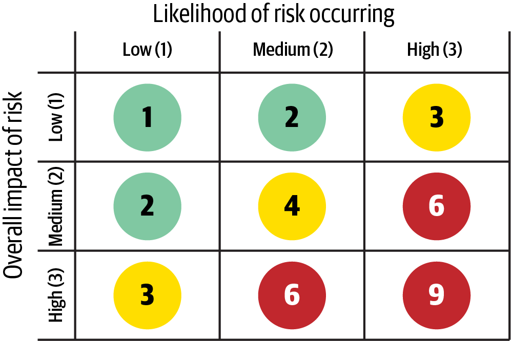

*图 20-1：确定架构风险的矩阵。*

矩阵中文转录如下，列为发生可能性，行为总体影响：

| 总体影响＼发生可能性 | 低（1） | 中（2） | 高（3） |
| --- | --- | --- | --- |
| 低（1） | 1：低风险 | 2：低风险 | 3：中风险 |
| 中（2） | 2：低风险 | 4：中风险 | 6：高风险 |
| 高（3） | 3：中风险 | 6：高风险 | 9：高风险 |

为说明如何使用风险矩阵，假设我们担心应用所用主要中央数据库的可用性。首先考虑影响维度：如果数据库停止运行或变得不可用，总体影响是什么？架构师可能将其影响判为高，因此风险值可能是 3，中风险；6，高风险；或者 9，高风险。不过，在应用第二个维度，也就是发生可能性后，架构师意识到，该数据库部署在采用集群配置的高可用服务器上，因此变得不可用的可能性较低。所以，高影响与低可能性的交点，给出了 3，也就是中风险的总体评级。

> 使用风险矩阵界定风险时，先考虑影响维度，再考虑可能性维度。

> 译注：原文称乘积为“客观数值”，这里保留。矩阵使评分方法一致，但影响和可能性的输入仍来自判断；数值不是经过统计验证的发生概率。

## 风险评估

上一节介绍的风险矩阵，可以用来创建所谓的风险评估。风险评估是一份汇总报告，根据某些具有背景意义的评估标准，概括架构的总体风险。

<!-- 书内第 299 页，PDF 第 319 页。 -->

风险评估的形式可以有很大差异，但通常会按照应用的服务或领域区域，列出某些评估标准下的风险，并用风险矩阵界定。图 20-2 展示了这种基本报告格式：浅灰色表示低风险 1–2，中灰色表示中风险 3–4，深灰色表示高风险 6–9。通常会用绿、黄、红分别表示低、中、高风险，但使用深浅阴影，有利于黑白呈现，也便于色觉障碍者阅读。

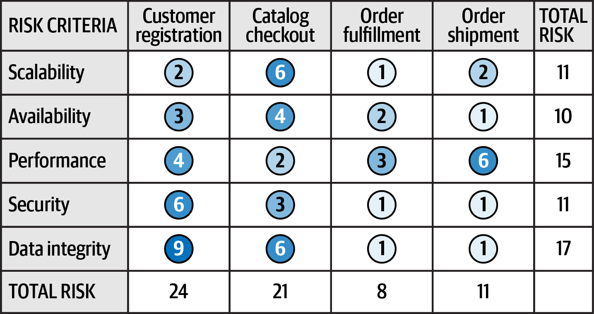

*图 20-2：标准风险评估示例。*

图中数据的中文转录如下：

| 风险标准 | 客户注册 | 目录结算 | 订单履行 | 订单发运 | 总风险 |
| --- | --- | --- | --- | --- | --- |
| 可扩展性 | 2 | 6 | 1 | 2 | 11 |
| 可用性 | 3 | 4 | 2 | 1 | 10 |
| 性能 | 4 | 2 | 3 | 6 | 15 |
| 安全性 | 6 | 3 | 1 | 1 | 11 |
| 数据完整性 | 9 | 6 | 1 | 1 | 17 |
| 总风险 | 24 | 21 | 8 | 11 | |

风险矩阵量化的风险，可以按风险标准汇总，也可以按服务或领域区域汇总。例如，注意图 20-2：数据完整性的累计风险最高，总计 17；可用性的累计风险只有 10，最低。示例风险评估也可以确定每个领域区域的相对风险。这里，客户注册的风险最高，订单履行最低。之后可以跟踪这些相对数字，展示某类风险或某个领域区域的风险是改善还是恶化。

虽然图 20-2 的风险评估包含所有分析结果，但实际呈现时很少直接这样展示。为了在特定背景下用视觉方式传达某条信息，筛选至关重要。例如，假设架构师参加会议，是为了介绍系统中的高风险区域。与其展示图 20-2，不如通过筛选只显示高风险区域，如图 20-3 所示，从而提高整体信噪比，清楚展示系统当前状态，无论好坏。

<!-- 书内第 300 页，PDF 第 320 页。 -->

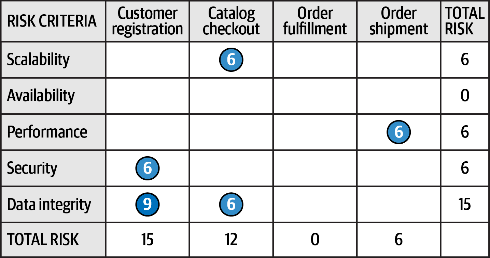

*图 20-3：筛选风险评估，只显示高风险。*

筛选后，原图保留以下值；空白表示被筛掉，不表示原始风险为零：

| 风险标准 | 客户注册 | 目录结算 | 订单履行 | 订单发运 | 总风险 |
| --- | --- | --- | --- | --- | --- |
| 可扩展性 | | 6 | | | 6 |
| 可用性 | | | | | 0 |
| 性能 | | | | 6 | 6 |
| 安全性 | 6 | | | | 6 |
| 数据完整性 | 9 | 6 | | | 15 |
| 总风险 | 15 | 12 | 0 | 6 | |

图 20-2 的另一个问题，是它只显示某个时点的快照，没有显示情况正在改善还是恶化。换句话说，它没有显示风险的变化方向。呈现风险方向存在一个问题：如果用向上或向下的箭头表示方向，向上箭头意味着什么？情况变好还是变差？多年来，我们一直问人们这个问题，近 50% 的人认为向上箭头表示越来越差，另近 50% 的人认为表示越来越好。向左与向右箭头也有同样的问题。因此，使用箭头表示方向时，必须提供图例。不过，我们发现，即使提供图例也不奏效：用户一旦滚动到看不到图例的位置，又会产生困惑。

我们通常在风险评分旁使用加号（+）和减号（−）这两个通用方向符号，表示变化方向，如图 20-4 所示。注意，客户注册的性能虽然是中风险 4，但方向是红色减号，表明它正在持续恶化，向高风险发展。另一方面，目录结算的可扩展性是高风险 6，却带有绿色加号，表明正在改善。没有加减号的评分，表示风险稳定，既没有改善，也没有恶化。

<!-- 书内第 301 页，PDF 第 321 页。 -->

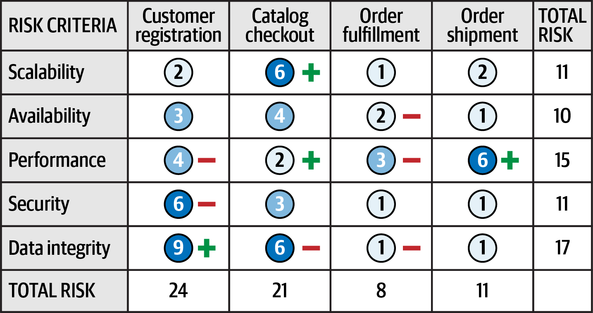

*图 20-4：用加减号表示风险方向。*

图中带方向的项目如下；其余值与图 20-2 相同：

| 风险标准／领域 | 当前值 | 方向 |
| --- | --- | --- |
| 可扩展性／目录结算 | 6 | +，改善 |
| 可用性／订单履行 | 2 | −，恶化 |
| 性能／客户注册 | 4 | −，恶化 |
| 性能／目录结算 | 2 | +，改善 |
| 性能／订单履行 | 3 | −，恶化 |
| 性能／订单发运 | 6 | +，改善 |
| 安全性／客户注册 | 6 | −，恶化 |
| 数据完整性／客户注册 | 9 | +，改善 |
| 数据完整性／目录结算 | 6 | −，恶化 |
| 数据完整性／订单履行 | 1 | −，恶化 |

有时，加减号仍会让一些人困惑。另一种表示方向的方法，是将箭头与风险正在趋向的评分数值结合起来。如图 20-5 所示，这种方法无须图例，因为方向很清楚。再加上颜色，红色箭头表示恶化，绿色表示改善，就能更清楚地展示风险走向。

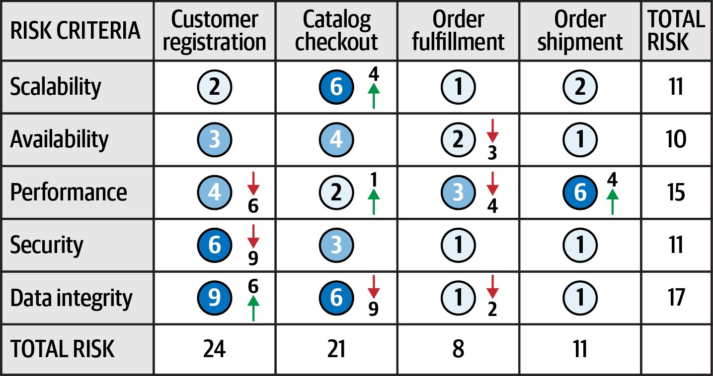

*图 20-5：用箭头与数值表示风险方向。*

图 20-5 中的变化趋势转录如下；其余项目稳定：

| 风险标准／领域 | 当前值 → 趋向值 |
| --- | --- |
| 可扩展性／目录结算 | 6 → 4，改善 |
| 可用性／订单履行 | 2 → 3，恶化 |
| 性能／客户注册 | 4 → 6，恶化 |
| 性能／目录结算 | 2 → 1，改善 |
| 性能／订单履行 | 3 → 4，恶化 |
| 性能／订单发运 | 6 → 4，改善 |
| 安全性／客户注册 | 6 → 9，恶化 |
| 数据完整性／客户注册 | 9 → 6，改善 |
| 数据完整性／目录结算 | 6 → 9，恶化 |
| 数据完整性／订单履行 | 1 → 2，恶化 |

<!-- 书内第 302 页，PDF 第 322 页。 -->

可以通过本书前面介绍的适应度函数进行持续测量，确定风险方向。通过客观分析每项风险标准，可以观察趋势，从而得到各项风险的变化方向。

## 风险风暴

没有架构师能独自确定一个系统的总体风险。原因有两个方面：单个架构师可能漏掉或忽视某个风险区域，而且很少有架构师完全了解系统的每个部分。风险风暴可以在这里发挥作用。

风险风暴是一种协作练习，用于确定特定维度的架构风险。常见维度，也就是风险领域，包括未经验证的技术、性能、可扩展性、可用性及其传递性依赖、数据丢失、单点故障和安全。虽然大多数风险风暴由多位架构师参与，但把资深开发者和技术负责人也纳入其中，是明智的做法。他们不仅能从实施角度看待架构风险，参与过程也能帮助开发者更好地理解架构。

风险风暴包括个人部分和协作部分。在个人部分，所有参与者独立工作，不进行协作，使用前面介绍的风险矩阵，对架构各区域评定风险。这个非协作部分至关重要，可以避免参与者相互影响，或者把注意力从某些架构区域移开。在协作部分，所有参与者一起对风险区域达成共识、讨论风险，并形成降低风险的方案。

风险风暴的两个部分都要使用架构图。整体风险评估通常使用全面的架构图，而针对应用特定区域的风险风暴，则使用相应上下文的架构图。组织风险风暴的架构师，有责任确保图是最新的，并且所有参与者都可以获得。

图 20-6 展示了一个用于说明风险风暴过程的示例架构。在这里，弹性负载均衡器位于各个 EC2 实例前方，实例包含 Web 服务器 Nginx 和应用服务。应用服务调用 MySQL 数据库、Redis 缓存，以及用于日志的 MongoDB 数据库。它们还调用推送扩展服务器；后者又都与 MySQL、Redis 和 MongoDB 日志设施交互。

<!-- 书内第 303 页，PDF 第 323 页。 -->

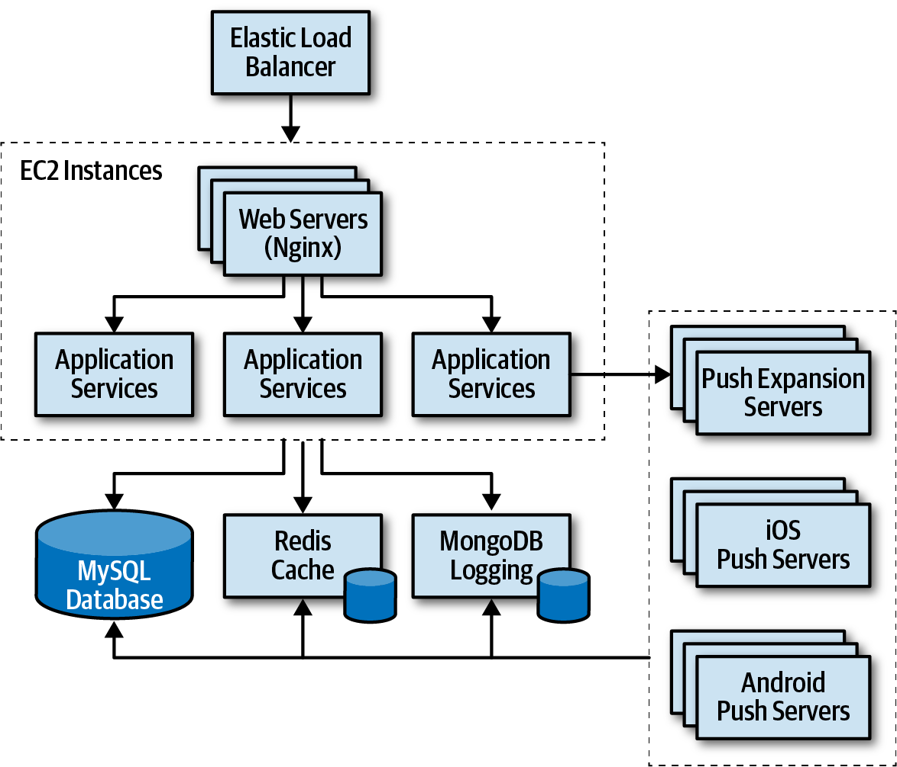

*图 20-6：风险风暴示例的架构图。*

风险风暴分为三项主要活动：

1. 识别。
2. 达成共识。
3. 缓解。

识别始终是个人独立完成、非协作的活动；共识和缓解则始终是协作活动，所有参与者要在同一房间内共同工作，至少也要在虚拟空间中聚在一起。接下来几节会详细讨论这三项活动。

### 识别

风险风暴的识别活动，是让每位参与者独立找出架构中的风险区域。步骤如下：

1. 组织风险风暴的架构师，在协作部分开始前一到两天向所有参与者发出邀请。邀请包含架构图或查找位置、本次要分析的风险维度、协作活动的日期和地点。

<!-- 书内第 304 页，PDF 第 324 页；上项跨页，已连读。 -->

2. 参与者使用本章第一节介绍的风险矩阵，独立分析架构，把风险分为低 1–2、中 3–4 或高 6–9。
3. 参与者准备对应颜色的小便利贴，绿、黄、红，并写下风险矩阵中对应的风险数值。

大多数风险风暴只分析某个特定维度，例如性能，但有时受人员或时间限制，可能在一次活动中分析多个维度，例如性能、可扩展性和数据丢失。这时，参与者会在便利贴上的风险数值旁写上维度，让每个人都知道具体指什么。例如，假设三位参与者都发现中央数据库有风险，都评为高风险 6，但一人发现的是可用性风险，另两人发现的是性能风险。这两个维度应分别讨论。

> 只要可能，就把一次风险风暴限制在单个维度。这让参与者能够专注于该维度，也能避免针对同一架构区域识别出多个风险领域时产生混淆。

### 达成共识

风险风暴中的共识活动具有很强的协作性，目标是让所有参与者对架构中的风险达成共识。如果有一张大幅打印的架构图贴在墙上，这项活动最有效。没有大幅纸质图时，也可以在大屏幕上显示电子版。

参与者来到风险风暴会议后，就把便利贴放到架构图上自己独立发现风险的位置。如果使用电子版，主持活动的架构师逐个询问参与者，并在图上相应的架构区域电子标注风险，参见图 20-7。

<!-- 书内第 305 页，PDF 第 325 页。 -->

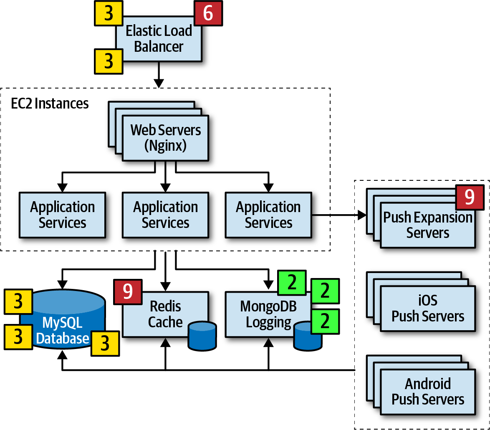

*图 20-7：风险区域的初始识别结果。*

所有便利贴放好后，协作部分就可以开始。这项活动的目标，是作为团队分析风险区域，并对风险界定达成共识。图 20-7 中识别出了几个风险区域：

1. 两位参与者独立将弹性负载均衡器识别为中风险 3，一位则识别为高风险 6。
2. 一位参与者独立将推送扩展服务器识别为高风险 9。
3. 三位参与者独立将 MySQL 数据库识别为中风险 3。
4. 一位参与者独立将 Redis 缓存识别为高风险 9。
5. 三位参与者将 MongoDB 日志识别为低风险 2。
6. 架构的所有其他区域都未被认为存在风险，因此没有便利贴。

<!-- 书内第 306 页，PDF 第 326 页。 -->

上面第 3、5 项不需要在此活动中进一步讨论，因为所有参与者都同意其风险级别与界定。不过，第 1 项意见不同，第 2、4 项只有一位参与者识别出风险，因此需要讨论。

第 1 项中，两位参与者独立将弹性负载均衡器评为中风险 3，一位评为高风险 6。这时，前两位会询问第三位，为什么认为风险高。假设第三位说，如果负载均衡器停止运行，整个系统都无法访问，所以风险高。虽然这一点没错，而且确实意味着总体影响较高，但另外两位说服他：这种情况发生的可能性很低。经过充分讨论，第三位同意了，把风险降为中风险 3。不过，前两位也可能没有看到第三位注意到的某项风险，因此这一阶段需要协作。

第 2 项就是这样的例子：一位参与者独立将推送扩展服务器识别为高风险 9，而其他人完全没有发现任何风险。这时，其他人询问原因。该参与者解释，过去曾多次遇到这些服务器在高负载下不断停止运行的情况，而当前架构恰好就有高负载。这体现了风险风暴的价值：没有他的参与，就不会有人看到这项高风险，当然，直到系统已经在生产环境中运行相当一段时间为止！

第 4 项也很有意思。一位参与者将 Redis 缓存识别为高风险 9，而其他人完全没有发现它有风险。大家问为什么，他回答：“Redis 缓存是什么？”在这个例子中，Redis 对该参与者而言是未知技术，所以被认为具有高风险。

> 对未经验证或未知的技术，始终赋予最高风险评分 9，因为风险矩阵无法用于这一维度。

第 4 项说明，把开发者纳入风险风暴既明智又重要。开发者不仅能更了解架构，而且，一位参与者，在这里是一名团队开发者，不了解某项技术这一事实，本身也向架构师提供了关于总体风险的有价值信息。

<!-- 书内第 307 页，PDF 第 327 页。 -->

这一过程会持续到所有参与者都同意识别出的风险区域。所有便利贴合并完成后，这项活动结束，下一项活动就可以开始。图 20-8 展示了最终结果。

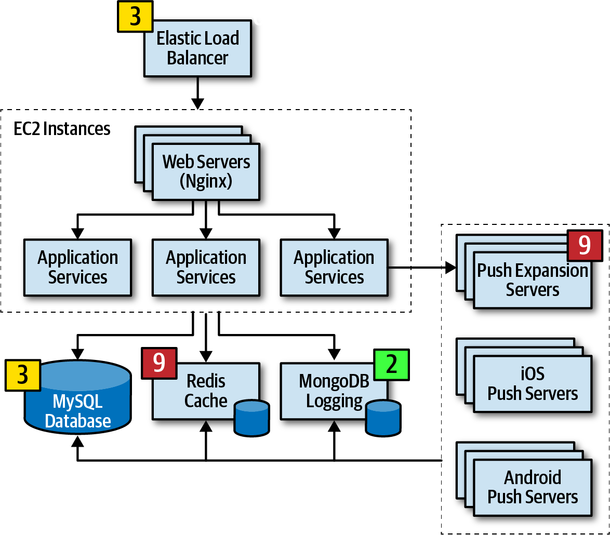

*图 20-8：对风险区域达成共识。*

### 缓解

所有参与者对架构风险区域的界定达成一致后，最后也是最重要的活动就开始了：风险缓解。缓解架构中的风险，通常需要修改或增强某些区域，而这些区域原本可能被认为已经完美无缺。

这项活动通常也通过协作进行，寻找降低或消除第一项活动所发现风险的方法。有时，风险识别的结果可能要求彻底改变原有架构；有时则只是直接的架构重构，例如增加一个用于背压的队列，以降低吞吐量瓶颈问题。

无论架构需要怎样改变，这项活动通常都会增加成本。因此，关键利益相关者通常要决定成本是否高于风险。例如，假设风险风暴将中央数据库在整体系统可用性方面评为中风险 4。参与者一致认为，对数据库建立集群，同时把单一数据库拆成不同的物理数据库，可以缓解风险。

<!-- 书内第 308 页，PDF 第 328 页；上段跨页，已连读。 -->

不过，虽然风险会显著降低，这个方案要花 20,000 美元。于是，架构师与关键业务利益相关者开会讨论这一权衡。在协商中，业务负责人认为价格过高，成本不值得承担。架构师没有放弃，而是提出另一种方法：不做集群，只把数据库拆成两部分，怎么样？这样，成本降为 8,000 美元，同时仍能缓解大部分风险。于是，利益相关者同意了这个方案。

这一场景展示了风险风暴不仅能影响整体架构，还能影响架构师与业务利益相关者的协商。将风险风暴与本章开头介绍的风险评估结合起来，为识别和跟踪风险、改进架构，以及关键利益相关者之间的协商，提供了很好的手段。

### 敏捷用户故事风险分析

除架构外，风险风暴也可用于软件开发的其他方面。例如，我们曾在用户故事梳理期间，利用它判断某个敏捷迭代中用户故事能否完成的总体风险，进而形成该迭代的总体风险评估。使用风险矩阵，第一个维度是如果故事未能在迭代内完成，会产生怎样的总体影响；第二个维度是故事无法完成的可能性。把同一个架构风险矩阵用于用户故事，团队可以识别高风险故事，仔细跟踪，并为它们安排优先级。

## 风险风暴示例

为展示风险风暴的力量，以及它如何改进系统整体架构，考虑一个呼叫中心系统，用来支持护士针对各种健康状况向患者提供建议。系统需求如下：

- 使用第三方诊断引擎，提供问题，并针对医疗问题指导护士或患者。
- 患者既可以呼入呼叫中心与护士交谈，也可以使用自助网站，绕过护士直接访问诊断引擎。
- 系统必须支持全国 250 名并发护士，以及全国最多数十万名并发自助患者。

<!-- 书内第 309 页，PDF 第 329 页。 -->

- 护士可以通过病历交换系统访问患者病历，但患者不能访问自己的病历。
- 病历相关处理必须符合 HIPAA。也就是说，必须确保只有护士能够访问病历。
- 系统需要应对疾病暴发，以及感冒和流感季节的高流量。
- 根据护士档案，例如双语需求，将来电路由给护士。
- 第三方诊断引擎每秒大约能处理 500 个请求。

> 译注：上述病历访问规则及其与 HIPAA 的对应关系，是原书案例需求的表述，按原文保留；它不是对实际法规或患者权利的准确性核验，也不是医疗服务建议。

系统架构师创建了图 20-9 所示的高层架构。其中有三个独立的 Web 用户界面：一个用于自助，一个供接听电话的护士使用，一个供管理人员新增和维护护士档案及配置设置。系统的呼叫中心部分包括接收来电的呼叫接收器，以及根据护士档案将来电路由给下一位可用护士的呼叫路由器。注意，呼叫路由器访问中央数据库以获取护士档案信息。这种架构的核心是诊断系统 API 网关，它执行安全检查，并将请求导向适当的后端服务。

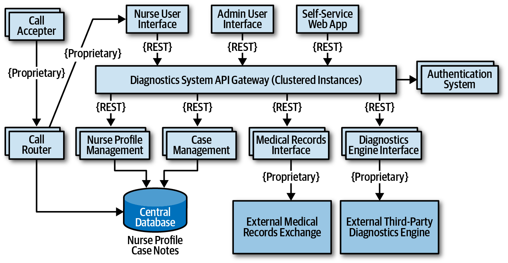

*图 20-9：护士诊断系统示例的高层架构。*

系统包含四项主要服务：个案管理服务、护士档案管理服务、病历交换接口，以及外部第三方诊断引擎。除了外部系统和呼叫中心服务使用专有协议之外，所有通信都使用 REST。

<!-- 书内第 310 页，PDF 第 330 页。 -->

架构师已经多次评审这一架构，认为它已经可以实施。作为自我评估，请研究需求和图 20-9，尝试确定这种架构在可用性、弹性和安全方面的风险程度。确定之后，再思考需要怎样修改架构，才能缓解这些风险。接下来的各节提供了一些场景，可以用来对照。

### 可用性

第一次风险风暴中，架构师选择先关注可用性，因为系统可用性对成功至关重要。经过识别与协作活动，参与者使用风险矩阵，得到如下风险区域，如图 20-10 所示：

- 使用中央数据库被识别为高风险 6，由高影响 3 与中等可能性 2 相乘得到。
- 诊断引擎的可用性被识别为高风险 9，由高影响 3 与未知可能性 3 相乘得到。
- 病历交换系统的可用性被识别为低风险 2，因为它不是系统运行所必需的组件。
- 由于每个服务有多个实例，而且 API 网关采用集群，系统其他部分未被认为存在可用性风险。

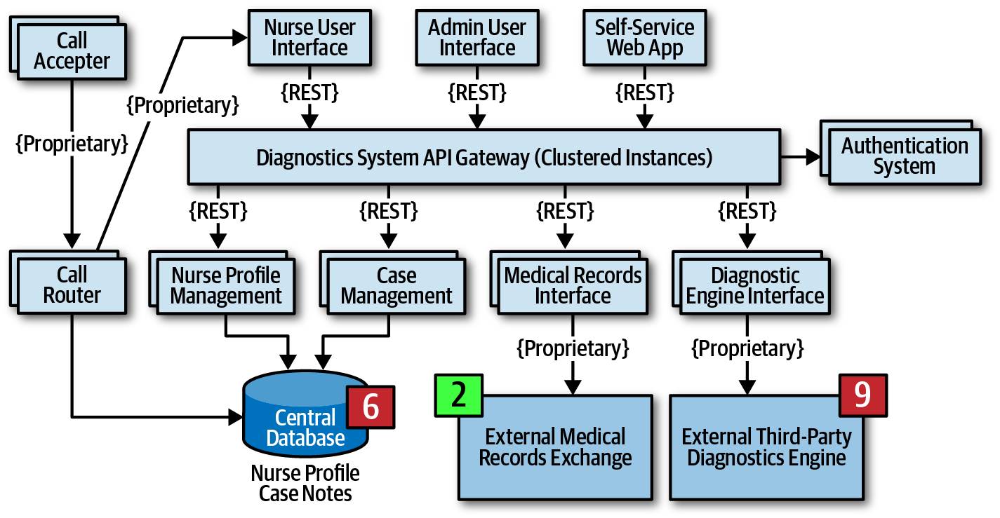

*图 20-10：可用性风险区域。*

在风险风暴中，所有参与者都同意：数据库停止运行时，护士可以手写个案笔记，但呼叫路由器在数据库不可用时无法工作。

<!-- 书内第 311 页，PDF 第 331 页；上段跨页，已连读。 -->

为缓解数据库风险，参与者选择把单一物理数据库拆成两个独立数据库：一个集群数据库保存护士档案信息，另一个单实例数据库保存个案笔记。这项架构变更不仅解决了数据库可用性的担忧，也有助于保护个案笔记，防止管理人员访问。另一种缓解方法，是在呼叫路由器中缓存护士档案信息。不过，由于呼叫路由器的实现未知，而且可能是第三方产品，参与者选择了数据库方案。

缓解外部系统，也就是诊断引擎和病历交换系统的可用性风险，要困难得多，因为无法控制这些系统。一种方法，是调查各系统是否有公开的服务级别协议（SLA）或服务级别目标（SLO）。SLA 通常是具有法律约束力的合同协议，而 SLO 通常不是。经过调查，架构师发现，诊断引擎 SLA 保证 99.99% 的可用性，相当于每年停机 52.60 分钟；病历交换系统保证 99.9% 的可用性，相当于每年停机 8.77 小时。基于相对风险，这些信息足以消除已识别的风险。

这次风险风暴后的架构修改如图 20-11 所示。注意，现在使用了两个数据库，架构图上也标出了 SLA。

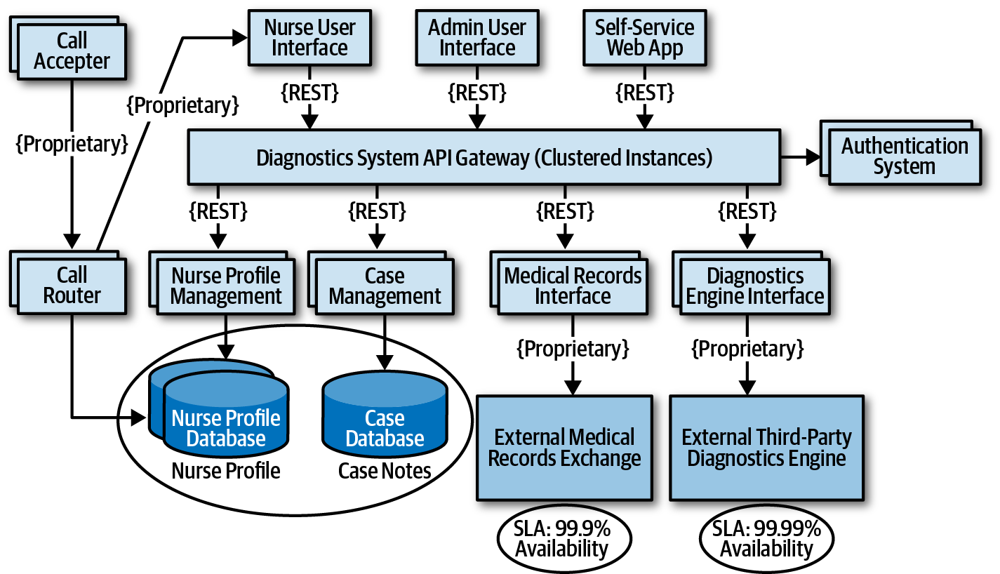

*图 20-11：为应对可用性风险所做的架构修改。*

> 译注：本段 SLA 的约束性质、保障值和“消除风险”均为原书示例叙述。SLA 数值与实际故障行为并非同一件事；这里未核验具体合同。停机时长是原书按全年时长换算的近似值，予以保留。

<!-- 书内第 312 页，PDF 第 332 页。 -->

### 弹性

第二次风险风暴中，架构师选择关注弹性，也就是用户负载突增，亦称可变的可扩展性。虽然只有 250 名护士，为大多数服务天然设定了上限，但自助用户也会像护士一样访问诊断引擎，显著增加诊断接口的请求数量。参与者担心疾病暴发和流感季节，因为预期系统负载会显著增加。

在风险风暴中，参与者都将诊断引擎接口识别为高风险 9。引擎每秒只能处理 500 个请求，大家计算后认为，它无法跟上预期吞吐量，尤其当前架构还采用 REST 作为接口协议。

一种缓解方法，是在 API 网关与诊断引擎接口之间使用异步队列，也就是消息机制，在调用积压时提供背压点。虽然这是好做法，但仍不能缓解风险，因为护士和自助患者等待诊断引擎响应的时间太长，请求很可能超时。使用所谓救护车模式（Ambulance Pattern），可以让护士拥有高于自助用户的优先级，因此需要两条消息通道。这种技术有助于缓解风险，但仍没有解决等待时间。参与者决定，除了使用队列提供背压，还要缓存与某次疾病暴发有关的特定诊断问题，使疾病暴发和流感相关的调用不必到达诊断引擎接口。

相应架构修改如图 20-12 所示。注意，除了两条队列通道，一条给护士，一条给自助患者，还新增了“诊断暴发缓存服务器”（Diagnostics Outbreak Cache Server）服务，处理与某次疾病暴发或流感问题有关的全部请求。采用这种架构后，限制因素，也就是对诊断引擎的调用，被移除了，从而允许数万个并发请求。如果没有风险风暴，这项风险可能直到疾病暴发或流感季节来临才被发现。

<!-- 书内第 313 页，PDF 第 333 页。 -->

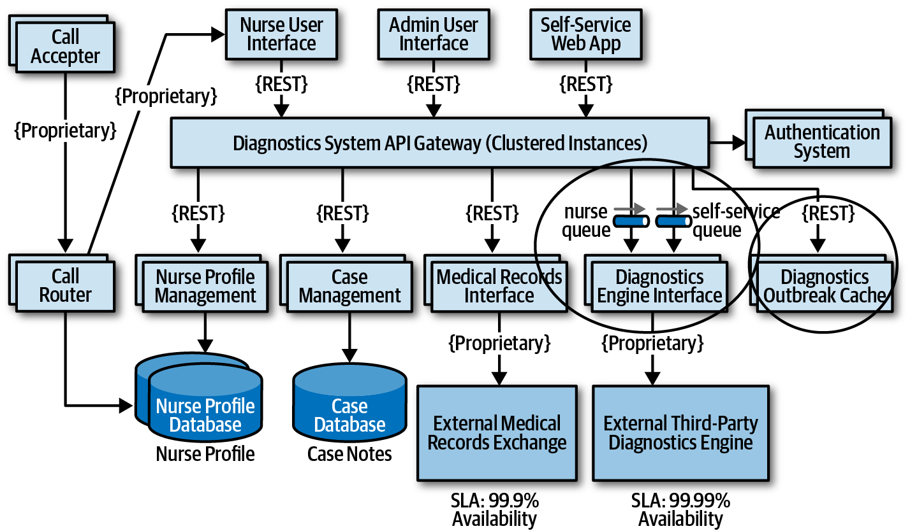

*图 20-12：为应对弹性风险所做的架构修改。*

### 安全

前两次风险风暴的结果与成功，鼓励架构师再举行最后一次活动，分析系统成功所必须支持的另一项重要架构特性：安全。由于 HIPAA 监管要求，经病历交换接口访问病历必须安全，只允许护士在需要时访问。架构师认为，API 网关提供身份认证和授权，因此这不是问题，但仍想知道参与者是否会发现其他安全风险。

风险风暴中，参与者都将诊断系统 API 网关识别为高安全风险 6。依据是：管理人员或自助患者访问病历的影响高 3，发生可能性中等 2。由于每次 API 调用都要经过安全检查，发生可能性没有评为高；但所有自助、管理和护士调用都经过同一个网关，因此仍评为中。架构师原本只评为低风险 2，在共识活动中被说服，认识到风险确实高，需要缓解。

<!-- 书内第 314 页，PDF 第 334 页。 -->

参与者一致认为，为每类用户分别设置 API 网关，即管理、自助／诊断和护士，可以防止管理 Web 界面或自助 Web 界面的调用到达病历交换接口。架构师同意，形成了图 20-13 所示的最终架构。

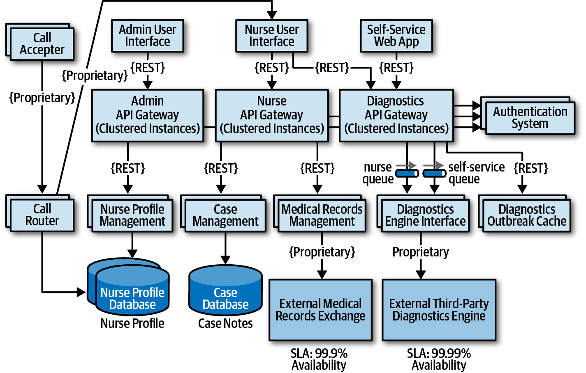

*图 20-13：为应对安全风险所做的最终架构修改。*

这个场景展示了风险风暴的力量。围绕对系统成功至关重要的风险维度，与其他架构师、开发者和关键利益相关者协作，可以识别原本会被忽视的风险区域。比较图 20-9 和图 20-13，注意活动前后架构的显著差异。这些重要变化，处理了架构中的可用性、弹性和安全问题。

风险风暴不是一次性过程，而是在系统整个生命周期中持续进行，在风险发生于生产环境之前发现并缓解它们。开展频率取决于许多因素，包括变更频率、架构重构工作，以及架构的渐进式开发。通常，在增加重大功能后，或在每次迭代结束时，会针对某个特定维度开展风险风暴。

---

## 图中文字中文对照（译者整理）

| 图号 | 英文标签 → 中文 |
| --- | --- |
| 图 20-1 | Likelihood of risk occurring → 风险发生可能性；Overall impact of risk → 风险总体影响；Low / Medium / High → 低 / 中 / 高；数值矩阵见正文 |
| 图 20-2 | Risk criteria → 风险标准；Customer registration → 客户注册；Catalog checkout → 目录结算；Order fulfillment → 订单履行；Order shipment → 订单发运；Total risk → 总风险；Scalability / Availability / Performance / Security / Data integrity → 可扩展性 / 可用性 / 性能 / 安全性 / 数据完整性；数值见正文 |
| 图 20-3 | 标签同图 20-2；仅显示高风险项，筛选后数据见正文 |
| 图 20-4 | 标签同图 20-2；+ 表示改善，− 表示恶化，变化项目见正文 |
| 图 20-5 | 标签同图 20-2；箭头旁数字表示趋向的风险值，完整趋势见正文 |
| 图 20-6 | Elastic Load Balancer → 弹性负载均衡器；EC2 Instances → EC2 实例；Web Servers (Nginx) → Web 服务器（Nginx）；Application Services → 应用服务；Push Expansion Servers → 推送扩展服务器；iOS / Android Push Servers → iOS / Android 推送服务器；MySQL Database → MySQL 数据库；Redis Cache → Redis 缓存；MongoDB Logging → MongoDB 日志 |
| 图 20-7 | 标签同图 20-6；便利贴数值为各参与者的独立风险评分，详见正文六项清单 |
| 图 20-8 | 标签同图 20-6；共识评分：负载均衡器 3、扩展服务器 9、MySQL 3、Redis 9、MongoDB 2 |
| 图 20-9 | Call Accepter → 呼叫接收器；Call Router → 呼叫路由器；Nurse User Interface → 护士用户界面；Admin User Interface → 管理用户界面；Self-Service Web App → 自助 Web 应用；Diagnostics System API Gateway (Clustered Instances) → 诊断系统 API 网关（集群实例）；Authentication System → 身份认证系统；Nurse Profile Management → 护士档案管理；Case Management → 个案管理；Medical Records Interface → 病历接口；Diagnostics Engine Interface → 诊断引擎接口；Central Database → 中央数据库；Nurse Profile → 护士档案；Case Notes → 个案笔记；External Medical Records Exchange → 外部病历交换系统；External Third-Party Diagnostics Engine → 外部第三方诊断引擎；Proprietary → 专有协议；REST 保留原词 |
| 图 20-10 | 标签同图 20-9；数据库 6、病历交换系统 2、诊断引擎 9，为可用性风险评分 |
| 图 20-11 | Nurse Profile Database → 护士档案数据库；Case Database → 个案数据库；SLA: 99.9% / 99.99% Availability → SLA：99.9% / 99.99% 可用性；其余标签同图 20-9 |
| 图 20-12 | nurse queue → 护士队列；self-service queue → 自助队列；Diagnostics Outbreak Cache → 诊断暴发缓存；其余标签同图 20-9、20-11 |
| 图 20-13 | Admin / Nurse / Diagnostics API Gateway (Clustered Instances) → 管理 / 护士 / 诊断 API 网关（集群实例）；Medical Records Management → 病历管理；其余标签同图 20-9、20-11、20-12 |

> 译注：图 20-13 的病历组件标签由前图的 Medical Records Interface 变为 Medical Records Management，按原图分别保留；正文仍以交换接口描述其作用。案例中的排队、缓存与网关拆分是作者的风险缓解示例，不是对任意实际诊断系统的完整设计保证。
