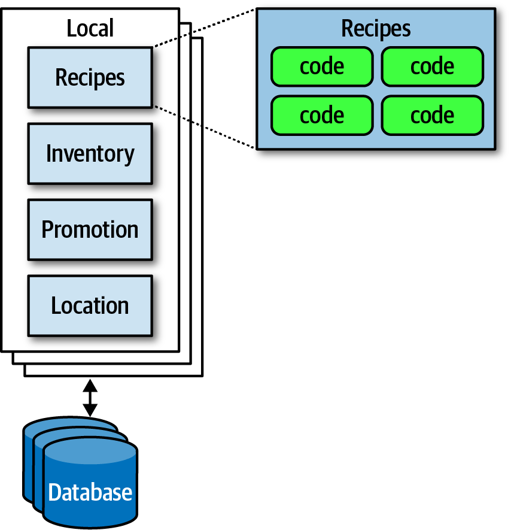
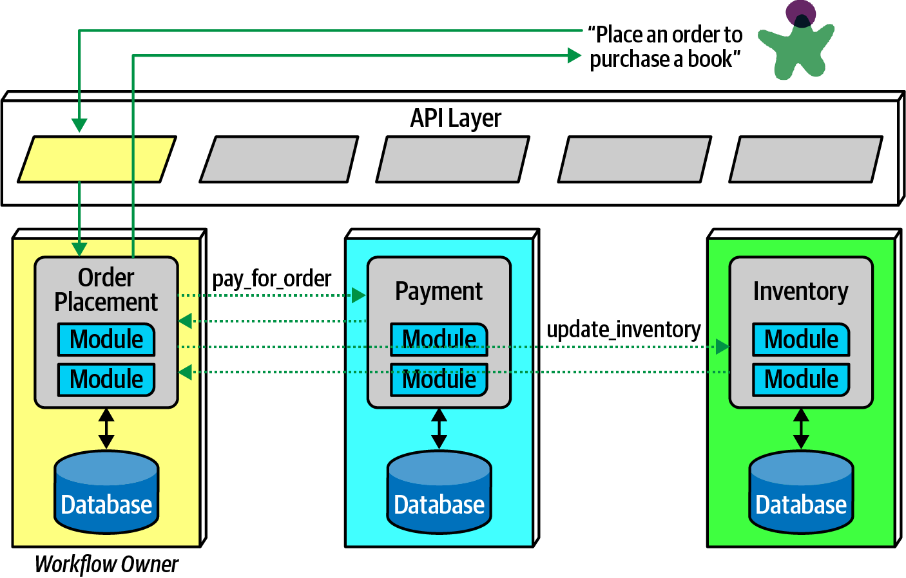
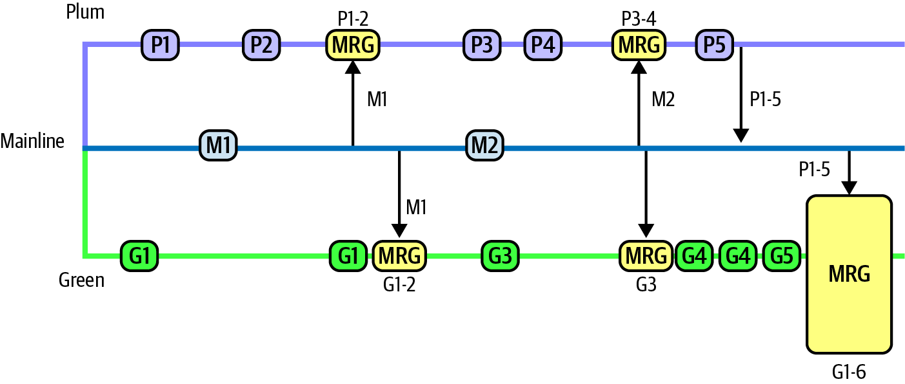
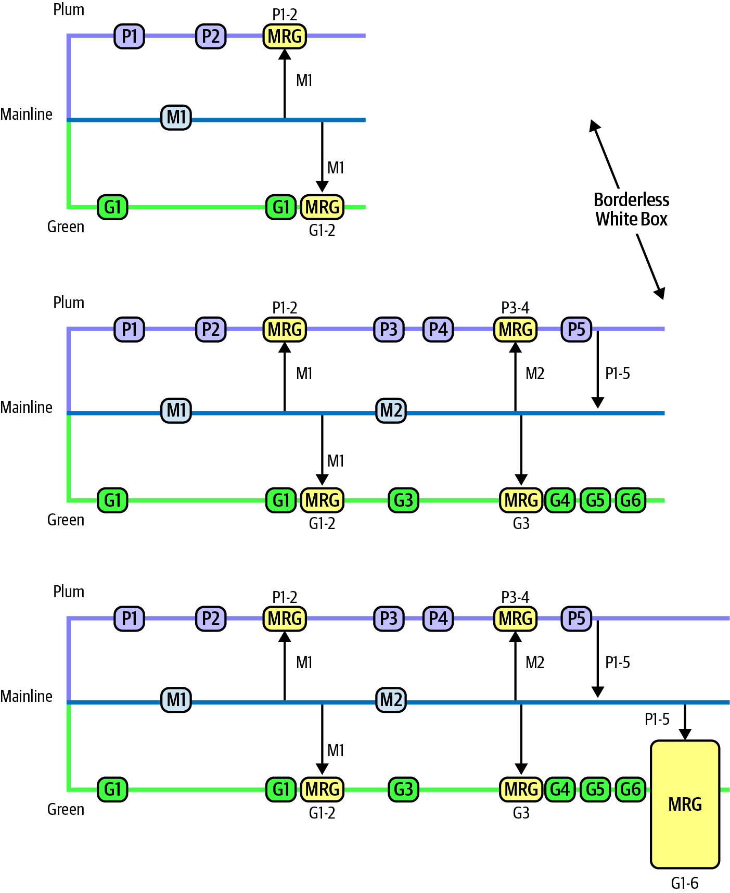

<!-- CH21-001 | PDF p. 335 | 标题 -->
# 第 21 章 绘制与展示架构

> 原文章名：Diagramming and Presenting Architecture
> 来源：英文第一版，书内第 315–324 页，PDF 第 335–344 页。
> 进度：本轮逐段质量校译完成；详见 [校译记录](../../reviews/chapter-21-review.md)。
> 保留英文原图，中文标签对照见文末；下文页码均指原书书内页码。

<!-- 书内第 315 页，PDF 第 335 页。 -->

<!-- CH21-002 | PDF p. 335 | 正文 -->
新任架构师经常感叹，除了让自己最初得以转任架构师的技术知识与经验，这份工作的内容竟然如此多样。尤其是，有效沟通对架构师的成功变得至关重要。无论技术想法多么出色，如果不能说服管理者出资、开发者实现，这些才华就永远无法体现。

<!-- CH21-003 | PDF p. 335 | 正文 -->
绘制与展示架构，是架构师的两项关键软技能。虽然这两个主题各自都有整本书专门讨论，我们仍会分别介绍一些重点。

<!-- CH21-004 | PDF p. 335 | 正文 -->
这两个主题放在一起，是因为它们有一些相似特征：都通过不同媒介，对架构愿景进行重要的视觉呈现。不过，表现一致性（representational consistency）这个概念把两者联系了起来。

<!-- CH21-005 | PDF p. 335 | 正文 -->
用视觉方式描述架构时，创作者通常必须展示不同视图。例如，架构师很可能先概览整个架构拓扑，再深入某个部分，探讨设计细节。但如果展示局部时，没有指出它在整体架构中的位置，就会让观众困惑。表现一致性，是指无论在图中还是演示中，在切换视图前，始终交代架构各部分之间的关系。

<!-- CH21-006 | PDF p. 335 | 正文 -->
例如，如果架构师想描述 Silicon Sandwiches 方案中的插件如何相互关联，就应先展示整个拓扑，再深入插件结构，让观众看到它们之间的关系。图 21-1 展示了一个例子。

<!-- 书内第 316 页，PDF 第 336 页。 -->

<!-- CH21-007 | PDF p. 336 | 图表 -->

<!-- CH21-008 | PDF p. 336 | 图表 -->
*图 21-1：用表现一致性说明局部在更大图中的背景。*

<!-- CH21-009 | PDF p. 336 | 正文 -->
谨慎保持表现一致性，可以确保观众理解所展示内容的范围，消除一种常见的困惑来源。

<!-- CH21-010 | PDF p. 336 | 标题 -->
## 绘图

<!-- CH21-011 | PDF p. 336 | 正文 -->
架构拓扑始终是架构师和开发者关注的内容，因为它捕捉结构如何组合在一起，并在整个团队中形成有价值的共同理解。因此，架构师应该把绘图技能磨练得十分娴熟。

<!-- CH21-012 | PDF p. 336 | 标题 -->
### 工具

<!-- CH21-013 | PDF p. 336 | 正文 -->
当前这一代架构绘图工具非常强大，架构师应该深入学习自己选择的工具。不过，在使用精良工具之前，不要忽视低保真制品，尤其在设计早期。早期创建非常临时性的设计制品，可以防止架构师过度依恋自己的产物；我们把这种反模式称为“不理性的制品依恋”（Irrational Artifact Attachment）。

<!-- 书内第 317 页，PDF 第 337 页。 -->

<!-- CH21-014 | PDF p. 337 | 标题 -->
#### 不理性的制品依恋

<!-- CH21-015 | PDF p. 337 | 正文 -->
它指一个人对某件制品的不理性依恋程度，与制作它耗费的时间成正比。如果架构师花两小时，用 Visio 等工具做出一张漂亮的图，就会对它产生大体与投入时间成比例的不理性依恋；这也意味着，花四小时制作的图，会比花两小时制作的图更让人难以舍弃。

<!-- CH21-016 | PDF p. 337 | 正文 -->
敏捷软件开发采用低仪式感方式，其好处之一，是以尽可能少的仪式，及时创建所需制品。这也有助于解释为什么许多敏捷实践者钟爱索引卡和便利贴。使用低技术门槛的工具，团队成员就能舍弃不合适的内容、自由试验，并通过修改、协作和讨论逐步摸索出合适的制品形态。

<!-- CH21-017 | PDF p. 337 | 正文 -->
有一种架构师喜欢的做法，是对“用手机拍白板，再不可避免地写上‘请勿擦除！’”的变体：不用白板，而用连接投影设备的平板电脑。它有几项优势。首先，平板具有无限画布，可以容纳团队所需的所有图。其次，它允许通过复制、粘贴探索“如果……会怎样”，而在白板上这样做可能会弄乱原图。第三，平板捕获的图像已经数字化，也没有手机拍白板时难免出现的反光。

<!-- CH21-018 | PDF p. 337 | 正文 -->
最终，架构师确实需要用精良工具制作漂亮的图，但要先确保团队已经充分迭代设计，值得投入时间把内容记录下来。

<!-- CH21-019 | PDF p. 337 | 正文 -->
各种平台上都有强大的绘图工具。我们不特别主张某一种优于另一种，本书所有图都使用 OmniGraffle 绘制，我们用得很满意；不过，架构师至少应该寻找以下基本功能：

<!-- CH21-020 | PDF p. 337 | 正文 -->
**图层**

<!-- CH21-021 | PDF p. 337 | 正文 -->
绘图工具通常支持图层，架构师应该熟练掌握。图层让绘图者能够把一组元素在逻辑上关联起来，并分别隐藏或显示。这样，架构师可以建立全面的图，而在不需要时隐藏令人难以消化的细节。图层还允许以后为演示逐步构建图像，参见第 322 页“渐进呈现”。

<!-- CH21-022 | PDF p. 337 | 正文 -->
**图形库／模板**

<!-- CH21-023 | PDF p. 337 | 正文 -->
图形库让架构师积累常用视觉组件，通常由其他基本形状组合而成。例如，读者在本书中见过的微服务等标准图形，在作者的图形库中只是一个单独条目。为组织中的常见模式和制品建立图形库，可以使架构图保持一致，并让架构师快速构建新图。

<!-- 书内第 318 页，PDF 第 338 页；上段跨页，已连读。 -->

<!-- CH21-024 | PDF p. 338 | 正文 -->
**吸附点**

<!-- CH21-025 | PDF p. 338 | 正文 -->
许多绘图工具会帮助连接图形之间的线。吸附点（magnets）就是图形上供线条自动吸附连接的位置，提供自动对齐及其他视觉便利。有些工具允许增加吸附点，或自行创建，以定制图中的连接外观。

<!-- CH21-026 | PDF p. 338 | 正文 -->
除这些有帮助的具体功能外，工具当然还应该支持线条、颜色和其他视觉元素，并能导出多种格式。

<!-- CH21-027 | PDF p. 338 | 标题 -->
### 绘图标准：UML、C4 与 ArchiMate

<!-- CH21-028 | PDF p. 338 | 正文 -->
软件技术图有几种正式标准。

<!-- CH21-029 | PDF p. 338 | 标题 -->
#### UML

<!-- CH21-030 | PDF p. 338 | 正文 -->
统一建模语言（Unified Modeling Language，UML）曾是一项标准，用来统一 20 世纪 80 年代并存的三种相互竞争的设计理念。它原本希望集各家之长，但像许多委员会设计的东西一样，除了强制使用它的组织之外，并未产生太大影响。

<!-- CH21-031 | PDF p. 338 | 正文 -->
架构师和开发者仍会使用 UML 类图和时序图来交流结构与工作流，但多数其他 UML 图类型已经很少使用。

<!-- CH21-032 | PDF p. 338 | 标题 -->
#### C4

<!-- CH21-033 | PDF p. 338 | 正文 -->
C4 是 Simon Brown 开发的一种绘图方法，用来解决 UML 的不足，并使其方法适应现代需求。C4 的四个 C 如下：

<!-- CH21-034 | PDF p. 338 | 正文 -->
**上下文（Context）**

<!-- CH21-035 | PDF p. 338 | 正文 -->
表示系统的完整上下文，包括用户角色和外部依赖。

<!-- CH21-036 | PDF p. 338 | 正文 -->
**容器（Container）**

<!-- CH21-037 | PDF p. 338 | 正文 -->
架构中的物理部署边界和容器，往往也是逻辑边界。这一视图为运维和架构师提供了很好的共同讨论点。

<!-- CH21-038 | PDF p. 338 | 正文 -->
**组件（Component）**

<!-- CH21-039 | PDF p. 338 | 正文 -->
系统的组件视图，与架构师看待系统的方式最吻合。

<!-- 书内第 319 页，PDF 第 339 页。 -->

<!-- CH21-040 | PDF p. 339 | 正文 -->
**类（Class）**

<!-- CH21-041 | PDF p. 339 | 正文 -->
C4 使用与 UML 相同风格的类图。类图有效，因此没有必要替换。

<!-- CH21-042 | PDF p. 339 | 正文 -->
如果公司希望统一绘图方法，C4 提供了一个不错的选择。不过，像所有技术绘图工具一样，它无法表达架构可能涉及的每一种设计。C4 最适合容器与组件关系可能不同的单体架构，对微服务这样的分布式架构则不那么适合。

<!-- CH21-043 | PDF p. 339 | 译注 -->
> 译注：本节的 Class，以及 C4 更适合单体、较不适合分布式架构的判断，均按本书原文保留；本次未核验当前 C4 定义或适用性，不把这段历史描述改写成现行规范。

<!-- CH21-044 | PDF p. 339 | 标题 -->
#### ArchiMate

<!-- CH21-045 | PDF p. 339 | 正文 -->
ArchiMate 的名称由 Architecture 与 Animate 拼合而成，是一种开源企业架构建模语言，支持在业务领域内部及跨领域描述、分析和可视化架构。它是 The Open Group 的技术标准，为企业生态系统提供较轻量的建模语言。其目标是“尽可能小”，而非覆盖每一种边缘场景。因此，它已成为许多架构师喜爱的选择。

<!-- CH21-046 | PDF p. 339 | 标题 -->
### 绘图指导原则

<!-- CH21-047 | PDF p. 339 | 正文 -->
无论架构师使用自己的建模语言，还是正式语言之一，都应该形成自己的绘图风格，并自由借鉴那些特别有效的表达方式。以下是创建技术图时可采用的一般指导原则。

<!-- CH21-048 | PDF p. 339 | 标题 -->
#### 标题

<!-- CH21-049 | PDF p. 339 | 正文 -->
确保图中所有元素都有标题，或已经为观众熟知。通过旋转等效果，让标题紧贴所关联的对象，并高效利用空间。

<!-- CH21-050 | PDF p. 339 | 标题 -->
#### 线条

<!-- CH21-051 | PDF p. 339 | 正文 -->
线条应该足够粗，便于看清。如果表示信息流，就用箭头标明方向或双向流动。不同箭头形状可以暗示不同语义，但架构师应该保持一致。

<!-- CH21-052 | PDF p. 339 | 正文 -->
一般而言，架构图中少数存在的惯例之一，是实线通常表示同步通信，虚线表示异步通信。

<!-- 书内第 320 页，PDF 第 340 页。 -->

<!-- CH21-053 | PDF p. 340 | 标题 -->
#### 形状

<!-- CH21-054 | PDF p. 340 | 正文 -->
虽然上述正式建模语言各有标准形状，但整个软件开发世界并不存在普遍通行的标准形状。因此，每位架构师通常都会形成自己的标准形状集合，有时还会推广到整个组织，建立标准语言。

<!-- CH21-055 | PDF p. 340 | 正文 -->
我们通常用三维盒子表示可部署制品，用矩形表示包含关系，除此之外并没有特定的图例规则。

<!-- CH21-056 | PDF p. 340 | 标题 -->
#### 标签

<!-- CH21-057 | PDF p. 340 | 正文 -->
架构师应该给图中每一项添加标签，尤其是在读者可能产生歧义时。

<!-- CH21-058 | PDF p. 340 | 标题 -->
#### 颜色

<!-- CH21-059 | PDF p. 340 | 正文 -->
架构师往往没有充分使用颜色。多年来，书籍出于现实需要采用黑白印刷，架构师和开发者因而习惯了单色图。虽然我们仍偏好单色，但当颜色有助于区分制品时，就会使用它。例如，第 254 页“通信”一节讨论微服务通信策略时，我们用颜色说明参与协调的是不同微服务，而非同一服务的两个实例；图 21-2 再现了这个例子。

<!-- CH21-060 | PDF p. 340 | 图表 -->

<!-- CH21-061 | PDF p. 340 | 图表 -->
*图 21-2：再次展示微服务通信示例，用不同颜色表示不同服务。*

<!-- 书内第 321 页，PDF 第 341 页。 -->

<!-- CH21-062 | PDF p. 341 | 标题 -->
#### 图例

<!-- CH21-063 | PDF p. 341 | 正文 -->
如果形状因任何原因可能产生歧义，就在图上提供图例，清楚说明每种形状代表什么。没有什么比导致误解的图更糟，它甚至比没有图还糟。

<!-- CH21-064 | PDF p. 341 | 标题 -->
## 演示

<!-- CH21-065 | PDF p. 341 | 正文 -->
现代架构师需要的另一项软技能，是使用 PowerPoint、Keynote 等工具进行有效演示。这些工具是现代组织的通用语言，组织各处的人都期待使用者熟练掌握。不幸的是，与文字处理和电子表格工具不同，人们似乎很少花时间研究如何用好演示工具。

<!-- CH21-066 | PDF p. 341 | 正文 -->
本书作者之一 Neal 几年前写过一本名为 [*Presentation Patterns*](https://presentationpatterns.com)（Addison-Wesley Professional）的书，将软件世界常见的模式／反模式方法应用到技术演示中。

<!-- CH21-067 | PDF p. 341 | 正文 -->
*Presentation Patterns* 对通过文档或演示论证某件事的根本差异，提出了一个重要观察：时间。在演示中，演讲者控制一个想法展开的速度；在文档中，则由读者控制。因此，架构师可以从演示工具中学到的最重要技能之一，是如何操控时间。

<!-- CH21-068 | PDF p. 341 | 标题 -->
### 操控时间

<!-- CH21-069 | PDF p. 341 | 正文 -->
演示工具提供两种操控幻灯片时间的方式：转场和动画。转场用于从一页移到另一页，动画则允许设计者在单页内部创建运动。通常，每页只能有一种转场，但每个元素可以有许多动画：进入，即出现；退出，即消失；以及动作，例如移动、缩放和其他动态行为。

<!-- CH21-070 | PDF p. 341 | 正文 -->
虽然工具提供许多花哨效果，例如铁砧落下，但架构师应使用转场和动画来隐藏幻灯片边界。*Presentation Patterns* 提到一种叫作[“千篇一律”（Cookie-Cutter）](https://oreil.ly/_Wldy)的常见反模式：想法没有预先规定的字数，因此设计者不应该人为填充内容，只为让它看起来占满一页。同样，许多想法也大于一页。通过巧妙组合淡化等转场和动画，演讲者可以隐藏各页边界，把一组幻灯片串起来讲述同一个故事。为了标示一个想法结束，应该使用明显不同的转场，例如门或立方体，给观众一个视觉提示：现在要转向另一个主题。

<!-- 书内第 322 页，PDF 第 342 页。 -->

<!-- CH21-071 | PDF p. 342 | 标题 -->
### 渐进呈现

<!-- CH21-072 | PDF p. 342 | 正文 -->
*Presentation Patterns* 将[“满是项目符号的尸体”（Bullet-Riddled Corpse）](https://oreil.ly/jS7DO)列为企业演示中的常见反模式：每一页本质上都是演讲者笔记，却被投影给所有人看。多数读者都有过这种痛苦经历：一整页文字出现后，先把全部内容读完，因为没有人能忍住不马上读完，随后却还要坐十分钟，听演讲者缓慢地逐项念给观众听。难怪那么多企业演示如此无聊！

<!-- CH21-073 | PDF p. 342 | 正文 -->
演示时，演讲者有两个信息通道：语言和视觉。把过多文字放在幻灯片上，再说出基本相同的话，会使一个通道过载，另一个却得不到充分利用。更好的办法，是采用渐进呈现：根据需要逐步构建信息，最好是图形信息，而不是一次全部展示。

<!-- CH21-074 | PDF p. 342 | 正文 -->
例如，假设架构师创建演示，解释功能分支的问题，并讨论分支存续时间过长的负面后果。考虑图 21-3 所示的图形化幻灯片。

<!-- CH21-075 | PDF p. 342 | 图表 -->

<!-- CH21-076 | PDF p. 342 | 图表 -->
*图 21-3：展示负面反模式的不良幻灯片版本。*

<!-- CH21-077 | PDF p. 342 | 正文 -->
图 21-3 中，如果演讲者一开始就展示完整幻灯片，观众可以看出结尾会出问题，却必须等讲解慢慢到达那里。

<!-- CH21-078 | PDF p. 342 | 正文 -->
更好的做法，是使用同一张图，但展示时用没有边框的白色矩形遮住一部分，每次只揭示一个区域，通过让遮挡矩形执行退出动画来实现，如图 21-4 所示。

<!-- 书内第 323 页，PDF 第 343 页。 -->

<!-- CH21-079 | PDF p. 343 | 图表 -->

<!-- CH21-080 | PDF p. 343 | 图表 -->
*图 21-4：更好的渐进版本，能够保持悬念。*

<!-- CH21-081 | PDF p. 343 | 正文 -->
在图 21-4 中，演讲者至少还有机会保留一些悬念，使演讲本身更加有趣。

<!-- CH21-082 | PDF p. 343 | 正文 -->
把动画、转场与渐进呈现结合起来，可以让演讲更有吸引力，也更生动。

<!-- 书内第 324 页，PDF 第 344 页。 -->

<!-- CH21-083 | PDF p. 344 | 标题 -->
### 信息幻灯片与现场演示

<!-- CH21-084 | PDF p. 344 | 正文 -->
有些架构师使用 PowerPoint、Keynote 等工具制作幻灯片，却从不真正现场讲解。它们像杂志文章一样通过邮件传阅，每个人按自己的速度阅读。信息幻灯片（infodecks）不是用于投影，而是以图形方式概括信息，本质上把演示工具当作桌面出版软件。

<!-- CH21-085 | PDF p. 344 | 正文 -->
这两种媒介的区别，在于内容完整程度，以及转场和动画的使用。如果读者会像翻杂志一样浏览幻灯片，作者就无须添加时间元素。另一个关键差异是材料数量。信息幻灯片应当能够独立阅读，因此包含创作者想传达的全部信息；而在现场演示中，幻灯片有意只占整个演示的一半，另一半是站在那里讲话的人！

<!-- CH21-086 | PDF p. 344 | 标题 -->
### 幻灯片只讲了一半故事

<!-- CH21-087 | PDF p. 344 | 正文 -->
演讲者常犯的错误，是把演示的全部内容都放进幻灯片。但是，如果幻灯片已经包含一切，就应该省去大家坐在那里听讲的时间，直接通过邮件发送给所有人！演讲者常常把太多材料塞进幻灯片，却忽略了更有力地表达重点的方法。记住，有两个信息通道，策略性地使用它们，可以增强信息的冲击力。一个好例子，就是有策略地使用“隐身”。

<!-- CH21-088 | PDF p. 344 | 标题 -->
### 隐身

<!-- CH21-089 | PDF p. 344 | 正文 -->
隐身（Invisibility）是一种简单模式：在演示中插入一张全黑空白页，让注意力重新完全聚焦于演讲者。如果原本有幻灯片和演讲者两个信息通道，而关闭其中一个，也就是幻灯片，就会自动增强另一个通道的分量。因此，想强调某个观点时，就插入一张空白页；房间里每个人都会重新注意演讲者，因为此时他成了唯一有意思的观看对象。

<!-- CH21-090 | PDF p. 344 | 正文 -->
学习演示工具的基本功能，以及一些改进演示的技巧，可以很好地补充架构师的技能。如果有绝妙想法，却找不到有效呈现的方式，就永远没有机会实现愿景。架构需要协作；为了找到合作者，架构师必须说服人们认同自己的愿景。演示工具就是现代企业的演讲台，因此值得学会把它用好。

<!-- CH21-091 | PDF p. 344 | 分隔符 -->
---

<!-- CH21-092 | PDF p. 344 | 标题 -->
## 图中文字中文对照（译者整理）

<!-- CH21-093 | PDF p. 344 | 表格 -->
| 图号 | 英文标签 → 中文 |
| --- | --- |
| 图 21-1 | Local → 本地；Recipes → 配方；Inventory → 库存；Promotion → 促销；Location → 位置；code → 代码；Database → 数据库 |
| 图 21-2 | Place an order to purchase a book → 下单购买一本书；API Layer → API 层；Order Placement → 订单提交；Payment → 支付；Inventory → 库存；Module → 模块；Database → 数据库；pay_for_order → 支付订单；update_inventory → 更新库存；Workflow Owner → 工作流所有者 |
| 图 21-3 | Plum / Green → 紫色 / 绿色分支；Mainline → 主线；MRG → 合并；P、G、M 前缀编号及 P1-2、G1-6 等范围标记按原图保留，用于指代提交或合并范围 |
| 图 21-4 | 分支和提交标签同图 21-3；Borderless White Box → 无边框白色矩形；三幅子图展示逐步揭示的过程 |

<!-- CH21-094 | PDF p. 344 | 译注 -->
> 译注：原书对 UML、C4、ArchiMate 的定义、普及程度与适用性均保留其出版时表述，未作现行标准核验。图 21-3、21-4 是作者演示手法的示意，提交编号沿用原图，不把它们改写成可执行 Git 操作。
