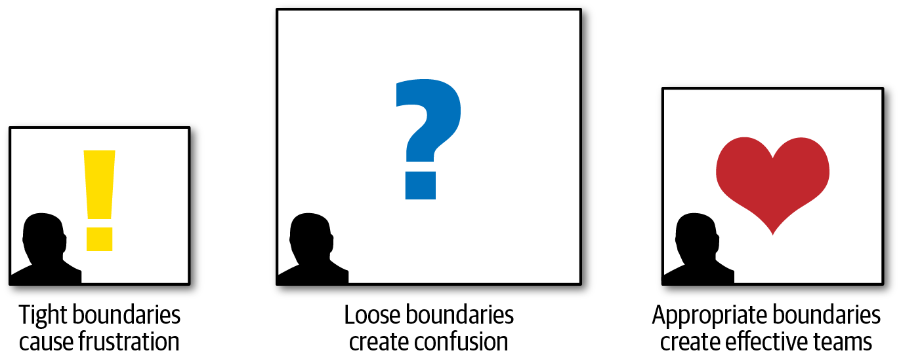
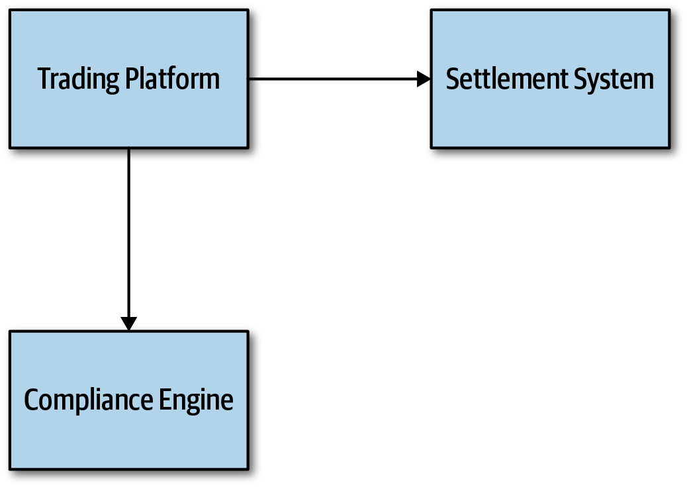
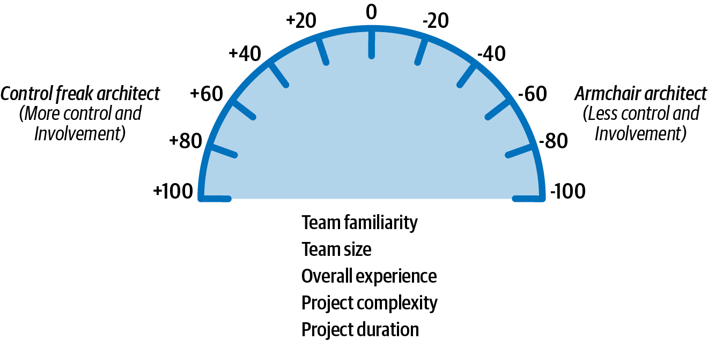
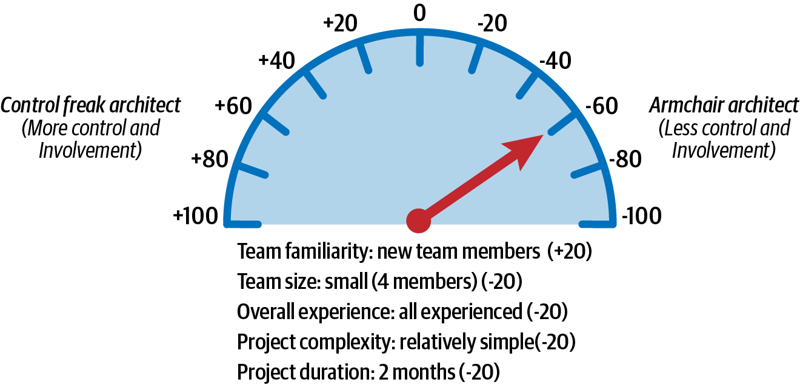
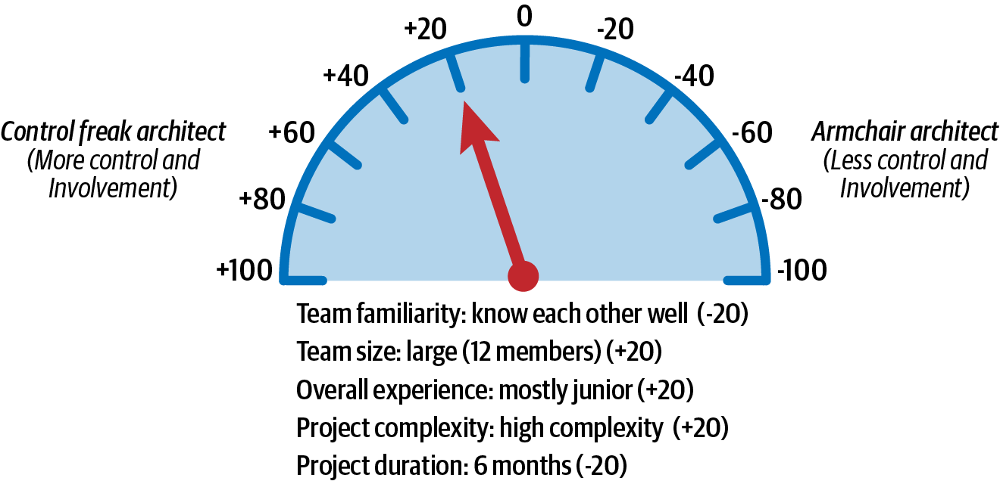
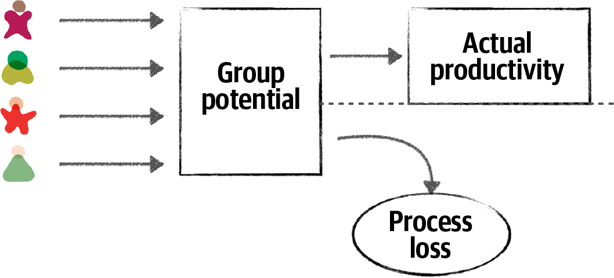
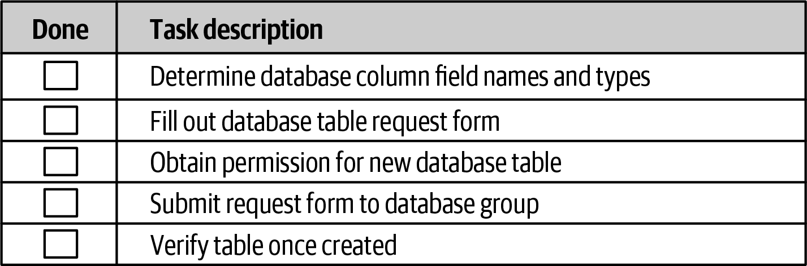
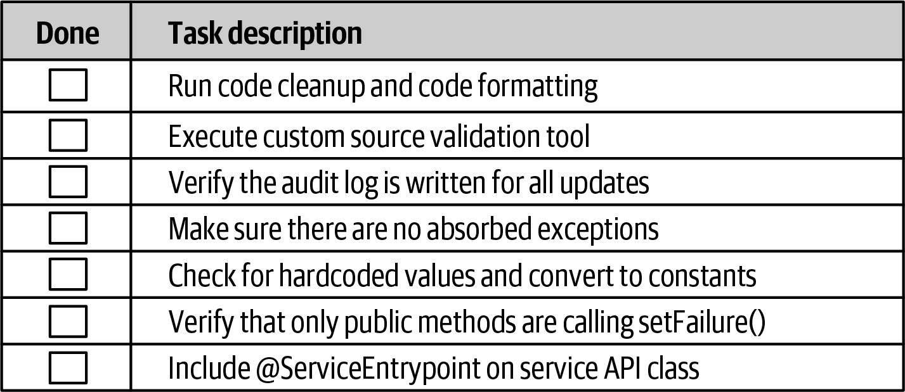
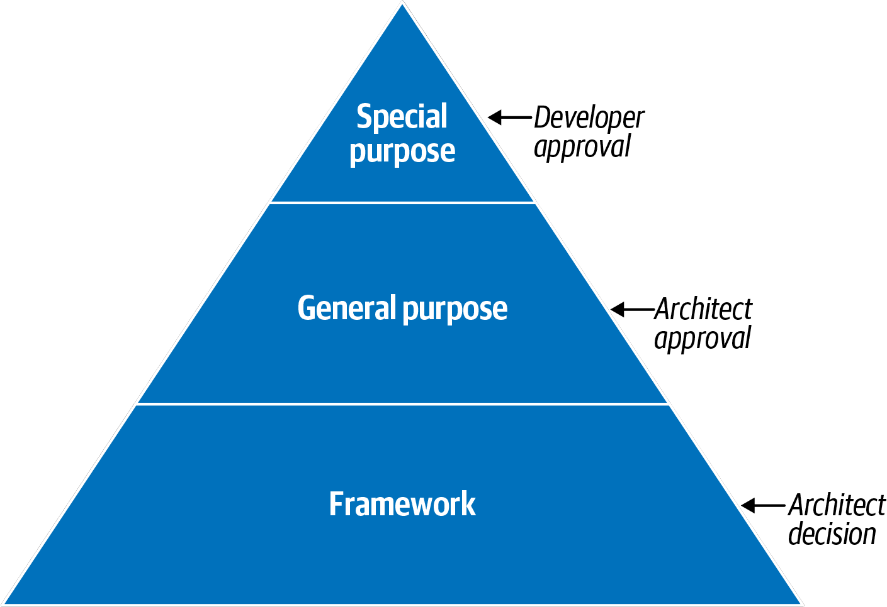

<!-- CH22-001 | PDF p. 345 | 标题 -->
# 第 22 章 让团队高效工作

> 原文章名：Making Teams Effective
> 来源：英文第一版，书内第 325–346 页，PDF 第 345–366 页。
> 进度：上一轮校译记录见 [原校译记录](../../reviews/chapter-22-review.md)；本次独立复审完成，见 [独立复审记录](../../reviews/independent-pass/chapter-22.md)。
> 保留英文原图，中文标签对照见文末；下文页码均指原书书内页码。

<!-- 书内第 325 页，PDF 第 345 页。 -->

<!-- CH22-002 | PDF p. 345 | 正文 -->
除了创建技术架构和做出架构决策，软件架构师还负责指导开发团队实施架构。善于这样做的软件架构师，能打造高效的开发团队，让成员密切合作，解决问题，创造成功方案。虽然这听起来理所当然，我们却屡次见到架构师忽视开发团队，在隔离环境中创建架构，然后交给开发团队，导致后者难以正确实施。让团队具有生产力，是高效、成功的软件架构师区别于其他架构师的方式之一。本章将介绍一些基本方法，帮助架构师让开发团队高效工作。

<!-- CH22-003 | PDF p. 345 | 标题 -->
## 团队边界

<!-- CH22-004 | PDF p. 345 | 正文 -->
根据我们的经验，软件架构师能够显著影响开发团队的成败。如果团队感到自己被排除在外，或与架构师乃至架构本身疏离，往往就无法得到恰当指导，也不了解系统的各种约束，因而不能正确实施架构。

<!-- CH22-005 | PDF p. 345 | 正文 -->
软件架构师的一项职责，是创建并传达约束，也就是一个让开发者在其中实施架构的“盒子”。架构师设定的边界可能太紧、太松，也可能恰到好处，如图 22-1 所示。边界过紧或过松，会直接影响团队成功实施架构的能力。

<!-- 书内第 326 页，PDF 第 346 页。 -->

<!-- CH22-006 | PDF p. 346 | 图表 -->

<!-- CH22-007 | PDF p. 346 | 图表 -->
*图 22-1：软件架构师创建的边界类型。*

<!-- CH22-008 | PDF p. 346 | 正文 -->
架构师如果设定过多约束，就会在团队周围形成紧绷的盒子，阻止他们使用有效实施系统所需的许多工具、库和实践。这让团队感到沮丧，通常导致开发者离开项目，寻找更快乐、更健康的环境。

<!-- CH22-009 | PDF p. 346 | 正文 -->
相反情况也会发生：架构师设定的约束太松，甚至根本没有约束，把所有重要架构决策都留给开发团队。这和约束过紧一样糟。团队实际上承担了架构师角色，却没有得到适当指导，不得不做概念验证、为设计决策争论，最终造成低效、困惑和挫败。

<!-- CH22-010 | PDF p. 346 | 正文 -->
高效的软件架构师努力提供恰当程度的指导与约束，让团队拥有正确的工具和库，有效实施架构。本章其余部分将讨论如何建立这些有效边界。

<!-- CH22-011 | PDF p. 346 | 标题 -->
## 架构师的行为类型

<!-- CH22-012 | PDF p. 346 | 正文 -->
架构师有三种基本行为类型：控制狂架构师，图 22-2；安乐椅架构师，图 22-3；以及高效架构师，图 22-5。每种类型都对应前面讨论的一种边界：控制狂产生紧边界，安乐椅架构师产生松边界，高效架构师则产生恰到好处的边界。

<!-- 书内第 327 页，PDF 第 347 页。 -->

<!-- CH22-013 | PDF p. 347 | 标题 -->
### 控制狂

<!-- CH22-014 | PDF p. 347 | 图表 -->

<!-- CH22-015 | PDF p. 347 | 图表 -->
*图 22-2：控制狂架构师，图片来源：iStockPhoto。*

<!-- CH22-016 | PDF p. 347 | 正文 -->
控制狂架构师试图控制软件开发过程的每一个细节。他们做出的每项决定，通常都过于细粒度、过于底层，导致开发团队受到过多约束。

<!-- CH22-017 | PDF p. 347 | 正文 -->
控制狂架构师产生前面讨论的紧边界。他们可能禁止开发团队下载任何有用的开源或第三方库，坚持让团队只使用语言 API 从头编写一切。他们还可能严格限制命名约定、类设计、方法长度等，甚至为开发团队编写伪代码。从本质上说，他们把编程这门艺术从开发者手中夺走，使开发者感到挫败，并对架构师缺乏尊重。

<!-- CH22-018 | PDF p. 347 | 正文 -->
成为控制狂架构师很容易，尤其是在从开发者转任架构师时。架构师的角色，是创建应用的构建块，也就是组件，并确定它们之间的交互。开发者的角色，则是接过这些组件，利用类图和设计模式，决定如何实现。然而，从开发者转向架构师时，人们很容易忍不住把类图和设计模式也一起设计好，因为那正是新架构师此前的职责。

<!-- 书内第 328 页，PDF 第 348 页。 -->

<!-- CH22-019 | PDF p. 348 | 正文 -->
例如，假设架构师创建一个组件，用来管理系统中的参考数据。参考数据包括网站上的静态名称—值对，以及产品代码、仓库代码等整个系统使用的静态数据。架构师的职责，是识别组件，在这里是 `Reference Manager`，确定其核心操作，例如 `GetData`、`SetData`、`ReloadCache`、`NotifyOnUpdate` 等，以及哪些组件需要与之交互。控制狂架构师可能认为，实现它的最佳方式，是采用并行加载器模式，使用内部缓存，并指定一种缓存数据结构。虽然这可能是有效设计，但不是唯一设计。更重要的是，为 `Reference Manager` 设计这些内部细节，已经不再是架构师的职责，而是开发者的职责。

<!-- CH22-020 | PDF p. 348 | 正文 -->
正如第 331 页“应该控制多少？”将讨论的，有时根据项目复杂性和团队技能水平，架构师确实需要扮演控制狂角色。不过，大多数情况下，这类架构师会干扰团队，不能提供适当指导，反而成为障碍，无法有效带领团队实施架构。

<!-- CH22-021 | PDF p. 348 | 标题 -->
### 安乐椅架构师

<!-- CH22-022 | PDF p. 348 | 图表 -->

<!-- CH22-023 | PDF p. 348 | 图表 -->
*图 22-3：安乐椅架构师，图片来源：iStockPhoto。*

<!-- CH22-024 | PDF p. 348 | 正文 -->
安乐椅架构师已经很久没有写代码，甚至可能从未写过，创建架构时也不考虑实施细节。他们通常与开发团队脱节，从不在场，或者初步架构图一完成，就转向另一个项目。

<!-- 书内第 329 页，PDF 第 349 页；上段跨页，已连读。 -->

<!-- CH22-025 | PDF p. 349 | 正文 -->
有些情况下，技术或业务领域的要求远超安乐椅架构师的能力，因此他们根本无法从技术或业务问题角度领导、指导团队。例如，开发者做什么？当然是写代码。写程序代码很难伪装：要么写了，要么没写。但架构师做什么？没人知道！多数架构师画许多线和框，可这些图究竟应该多细？这里有个架构领域不太光彩的小秘密：架构师想要蒙混过关，其实很容易！

<!-- CH22-026 | PDF p. 349 | 正文 -->
假设某位安乐椅架构师能力不足，或者没时间为股票交易系统设计合适方案，最终架构图可能就是图 22-4 那样。这张图并没有错，只是层次太高，对任何人都没什么用。

<!-- CH22-027 | PDF p. 349 | 图表 -->

<!-- CH22-028 | PDF p. 349 | 图表 -->
*图 22-4：安乐椅架构师创建的交易系统架构。*

<!-- CH22-029 | PDF p. 349 | 正文 -->
安乐椅架构师为开发团队设定松边界。在这种情况下，团队最终承担架构师角色，实际上做着本应由架构师完成的工作，导致团队速度和生产力下降，也弄不清系统应该如何工作。

<!-- CH22-030 | PDF p. 349 | 正文 -->
与控制狂一样，成为安乐椅架构师也很容易。最大的迹象，是没有足够时间陪伴实施架构的开发团队，或者选择不花时间与他们合作。开发团队需要架构师支持和指导，并在出现技术或业务问题时能够找到架构师。

<!-- 书内第 330 页，PDF 第 350 页；上段跨页，已连读。 -->

<!-- CH22-031 | PDF p. 350 | 正文 -->
其他迹象包括：

<!-- CH22-032 | PDF p. 350 | 列表 -->
- 没有充分理解业务领域、业务问题或所用技术。
- 缺乏足够的软件开发实操经验。
- 不考虑实施架构方案所带来的影响。

<!-- CH22-033 | PDF p. 350 | 正文 -->
有时，架构师并非有意成为安乐椅架构师，只是在过多项目或团队间疲于奔命，与技术或业务领域脱节，于是这种情况“就发生了”。通过更多参与项目所用技术，并理解业务问题与领域，可以避免这种行为类型。

<!-- CH22-034 | PDF p. 350 | 标题 -->
### 高效架构师

<!-- CH22-035 | PDF p. 350 | 图表 -->

<!-- CH22-036 | PDF p. 350 | 图表 -->
*图 22-5：高效的软件架构师，图片来源：iStockPhoto。*

<!-- CH22-037 | PDF p. 350 | 正文 -->
高效的软件架构师为团队提供适当约束与边界，确保成员合作良好，并获得恰当指导；也确保团队拥有正确、适合的工具和技术。此外，他们还移除妨碍开发团队实现目标的障碍。

<!-- 书内第 331 页，PDF 第 351 页。 -->

<!-- CH22-038 | PDF p. 351 | 正文 -->
虽然听起来显而易见、很容易，实际上并非如此。成为开发团队中的有效领导者，是一门艺术。成为高效架构师，需要与团队密切工作、合作，并赢得尊重。本部分后面的章节还会讨论其他方法。现在，先介绍一些判断高效架构师应该对团队施加多少控制的指导原则。

<!-- CH22-039 | PDF p. 351 | 标题 -->
## 应该控制多少？

<!-- CH22-040 | PDF p. 351 | 正文 -->
成为高效软件架构师，意味着知道应该对某个开发团队施加多少控制。这一概念称为[弹性领导力（Elastic Leadership）](https://www.elasticleadership.com)，由作者兼顾问 Roy Osherove 广泛推广。这里我们稍微偏离他的研究，专注于软件架构的具体因素。

<!-- CH22-041 | PDF p. 351 | 正文 -->
判断高效架构师应该在多大程度上像控制狂、多大程度上像安乐椅架构师，涉及五项主要因素。这些因素也决定架构师能够同时管理多少团队或项目：

<!-- CH22-042 | PDF p. 351 | 正文 -->
**团队熟悉程度**

<!-- CH22-043 | PDF p. 351 | 正文 -->
成员之间有多熟悉？以前一起做过项目吗？一般而言，彼此越熟悉，所需控制越少，因为团队开始能够自组织。相反，新成员越多，越需要控制，以促进合作、减少小圈子。

<!-- CH22-044 | PDF p. 351 | 正文 -->
**团队规模**

<!-- CH22-045 | PDF p. 351 | 正文 -->
团队有多大？我们把超过 12 名开发者视为大团队，4 人或更少视为小团队。团队越大，所需控制越多；越小则越少。第 335 页“团队警示信号”将进一步讨论。

<!-- CH22-046 | PDF p. 351 | 正文 -->
**总体经验**

<!-- CH22-047 | PDF p. 351 | 正文 -->
有多少资深成员、多少初级成员？是两者混合吗？对技术和业务领域了解多少？初级开发者较多的团队，需要更多控制与指导；资深成员较多，则需要较少控制。后一种情况下，架构师会从导师转为促进者。

<!-- CH22-048 | PDF p. 351 | 正文 -->
**项目复杂性**

<!-- CH22-049 | PDF p. 351 | 正文 -->
项目高度复杂，还是只是简单网站？高度复杂的项目要求架构师更容易被团队找到，并协助解决问题，因此需要更多控制；相对简单的项目比较直接，所需控制较少。

<!-- 书内第 332 页，PDF 第 352 页；上段跨页，已连读。 -->

<!-- CH22-050 | PDF p. 352 | 正文 -->
**项目周期**

<!-- CH22-051 | PDF p. 352 | 正文 -->
项目是短期，两个月；长期，两年；还是平均周期，六个月？周期越短，所需控制越少；反之，越长，所需控制越多。

<!-- CH22-052 | PDF p. 352 | 正文 -->
虽然多数因素与控制多少的关系都容易理解，但项目周期这一项可能看起来不合理。正如前面所说，周期越短，控制越少；周期越长，控制越多。直觉上似乎应该相反，其实不是。考虑一个两个月的快速项目：时间不足以充分界定需求、实验、开发、测试所有场景并发布到生产环境。这时，架构师应该更像安乐椅架构师，因为团队本身已经有强烈紧迫感。控制狂只会碍事，很可能拖慢项目。相反，考虑两年的项目：开发者比较放松，没有紧迫感，很可能在计划休假和享受漫长午餐。因此，架构师需要更多控制，确保项目及时推进，并优先完成复杂任务。

<!-- CH22-053 | PDF p. 352 | 正文 -->
多数项目通常在开始时利用这些因素判断控制程度，但随着系统演进，控制程度也会变化。因此，我们建议在整个项目生命周期持续分析这些因素，判断对开发团队应该施加多少控制。

<!-- CH22-054 | PDF p. 352 | 正文 -->
为了展示如何利用这些因素，假设每项采用固定的 20 分尺度。负值偏向安乐椅架构师，即较少控制和参与；正值偏向控制狂，即更多控制和参与。图 22-6 展示了这一尺度。

<!-- 书内第 333 页，PDF 第 353 页。 -->

<!-- CH22-055 | PDF p. 353 | 图表 -->

<!-- CH22-056 | PDF p. 353 | 图表 -->
*图 22-6：控制程度的尺度。*

<!-- CH22-057 | PDF p. 353 | 正文 -->
这种评分当然并不精确，但有助于判断相对控制程度。例如，考虑表 22-1 和图 22-7 的项目场景。各因素分别指向控制狂 +20，或安乐椅架构师 −20。累计得分 −60，表明架构师应更多扮演安乐椅角色，不要妨碍团队。

<!-- CH22-058 | PDF p. 353 | 表格 -->
*表 22-1：控制程度示例，场景 1。*

<!-- CH22-059 | PDF p. 353 | 表格 -->
| 因素 | 取值 | 评分 | 行为类型 |
| --- | --- | --- | --- |
| 团队熟悉程度 | 新团队成员 | +20 | 控制狂 |
| 团队规模 | 小，4 人 | −20 | 安乐椅架构师 |
| 总体经验 | 全部有经验 | −20 | 安乐椅架构师 |
| 项目复杂性 | 相对简单 | −20 | 安乐椅架构师 |
| 项目周期 | 2 个月 | −20 | 安乐椅架构师 |
| 累计得分 | | −60 | 安乐椅架构师 |

<!-- 书内第 334 页，PDF 第 354 页。 -->

<!-- CH22-060 | PDF p. 354 | 图表 -->

<!-- CH22-061 | PDF p. 354 | 图表 -->
*图 22-7：场景 1 的控制程度。*

<!-- CH22-062 | PDF p. 354 | 正文 -->
场景 1 考虑全部因素后表明，高效架构师最初应该扮演促进者，不要过度参与团队日常互动。架构师需要回答问题、确保团队方向正确，但大多数时候应当放手，让有经验的团队发挥最擅长的能力：快速开发软件。

<!-- CH22-063 | PDF p. 354 | 正文 -->
再考虑表 22-2 和图 22-8 的另一场景：成员彼此熟悉，但团队较大，有 12 人，而且主要由经验不足的初级开发者组成。项目相对复杂，周期六个月。此时累计得分为 −20，表明高效架构师应参与日常活动，承担指导、辅导角色，但不要过度干扰团队。

<!-- CH22-064 | PDF p. 354 | 表格 -->
*表 22-2：控制程度示例，场景 2。*

<!-- CH22-065 | PDF p. 354 | 表格 -->
| 因素 | 取值 | 评分 | 行为类型 |
| --- | --- | --- | --- |
| 团队熟悉程度 | 彼此熟悉 | −20 | 安乐椅架构师 |
| 团队规模 | 大，12 人 | +20 | 控制狂 |
| 总体经验 | 主要为初级成员 | +20 | 控制狂 |
| 项目复杂性 | 高复杂性 | +20 | 控制狂 |
| 项目周期 | 6 个月 | −20 | 安乐椅架构师 |
| 累计得分 | | −20 | 控制狂 |

<!-- CH22-066 | PDF p. 354 | 译注 -->
> 译注：以上保留原书数据。表中五项相加为 +20，不是正文和合计栏写的 −20；图 22-8 的指针也指向正值一侧。表合计栏同时写 −20 与“控制狂”，与前面正负值定义不一致。另外，前文定义大团队为“超过 12 人”，这里把 12 人列为大团队，也按原文保留。

<!-- 书内第 335 页，PDF 第 355 页。 -->

<!-- CH22-067 | PDF p. 355 | 图表 -->

<!-- CH22-068 | PDF p. 355 | 图表 -->
*图 22-8：场景 2 的控制程度。*

<!-- CH22-069 | PDF p. 355 | 正文 -->
这些因素很难完全客观化，因为有些因素，例如总体团队经验，可能比其他因素权重更大。在这种情况下，可以方便地调整权重或修改指标，以适应具体情境。无论如何，主要观点是：架构师对团队的控制与参与程度，会随这五项主要因素变化。考虑它们之后，就可以衡量该施加何种控制，以及团队工作所处的盒子应是什么样，采用紧还是松的边界与约束。

<!-- CH22-070 | PDF p. 355 | 标题 -->
## 团队警示信号

<!-- CH22-071 | PDF p. 355 | 正文 -->
正如上一节所说，团队规模会影响架构师应该施加的控制程度。团队越大，所需控制越多；越小则越少。考虑最有效的开发团队规模时，有三个因素需要关注：

<!-- CH22-072 | PDF p. 355 | 列表 -->
- 过程损耗。
- 多元无知。
- 责任分散。

<!-- CH22-073 | PDF p. 355 | 正文 -->
过程损耗（process loss），也称[布鲁克斯定律（Brooks’s law）](https://oreil.ly/rZt88)，最初由 Fred Brooks 在 *The Mythical Man-Month*（Addison-Wesley）中提出。其基本思想是：向项目增加的人越多，项目所需时间越长。如图 22-9 所示，团队潜能由所有成员的共同努力决定。但任何团队的实际生产力，总会小于团队潜能，两者的差额就是过程损耗。

<!-- CH22-074 | PDF p. 355 | 译注 -->
> 译注：本段将过程损耗概括为布鲁克斯定律，并省略其通常涉及的项目条件，按原文保留；不要据此把任何增加人手的情况都视为必然延误。

<!-- 书内第 336 页，PDF 第 356 页。 -->

<!-- CH22-075 | PDF p. 356 | 图表 -->

<!-- CH22-076 | PDF p. 356 | 图表 -->
*图 22-9：团队规模影响实际生产力，布鲁克斯定律。*

<!-- CH22-077 | PDF p. 356 | 正文 -->
高效架构师会观察开发团队，寻找过程损耗。它是判断某项工作合适团队规模的良好因素。一个迹象，是向存储库推送代码时频繁发生合并冲突，可能说明成员相互妨碍，在修改相同代码。寻找可并行的工作，让成员分别处理不同服务或应用区域，是避免过程损耗的一种方法。每当新成员加入，如果没有可以建立并行工作流的区域，高效架构师就会质疑增员原因，并向项目经理说明这位新成员对团队的负面影响。

<!-- CH22-078 | PDF p. 356 | 正文 -->
团队过大时，也会出现多元无知（pluralistic ignorance）：每个人都同意某项规范，私下却反对，因为觉得自己可能漏掉了显而易见的东西。例如，大团队中多数人同意两个远程服务之间使用消息是最佳方案，但某位成员认为这是个蠢主意，因为两者之间有一道安全防火墙。然而，他没有说出来，也跟着同意，只在心里反对，因为害怕自己漏掉了什么，或说出来显得愚蠢。在这个例子中，反对者是对的：防火墙使消息无法工作。如果他能说出来，而且团队更小，原方案就会受到挑战，改用 REST 等其他协议，这在本例中更好。

<!-- CH22-079 | PDF p. 356 | 正文 -->
多元无知这个概念因 Hans Christian Andersen 的丹麦童话[《皇帝的新装》](https://oreil.ly/ROvce)而广为人知。故事中，国王相信新衣对不配看到它的人是隐形的。他一丝不挂地四处走动，询问臣民喜不喜欢新衣。臣民害怕被视为愚蠢或不配，都回答新衣好极了。

<!-- 书内第 337 页，PDF 第 357 页；上段跨页，已连读。 -->

<!-- CH22-080 | PDF p. 357 | 正文 -->
这种荒唐持续到一个孩子终于喊出：国王根本没有穿衣服。

<!-- CH22-081 | PDF p. 357 | 正文 -->
在各种协作会议或讨论中，高效架构师应该持续观察表情和肢体语言，察觉多元无知时，就扮演促进者。例如，可以打断讨论，询问那位成员对方案的看法，并在他发言时站在他这一边，支持他。

<!-- CH22-082 | PDF p. 357 | 正文 -->
第三个判断团队规模是否合适的因素，是责任分散（diffusion of responsibility）。其依据是，团队变大时，沟通会受到负面影响。搞不清谁负责什么，以及事情被遗漏，都是团队过大的明显迹象。

<!-- CH22-083 | PDF p. 357 | 正文 -->
看看图 22-10，你观察到了什么？

<!-- CH22-084 | PDF p. 357 | 图表 -->

<!-- CH22-085 | PDF p. 357 | 图表 -->
*图 22-10：责任分散。*

<!-- CH22-086 | PDF p. 357 | 正文 -->
图中有人站在乡间小路边，一辆车抛锚了。在这种情况下，会有多少人停下来询问是否需要帮助？由于道路和社区都小，很可能每个路过的人都会问。然而，在大城市繁忙公路上，司机被困路边，数千辆车经过，却没有人停下来询问，这种情况发生过多少次？经常发生。这很好地说明了责任分散。城市越繁忙拥挤，人们越会认为，这么多人看见，司机一定已经打电话，或者救援正在路上。但大多数情况下，救援并没有出发，司机的手机没电或忘了带，根本无法求助。

<!-- 书内第 338 页，PDF 第 358 页。 -->

<!-- CH22-087 | PDF p. 358 | 正文 -->
高效架构师不仅指导团队实施架构，还确保团队健康、快乐，并为共同目标合作。寻找这三种警示信号，并帮助纠正，可以确保开发团队有效运作。

<!-- CH22-088 | PDF p. 358 | 标题 -->
## 利用检查清单

<!-- CH22-089 | PDF p. 358 | 正文 -->
飞行员每次飞行都使用检查清单，即使经验最丰富的老手也不例外。他们对起飞、降落，以及数千种常见和不常见情况都有清单，因为漏掉一个飞机设置，例如把襟翼设为 10 度，或漏掉某个程序，例如取得进入终端管制区的许可，都可能决定飞行安全还是发生灾难。

<!-- CH22-090 | PDF p. 358 | 正文 -->
Atul Gawande 医生写过一本优秀的书，[*The Checklist Manifesto*](https://oreil.ly/XNcV9)（Picador），描述清单对手术流程的作用。他因医院葡萄球菌感染率居高不下而警觉，创建手术清单，试图降低感染率。书中展示，使用清单的医院，其感染率降到接近零；未使用清单的对照医院，感染率却继续上升。

<!-- CH22-091 | PDF p. 358 | 正文 -->
清单有效。它是确保所有事项被覆盖、处理的绝佳手段。如果清单这么有效，软件开发行业为什么不利用？根据亲身经验，我们坚信清单能显著改善开发团队效能。不过，这个说法也有限制。多数开发者并不开客机，也不做心脏直视手术；换句话说，不是所有事情都需要清单。让团队高效的关键，是知道何时使用、何时不使用。

<!-- CH22-092 | PDF p. 358 | 译注 -->
> 译注：本段医疗效果是作者转述另一书籍的内容，未在本次翻译中核验其研究条件或数据，不作为医疗事实建议。

<!-- 书内第 339 页，PDF 第 359 页。 -->

<!-- CH22-093 | PDF p. 359 | 正文 -->
考虑图 22-11 中创建新数据库表的检查清单。

<!-- CH22-094 | PDF p. 359 | 图表 -->

<!-- CH22-095 | PDF p. 359 | 图表 -->
*图 22-11：不良检查清单示例。*

<!-- CH22-096 | PDF p. 359 | 正文 -->
图中各项译文如下，均为未勾选状态：

<!-- CH22-097 | PDF p. 359 | 列表 -->
- [ ] 确定数据库列字段的名称与类型。
- [ ] 填写数据库建表申请表。
- [ ] 取得创建新数据库表的许可。
- [ ] 向数据库团队提交申请表。
- [ ] 表创建后验证它。

<!-- CH22-098 | PDF p. 359 | 正文 -->
这不是检查清单，而是一组程序步骤，因此不应该放在检查清单中。例如，申请表尚未提交，怎么能验证数据库表！具有依赖任务和顺序流程的过程，不应该放在这种清单里。简单、众所周知、经常无误执行的流程，也不需要清单。

<!-- CH22-099 | PDF p. 359 | 正文 -->
适合清单的，是没有程序顺序或依赖任务的过程，以及容易出错、经常漏掉或跳过步骤的过程。有效使用清单的关键，是不要把一切都做成清单。架构师发现它确实有效后，就开始把所有事都清单化，触发收益递减定律：清单越多，开发者使用的可能性越小。另一个成功因素，是在捕捉必要步骤的同时，尽可能缩短清单。开发者通常不遵循过长清单。寻找可以自动化的项目，并将它们移出清单。

<!-- CH22-100 | PDF p. 359 | 框文 -->
> 不要担心在清单里写显而易见的事项。通常被跳过或遗漏的，恰恰是这些事。

<!-- CH22-101 | PDF p. 359 | 正文 -->
我们发现最有效的三种清单，是开发者代码完成清单、单元与功能测试清单，以及软件发布清单。下面分别讨论。

<!-- 书内第 340 页，PDF 第 360 页。 -->

<!-- CH22-102 | PDF p. 360 | 标题 -->
### 霍桑效应

<!-- CH22-103 | PDF p. 360 | 正文 -->
给开发团队引入清单时，一个问题是如何让开发者真正使用。某些开发者时间不够，就直接把所有项目标为完成，实际上并没有执行，这太常见了。

<!-- CH22-104 | PDF p. 360 | 正文 -->
解决方法之一，是与团队讨论清单的重要性，以及它能带来什么改变。让成员阅读 Atul Gawande 的 *The Checklist Manifesto*，充分理解清单的力量，并确保大家理解每份清单的理由与用途。让开发者共同决定哪些内容应该或不应该列入，也有帮助。

<!-- CH22-105 | PDF p. 360 | 正文 -->
其他方法都失败时，架构师可以利用[霍桑效应（Hawthorne effect）](https://oreil.ly/caGH_)：人们知道自己被观察或监控时，行为会改变，通常会做正确的事。例如，建筑物内外设置了醒目的摄像头，却实际上无法工作或根本没有录像（这非常常见！）；再比如网站监控软件——有多少报告真正被人查看过？

<!-- CH22-106 | PDF p. 360 | 正文 -->
霍桑效应也可用于治理清单使用。架构师可以告诉团队，清单对团队效能至关重要，因此所有清单都会核实，确保任务实际执行；但事实上，架构师只是偶尔抽查准确性。利用这种效应，开发者就不太会跳过事项，或者在没有执行时把它标为完成。

<!-- CH22-107 | PDF p. 360 | 译注 -->
> 译注：这里“告知全部检查，实际偶尔抽查”是作者的原文建议，译文保留这一表述。

<!-- CH22-108 | PDF p. 360 | 标题 -->
### 开发者代码完成清单

<!-- CH22-109 | PDF p. 360 | 正文 -->
开发者代码完成清单是一种有效工具，尤其适用于开发者声称代码“完成”时。它也有助于界定“完成的定义”（definition of done）。清单全部完成后，开发者才能说代码确实完成。

<!-- CH22-110 | PDF p. 360 | 正文 -->
可包含的事项有：

<!-- CH22-111 | PDF p. 360 | 列表 -->
- 未包含在自动化工具中的编码与格式标准。
- 经常被忽略的内容，例如被吞掉的异常。
- 项目专用标准。
- 特殊团队指示或程序。

<!-- 书内第 341 页，PDF 第 361 页。 -->

<!-- CH22-112 | PDF p. 361 | 正文 -->
图 22-12 展示了一个例子。

<!-- CH22-113 | PDF p. 361 | 图表 -->

<!-- CH22-114 | PDF p. 361 | 图表 -->
*图 22-12：开发者代码完成清单示例。*

<!-- CH22-115 | PDF p. 361 | 正文 -->
图中各项译文如下，均为未勾选状态：

<!-- CH22-116 | PDF p. 361 | 列表 -->
- [ ] 执行代码清理与格式化。
- [ ] 执行定制源码验证工具。
- [ ] 验证所有更新都已写入审计日志。
- [ ] 确保没有被吞掉的异常。
- [ ] 检查硬编码值，并转换为常量。
- [ ] 验证只有公共方法调用 `setFailure()`。
- [ ] 在服务 API 类上添加 `@ServiceEntrypoint`。

<!-- CH22-117 | PDF p. 361 | 正文 -->
注意“执行代码清理与格式化”和“确保没有被吞掉的异常”这两项显而易见的任务。开发者在一天或一次迭代结束时匆忙收尾，忘记从 IDE 执行清理和格式化，有多少次？很多次。Gawande 在书中发现，手术流程也有同样现象：明显的步骤，往往最容易被漏掉。

<!-- CH22-118 | PDF p. 361 | 正文 -->
再注意第 2、3、6、7 项项目专用任务。虽然适合列入，架构师仍应始终审视清单，看看有没有事项可以自动化，或写成代码验证器插件。例如，“在服务 API 类上添加 `@ServiceEntrypoint`”也许无法自动检查，但“验证只有公共方法调用 `setFailure()`”肯定可以；任何代码遍历工具都能直接进行这种检查。寻找自动化机会，可以减少清单长度和噪声，使其更有效。

<!-- CH22-119 | PDF p. 361 | 标题 -->
### 单元与功能测试清单

<!-- CH22-120 | PDF p. 361 | 正文 -->
也许最有效的清单之一，就是单元与功能测试清单。它包含开发者容易忘记的一些不常见测试和边缘情况。每当 QA 根据某个测试用例发现代码问题，就应该把该用例添加进清单。由于可以对代码执行的测试种类很多，这通常是最大的清单之一。目的在于尽可能让代码完整：开发者完成清单时，代码基本上已经可以进入生产环境。

<!-- 书内第 342 页，PDF 第 362 页。 -->

<!-- CH22-121 | PDF p. 362 | 正文 -->
典型清单包括：

<!-- CH22-122 | PDF p. 362 | 列表 -->
- 文本与数字字段中的特殊字符。
- 最小值和最大值范围。
- 不常见与极端测试用例。
- 缺失字段。

<!-- CH22-123 | PDF p. 362 | 正文 -->
与代码完成清单一样，任何可以写成自动测试的事项，都应该移出清单。例如，股票交易应用清单要求测试负数股数，如买入 −1,000 股苹果股票 AAPL。如果测试套件已经通过单元或功能测试自动检查，就应移除该项。

<!-- CH22-124 | PDF p. 362 | 正文 -->
开发者有时不知道从哪里开始写单元测试，或应该写多少。清单可以确保开发过程中包含一般或特定测试场景。如果开发与测试由不同团队执行，它也能有效弥合两者之间的差距。开发团队测试越完整，测试团队工作越容易，也就越能专注于清单未覆盖的特定业务场景。

<!-- CH22-125 | PDF p. 362 | 标题 -->
### 软件发布清单

<!-- CH22-126 | PDF p. 362 | 正文 -->
把软件发布到生产环境，也许是开发生命周期中最容易出错的环节之一，因此很适合使用清单。它有助于避免构建或部署失败，并显著降低发布风险。

<!-- CH22-127 | PDF p. 362 | 正文 -->
软件发布清单通常变化最多，因为每次部署失败或出现问题后，都要持续修改，以处理新的错误和情况。

<!-- CH22-128 | PDF p. 362 | 正文 -->
典型事项包括：

<!-- CH22-129 | PDF p. 362 | 列表 -->
- 服务器或外部配置服务器中的配置变化。
- 新增第三方库，例如 JAR、DLL。
- 数据库更新及对应的数据库迁移脚本。

<!-- 书内第 343 页，PDF 第 363 页。 -->

<!-- CH22-130 | PDF p. 363 | 正文 -->
每次构建或部署失败，架构师都应该分析根因，并添加对应条目。这样，下次构建或部署就会验证，避免再次发生。

<!-- CH22-131 | PDF p. 363 | 标题 -->
## 提供指导

<!-- CH22-132 | PDF p. 363 | 正文 -->
软件架构师还可以通过设计原则提供指导，让团队高效。这也有助于形成本章开始讨论的盒子，即开发者实施架构时所处的约束。有效传达这些原则，是建立成功团队的关键之一。

<!-- CH22-133 | PDF p. 363 | 正文 -->
例如，考虑如何指导团队使用通常所谓的分层技术栈（layered stack），也就是构成应用的第三方库集合，如 JAR、DLL。开发团队通常有许多疑问：能否自行选择库，哪些可以用，哪些不能用。

<!-- CH22-134 | PDF p. 363 | 正文 -->
针对这个例子，高效架构师可以先让开发者回答：

<!-- CH22-135 | PDF p. 363 | 列表 -->
1. 新提议的库，与系统现有功能是否存在重叠？
2. 提议使用这个库的依据是什么？

<!-- CH22-136 | PDF p. 363 | 正文 -->
第一个问题引导开发者检查现有库，看看能否用已有库或功能满足需求。根据经验，开发者有时忽略这一步，导致大量重复功能，尤其在大型项目和大团队中。

<!-- CH22-137 | PDF p. 363 | 正文 -->
第二个问题促使开发者思考，为什么真正需要新库或功能。高效架构师会要求同时给出技术与业务依据。这是让开发团队意识到业务依据必要性的有力方法。

<!-- 书内第 344 页，PDF 第 364 页。 -->

<!-- CH22-138 | PDF p. 364 | 标题 -->
### 业务依据的影响

<!-- CH22-139 | PDF p. 364 | 正文 -->
作者之一 Mark 曾担任一个特别复杂的 Java 项目的首席架构师，团队很大。一位成员特别痴迷 Scala，迫切希望在项目中使用。这个愿望最终造成严重干扰，几位关键成员告诉 Mark，打算离开，转向“没那么有毒”的环境。Mark 说服其中两位暂缓决定，并与 Scala 爱好者谈话。他表示会支持项目使用 Scala，但鉴于培训成本和重写工作，对方必须提供业务依据。Scala 爱好者欣喜若狂，说马上就做，离开会议时喊道：“谢谢，你是最棒的！”

<!-- CH22-140 | PDF p. 364 | 正文 -->
第二天，他来到办公室，像变了个人。他立刻找 Mark 谈话，进会议室后，马上谦逊地说“谢谢”。他解释，自己可以提出无数采用 Scala 的技术理由，但对项目要求的架构特性、成本、预算和时间安排而言，这些技术优势并没有任何业务价值。事实上，他意识到增加成本、预算和工期，不会带来任何收益。

<!-- CH22-141 | PDF p. 364 | 正文 -->
意识到自己造成干扰后，他迅速成为团队中最优秀、最乐于助人的成员之一，仅仅因为有人要求他为自己想用的东西提供业务依据。对依据的这种意识，不仅让他成为更好的开发者，也让团队更强健、更健康。

<!-- CH22-142 | PDF p. 364 | 正文 -->
补记：那两位关键开发者一直留到项目结束。

<!-- CH22-143 | PDF p. 364 | 正文 -->
继续第三方库治理的例子，另一种有效传达设计原则的方法，是用图形说明开发团队能够决定什么、不能决定什么。图 22-13 展示了治理分层技术栈时，这种图形及指导可能是什么样。

<!-- 书内第 345 页，PDF 第 365 页。 -->

<!-- CH22-144 | PDF p. 365 | 图表 -->

<!-- CH22-145 | PDF p. 365 | 图表 -->
*图 22-13：为分层技术栈提供指导。*

<!-- CH22-146 | PDF p. 365 | 正文 -->
架构师会先举例说明每类第三方库包含什么，再说明团队可以和不可以做什么，也就是设计原则和本章开头的盒子。例如，可以定义三类：

<!-- CH22-147 | PDF p. 365 | 正文 -->
**专用库**

<!-- CH22-148 | PDF p. 365 | 正文 -->
用于 PDF 渲染、条码扫描等特定用途，在这些场景中不值得自行编写软件。

<!-- CH22-149 | PDF p. 365 | 正文 -->
**通用库**

<!-- CH22-150 | PDF p. 365 | 正文 -->
语言 API 之上的封装，例如 Java 的 Apache Commons、Guava。

<!-- CH22-151 | PDF p. 365 | 正文 -->
**框架**

<!-- CH22-152 | PDF p. 365 | 正文 -->
用于持久化，例如 Hibernate，或控制反转，例如 Spring。换句话说，这些库构成应用的整个层次或结构，侵入性很强。

<!-- CH22-153 | PDF p. 365 | 正文 -->
完成分类后（以上仅是示例，还可以有更多类别），架构师就围绕设计原则建立盒子。图 22-13 中，对于这个具体项目，架构师规定：专用库由开发者自己决定，无须咨询架构师。

<!-- 书内第 346 页，PDF 第 366 页；上段跨页，已连读。 -->

<!-- CH22-154 | PDF p. 366 | 正文 -->
但通用库需要开发者分析功能重叠、说明依据并提出建议，再由架构师批准。最后，框架类库属于架构师决策；开发团队甚至不应为这类库开展分析，架构师决定自行承担相应责任。

<!-- CH22-155 | PDF p. 366 | 标题 -->
## 小结

<!-- CH22-156 | PDF p. 366 | 正文 -->
让开发团队高效是一项艰难工作，需要丰富经验、实践，以及良好的人际技能，后面章节还会讨论。不过，本章介绍的简单方法，包括弹性领导力、检查清单，以及有效传达设计原则来提供指导，确实可行，已经证明能够让团队更聪明、更有效地工作。

<!-- CH22-157 | PDF p. 366 | 正文 -->
有人可能质疑这些活动是否属于架构师职责，认为让团队高效应该由开发经理或项目经理负责。我们强烈反对这种看法。软件架构师不仅提供技术指导，也要带领团队实施架构。双方密切协作，让架构师能够观察团队动态，促进变化，提高团队效能。这正是技术架构师与高效软件架构师的区别。

<!-- CH22-158 | PDF p. 366 | 分隔符 -->
---

<!-- CH22-159 | PDF p. 366 | 标题 -->
## 图中文字中文对照（译者整理）

<!-- CH22-160 | PDF p. 366 | 表格 -->
| 图号 | 英文标签 → 中文 |
| --- | --- |
| 图 22-1 | Tight boundaries cause frustration → 边界过紧导致挫败；Loose boundaries create confusion → 边界过松导致困惑；Appropriate boundaries create effective teams → 合适边界造就高效团队 |
| 图 22-2 | 无文字标签，控制狂架构师照片；来源：iStockPhoto |
| 图 22-3 | 无文字标签，安乐椅架构师照片；来源：iStockPhoto |
| 图 22-4 | Trading Platform → 交易平台；Settlement System → 结算系统；Compliance Engine → 合规引擎 |
| 图 22-5 | 无文字标签，高效架构师协作照片；来源：iStockPhoto |
| 图 22-6 | Control freak architect (More control and Involvement) → 控制狂架构师，更多控制与参与；Armchair architect (Less control and Involvement) → 安乐椅架构师，较少控制与参与；Team familiarity / Team size / Overall experience / Project complexity / Project duration → 团队熟悉程度 / 团队规模 / 总体经验 / 项目复杂性 / 项目周期；尺度 +100 至 −100 |
| 图 22-7 | 标签同图 22-6；五项取值同表 22-1，指针为 −60 |
| 图 22-8 | 标签同图 22-6；五项取值同表 22-2，指针为正值 +20；与正文及表合计的差异见译注 |
| 图 22-9 | Group potential → 团队潜能；Actual productivity → 实际生产力；Process loss → 过程损耗 |
| 图 22-10 | 无文字标签，路边车辆抛锚照片，用于说明责任分散 |
| 图 22-11 | Done → 完成；Task description → 任务描述；五项内容已在正文全文转录 |
| 图 22-12 | Done → 完成；Task description → 任务描述；七项内容已在正文全文转录 |
| 图 22-13 | Special purpose → 专用；General purpose → 通用；Framework → 框架；Developer approval → 开发者批准；Architect approval → 架构师批准；Architect decision → 架构师决策 |

<!-- CH22-161 | PDF p. 366 | 译注 -->
> 译注：本章的团队评分、检查清单和审批边界都是作者的建议或示例。译稿保留作者对行为和团队的概括，实际应用需结合具体团队与项目判断。
