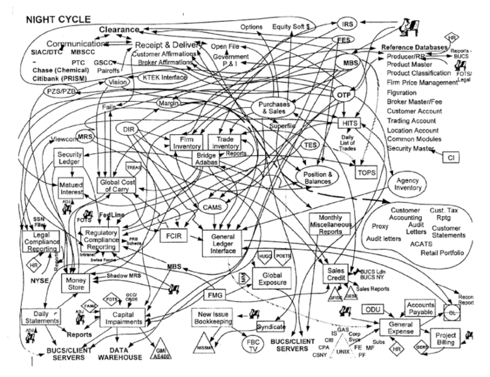
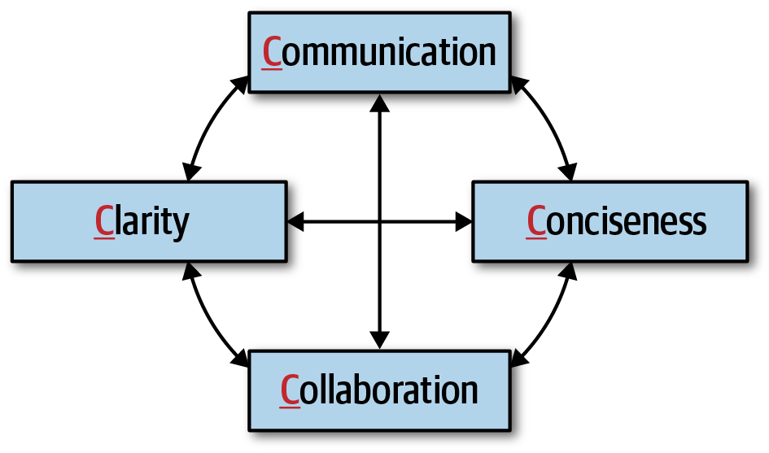
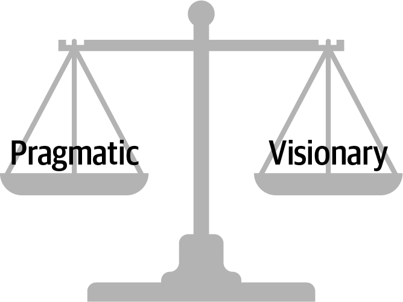
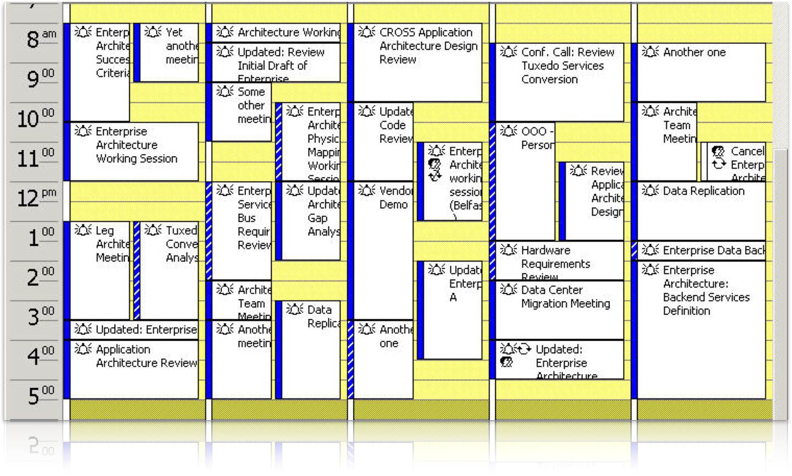
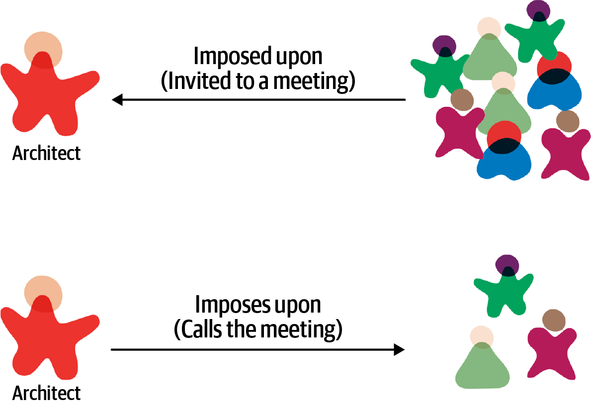

<!-- CH23-001 | PDF p. 367 | 标题 -->
# 第 23 章 协商与领导技能

> 原文章名：Negotiation and Leadership Skills
> 来源：英文第一版，书内第 347–363 页，PDF 第 367–383 页。
> 进度：本轮逐段质量校译完成；详见 [校译记录](../../reviews/chapter-23-review.md)。
> 保留英文原图，中文标签对照见文末；下文页码均指原书书内页码。

<!-- 书内第 347 页，PDF 第 367 页。 -->

<!-- CH23-002 | PDF p. 367 | 正文 -->
协商与领导技能很难获得。要成为高效软件架构师，需要多年学习、实践和经验教训。我们知道，本书无法让人一夜成为协商与领导专家，但本章的方法，可以为掌握这些重要技能提供良好起点。

<!-- CH23-003 | PDF p. 367 | 标题 -->
## 协商与促进

<!-- CH23-004 | PDF p. 367 | 正文 -->
本书开头列出了架构师的核心期望，最后一项，是理解企业政治环境并能在其中开展工作。原因是，架构师几乎每个决定都会遭到挑战。开发者可能认为自己知道得更多、方法更好；组织内其他架构师可能觉得自己有更好的想法；利益相关者则可能认为决定太贵，或花费时间太长。

<!-- CH23-005 | PDF p. 367 | 正文 -->
例如，架构师决定通过数据库集群和联邦化，也就是按领域使用独立物理数据库实例，降低系统整体可用性风险。虽然这是应对数据库可用性的合理方案，但成本也高。架构师必须与为系统付费的关键业务利益相关者协商，就可用性与成本之间的权衡达成一致。

<!-- CH23-006 | PDF p. 367 | 正文 -->
协商是架构师最重要的技能之一。高效架构师理解组织政治，具有出色的协商和促进能力，能够克服分歧，形成所有利益相关者都认同的方案。

<!-- 书内第 348 页，PDF 第 368 页；上段跨页，已连读。 -->

<!-- CH23-007 | PDF p. 368 | 标题 -->
### 与业务利益相关者协商

<!-- CH23-008 | PDF p. 368 | 正文 -->
考虑关键业务利益相关者与首席架构师之间的真实场景 1：

<!-- CH23-009 | PDF p. 368 | 正文 -->
**场景 1**

<!-- CH23-010 | PDF p. 368 | 正文 -->
项目发起人是一位高级副总裁，坚持新交易系统必须支持五个九，即 99.999% 可用性。然而，首席架构师基于研究、计算，以及对业务和技术的了解，确信三个九，即 99.9%，已经足够。问题是，发起人不喜欢犯错或被纠正，而且非常讨厌居高临下的人。他的技术能力并不很强，却自认为很强，因此常常介入项目的非功能方面。架构师必须通过协商说服他，三个九已经足够。

<!-- CH23-011 | PDF p. 368 | 正文 -->
这类协商中，架构师必须避免在分析中过分自负、强硬，同时确保没有遗漏任何可能在协商中证明自己错误的信息。可以采用几项关键技巧。

<!-- CH23-012 | PDF p. 368 | 引文／对话 -->
> 利用措辞和流行术语，更好地理解情况。

<!-- CH23-013 | PDF p. 368 | 正文 -->
“必须零停机”“这些功能昨天就该给我了”等话，通常没有明确含义，却仍向即将协商的架构师提供有价值的信息。例如，问发起人何时需要某项功能，对方说“昨天就要”，说明上市时间很重要。“系统必须快如闪电”说明关心性能，“零停机”说明可用性至关重要。高效架构师会利用这些并不严谨的措辞，理解真正担忧，并在协商中使用这些信息。

<!-- CH23-014 | PDF p. 368 | 正文 -->
场景 1 中，发起人要求五个九，表明可用性非常重要。这引出第二项技巧：

<!-- 书内第 349 页，PDF 第 369 页。 -->

<!-- CH23-015 | PDF p. 369 | 引文／对话 -->
> 进入协商前，尽可能收集信息。

<!-- CH23-016 | PDF p. 369 | 正文 -->
“五个九”是表示高可用的术语，但它到底意味着什么？事先研究、积累知识，可得到表 23-1。

<!-- CH23-017 | PDF p. 369 | 表格 -->
*表 23-1：可用性的几个九。*

<!-- CH23-018 | PDF p. 369 | 表格 -->
| 正常运行百分比 | 每年停机时间（每日停机时间） |
| --- | --- |
| 90.0%，一个九 | 36 天 12 小时（2.4 小时） |
| 99.0%，两个九 | 87 小时 46 分钟（14 分钟） |
| 99.9%，三个九 | 8 小时 46 分钟（86 秒） |
| 99.99%，四个九 | 52 分钟 33 秒（7 秒） |
| 99.999%，五个九 | 5 分钟 35 秒（1 秒） |
| 99.9999%，六个九 | 31.5 秒（86 毫秒） |

<!-- CH23-019 | PDF p. 369 | 正文 -->
五个九意味着每年 5 分 35 秒，或每天 1 秒的非计划停机时间。目标很高，成本也很高，而且对前例没有必要。把问题换算为小时、分钟，或这里的秒，比始终使用“几个九”的术语更适合交流。

<!-- CH23-020 | PDF p. 369 | 正文 -->
场景 1 中，协商应先认可对方的关注点：“我理解可用性对系统非常重要。”然后把讨论从术语转向合理的非计划停机时长。架构师认为够用的三个九，平均每天 86 秒；在本场景的全球交易系统背景下，当然是合理数值。架构师还可以把下面一招作为后备：

<!-- CH23-021 | PDF p. 369 | 引文／对话 -->
> 其他方法都失败时，就用成本和时间来说明。

<!-- CH23-022 | PDF p. 369 | 正文 -->
我们建议把这一技巧留到最后。我们见过太多协商，因为一开始就说“那会花很多钱”或“没时间做”，而从错误的方向起步。金钱和时间，也就是工作量，当然是关键因素，但应作为最后手段，先尝试其他更重要的依据与解释。

<!-- 书内第 350 页，PDF 第 370 页；上段跨页，已连读。 -->

<!-- CH23-023 | PDF p. 370 | 正文 -->
达成一致后，如果成本和时间是协商的重要属性，再将它们纳入考虑。

<!-- CH23-024 | PDF p. 370 | 译注 -->
> 译注：表 23-1 与后文数值均按原书保留，但部分换算有误。按每年 365 天、每天 24 小时计算，99% 对应每年 87 小时 36 分钟，并非 87 小时 46 分钟；99.99% 对应每天 8.64 秒，并非 7 秒；99.999% 对应每年 5 分 15.36 秒，并非 5 分 35 秒。其余若干数值为近似值。某个可用率是否适合交易系统，是案例中的判断，还取决于停机定义、业务时段及故障分布。

<!-- CH23-025 | PDF p. 370 | 正文 -->
另一项始终值得记住的技巧，尤其适合场景 1：

<!-- CH23-026 | PDF p. 370 | 引文／对话 -->
> 利用“分而治之”，界定要求或需求。

<!-- CH23-027 | PDF p. 370 | 正文 -->
中国古代军事家孙子在《孙子兵法》中写道：“亲而离之。”架构师也可把这种分而治之用于协商。场景 1 中，发起人坚持新交易系统要五个九，但整个系统都需要吗？将需求限定到真正需要五个九的具体区域，可以缩小困难且昂贵的需求范围，也缩小协商范围。

<!-- CH23-028 | PDF p. 370 | 标题 -->
### 与其他架构师协商

<!-- CH23-029 | PDF p. 370 | 正文 -->
考虑同一项目中首席架构师与另一位架构师之间的真实场景 2：

<!-- CH23-030 | PDF p. 370 | 正文 -->
**场景 2**

<!-- CH23-031 | PDF p. 370 | 正文 -->
首席架构师认为，一组服务之间应采用异步消息，以提高性能和可扩展性。但另一位又一次强烈反对，坚持 REST 更好，因为 REST 总比消息快，而且同样能扩展：“自己上网搜搜就知道！”这不是两人第一次激烈争论，也不会是最后一次。首席架构师必须说服对方，消息才是合适方案。

<!-- CH23-032 | PDF p. 370 | 正文 -->
首席架构师当然可以凭资历说，对方意见不重要，直接忽略。但这样只会加深敌意，形成不健康、缺乏协作的关系，最终负面影响开发团队。下面的技巧可以帮助处理这类情况：

<!-- 书内第 351 页，PDF 第 371 页。 -->

<!-- CH23-033 | PDF p. 371 | 引文／对话 -->
> 永远记住，演示胜过讨论。

<!-- CH23-034 | PDF p. 371 | 正文 -->
不要争论 REST 和消息，而应向对方展示，在具体环境中，消息为何更好。每个环境都不同，因此单靠上网搜索，永远得不到正确答案。在接近生产的环境中比较两个选项，再展示结果，很可能就能避免争论。

<!-- CH23-035 | PDF p. 371 | 正文 -->
另一项关键技巧是：

<!-- CH23-036 | PDF p. 371 | 引文／对话 -->
> 协商中避免过分争辩，也不要把问题个人化；冷静的领导方式加上清楚简洁的理由，总能赢得协商。

<!-- CH23-037 | PDF p. 371 | 正文 -->
这对场景 2 中的对立关系非常有效。如果过于个人化或争吵，最好停止协商，等双方平静后再谈。架构师之间难免争论，但冷静处理，通常能在局面过热时促使对方退让。

<!-- CH23-038 | PDF p. 371 | 标题 -->
### 与开发者协商

<!-- CH23-039 | PDF p. 371 | 正文 -->
高效架构师不会利用头衔命令开发者，而是与团队合作，赢得尊重，使请求不会演变成争吵或怨恨。合作有时很困难。开发团队常常觉得自己与架构及架构师脱节，未参与决策。这是“象牙塔架构”反模式的典型例子：架构师高高在上下命令，不考虑团队意见或担忧，通常导致失去尊重、团队动态最终崩溃。始终说明依据，是一种应对技巧：

<!-- 书内第 352 页，PDF 第 372 页。 -->

<!-- CH23-040 | PDF p. 372 | 引文／对话 -->
> 说服开发者接受架构决策或执行任务时，要说明理由，不要“从高处发号施令”。

<!-- CH23-041 | PDF p. 372 | 正文 -->
解释为何需要做某件事，开发者就更可能同意。例如，在传统多层架构中执行简单查询，可能有这样的对话：

<!-- CH23-042 | PDF p. 372 | 引文／对话 -->
> 架构师：“你必须通过业务层调用。”
>
> 开发者：“不，直接调用数据库快多了。”

<!-- CH23-043 | PDF p. 372 | 正文 -->
这段对话有几个问题。首先，“你必须”这种命令语气不仅居高临下，也是开始协商最糟的方式之一。开发者随即用理由反驳：经过业务层更慢、更耗时。再看另一种说法：

<!-- CH23-044 | PDF p. 372 | 引文／对话 -->
> 架构师：“因为变更控制对我们最重要，所以采用封闭分层架构。这意味着所有数据库调用都需要来自业务层。”
>
> 开发者：“好，我明白了。但这样的话，简单查询的性能问题怎么解决？”

<!-- CH23-045 | PDF p. 372 | 正文 -->
这里先说明所有请求经过业务层的理由。先讲理由总是好方法。人们一听到不同意的话，往往就不再听下去；先说理由，能确保它被听见。架构师还去掉了个人化命令，不再说“你必须”“你需要”，而是陈述事实：“这意味着……”。再看开发者的回应：讨论从反对分层限制，转为如何提高简单调用性能的问题。双方现在可以合作，寻找既保留封闭层次、又加快查询的方法。

<!-- CH23-046 | PDF p. 372 | 正文 -->
另一项有效技巧，是让反对某项设计或架构决策的开发者自己得出方案，形成架构师不会输的双赢局面。例如，架构师在框架 X、Y 之间选择，发现 Y 无法满足安全要求，自然选择 X。开发者强烈反对，坚持 Y 更好。

<!-- 书内第 353 页，PDF 第 373 页；上段跨页，已连读。 -->

<!-- CH23-047 | PDF p. 373 | 正文 -->
架构师不争论，而是说：只要能展示采用 Y 如何满足安全要求，团队就使用 Y。会有两种结果：

<!-- CH23-048 | PDF p. 373 | 列表 -->
1. 开发者无法证明 Y 满足要求，亲自理解为何不能用。让他自己得出方案，相当于把选择 X 变成他自己的决定，自动获得认同。这是胜利。
2. 开发者找到办法，让 Y 满足安全要求，并展示给架构师。架构师原来漏掉了信息，而 Y 也确实更好。这同样是胜利。

<!-- CH23-049 | PDF p. 373 | 引文／对话 -->
> 如果开发者不同意某项决定，就让他自己得出解决方案。

<!-- CH23-050 | PDF p. 373 | 正文 -->
架构师正是通过与开发团队协作，赢得尊重并形成更好方案。开发者越尊重架构师，与他们协商就越容易。

<!-- CH23-051 | PDF p. 373 | 标题 -->
## 作为领导者的软件架构师

<!-- CH23-052 | PDF p. 373 | 正文 -->
软件架构师也是领导者，能够指导团队实施架构。我们认为，成为高效架构师，约有一半依赖良好的人际、促进和领导技能。本节讨论一些关键领导方法。

<!-- CH23-053 | PDF p. 373 | 标题 -->
### 架构的四个 C

<!-- CH23-054 | PDF p. 373 | 正文 -->
事情每天都在变复杂，业务流程、系统甚至架构皆如此。复杂性存在于架构和软件开发中，而且永远存在。有些架构非常复杂，例如支持六个九，即 99.9999% 可用性的架构，相当于每天约 86 毫秒、每年 31.5 秒非计划停机。这类复杂性称为本质复杂性，换句话说：“我们遇到了难题。”

<!-- 书内第 354 页，PDF 第 374 页；上段跨页，已连读。 -->

<!-- CH23-055 | PDF p. 374 | 正文 -->
许多架构师会掉进一个陷阱：为方案、图和文档添加不必要复杂性。架构师和开发者似乎都热爱复杂性。引用 Neal 的话：

<!-- CH23-056 | PDF p. 374 | 引文／对话 -->
> 开发者被复杂性吸引，就像飞蛾扑火——结果也往往相同。

<!-- CH23-057 | PDF p. 374 | 正文 -->
图 23-1 展示了一家大型全球银行后端处理系统的主要信息流。这一定很复杂吗？没人知道，因为架构师把它弄复杂了。这称为偶然复杂性，换句话说：“我们把问题弄难了。”架构师有时这样做，是为了在事情太简单时证明价值，或确保自己始终参与业务、架构讨论和决策；有些人则是为了保住工作。无论理由是什么，把偶然复杂性引入原本不复杂的事情，都是让自己成为无效领导者的最佳方式之一。

<!-- CH23-058 | PDF p. 374 | 图表 -->

<!-- CH23-059 | PDF p. 374 | 图表 -->
*图 23-1：把偶然复杂性引入问题。*

<!-- 书内第 355 页，PDF 第 375 页。 -->

<!-- CH23-060 | PDF p. 375 | 正文 -->
避免偶然复杂性的有效方式，是我们所谓架构的四个 C：沟通（communication）、协作（collaboration）、清晰（clarity）和简洁（conciseness）。它们共同作用，让人能够在团队中有效沟通与协作，如图 23-2。

<!-- CH23-061 | PDF p. 375 | 图表 -->

<!-- CH23-062 | PDF p. 375 | 图表 -->
*图 23-2：架构的四个 C。*

<!-- CH23-063 | PDF p. 375 | 正文 -->
作为领导者、促进者和协商者，架构师必须能够清楚、简洁、有效地沟通。同样重要的是，与开发者、业务利益相关者及其他架构师共同讨论、形成方案。专注这四点，可以赢得尊重，成为项目中大家不仅寻求答案，也寻求建议、指导、辅导与领导的人。

<!-- CH23-064 | PDF p. 375 | 标题 -->
### 务实，同时有远见

<!-- CH23-065 | PDF p. 375 | 正文 -->
高效架构师必须务实，同时有远见。这并不像听起来那么容易，需要相当成熟和大量实践。先看看“有远见”的定义：

<!-- CH23-066 | PDF p. 375 | 正文 -->
**有远见**

<!-- CH23-067 | PDF p. 375 | 正文 -->
以想象力或智慧思考、规划未来。

<!-- CH23-068 | PDF p. 375 | 正文 -->
有远见意味着对问题进行战略思考，这正是架构师应该做的。架构关乎规划未来，确保架构生命力，也就是架构的有效性，长久保持。但架构师常常在规划和设计中过于理论化，让方案难以理解，甚至难以实现。再看看“务实”：

<!-- CH23-069 | PDF p. 375 | 正文 -->
**务实**

<!-- CH23-070 | PDF p. 375 | 正文 -->
以实际而非理论考量为基础，理智、现实地处理事情。

<!-- 书内第 356 页，PDF 第 376 页。 -->

<!-- CH23-071 | PDF p. 376 | 正文 -->
架构师需要有远见，也必须采用实际可行的方案。务实意味着创建方案时考虑所有这些因素与约束：

<!-- CH23-072 | PDF p. 376 | 列表 -->
- 预算约束及其他成本因素。
- 时间约束及其他时间因素。
- 开发团队的技能种类与水平。
- 架构决策的权衡与影响。
- 提议的架构设计或方案的技术限制。

<!-- CH23-073 | PDF p. 376 | 正文 -->
优秀架构师努力在务实与运用想象、智慧解决问题之间取得平衡，参见图 23-3。例如，面对弹性问题，即未知、突然且显著的并发负载增长，有远见者可能提出复杂的数据网格（data mesh），一组按领域划分的分布式数据库，作为精巧方案。理论上也许不错，但务实要求理智考虑：公司以前用过吗？有哪些权衡？真的能解决问题吗？

<!-- CH23-074 | PDF p. 376 | 图表 -->

<!-- CH23-075 | PDF p. 376 | 图表 -->
*图 23-3：优秀架构师在务实与远见之间取得平衡。*

<!-- CH23-076 | PDF p. 376 | 正文 -->
保持这种平衡，是赢得尊重的好方法。业务方会欣赏符合约束的远见方案，开发者则会欣赏可实施、而非仅停留在理论上的方案。

<!-- CH23-077 | PDF p. 376 | 正文 -->
务实架构师首先会寻找弹性需求中的限制因素：瓶颈是数据库、某些服务，还是其他外部资源？找出并隔离瓶颈，是第一个实际步骤。

<!-- 书内第 357 页，PDF 第 377 页；上段跨页，已连读。 -->

<!-- CH23-078 | PDF p. 377 | 正文 -->
事实上，即使是数据库，也许可以缓存部分所需数据，从而完全避免访问数据库。

<!-- CH23-079 | PDF p. 377 | 译注 -->
> 译注：本段 data mesh 按原文解释为按领域组织的分布式数据库集合，并与原书所附[资料链接](https://oreil.ly/6HmSp)一同保留，不与第 15 章 data grid 混用，也未核验当前概念定义。

<!-- CH23-080 | PDF p. 377 | 标题 -->
### 以身作则带领团队

<!-- CH23-081 | PDF p. 377 | 正文 -->
不好的架构师凭头衔让人服从，高效架构师则以身作则。关键是赢得开发团队、业务方，以及运维负责人、开发经理、产品负责人等组织成员的尊重。

<!-- CH23-082 | PDF p. 377 | 正文 -->
经典故事中，一位远离士兵的上尉命令部队攻下一座险峻山头。充满疑虑的士兵却不看上尉，而看军衔较低的军士。军士观察情况，轻轻点头，士兵立刻充满信心地前进。

<!-- CH23-083 | PDF p. 377 | 正文 -->
故事说明，领导别人时，军衔和头衔作用很小。计算机科学家 [Gerald Weinberg](https://oreil.ly/6fI2m) 有句名言：“无论是什么问题，都是人的问题。”多数人认为解决技术问题只关乎技术知识，与人际技能无关。技术当然必要，但只是解决问题的一部分。例如，架构师与开发团队开会处理生产问题，一名开发者提出建议，架构师回应：“这个主意太蠢了。”不仅他不再提意见，其他人也不敢说话，整个团队都不再愿意参与讨论。

<!-- CH23-084 | PDF p. 377 | 正文 -->
赢得尊重、带领团队，涉及基本人际技能。考虑架构师与客户或开发团队讨论性能问题的对话：

<!-- CH23-085 | PDF p. 377 | 引文／对话 -->
> 开发者：“这个性能问题怎么解决？”
>
> 架构师：“你需要做的，就是使用缓存。它能解决问题。”
>
> 开发者：“别告诉我该怎么做。”
>
> 架构师：“我说的就是，这能解决问题。”

<!-- CH23-086 | PDF p. 377 | 正文 -->
“你需要”“你必须”把意见强加给开发者，阻碍了协作。这是只有沟通、没有协作的好例子。再看修改后的对话：

<!-- 书内第 358 页，PDF 第 378 页。 -->

<!-- CH23-087 | PDF p. 378 | 引文／对话 -->
> 开发者：“这个性能问题怎么解决？”
>
> 架构师：“考虑过缓存吗？也许能解决。”
>
> 开发者：“嗯，没想过。你怎么看？”
>
> 架构师：“如果我们在这里放缓存……”

<!-- CH23-088 | PDF p. 378 | 正文 -->
“考虑过……吗”“……怎么样”通过提问把控制权交回开发者或客户，让双方共同形成方案。建立协作环境时，措辞至关重要。架构师不只自己参与合作，也要作为促进者推动团队协作。观察团队动态，发现第一种对话时，可以私下辅导成员如何用措辞促进合作，改善团队关系，建立彼此尊重。

<!-- CH23-089 | PDF p. 378 | 正文 -->
另一项基本技巧，是在对话或协商中尽量使用对方姓名。这不仅让人愉快，也增进熟悉感。练习记名字，并经常使用。有些名字难发音，应先确认，再练到准确。我们询问姓名后，会复述并确认发音；不对就重复，直到正确。

<!-- CH23-090 | PDF p. 378 | 正文 -->
如果第一次或偶尔才见面，应握手并保持眼神接触。握手是可追溯到中世纪的重要人际技巧，简单的身体连接让双方知道彼此是朋友而非敌人，并形成联系。但简单握手也不一定容易做好。

<!-- CH23-091 | PDF p. 378 | 正文 -->
握手要坚定，但不要用力压人，同时看着对方眼睛。握手时看别处，会被视为不尊重，而且多数人会注意到。也不要握太久，坚定握两三秒就足够开始或问候。过度使用也会让人不舒服，甚至不想沟通。例如，每天早晨来办公室就和所有人握手，有点奇怪，也令人不自在。但每月与运维负责人见面，就很适合站起来说：“Ruth，你好，很高兴又见到你。”然后简短、坚定地握手。

<!-- 书内第 359 页，PDF 第 379 页；上段跨页，已连读。 -->

<!-- CH23-092 | PDF p. 379 | 正文 -->
知道何时握手、何时不握，是复杂人际技巧的一部分。

<!-- CH23-093 | PDF p. 379 | 正文 -->
作为领导者、促进者和协商者，架构师应该维护人与人之间的边界。握手是有效而专业的联系，但职场拥抱则不是。架构师也许以为这样更亲近，却可能让同事不舒服，更重要的是，可能导致骚扰问题。因此，不管什么职业环境，都应跳过拥抱，坚持握手；除非公司所有人都互相拥抱，那也实在有点奇怪。

<!-- CH23-094 | PDF p. 379 | 正文 -->
有时，把要求转为请人帮忙，更容易让对方做原本不愿做的事。一般来说，人不喜欢被命令，但多半愿意帮助别人，这是基本人性。考虑繁忙迭代中，架构师提出重构：

<!-- CH23-095 | PDF p. 379 | 引文／对话 -->
> 架构师：“需要你把支付服务拆成五个，分别处理商店余额、信用卡、PayPal、礼品卡和积分，提高网站容错性与可扩展性。应该花不了多久。”
>
> 开发者：“不行，这个迭代太忙，做不了。”
>
> 架构师：“这很重要，本迭代必须完成。”
>
> 开发者：“抱歉，真不行。找别人吧，我太忙。”

<!-- CH23-096 | PDF p. 379 | 正文 -->
开发者立即拒绝，虽然架构师解释了收益。注意，这是要求一个已经太忙的人再做事，而且连名字都没提！再看把要求转为帮忙：

<!-- CH23-097 | PDF p. 379 | 引文／对话 -->
> 架构师：“Sridhar，你好。我真遇到麻烦了。为了改善容错性和可扩展性，确实需要按支付类型拆分服务，但我拖得太久。能不能挤进这个迭代？真能帮我大忙。”
>
> 开发者：“（停顿）我很忙，不过应该可以，看看能做什么。”
>
> 架构师：“谢谢，Sridhar，真感谢帮忙，欠你一次。”
>
> 开发者：“没事，我会确保本迭代完成。”

<!-- CH23-098 | PDF p. 379 | 正文 -->
首先，反复使用姓名，让对话更亲近熟悉，而不是冷冰冰的工作要求。

<!-- 书内第 360 页，PDF 第 380 页；上段跨页，已连读。 -->

<!-- CH23-099 | PDF p. 380 | 正文 -->
其次，架构师承认自己遇到麻烦，也承认拆分会帮自己大忙。这不总能奏效，但借助互相帮助的基本人性，比前一种对话更可能成功。下次遇到这种情况可以试试，结果通常比命令更积极。

<!-- CH23-100 | PDF p. 380 | 正文 -->
要成为有效领导者，架构师应努力成为团队中大家遇到问题就会找的人。无论头衔或角色如何，都应主动把握带领团队的机会。看到成员困于技术问题，就主动提供帮助或指导。非技术情况也一样。例如，发现有人上班时情绪低落、明显心烦，可以说：“Antonio，我去买咖啡，一起吧？”路上再问是否还好，至少打开私人交流的机会，最好还能提供更个人化的指导。但有效领导者也会读懂语言和表情，知道何时别太强求，适时退后。

<!-- CH23-101 | PDF p. 380 | 正文 -->
另一个赢得尊重、成为大家愿意求助的人的方法，是定期举办午餐分享，讨论某项技术或方法。每个读者都有别人不具备的知识。通过分享，架构师既展示技术能力，也练习演讲与指导。例如，回顾设计模式，或介绍语言新版本特性，既提供有价值信息，也让人开始把自己视为领导者和导师。

<!-- CH23-102 | PDF p. 380 | 标题 -->
## 融入开发团队

<!-- CH23-103 | PDF p. 380 | 正文 -->
架构师日历通常排满会议，而且彼此冲突，如图 23-4。如果是这样，何时才能融入团队、指导成员，并随时回答问题？不幸的是，会议是 IT 世界中必要的麻烦，它们频繁发生，也总会存在。

<!-- 书内第 361 页，PDF 第 381 页。 -->

<!-- CH23-104 | PDF p. 381 | 图表 -->

<!-- CH23-105 | PDF p. 381 | 图表 -->
*图 23-4：软件架构师的典型日历。*

<!-- CH23-106 | PDF p. 381 | 正文 -->
高效的关键，是为开发团队留出更多时间，这意味着控制会议。有两种会议：别人施加给自己的，即受邀参加；自己施加给别人的，即主动召集。图 23-5 展示了两种类型。

<!-- CH23-107 | PDF p. 381 | 图表 -->

<!-- CH23-108 | PDF p. 381 | 图表 -->
*图 23-5：会议类型。*

<!-- 书内第 362 页，PDF 第 382 页。 -->

<!-- CH23-109 | PDF p. 382 | 正文 -->
受邀会议最难控制。由于需要与许多利益相关者沟通合作，架构师几乎什么会议都被邀请。高效架构师应该询问组织者，为什么需要自己参加。很多时候只是为让自己了解信息，而会议纪要就能做到。询问原因，可以判断哪些该去、哪些可不去。另一项技巧，是接受前先索要议程。组织者可能觉得需要架构师，但看过议程，才能判断是否真的必要。往往也不必全程参加，可以在相关讨论开始时加入，结束后离开。能用来陪伴团队的时间，不要浪费在无关会议中。

<!-- CH23-110 | PDF p. 382 | 引文／对话 -->
> 提前索要会议议程，帮助判断自己是否真的需要参加。

<!-- CH23-111 | PDF p. 382 | 正文 -->
如果开发者也被邀请，可以替团队承担会议。与其让技术负责人参加，不如代他去，尤其两人都被邀请时。这让团队专注手头任务。虽然增加架构师会议时间，却提高团队生产力。

<!-- CH23-112 | PDF p. 382 | 正文 -->
架构师主动召集的会议有时必要，但应尽可能少。这类会议可以自己控制。始终问自己：这比把成员从原工作中抽离出来更重要吗？很多时候发邮件就能传达信息，省去大量时间。召集会议时，总应设置并遵守议程。讨论常因其他问题偏离，而那些问题未必与所有人相关。还要关注开发者心流，避免召集会议打断。心流是大脑完全投入特定问题、注意力集中且创造力最大的状态。

<!-- 书内第 363 页，PDF 第 383 页；上段跨页，已连读。 -->

<!-- CH23-113 | PDF p. 383 | 正文 -->
例如，开发者处理困难算法或代码，几小时过去却仿佛只有几分钟。架构师应尽量把会议安排在早晨一开始、午饭后或一天快结束时，而不是多数开发者进入心流的工作时段。

<!-- CH23-114 | PDF p. 383 | 正文 -->
除了管理会议，还可以坐到团队旁边。远离团队的隔间传递“架构师很特殊”的信息，四周隔墙仿佛在说不要打扰。与团队坐一起，表示自己是其中一员，可以随时回答问题。通过身体位置表明归属，可以获得更多尊重，更好地指导团队。

<!-- CH23-115 | PDF p. 383 | 正文 -->
如果不能坐在一起，就应经常走动，让人看见。总在别的楼层、办公室或隔间，从不出现，就不可能帮助团队实施架构。在早晨、午后或傍晚留出时间，交流、解决问题、回答疑问、提供辅导。团队会欣赏并尊重这种时间投入。其他利益相关者也一样：去买咖啡路上顺便问候运维负责人，就是保持与业务及关键利益者开放沟通的好方法。

<!-- CH23-116 | PDF p. 383 | 标题 -->
## 小结

<!-- CH23-117 | PDF p. 383 | 正文 -->
本章的协商与领导技巧，旨在帮助架构师与团队及其他利益相关者建立更好的协作关系。这是成为高效软件架构师所必需的能力。虽然这些技巧为有效领导的旅程提供良好起点，但最好的建议，也许来自美国第 26 任总统 [Theodore Roosevelt 的一句话](https://oreil.ly/dCN_t)：

<!-- CH23-118 | PDF p. 383 | 引文／对话 -->
> 成功公式中最重要的单一要素，是懂得如何与人相处。
>
> ——Theodore Roosevelt

<!-- CH23-119 | PDF p. 383 | 分隔符 -->
---

<!-- CH23-120 | PDF p. 383 | 标题 -->
## 图中文字中文对照（译者整理）

<!-- CH23-121 | PDF p. 383 | 表格 -->
| 图号 | 英文标签 → 中文 |
| --- | --- |
| 图 23-1 | Night Cycle → 夜间处理周期；Clearance → 清算；Receipt & Delivery → 接收与交付；Reference Databases → 参考数据库；Purchases & Sales → 买入与卖出；Positions & Balances → 持仓与余额；General Ledger Interface → 总账接口；Accounts Payable → 应付账款；General Expense → 一般费用；Project Billing → 项目计费；Data Warehouse → 数据仓库。原图用于展示交织的信息流，其他业务缩写及细小标签保留原图，不猜测展开 |
| 图 23-2 | Communication → 沟通；Collaboration → 协作；Clarity → 清晰；Conciseness → 简洁 |
| 图 23-3 | Pragmatic → 务实；Visionary → 有远见 |
| 图 23-4 | 原图为密集且重叠的日程截图；可辨标题如 Enterprise Architecture Working Session → 企业架构工作会议、Application Architecture Review → 应用架构评审、Data Center Migration Meeting → 数据中心迁移会议；部分标题在截图中被截断，保留原图，不补写缺字 |
| 图 23-5 | Architect → 架构师；Imposed upon (Invited to a meeting) → 受邀参加会议；Imposes upon (Calls the meeting) → 主动召集会议 |

<!-- CH23-122 | PDF p. 383 | 译注 -->
> 译注：本章“始终”“总能”等说法是作者的经验性建议；握手、眼神接触、工作场所身体边界等表述亦按原文保留，不将其视为所有文化或个人都适用的规范。示例中的消息性能、框架安全及服务拆分结论依赖各自情境，未作为当前产品能力验证。
