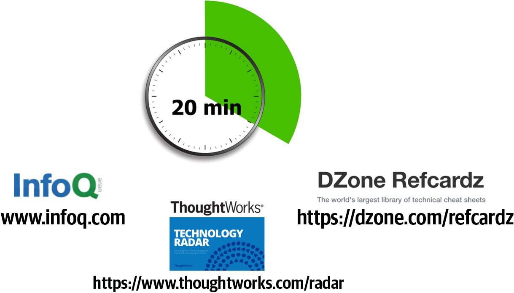
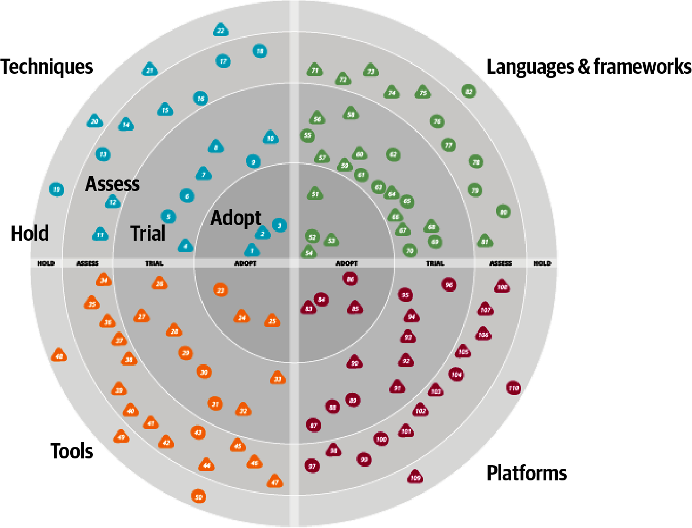
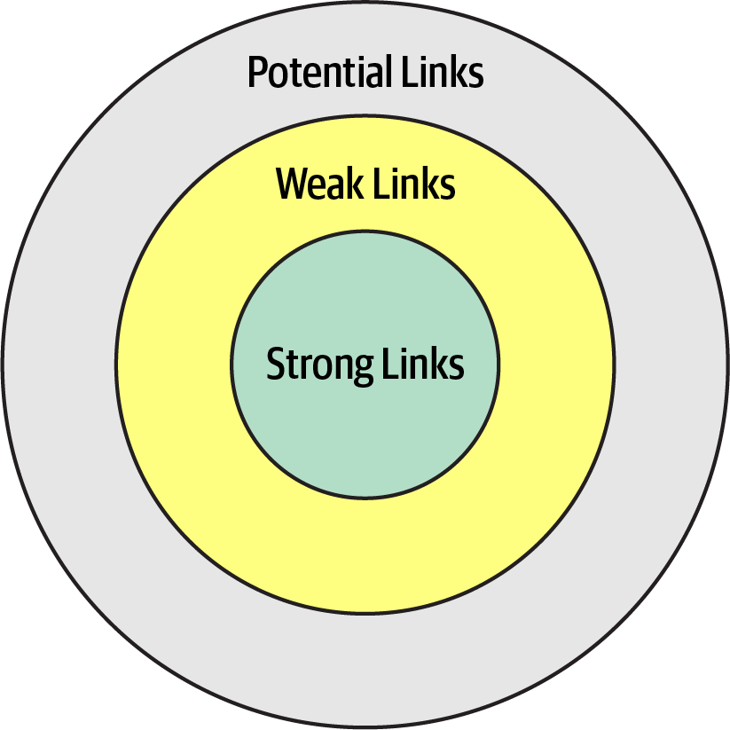

<!-- CH24-001 | PDF p. 385 | 标题 -->
# 第 24 章 规划职业发展道路

> 原文章名：Developing a Career Path
> 来源：英文第一版，书内第 365–372 页，PDF 第 385–392 页。
> 进度：本轮逐段质量校译完成；详见 [校译记录](../../reviews/chapter-24-review.md)。
> 保留英文原图，中文标签对照见文末；下文页码均指原书书内页码。

<!-- 书内第 365 页，PDF 第 385 页。 -->

<!-- CH24-002 | PDF p. 385 | 正文 -->
成为架构师需要时间与努力，但基于本书反复讨论的许多原因，成为架构师后继续规划和推进职业发展，同样棘手。虽然无法为你绘制具体路线，我们可以指出一些行之有效的实践。

<!-- CH24-003 | PDF p. 385 | 正文 -->
架构师必须终身学习。技术世界变化快得令人目眩。Neal 的一位前同事是世界知名的 Clipper 专家，他遗憾自己无法把海量、如今却无用的 Clipper 知识替换成其他东西。他还提出一个仍无答案的问题：历史上，是否还有哪类人在一生中学习并抛弃过像软件开发者这样大量的详细知识？

<!-- CH24-004 | PDF p. 385 | 正文 -->
每位架构师都应留意技术与业务相关资源，纳入个人储备。遗憾的是，资源来去太快，所以本书不列资源清单。与同事或专家交流，了解他们如何保持知识更新，是寻找活跃资讯源、网站与社群的好办法。架构师还应该每天留出时间，利用这些资源维护知识广度。

<!-- CH24-005 | PDF p. 385 | 标题 -->
## 二十分钟法则

<!-- CH24-006 | PDF p. 385 | 正文 -->
如图 2-6 所示，对架构师而言，技术广度比深度更重要。但维护广度需要时间与精力，应该纳入日程。可谁有时间去各种网站看文章、看演讲、听播客？答案是，没多少人。开发者和架构师都在艰难平衡日常工作、家庭、陪伴孩子、兴趣爱好、个人时间与职业发展，同时还要跟上最新趋势和术语。

<!-- 书内第 366 页，PDF 第 386 页；上段跨页，已连读。 -->

<!-- CH24-007 | PDF p. 386 | 正文 -->
我们采用的一种平衡方法，叫作二十分钟法则。如图 24-1，每天至少花二十分钟，通过学习新东西或深入某个主题，投入架构师职业发展。图中举了一些资源，如 [InfoQ](https://www.infoq.com)、[DZone Refcardz](https://dzone.com/refcardz) 和 [ThoughtWorks 技术雷达](https://www.thoughtworks.com/radar)。用这至少二十分钟搜索陌生术语，也就是第 2 章“不知道自己不知道的东西”，稍作了解，把它提升为“知道自己不知道的东西”；也可以深入某个主题，增加一点知识。重点是为职业发展留出时间，持续扩展技术广度。

<!-- CH24-008 | PDF p. 386 | 图表 -->

<!-- CH24-009 | PDF p. 386 | 图表 -->
*图 24-1：二十分钟法则。*

<!-- CH24-010 | PDF p. 386 | 正文 -->
许多架构师接受这个概念，计划午饭或下班后花二十分钟。但根据经验，很少奏效。午饭时间越来越短，变成追赶工作，而不是休息吃饭；到了晚上，又会有临时情况、别的安排和更重要的家庭事务，二十分钟学习计划最终就落空了。

<!-- CH24-011 | PDF p. 386 | 正文 -->
我们强烈建议每天一开始就做。不过，这个建议也有限制。架构师早上到办公室，第一件事是什么？当然是先来一杯美妙的咖啡或茶。

<!-- 书内第 367 页，PDF 第 387 页；上段跨页，已连读。 -->

<!-- CH24-012 | PDF p. 387 | 正文 -->
那么第二件事呢？查邮件。查邮件后就会分心，开始回复，一天就过去了。因此，我们强烈建议：拿到咖啡或茶后、查邮件前，首先执行二十分钟法则。稍早一点到办公室。这能增加技术广度，培养成为高效架构师所需的知识。

<!-- CH24-013 | PDF p. 387 | 标题 -->
## 建立个人雷达

<!-- CH24-014 | PDF p. 387 | 正文 -->
20 世纪 90 年代大部分时间，以及 21 世纪初，Neal 在一家小型培训咨询公司担任 CTO。最初，主要平台是 Clipper，一种在 dBASE 文件上构建 DOS 应用的快速开发工具。直到有一天，它消失了。公司注意到了 Windows 的崛起，但商业市场仍在 DOS 上，直到突然不再如此。这留下深刻教训：忽视技术前进，要自担风险。

<!-- CH24-015 | PDF p. 387 | 正文 -->
这也揭示技术泡泡的教训。重度投入某种技术时，开发者生活在一个观念泡泡中，它也是回音室。厂商制造的泡泡尤其危险，因为在里面听不到诚实评估。最大的危险，是泡泡开始坍塌时，身在其中的人往往等到为时已晚才察觉。

<!-- CH24-016 | PDF p. 387 | 正文 -->
他们缺少的是技术雷达：一份持续更新的文档，评估现有与新兴技术的风险与收益。这个概念来自 ThoughtWorks。我们先介绍它如何产生，再说明如何建立个人雷达。

<!-- CH24-017 | PDF p. 387 | 标题 -->
### ThoughtWorks 技术雷达

<!-- CH24-018 | PDF p. 387 | 正文 -->
ThoughtWorks 技术顾问委员会（TAB）由公司资深技术领导者组成，创建目的是协助 CTO Rebecca Parsons 博士，为公司与客户确定技术方向和战略。委员会每年面对面开会两次，成果之一就是技术雷达，逐渐发展为每半年发布一次的版本。

<!-- CH24-019 | PDF p. 387 | 正文 -->
TAB 慢慢形成每年两次的制作节奏。然后，出乎意料的副作用出现了。Neal 参加一些大会演讲时，听众找到他，感谢帮助制作雷达，并说自己的公司也开始制作。

<!-- 书内第 368 页，PDF 第 388 页。 -->

<!-- CH24-020 | PDF p. 388 | 正文 -->
Neal 还意识到，这也回答了大会嘉宾讨论中无处不在的问题：“你们如何跟上技术？怎样决定接下来探索什么？”答案当然是，每个人心中都有某种内部雷达。

<!-- CH24-021 | PDF p. 388 | 标题 -->
#### 组成部分

<!-- CH24-022 | PDF p. 388 | 正文 -->
ThoughtWorks 雷达有四个象限，尝试覆盖软件开发的大部分领域：

<!-- CH24-023 | PDF p. 388 | 正文 -->
**工具**

<!-- CH24-024 | PDF p. 388 | 正文 -->
从 IDE 等开发工具，到企业级集成工具。

<!-- CH24-025 | PDF p. 388 | 正文 -->
**语言与框架**

<!-- CH24-026 | PDF p. 388 | 正文 -->
计算机语言、库和框架，通常为开源。

<!-- CH24-027 | PDF p. 388 | 正文 -->
**技术方法**

<!-- CH24-028 | PDF p. 388 | 正文 -->
帮助整体软件开发的实践，包括流程、工程实践与建议。

<!-- CH24-029 | PDF p. 388 | 正文 -->
**平台**

<!-- CH24-030 | PDF p. 388 | 正文 -->
技术平台，包括数据库、云厂商和操作系统。

<!-- CH24-031 | PDF p. 388 | 标题 -->
#### 环

<!-- CH24-032 | PDF p. 388 | 正文 -->
雷达有四个环，从外到内如下：

<!-- CH24-033 | PDF p. 388 | 正文 -->
**暂缓（Hold）**

<!-- CH24-034 | PDF p. 388 | 正文 -->
最初意味着“暂且等等”，表示技术太新，尚不能合理评估：热度高，却未获验证。后来演变为“不要再用它开始新项目”。现有项目继续使用没有关系，但新开发应三思。

<!-- CH24-035 | PDF p. 388 | 正文 -->
**评估（Assess）**

<!-- CH24-036 | PDF p. 388 | 正文 -->
表示值得探索，以了解如何影响组织。架构师应该投入精力，例如限时技术探索（spike）、研究项目或大会分享，判断是否会产生影响。例如，许多大公司制定移动战略时，明显经历过这一阶段。

<!-- 书内第 369 页，PDF 第 389 页。 -->

<!-- CH24-037 | PDF p. 389 | 正文 -->
**试用（Trial）**

<!-- CH24-038 | PDF p. 389 | 正文 -->
表示值得继续投入，重要的是理解如何建立相应能力。可以试点一个低风险项目，让架构师和开发者真正理解技术。

<!-- CH24-039 | PDF p. 389 | 正文 -->
**采用（Adopt）**

<!-- CH24-040 | PDF p. 389 | 正文 -->
ThoughtWorks 强烈认为行业应该采用的技术或方法。

<!-- CH24-041 | PDF p. 389 | 正文 -->
图 24-2 展示了雷达示例。

<!-- CH24-042 | PDF p. 389 | 图表 -->

<!-- CH24-043 | PDF p. 389 | 图表 -->
*图 24-2：ThoughtWorks 技术雷达示例。*

<!-- CH24-044 | PDF p. 389 | 正文 -->
每个点代表一种技术或方法，并有简短说明。ThoughtWorks 用雷达传播对软件世界的看法，许多开发者和架构师也把它用来组织技术评估流程。架构师可以使用第 371 页“开源可视化工具”介绍的工具，构建相同视觉形式，整理自己应该把时间投入何处。

<!-- 书内第 370 页，PDF 第 390 页。 -->

<!-- CH24-045 | PDF p. 390 | 正文 -->
个人使用时，我们建议把各区域的含义调整如下：

<!-- CH24-046 | PDF p. 390 | 正文 -->
**暂缓**

<!-- CH24-047 | PDF p. 390 | 正文 -->
不仅包括要避免的技术与方法，也可以包括想改掉的习惯。例如，.NET 架构师可能习惯看论坛里的团队内部新闻或八卦，虽然有趣，却是低价值信息流。放入暂缓区，可以提醒自己避免这些问题。

<!-- CH24-048 | PDF p. 390 | 正文 -->
**评估**

<!-- CH24-049 | PDF p. 390 | 正文 -->
放入听过好评、尚未亲自评估的有前景技术，参见第 371 页“使用社交媒体”。这里是未来深入研究的暂存区。

<!-- CH24-050 | PDF p. 390 | 正文 -->
**试用**

<!-- CH24-051 | PDF p. 390 | 正文 -->
表示正在进行的研发，例如在大型代码库中做探索实验。这些技术值得投入时间深入理解，以便有效分析权衡。

<!-- CH24-052 | PDF p. 390 | 正文 -->
**采用**

<!-- CH24-053 | PDF p. 390 | 正文 -->
代表自己最看好的新事物，以及解决特定问题的最佳实践。

<!-- CH24-054 | PDF p. 390 | 正文 -->
对技术组合放任自流很危险。多数技术人员或多或少临时决定采用什么，依据可能是流行程度或雇主推动方向。创建雷达，有助于正式梳理想法，平衡相互冲突的标准：技术更酷却不容易找工作，或市场巨大却工作没那么有趣。架构师应该像对待金融投资组合那样，对待技术组合；许多方面两者相同。理财规划师会建议什么？多样化！

<!-- CH24-055 | PDF p. 390 | 正文 -->
选择一些需求广泛的技术或技能，并跟踪需求；也可以试试开源、移动开发等技术上的新尝试。这样的故事很多：开发者利用深夜参与开源项目，项目后来流行起来、具备出售价值，最终还成了他们的职业归宿，让他们摆脱隔间里的束缚。这也是重广度而非深度的又一个理由。

<!-- CH24-056 | PDF p. 390 | 正文 -->
应该留出时间扩展技术组合，而雷达提供良好支架。但过程比产物更重要。创建可视化，为思考这些事提供理由。

<!-- 书内第 371 页，PDF 第 391 页；上段跨页，已连读。 -->

<!-- CH24-057 | PDF p. 391 | 正文 -->
对繁忙架构师而言，找个理由从日程中划出时间，往往是这类思考发生的唯一方式。

<!-- CH24-058 | PDF p. 391 | 译注 -->
> 译注：原文在介绍个人雷达时写 quadrants（象限），但随后列出的 Hold、Assess、Trial、Adopt 实际是前面定义的环；此处译作“各区域”，并注明原文用词差异。

<!-- CH24-059 | PDF p. 391 | 标题 -->
#### 开源可视化工具

<!-- CH24-060 | PDF p. 391 | 正文 -->
应广泛要求，ThoughtWorks 于 2016 年 11 月发布工具，帮助技术人员构建自己的雷达。为公司开展练习时，他们将会议结果记入电子表格，每个象限一张工作表。Build Your Own Radar 工具以 Google 电子表格为输入，使用 HTML5 canvas 生成雷达。重要之处虽是讨论，但也产出了有用可视化。

<!-- CH24-061 | PDF p. 391 | 标题 -->
## 使用社交媒体

<!-- CH24-062 | PDF p. 391 | 正文 -->
从哪里寻找新技术和方法，放进评估环？Andrew McAfee 的 *Enterprise 2.0*（Harvard Business Review Press）对社交媒体和网络提出了一个有趣观察：人际联系可分三类，如图 24-3。

<!-- CH24-063 | PDF p. 391 | 图表 -->

<!-- CH24-064 | PDF p. 391 | 图表 -->
*图 24-3：人际关系的社交圈。*

<!-- CH24-065 | PDF p. 391 | 正文 -->
强联系是家人、同事及经常接触的人。一个衡量亲近程度的方法，是能说出对方上周至少某一天午饭吃了什么。弱联系是普通熟人、远亲，或一年只见几次的人。

<!-- 书内第 372 页，PDF 第 392 页；上段跨页，已连读。 -->

<!-- CH24-066 | PDF p. 392 | 正文 -->
社交媒体出现之前，很难持续了解这一圈人的近况。潜在联系，则是还没有见过的人。

<!-- CH24-067 | PDF p. 392 | 正文 -->
McAfee 最有趣的观察，是下一份工作更可能来自弱联系，而非强联系。强联系成员知道圈内的一切，因为总是见面；弱联系则提供日常经验之外的建议，包括新工作机会。

<!-- CH24-068 | PDF p. 392 | 正文 -->
利用社交网络特点，架构师可以通过社交媒体拓展技术广度。在 Twitter 等平台上以专业方式活动，寻找并关注值得尊重其建议的技术人员，建立发现新技术、评估有趣事物的网络，跟上技术世界变化。

<!-- CH24-069 | PDF p. 392 | 标题 -->
## 临别建议

<!-- CH24-070 | PDF p. 392 | 引文／对话 -->
> 如何培养伟大的设计者？当然是让他们设计。
>
> ——Fred Brooks

<!-- CH24-071 | PDF p. 392 | 引文／对话 -->
> 如果架构师整个职业生涯只有不到六次真正做架构的机会，我们又如何培养伟大架构师？
>
> ——Ted Neward

<!-- CH24-072 | PDF p. 392 | 正文 -->
练习是提升生活中任何技能的可靠方式，架构也一样。我们鼓励新老架构师持续磨练技术广度与架构设计技艺。可以查看本书配套网站上的[架构练习](https://oreil.ly/EPop7)，它们仿照书中案例，帮助练习架构技能。

<!-- CH24-073 | PDF p. 392 | 正文 -->
关于这些练习，一个常见问题是：有没有标准答案？

<!-- CH24-074 | PDF p. 392 | 正文 -->
遗憾的是，没有。引用作者 Neal 的话：

<!-- CH24-075 | PDF p. 392 | 引文／对话 -->
> 架构没有对错答案，只有权衡。

<!-- CH24-076 | PDF p. 392 | 正文 -->
最初在现场培训中使用这些练习时，我们保存学员图稿，打算建立答案库。但很快就放弃，因为发现制品不完整：团队画出了拓扑，在课堂上解释了决定，却没时间写 ADR。如何实现固然有趣，为什么这样实现更有趣，因为其中包含决策时的权衡。只保留如何实现，只是一半故事。因此，最后的建议是：持续学习，持续练习，去做一些架构吧！

<!-- CH24-077 | PDF p. 392 | 分隔符 -->
---

<!-- CH24-078 | PDF p. 392 | 标题 -->
## 图中文字中文对照（译者整理）

<!-- CH24-079 | PDF p. 392 | 表格 -->
| 图号 | 英文标签 → 中文 |
| --- | --- |
| 图 24-1 | 20 min → 二十分钟；InfoQ、DZone Refcardz 保留名称；ThoughtWorks Technology Radar → ThoughtWorks 技术雷达；图内资源地址已在正文保留 |
| 图 24-2 | Techniques → 技术方法；Languages & frameworks → 语言与框架；Tools → 工具；Platforms → 平台；Hold / Assess / Trial / Adopt → 暂缓 / 评估 / 试用 / 采用；点内编号按原图保留，图中未列每个编号对应条目的完整说明 |
| 图 24-3 | Strong Links → 强联系；Weak Links → 弱联系；Potential Links → 潜在联系 |

<!-- CH24-080 | PDF p. 392 | 译注 -->
> 译注：本章的公司职务、雷达制作流程、工具和社交平台名称均属于本书 2020 年版语境，按原文保留，未核验当前状态。
